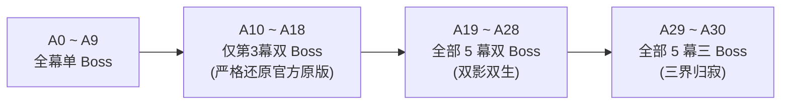

# 进阶挑战系统 (Ascension 1~30)

Seer Mod 全面重构并扩展了《杀戮尖塔2》的进阶模式（Ascension）。不仅**严格还原了原版进阶 10（A10）的官方设计**，更在此之上引入了 **进阶 11 至 进阶 30（A11 ~ A30）** 共 20 级深度定制的高难进阶挑战体系。

::: tip 进阶难度定位与阶梯演进
- **A00 ~ A09（原版基础）**：原版基础进阶规则，循序渐进增加敌人伤害、生命与特殊限制。
- **A10（官方原版还原）**：【双重Boss】—— **仅在第 3 幕末尾**连续挑战两名首领（严格契合原版官方设计）。
- **A11 ~ A20（初阶混沌与资源收紧）**：引入怪物特异能力、原版宿敌强化、经济与掉落全方位紧缩、全 5 幕双首领机制。
- **A21 ~ A30（终极灾厄与规则压迫）**：泰坦商店永久封锁、先古恢复限半、初始诅咒、卡牌跨幕退化、全 5 幕三首领连战、以及第四/五幕终极先攻压制。
:::

---

## 进阶等级全览表 (A1 ~ A30)

| 进阶 | 体系归属 | 中文名称 | 英文名称 | 简洁描述 | 机制深度解析 |
| :--- | :--- | :--- | :--- | :--- | :--- |
| **A01** | 原版官方 | 恶魔试炼 | Elite Remnants | 精英敌人出现概率增加 | 原版基础规则。 |
| **A02** | 原版官方 | 致命伤痛 | Deadlier Foes | 普通敌人造成更多伤害 | 原版基础规则。 |
| **A03** | 原版官方 | 顽固伤势 | Lingering Wounds | 战斗后生命恢复降低 | 原版基础规则。 |
| **A04** | 原版官方 | 蛮横强敌 | Savage Foes | 精英敌人造成更多伤害 | 原版基础规则。 |
| **A05** | 原版官方 | 破旧铁甲 | Tattered Armor | 战斗开始时敌人获得格挡 | 原版基础规则。 |
| **A06** | 原版官方 | 恶毒首领 | Vicious Bosses | 首领造成更多伤害并拥有更多生命 | 原版基础规则。 |
| **A07** | 原版官方 | 凶残精英 | Ferocious Elites | 精英敌人拥有更多生命与特殊能力 | 原版基础规则。 |
| **A08** | 原版官方 | 贫瘠之地 | Barren Lands | 休息处恢复的生命值减少 | 原版基础规则。 |
| **A09** | 原版官方 | 尖塔阴影 | Shadow of the Spire | 游戏开始时牌组中增加一张寄生诅咒 | 原版基础规则。 |
| **A10** | **官方原版** | **双重Boss** | **Double Boss** | **必须在第3幕末尾与两名首领战斗。** | **严格还原官方原版：仅第 3 幕拥有 2 名 Boss，第 1、2、4、5 幕保持常规 1 名 Boss。** |
| **A11** | **Seer Mod** | **异能苏醒** | **Awakened Talents** | **怪物有概率获得特殊能力。** | 全体怪物随进入房间数获得 63 种赛尔特殊能力（强体/侵蚀/吸血/神话/城守/绝律/扼生等）；A11 的觉醒概率是基准值的 0.5 倍。 |
| **A12** | **Seer Mod** | **药剂匮乏** | **Dwindling Potions** | **战斗后药水掉落概率降低。** | 战斗胜利后药水掉落判定概率降至 60%，保底浮动步长压缩至 5%（原版为 10%）。 |
| **A13** | **Seer Mod** | **旧敌异化** | **Mutated Adversaries** | **原版怪物获得特殊能力的概率翻倍。** | 尖塔原生怪物的觉醒概率翻倍（回到基准值 1.0 倍）。 |
| **A14** | **Seer Mod** | **外域高价** | **Interstellar Tariff** | **赛尔商店中遗物的售价提高。** | 赛尔商人（赛尔豆商店）处出售的所有遗物标价上浮 30%。 |
| **A15** | **Seer Mod** | **宿敌狂暴** | **Savage Remnants** | **前三幕中的原版怪物大幅强化。** | 仅强化前三幕原版怪物：第 1 幕增伤 40%/减伤 20%；第 2 幕增伤 60%/减伤 30%；第 3 幕增伤 100%/减伤 50%（不影响第 4、5 幕与副本地图）。 |
| **A16** | **Seer Mod** | **劣质赏赐** | **Tarnished Rewards** | **战斗卡牌奖励的稀有度降低。** | 非首领战斗奖励中，罕见卡牌权重降为 40%，稀有卡牌权重降为 50%，其余转移至普通卡牌（不影响商店卡牌）。 |
| **A17** | **Seer Mod** | **空匮宝箱** | **Barren Treasures** | **部分宝箱为空，精英掉落遗物的概率降低。** | 精英战斗胜利有 30% 概率不掉落遗物；宝箱房有 30% 概率开启为空宝箱。 |
| **A18** | **Seer Mod** | **未琢璞玉** | **Uncut Gems** | **战斗卡牌奖励不再出现已升级卡牌。** | 战斗卡牌奖励的基础升级概率强制降为 0%（蛋类遗物等必定升级效果依然生效）。 |
| **A19** | **Seer Mod** | **双影双生** | **Dual Nemeses** | **全部幕末尾均必须连续挑战两名首领。** | 全部 5 幕（第 1 ~ 5 幕）均必须击败 2 位 Boss 才能通往下一幕；顶栏与地图显示双 Boss 排布。 |
| **A20** | **Seer Mod** | **矿脉贫瘠** | **Depleted Veins** | **敌人掉落的赛尔豆数量减少。** | 战斗胜利结算掉落的赛尔豆基础数量减少至原有的 60%。 |
| **A21** | **Seer Mod** | **星际重税** | **Exorbitant Markup** | **原版商店中的赛尔遗物售价更高。** | 原版尖塔商人进货的赛尔遗物基础售价额外增加 75 金币。 |
| **A22** | **Seer Mod** | **珍宝贬抑** | **Diminished Rarities** | **遗物稀有度下调，赛尔遗物掉落减少。** | 遗物稀有度重排：稀有概率 8.5%（原 17% 的一半），罕见概率 24.75%（原 33% 的四分之三），普通概率 66.75%；常规池中赛尔遗物出现权重减半。 |
| **A23** | **Seer Mod** | **禁忌封缄** | **Forbidden Pacts** | **泰坦商店每进入一次，永久封锁一项兑换。** | 每次踏入泰坦之灵商店，随机且永久封禁 1 项兑换项目（多人两端结果一致，已封禁的不会重复计算）。 |
| **A24** | **Seer Mod** | **残息难继** | **Fading Embers** | **先古之民的生命恢复效果大幅减弱。** | 涅奥等先古之民为玩家恢复生命时，只会恢复已损失生命值的 50%（原版涅奥会直接回满）。 |
| **A25** | **Seer Mod** | **厄运缠身** | **Inauspicious Omen** | **初始牌组额外增加一张随机的赛尔诅咒。** | 游戏开始时，牌组中额外封入一张随机的赛尔诅咒牌（从傲慢、暴食、贪婪、怠惰等 17 张诅咒池中抽取）。 |
| **A26** | **Seer Mod** | **神恩渐隐** | **Diminishing Grace** | **泰坦商店中高阶物品出现概率减半。** | 泰坦之灵抽奖转盘中，2~5 星奖励权重减半（6 星原本就是最低权重 1，维持不变），多出权重归入 1 星。 |
| **A27** | **Seer Mod** | **技艺退化** | **Atrophied Prowess** | **踏入新的一幕时，随机降级数张卡牌。** | 跨幕时随机降级玩家牌组中的已升级卡牌：第 2 幕降 2 张，第 3 幕降 3 张，第 4 幕降 4 张，第 5 幕降 5 张（第 1 幕不触发）。 |
| **A28** | **Seer Mod** | **混沌沸腾** | **Chaotic Surge** | **全体怪物获得特殊能力的概率再度翻倍。** | 全体怪物觉醒概率再翻倍：赛尔怪 1.0 倍、原版怪 2.0 倍（A13 + A28 同时生效）。 |
| **A29** | **Seer Mod** | **三界归寂** | **Triumvirate of Ruin** | **全部幕末尾均必须连续挑战三名首领。** | 全部 5 幕均必须连续挑战 3 位首领！地图纵向等间距排列 3 个 Boss 节点，顶栏三阶梯图标显示。 |
| **A30** | **Seer Mod** | **终焉突袭** | **First Strike** | **在第四幕与第五幕中，怪物在首回合必定先手！** | 踏入第四幕（星海尽头）与第五幕（终焉之门）后，所有遭遇战第 1 回合均由怪物先攻出招，玩家失去先手权！ |

---

## 核心机制设计深度解析

### 1. 首领挑战阶梯递进（A10 / A19 / A29）

进阶体系对首领战的推进层次进行了精密重构：

- **A10 官方原版还原**：在 A10 ~ A18 期间，仅第 3 幕存在双 Boss，第 1、2、4、5 幕均维持原版 1 位 Boss，避免低阶流程过长。
- **A19 全幕双首领**：从第 1 幕到第 5 幕，击败第一位 Boss 后，结算奖励界面点击「继续」不会直接跳幕，而是安全返回地图，解锁通往第二位 Boss 的路径与节点。
- **A29 三界归寂**：全部 5 幕末尾均有 3 位首领严阵以待。
  - 地图背景会向上延长，3 个 Boss 节点与连线纵向等间距展开。
  - 顶栏三阶梯图标动态刷新，玩家可随时观察当前正在挑战第几位首领。
  - **通关时间守卫**：击败前两位首领时不会提前冻结总计时，完整记录三 Boss 战的总耗时。

### 2. 怪物异能觉醒曲线（A11 / A13 / A28）

从 A11 开始，怪物随机特殊能力池介入战斗：
- **能力库规模**：包含 63 种赛尔特异能力（强体、侵蚀、暗滞、吸魂、逆转吞噬、城守、吸血、复活、神话、绝律一/二、扼生一/二等）。
- **概率构成**：每种能力有各自的固定基础概率与「每进入一个房间增加的概率」，再乘以进阶倍率；同一只怪物可能同时觉醒多种能力。
- **倍率成长**（相对于能力表基准值）：
  - **A11**：所有怪物 0.5 倍。
  - **A13**：原版怪翻倍到 1.0 倍。
  - **A28**：全体再翻倍（赛尔怪 1.0 倍、原版怪 2.0 倍），怪物携带多种强力特异的概率明显上升。
- **多人一致**：开局能力的分配在战斗生命周期内由两端同步判定，不会出现一端已挂载、另一端未挂载的伤害分叉。

### 3. 原版宿敌战力重塑（A15）

为了平衡原版前三幕怪物在赛尔体系高爆发下的数值差距，A15 对原生怪物进行了大幅战力提振：
- **第 1 幕**：原版怪获得 **+40% 永久增伤 / 20% 永久减伤**。
- **第 2 幕**：原版怪获得 **+60% 永久增伤 / 30% 永久减伤**。
- **第 3 幕**：原版怪获得 **+100% 永久增伤 / 50% 永久减伤**。
- **作用边界**：只在前三幕的主线原生怪物身上生效；赛尔怪物、第四/五幕怪物以及子地图活动内的敌人拥有其独立的数值体系，不受此项叠加。

### 4. 泰坦商店与经济制约（A14 / A20 / A21 / A23 / A26）

高阶进阶对资源产出与特殊商店施加了全方位的经济封锁：
- **常规经济**：
  - **A20**：战斗胜利结算掉落的赛尔豆减少至 60%。
  - **A14**：赛尔商店遗物售价上浮 30%。
  - **A21**：尖塔原版商人售卖赛尔遗物时额外加收 75 金币。
- **泰坦之灵商店封锁**：
  - **A23 禁忌封缄**：玩家每次右键「星辰之录」进入泰坦商店，都会随机永久封锁 1 项兑换。被封锁的按钮置灰，悬停提示「选项已封锁 / 受进阶23【禁忌封缄】影响，该兑换选项本场游戏已永久被封锁」，点击无效。
  - **A26 神恩渐隐**：转盘除 1 星外，2~5 星奖励权重减半（2星: 500, 3星: 150, 4星: 47, 5星: 2；原本就是 1 的 6 星维持不变），多余权重全部回流至 1 星，使高星级奖励获取难度翻倍。

### 5. 卡牌与遗物产出贬抑（A16 / A17 / A18 / A22 / A27）

- **A16 劣质赏赐**：普通与精英战斗的卡牌奖励中，罕见卡权重降为 $40\%$，稀有卡权重降为 $50\%$，多出概率向普通卡转移（不影响商店购牌）。
- **A17 空匮宝箱**：30% 概率击败精英不掉落遗物，30% 概率宝箱房为空宝箱（判定基于本局种子与楼层，多人两端一致）。
- **A18 未琢璞玉**：战斗卡牌奖励基础升级率强制降为 0%（熔岩蛋、有毒蛋、冰冻蛋等必定升级的遗物效果依然生效）。
- **A22 珍宝贬抑**：
  - 稀有遗物概率：$8.5\%$（原 17% 的一半）
  - 罕见遗物概率：$24.75\%$（原 33% 的四分之三）
  - 普通遗物概率：$66.75\%$（补足剩余概率）
  - 常规掉落池中，赛尔专属遗物抽取权重减半。
- **A27 技艺退化**：每次通过 Boss 战进入新一幕，系统会从牌组中的已升级卡牌中随机抽取并退化为未升级版本：
  - 第 2 幕：降级 **2** 张
  - 第 3 幕：降级 **3** 张
  - 第 4 幕：降级 **4** 张
  - 第 5 幕：降级 **5** 张

### 6. 终焉突袭机制（A30）

作为全进阶的登顶挑战，A30 颠覆了常规回合制节奏：
- **生效范围**：第四幕「星海尽头」与第五幕「终焉之门」的所有遭遇战（子地图内不生效）。
- **底层规则**：战斗开始时直接把行动方切到敌方，并让所有怪物预先决定首回合意图。
- **出招实效**：敌方全员在第 1 回合立即执行技能释放与猛烈攻击；待敌方回合结束后，行动权才轮转至玩家（玩家回合 1 开始）。
- **生存考验**：在没有任何防御牌被打出的情况下，玩家必须凭借开门遗物（如锚）、被动减伤与高额血量硬接怪物的先手爆发！

---

## 高阶进阶与后两幕/副本地图的交互

进阶难度与 Mod 扩展的后续章节形成强烈的复合难度曲线：

### 1. 第四幕与第五幕出身幕缩放
在第四幕与第五幕中，低层怪物被注入高额出身强化：
- **第一层怪**：在第四幕拥有 **生命 ×10 / 减伤 50% / 增伤 400%**，在第五幕拥有 **生命 ×15 / 减伤 55% / 增伤 500%**。
- **第二层怪**：在第四幕拥有 **生命 ×6 / 减伤 40% / 增伤 200%**，在第五幕拥有 **生命 ×9 / 减伤 45% / 增伤 300%**。
- **第三层怪**：在第四幕拥有 **生命 ×2 / 减伤 30% / 增伤 100%**，在第五幕拥有 **生命 ×3 / 减伤 35% / 增伤 150%**。
- **叠加 A30 先手**：第五幕的第一层怪物在 A30 的先手回合中，以 500% 的增伤直接砸在玩家脸上，极其致命！

### 2. 子地图（秘境）的战力支撑
为了应对高进阶的恐怖压力，击败各幕 Boss 后邀请前往的[子地图活动](/mechanics/submap-activity)提供了逆境翻盘的可能：
- **从第 1 幕 Boss 进入**：全队获得 **减伤 50% + 增伤 150%**，且每过一个房间恢复 30% 已损生命；
- **从第 2 幕 Boss 进入**：全队获得 **减伤 30% + 增伤 60%**，且每过一个房间恢复 20% 已损生命；
- **从第 3 幕 Boss 进入**：无额外数值增益；
- **从第 4 幕 Boss 进入**：怪物获得增伤 100%、减伤 50%。
- 通关子地图可斩获强力史诗/传说遗物，是高难进阶下补充战力的核心途径。

---

## 多人模式一致性说明

联机时，上述进阶机制都按同一份种子与房间计数判定，主机与客机结果一致：

1. **泰坦商店封锁**：封锁项保存在全队共享的局内计数里，每次进入由当前种子与已封锁数量共同决定，不会一端封 A、另一端封 B。
2. **卡牌退化**：跨幕降级按「种子 + 当前幕 + 玩家」派生独立随机，不消耗局内共享随机流，因此不会打乱后续发牌。
3. **第二/第三 Boss 抽取**：按遗物与遭遇的固定排序加种子抽取，重连后也不会偏移。
4. **进阶等级上限**：联机大厅与单人选人界面均已放开到 0~30 级，网络包与存档都支持 30 级。

---

## 高阶进阶实战通关策略

1. **应对 A30 怪物先攻**：
   - 优先拿取开局自动提供格挡的遗物（如锚，以及各类开局格挡能力的遗物与刻印）。
   - 保留保命药水（回血、格挡、复活类），在踏入第四、五幕前务必留出药水栏位。
   - 构筑体系中适度扩充生命上限，避免在第一回合直接被秒杀。
2. **应对 A27 卡牌跨幕退化**：
   - 避免将升级资源单一倾斜在少数几张牌上；若主力牌在第 4 幕被降级可能严重影响输出循环。
   - 寻找必定升级的蛋类遗物，或预留火堆位及时补升关键核心牌。
3. **应对 A23 泰坦商店封锁**：
   - 泰坦商店每进一次封锁一项，越晚进可选项越少；若有核心需求（如兑换传说遗物或锁定关键刻印），建议尽早规划并集中兑换。
4. **重视百分比伤害与固定伤害**：
   - 在部分高层怪物拥有 50%~55% 减伤（第四/五幕的第一层出身怪）时，[固定伤害](/mechanics/fixed-damage)与灼烧/中毒/焚烬等真实伤害完全不受防御减免影响，输出效率远高于纯物理直伤。
