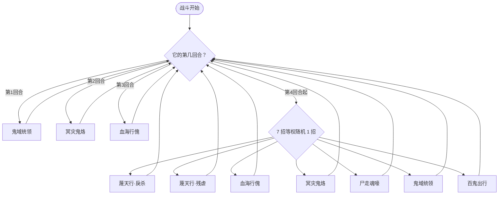

# 百罗鬼帝

> **类型**：BOSS 怪物
> **初始生命**：无限（显示为无限；实际击杀线是**当前已损失生命**达到 4444）
> **遭遇战**：第五幕（终焉之门）Boss 战 · 单怪
> **特性**：[四绝天罗](/powers/four_nets_power.md) 44 张牌上限 + 444 秒死线 + 4444 损失生命击杀线 + 鬼祰随机增益

> **说明**：百罗鬼帝是无限生命 Boss，血条显示为无限符号。它不会被打空血，真正的胜利条件是把「当前已损失生命」打到 4444 并在它回合结束时存活到结算。

## 被动能力（开局自带）

| 名称 | 类型 | 效果 |
|------|------|------|
| **[四绝天罗](/powers/four_nets_power.md)** | 能力（不可消除） | ①单个回合内，玩家队伍累计消耗超过 4 点能量后，每额外消耗 1 点能量，百罗鬼帝随机获得 1 道[鬼祰](/powers/ghost_net_chi_power.md)。②全队累计打出的牌数每达到 44 的倍数（44、88…）时，立即结束所有存活玩家的回合，并展开 4 回合[四杀鬼囹](/powers/ghost_prison_power.md)。③本场战斗进行 444 秒时，百罗鬼帝在自身回合开始时消灭全体敌人。④百罗鬼帝已损失生命达到 4444 点时，在自身回合结束时彻底湮灭。 |

::: tip 四道鬼祰
鬼祰是随机的增减益：魑、魅、魉 挂在百罗鬼帝身上，魍 挂在玩家身上。每次获得时在四种里随机：

| 鬼祰 | 效果 |
| --- | --- |
| [鬼祰·魑](/powers/ghost_net_chi_power.md) | 自身下一次攻击伤害翻倍，触发后移除 1 层 |
| [鬼祰·魅](/powers/ghost_net_mei_power.md) | 自身下一次受到的攻击伤害变为 0，触发后移除 1 层 |
| [鬼祰·魍](/powers/ghost_net_wang_power.md) | 你下一次受到的固定伤害提高 100%，触发后移除 1 层 |
| [鬼祰·魉](/powers/ghost_net_liang_power.md) | 自身下一次攻击无视格挡，触发后移除 1 层 |
:::

::: warning 四杀鬼囹
[四杀鬼囹](/powers/ghost_prison_power.md)：持续 4 回合，百罗鬼帝及其友军被击晕，你只能打出状态牌。双方都动不了，但 444 秒现实死线仍在走。

全队累计每打满 44 张牌必定触发，此外戾杀消耗 ≥4 道鬼祰、残虐未造成实际伤害、尸走魂嚎销毁 4 张「鬼」、百鬼出行复制后鬼/魂总数 >44 都会额外开启。44 张牌上限是这场战斗最硬的资源约束。
:::

## 行动逻辑

前 3 回合固定顺序出招，第 4 回合起每回合从 7 招中等权随机 1 招。

> **说明**：第 1 回合鬼域统领，第 2 回合冥灾鬼烙，第 3 回合血海行傀；第 4 回合起每回合 7 选 1，可能出现与固定回合相同的招式。

## 招式表

| 招式名 | 意图 | 类型 | 效果 |
|--------|------|------|------|
| **蔑天行·戾杀** | 攻击 44 | 攻击 + 固伤 + 回复 | 造成 44 点伤害；对每个敌人施加固定伤害：4 × 4 的（场上存活生物数）次方（单怪单人为 64）；消耗场上全部鬼祰，每消耗 1 道回复 444 点生命；消耗达到 4 道时开启四杀鬼囹。 |
| **蔑天行·残虐** | 攻击 4×4 | 多段攻击 + 狂暴臣服 | 自身获得 4 回合[狂暴](/powers/fury_power.md)，所有敌人获得 4 回合[臣服](/powers/subjugation_power.md)；反弱、反强；造成 4 点伤害 4 次；若本次攻击未造成任何实际伤害，开启四杀鬼囹。 |
| **血海行傀** | 血海行傀 | 自身增益 + 固伤 | 自身全属性各 +1，场上每有 1 层异常状态额外各 +1；对每个敌人造成 44 点固定伤害；场上每有 1 道鬼祰，自身永久获得 4% 免伤与 4% 增伤。 |
| **冥灾鬼烙** | 冥灾鬼烙 | 鬼祰 + 吸血固伤 | 随机获得 4 道鬼祰；4 回合内，自身回合开始时回复已损失生命值的 1/4，并对每个敌人造成等量固定伤害。 |
| **尸走魂嚎** | 攻击 4（+4%/损失） | 攻击 + 销毁鬼 | 造成 4 点伤害（自身每损失 1 点生命值，本招伤害提高 4%）；若敌人所有牌堆中「[鬼](/cards/status/ghost.md)」达到 4 张，销毁其中 4 张并开启四杀鬼囹。 |
| **鬼域统领** | 鬼域统领 | 先制 + 异常 + 塞鬼 | 自身先制 +4；使每个敌人随机获得 4 种异常状态，每种 4 层；用「鬼」填满每个敌人的手牌；手牌达到上限且全为「鬼」时，该敌人死亡（可被复活/免死拦下）。 |
| **百鬼出行** | 百鬼出行 | 自损 + 格挡 + 复制 | 失去自身已损失生命值的 4%，对每个敌人造成等量伤害，并获得 44% 已损失生命值的格挡；将敌人所有名称带「鬼」或「魂」的卡牌复制一份加入其抽牌堆；复制后相关卡牌总数超过 44 张时开启四杀鬼囹。 |

## 遭遇战

| 遭遇战 | 房间类型 | 池子 | 数量 | 说明 |
|--------|----------|------|------|------|
| 百罗鬼帝 | Boss | 第五幕 Boss 池 | 1 只 | 单怪 Boss 战；双 Boss / 三 Boss 规则下与其他第五幕 Boss 同场 |

## 策略提示

1. **44 张牌是硬上限**：全队累计每打满 44 张牌就强制结束所有存活玩家的回合并进入 4 回合四杀鬼囹。这不是「打慢一点」能解决的问题，而是每 44 次出牌就要交一次时间税。高单卡质量、少过牌、少循环的构筑才是正解。

2. **444 秒现实时间是第二道死线**：战斗进行到 444 秒，它回合开始直接消灭全体。拖时间、长动画、复杂连锁都会挤占这 444 秒，别把战斗拖进消耗战。

3. **击杀线是当前已损失生命 4444，不是血条**：无限生命不会被打空；把它的「最大生命 − 当前生命」打到 4444，并在它回合结束时仍 ≥4444，就会自灭。它每次回血（戾杀每道鬼祰 444、冥灾鬼烙 1/4 已损失）都会把进度拉回去，所以需要在一个窗口内集中打出净 4444 伤害。

4. **每回合最多 4 点能量**：超过 4 点的每 1 点能量都会给它随机 1 道鬼祰。鬼祰里魑翻倍、魅免伤、魉无视格挡、魍让你吃双倍固定伤害，越攒越难打。高能量爆发回合等于给它叠增益。

5. **四杀鬼囹是时间税**：4 回合双方都动不了（怪物侧被击晕、玩家只能打出状态牌），但 444 秒死线照走。除了 44 张牌触发，戾杀消耗 4 道鬼祰、残虐没打中、尸走魂嚎销毁 4 张鬼、百鬼出行复制超 44 张都会额外触发。主动避免给它凑触发条件。

6. **鬼域统领会用「鬼」塞满手牌**：手牌达到上限且全是鬼时你会死亡（可被复活/免死效果拦下）。被塞鬼后立刻想办法消耗/丢弃/转化手牌，别让手牌长期满格。

7. **每打一张「鬼」都要烧掉 4 秒现实时间**：鬼打出后触发 4 秒全屏白雾并封锁输入（不暂停游戏）。这场战斗本身只有 444 秒死线，清鬼越多次，留给输出的现实时间越少——鬼既是手牌上限威胁，也是时间资源税。

8. **冥灾鬼烙是回血+固伤双杀**：每回合回 1/4 已损失生命，同时对你打等量固定伤害。它损失越多，回得越多、打得越痛——你的进度和承伤是同一个数字，越接近 4444 越危险，最后一击要留足格挡/固定伤害免疫。

9. **血海行傀按场上异常层数涨属性**：你身上的异常层数会直接变成它的全属性；鬼祰还会给它永久免伤/增伤。异常流在这里是双刃剑，尽量别让场上堆太多层数。

## 源码

- 怪物：`SeerBailuoguidiMonster.cs`
- 被动能力：`SeerFourNetsPower.cs`、`SeerAllGhostDeathPower.cs`
- 鬼祰：`SeerGhostNetChiPower.cs`、`SeerGhostNetMeiPower.cs`、`SeerGhostNetWangPower.cs`、`SeerGhostNetLiangPower.cs`
- 四杀鬼囹：`SeerGhostPrisonPower.cs`
- 状态牌：`SeerGhost.cs`
- 遭遇战：`SeerBailuoguidiBoss.cs`
- 本地化：`monsters.json`、`intents.json`、`powers.json`
