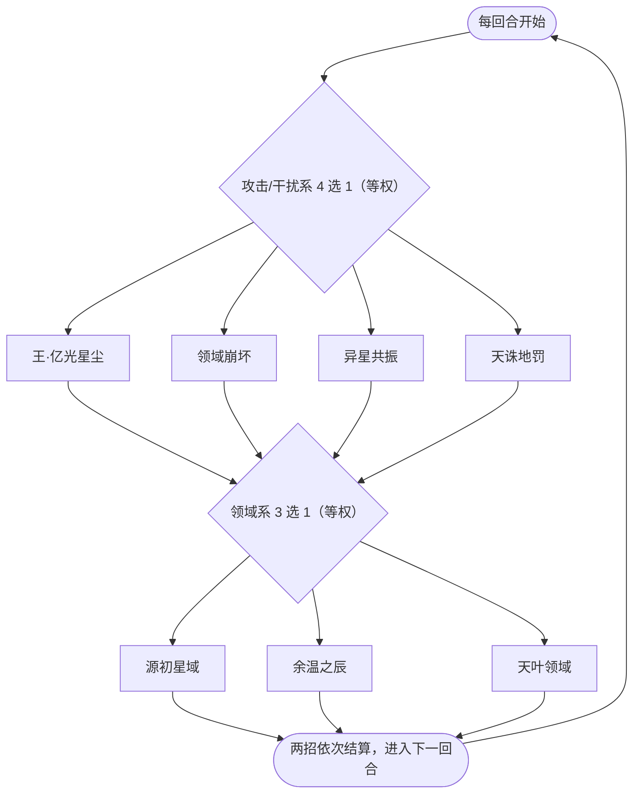

# 不羁·弗里德

> **类型**：BOSS 怪物
> **初始生命**：3200
> **遭遇战**：第四幕（星海尽头）Boss 战 · 单怪
> **特性**：[独步星渊](/powers/star_abyss_power.md) 先制差封牌 + 状态牌喂养 + 辉星反噬 + 每回合双动 12 种组合

## 被动能力（开局自带）

| 名称 | 类型 | 效果 |
|------|------|------|
| **[独步星渊](/powers/star_abyss_power.md)** | 能力（不可消除） | ①你的回合开始时锁定本回合的封牌张数：前若干张打出的牌无效（费用照付、不产生效果），数量＝你的[先制](/powers/first_strike_power.md) − 弗里德先制（最低 0）。②你所有牌堆中每存在 1 张[状态牌](/cards/status/) ，弗里德受到的攻击伤害降低 5%、造成的攻击伤害提高 15%。③你每次获得[辉星](/mechanics/star)，弗里德先制 −1，并对你造成 10 点[固定伤害](/powers/fixed_damage_power.md)。 |

::: tip 先制差是双向的
弗里德自己没有任何加先制手段，只会不断扣自己的先制：领域崩坏 −5、异星共振 −3、余温之辰 −1、每次你获得辉星 −1。自身先制越负，「你的先制 − 它的先制」越大，封牌张数与领域崩坏连击数越高。**你堆先制也会放大这个差值**，等于帮它加码。
:::

## 行动逻辑

每回合必定双动：先从「王·亿光星尘 / 领域崩坏 / 异星共振 / 天诛地罚」等权抽 1 个，再从「源初星域 / 余温之辰 / 天叶领域」等权抽 1 个，两招同回合依次结算，共 12 种组合。

> **说明**：两组各自独立等权抽取，组合无法预判；先结算攻击/干扰招，再结算领域招。

## 招式表

| 招式名 | 意图 | 类型 | 效果 |
|--------|------|------|------|
| **王·亿光星尘** | 攻击 50 | 攻击 + 辉星 + 固伤 | 造成 50 点伤害（不受微弱影响）；使敌人获得 1 点[辉星](/mechanics/star)，触发 3 次（每次使用本招，触发次数永久 +1）；随后按敌人**获得辉星后**的当前辉星数追加等量固定伤害。 |
| **领域崩坏** | 攻击 9×N | 多段攻击 + 封锁能量 | 自身先制 −5，然后造成 9 点伤害 N 次（N＝先制降低后的双方先制差）；2 回合内敌人无法额外获得能量。 |
| **异星共振** | 攻击 36 | 攻击 + 吸强反弱 | 造成 36 点伤害，自身先制 −3。吸强成功时，敌人下回合无法打出技能牌；反弱成功时，敌人下回合无法打出攻击牌。 |
| **天诛地罚** | 攻击 40 | 攻击 + 异常 + 塞状态牌 | 造成 40 点伤害；敌人随机获得 7 种异常状态各 7 层；下回合开始时，敌人手牌被随机状态牌填满。 |
| **源初星域** | 源初星域 | 自身增益 + 领域 | 自身全属性各 +10；3 回合内自身每回合受到的伤害总和不超过 200 点，且敌人无法打出带有辉星的卡牌。 |
| **余温之辰** | 余温之辰 | 塞牌 + 自身增益 | 向敌人的抽牌堆、弃牌堆与消耗牌堆各洗入 4 张「[温](/cards/status/warmth.md)」；自身先制 −1，获得 4 回合[弹控](/powers/debuff_immune_reflect_power.md)与[吃月亮](/powers/eat_moon_power.md)。 |
| **天叶领域** | 天叶领域 | 领域 + 洗牌 + 温变辰 | 3 回合内，牌面伤害数值高于 20 点的攻击牌无法打出；敌人立即洗牌；把所有「温」蜕变进化成「[辰](/cards/status/morning_star.md)」。 |

::: warning 「温→辰」是陷阱，不是补给
「辰」抽到时会给辉星、能量和储君牌，看起来是白送的资源；但弗里德的被动规定**你每获得 1 点辉星，它先制 −1 并打你 10 点固定伤害**，同时先制差继续扩大。天叶领域把满牌堆的温变成辰，等于一次性给它送一大截先制差与固定伤害。
:::

## 遭遇战

| 遭遇战 | 房间类型 | 池子 | 数量 | 说明 |
|--------|----------|------|------|------|
| 不羁·弗里德 | Boss | 第四幕 Boss 池 | 1 只 | 单怪 Boss 战；双 Boss / 三 Boss 规则下与其他第四幕 Boss 同场 |

## 策略提示

1. **绝对不要堆先制**：封牌数量与领域崩坏连击都按「你 − 它」的先制差算，它自己只会越扣越低。你每层先制都是在给它加伤害与封牌数。先制牌、先制遗物在它面前是负资产。

2. **辉星是它的燃料**：每次获得辉星，它先制 −1 并打你 10 固定伤害；王·亿光星尘还会按你当前辉星追加固定伤害。辉星流卡组在这关要被反向吸血，尽量别主动拿星。

3. **状态牌会让它越打越硬**：你所有牌堆里每张状态牌，它攻击伤害 +15%、受伤 −5%。天诛地罚会直接用手牌塞满状态牌，塞完它的下一轮伤害会明显上一个档。状态牌要尽快消耗/销毁。

4. **领域崩坏的连击数会滚起来**：9 伤害 × 先制差，它每用一次自己 −5 先制，后面连击越来越高。看到它连续出领域崩坏，必须准备大格挡或减伤，否则会被多段磨死。

5. **源初星域是输出窗口的禁区**：3 回合内它每回合受到的伤害总和最多 200（固定伤害、中毒/烧伤等非攻击伤害也计入同一上限），同时禁你的辉星牌。多段小伤害被 200 上限吃掉，爆发大牌又可能被天叶领域封（牌面伤害 >20 的攻击牌无法打出）。这 3 回合优先做防守与铺场。

6. **异星共振的封印要看反强反弱结果**：吸强成功封技能牌、反弱成功封攻击牌。别把关键牌押在单一类型上，攻击与技能都要留可用牌。

7. **12 种组合无法预判**：它每回合两动，可能「天诛地罚 + 天叶领域」这种双重封锁同时出现。按最坏组合留资源，不要假设下回合一定能打出某张牌。

8. **固定伤害能绕减伤，但绕不过 200 上限**：状态牌带来的 5% 减伤只作用于攻击伤害，固定伤害不受它影响；但源初星域的 200 上限按「每回合受到的总伤害」计算，固定伤害与中毒/流血/焚烬同样会被压缩。没有源初星域的回合，固定伤害和持续伤害才是稳定输出。

## 源码

- 怪物：`SeerBujifulideMonster.cs`
- 被动能力：`SeerStarAbyssPower.cs`
- 封印/领域能力：`SeerAttackCardSealPower.cs`、`SeerSkillCardSealPower.cs`、`SeerStarCardSealPower.cs`、`SeerDamageCapPower.cs`、`SeerNoExtraEnergyForTurnsPower.cs`
- 温/辰：`SeerWarmth.cs`、`SeerMorningStar.cs`、`SeerResidualWarmthStar.cs`
- 遭遇战：`SeerBujifulideBoss.cs`
- 本地化：`monsters.json`、`intents.json`、`powers.json`
