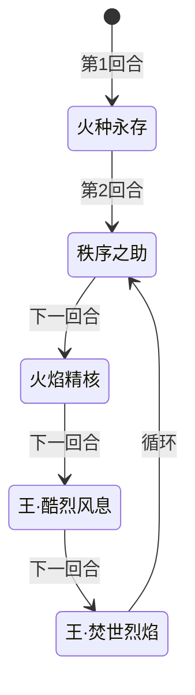
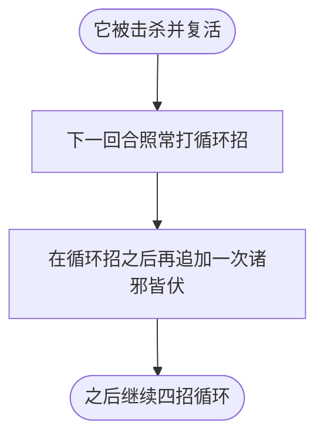

# 不灭·艾恩斯

> **类型**：BOSS 怪物
> **初始生命**：2600
> **遭遇战**：第四幕（星海尽头）Boss 战 · 单怪
> **特性**：[焚世涅槃](/powers/burning_nirvana_power.md) 多命复活 + 火种→火苗→烈焰→燎原之火连锁 + 焚烬/烧伤滚雪球

## 被动能力（开局自带）

| 名称 | 类型 | 效果 |
|------|------|------|
| **[焚世涅槃](/powers/burning_nirvana_power.md)** | 能力（不可消除） | ①自身回合开始时，未转化的[火种](/powers/spark_power.md)、[火苗](/powers/flame_power.md)、[烈焰](/powers/blaze_power.md) 不消失，保留到下回合继续转化。②自身回合开始时，敌人每有 1 层[烧伤](/powers/burn_power.md)或[焚烬](/powers/ash_power.md)，自身获得 1 层火种。③首次死亡时免疫死亡、回满生命并获得 200 层火种；此后每消耗 1 层[燎原之火](/powers/wildfire_power.md) 复活 1 次并回满生命。 |

::: tip 火种连锁是什么
- **[火种](/powers/spark_power.md)**：自身回合开始时每个火种 10% 转化为火苗；每转化 1 个获得 1 层增伤与 1 层减伤。
- **[火苗](/powers/flame_power.md)**：每个火苗 10% 转化为烈焰；每转化 1 个，所有敌人随机获得 1 种异常状态、层数等于转化数量。
- **[烈焰](/powers/blaze_power.md)**：每个烈焰 10% 转化为燎原之火；每转化 1 个，令 1 名随机敌人失去等同于其最大生命的生命值（对 Boss 减半）。
- **[燎原之火](/powers/wildfire_power.md)**：每消耗 1 层，艾恩斯额外复活 1 次。
- 普通怪物每回合没转化的火种会消失；艾恩斯因焚世涅槃全部保留，所以火种会一直堆着，转化只是时间问题。
:::

::: warning 烈焰→燎原之火是灭团级威胁
烈焰转化时的「失去等同于最大生命的生命值」对玩家是**满血直接清空**级别。焚世涅槃会保留未转化的烈焰，意味着只要战斗拖得够久，场上烈焰迟早转化。这不是慢慢扣血，而是必须抢在转化前结束战斗。
:::

## 行动逻辑

第 1 回合只放「火种永存」；第 2 回合起按 秩序之助 → 火焰精核 → 王·酷烈风息 → 王·焚世烈焰 四招循环。每次复活后的下一回合，循环招之后再追加一次「诸邪皆伏」。

**复活后的追加行动**

> **说明**：第 1 回合只有「火种永存」，不追加「诸邪皆伏」；「诸邪皆伏」不是循环成员，只在每次复活后的下一回合额外追加一次。四招循环按 秩序之助 → 火焰精核 → 王·酷烈风息 → 王·焚世烈焰 的顺序无限重复。

## 招式表

| 招式名 | 意图 | 类型 | 效果 |
|--------|------|------|------|
| **火种永存** | 火种永存 | 持续增益 | 持续 10 回合：自身回合结束时，使敌人获得 6 层[焚烬](/powers/ash_power.md)与 6 层[烧伤](/powers/burn_power.md)。施加时自身获得 5 层[无实体](/powers/intangible_power.md)，并使敌人所有牌堆中耗能为 0 的卡牌附魔[永耀](/enchantments/eternal_radiance_enchantment.md)。 |
| **王·焚世烈焰** | 攻击 50 | 攻击 + 吸强 | 造成 50 点伤害（不受微弱影响），吸强。敌人每有 1 种异常状态，本招伤害提高 50%；自身每有 1 层[燎原之火](/powers/wildfire_power.md)，敌人的焚烬与烧伤层数额外提高 100%。 |
| **王·酷烈风息** | 攻击 46 | 攻击 + 反弱 | 反弱。造成 46 点伤害，施加 10 层焚烬。自身每有 1 层[烈焰](/powers/blaze_power.md)，随机使敌人所有牌堆中 1 张未附魔的卡牌附魔[无效](/enchantments/invalid_enchantment.md)。 |
| **火焰精核** | 火焰精核 | 自身增益 | 自身全属性各 +4，每拥有 1 层[火苗](/powers/flame_power.md)额外各 +1；获得 4 回合[吃月亮](/powers/eat_moon_power.md)与 300 点格挡。 |
| **秩序之助** | 攻击 40 | 攻击 + 禁疗 + 固伤增幅 | 造成 40 点伤害，使敌人[禁疗](/powers/timed_no_heal_power.md) 3 回合。自身每拥有 1 层火种，敌人本场战斗受到的固定伤害永久提高 5%。 |
| **诸邪皆伏** | 攻击 30 | 攻击 + 弹控 + 销毁附魔 | 造成 30 点伤害，自身获得 4 回合[弹控](/powers/debuff_immune_reflect_power.md)。将敌人所有牌堆中的附魔卡牌移入[销毁牌堆](/mechanics/destroyed_pile)，并造成等同于这些牌当前 PP 总和的[固定伤害](/powers/fixed_damage_power.md)。**只在每次复活后的下一回合额外追加一次，不参与常规循环。** |

## 遭遇战

| 遭遇战 | 房间类型 | 池子 | 数量 | 说明 |
|--------|----------|------|------|------|
| 不灭·艾恩斯 | Boss | 第四幕 Boss 池 | 1 只 | 单怪 Boss 战；双 Boss / 三 Boss 规则下与其他第四幕 Boss 同场 |

## 策略提示

1. **这是一场和转化赛跑的仗**：火种 → 火苗 → 烈焰 → 燎原之火，每层每回合 10% 转化，且焚世涅槃**保留未转化层数**。拖得越久，烈焰转化触发「失去最大生命」的概率越高，属于满血秒杀级威胁。速攻不是可选项，是唯一解。

2. **复活次数不固定**：首次死亡必定免疫并回满，还额外获得 200 层火种；之后每消耗 1 层燎原之火再复活一次。爆发队不要看到空血就交完所有资源，先确认它是否还有燎原之火。

3. **异常状态会反过来喂它**：自身回合开始时，你每有 1 层烧伤或焚烬，它就获得 1 层火种。给它叠烧伤看似输出，实际在加速火种连锁。中毒、流血、固定伤害这类不喂火种的伤害更安全。

4. **王·焚世烈焰按你的异常种类增伤**：每有 1 种异常 +50%，而每层燎原之火还会让焚烬/烧伤层数额外 +100%。身上异常种类越多，这一招越接近秒杀；进 Boss 战前尽量清掉多余异常。

5. **火焰精核是防守窗口**：+4 全属性、每层火苗额外 +1、300 格挡、4 回合吃月亮，这一回合它几乎不掉血。不要在此时硬交爆发，先处理自己的异常、补格挡，等下一回合酷烈风息/焚世烈焰再打。

6. **复活后追加的诸邪皆伏专杀附魔与 PP 牌**：把所有附魔牌丢进销毁牌堆，再按这些牌的 PP 总和打固定伤害。附魔流和 PP 大牌损失极大，附魔牌尽量在它复活后那一回合前用掉，或准备免疫固定伤害。

7. **禁疗与固伤增幅会叠加**：秩序之助给你 3 回合禁疗，并让本场你受到的固定伤害永久 +5%/火种。火种越多，后续所有固定伤害越痛；禁疗期间别指望回血，提前把血线抬高。

8. **火种永存只在第 1 回合放一次，效果持续 10 回合**：它每次回合结束给你 6 焚烬 + 6 烧伤，同时开场给自己 5 层无实体。无实体期间攻击几乎无效，优先用固定伤害/异常状态过渡，别把大招浪费在无实体窗口。

## 源码

- 怪物：`SeerBumieAiEnSiMonster.cs`
- 被动能力：`SeerBurningNirvanaPower.cs`
- 火种连锁：`SeerSparkPower.cs`、`SeerFlamePower.cs`、`SeerBlazePower.cs`、`SeerWildfirePower.cs`
- 招式能力：`SeerFireSeedEternalPower.cs`、`SeerTimedNoHealPower.cs`、`SeerDebuffImmuneReflectPower.cs`、`SeerPermanentDamageBoostPower.cs`、`SeerPermanentDamageReductionPower.cs`
- 附魔：`SeerEternalRadianceEnchantment.cs`、`SeerInvalidEnchantment.cs`
- 遭遇战：`SeerBumieAiEnSiBoss.cs`
- 本地化：`monsters.json`、`intents.json`、`powers.json`
