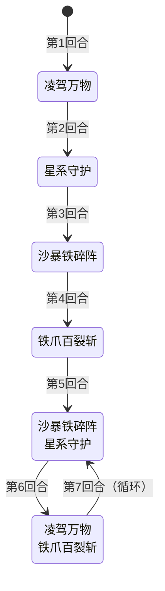

# 巴斯特

> **类型**：Boss 怪物
> **初始生命**：195 - 199
> **遭遇战**：第二层 Boss 池 · 神兽空间事件
> **特性**：大地守护（60%减伤+15覆甲+每回合+3防御）+ 防御雪球（沙暴固定伤害/铁爪力量随防御放大）+ 高塔充能球叠加覆甲 + 铁爪百裂斩爆发

## 被动能力

### 大地守护（开局自带，3 个能力组合）

加入房间时一次性施加 3 个独立能力，共同构成"大地守护"被动：

| 能力 | 数值 | 机制 | 能力类型 |
|------|------|------|----------|
| **永久减伤** | 60% | 受到的**攻击伤害**减少 60%（仅对攻击伤害生效，固定伤害/非攻击伤害不受影响） | 被动型，不可消除 |
| **大地守护** | 1 层（不显示层数） | 每回合开始时自身防御 +3 | 被动型，不可消除 |
| **覆甲** | 15 层 | 自身回合结束时获得等同层数的格挡；自身回合开始时层数 −1（单人）。开局 15 层，之后靠高塔球补充 | 被动（开局 15 层，每回合衰减） |

::: warning 三层减伤链
巴斯特的减伤链：①60% 减伤（攻击伤害 ×0.4，乘法伤害修正最先执行）→ ②防御（每层 -1 攻击伤害，加法修饰）→ ③覆甲产生的格挡（回合结束获得等同层数的格挡）。前期低伤卡牌几乎无效，需用高伤单次攻击或固定伤害/非攻击类手段应对。
:::

### 防御

巴斯特的"防御"是独立能力（非原版格挡），每有一层使受到的攻击伤害降低 1 点。防御来源：
- 大地守护：每回合开始 +3
- ③凌驾万物：+5
- 防御不会自然消退，持续累积。

## 行动逻辑

前 4 回合固定出招，第 5 回合起在两个双招组合之间交替循环。

> **凌驾万物**：防御+5，生成高塔充能球（槽位上限 2，满槽时激发最旧的球 +4 覆甲），并获得 3 回合免控；**星系守护**：40格挡，玩家力量-5；**沙暴铁碎阵**：10攻击伤害+防御层数固定伤害（下回合开始时结算，不可格挡）；**铁爪百裂斩**：力量拉平到防御值，5伤害×4次。防御每回合+3持续累积，铁爪伤害随防御雪球式放大。

## 招式表

### 单意图招式

| 招式名 | 意图 | 类型 | 效果 | 数值 |
|--------|------|------|------|------|
| **沙暴铁碎阵** | 沙暴铁碎阵 | 攻击 + 固定伤害 | 造成攻击伤害（受力量影响），附加等于自身防御层数的固定伤害（通过固定伤害能力施加，不可格挡） | 攻击伤害 10，固定伤害 = 防御层数 |
| **凌驾万物** | 凌驾万物 | 自身增益 | 自身防御 +5，生成 1 个高塔充能球（每球每回合 +1 覆甲），并获得 3 回合免控 | 防御 +5，高塔球 ×1，免控 3 回合 |
| **星系守护** | 星系守护 | 自身增益 + 减益 | 自身获得 40 点格挡，对所有敌人施加力量 -5 | 格挡 40，玩家力量 -5 |
| **铁爪百裂斩** | 铁爪百裂斩 | 攻击（多段） | 自身力量提升至与防御相同，造成 5 点伤害 4 次（受力量加成） | 伤害 5（+力量）×4 次 |

### 双意图组合招式

| 招式名 | 组成 | 执行顺序 | 出现时机 |
|--------|------|----------|----------|
| **沙暴铁碎阵·星系守护** | ②沙暴铁碎阵 + ④星系守护 | 先 ② 后 ④ | 第 5 回合起（偶数计数） |
| **凌驾万物·铁爪百裂斩** | ③凌驾万物 + ⑤铁爪百裂斩 | 先 ③ 后 ⑤ | 第 6 回合起（奇数计数） |

### 沙暴铁碎阵的固定伤害机制

沙暴铁碎阵附加的固定伤害在**目标下回合开始时**结算（通过固定伤害能力施加，回合开始时触发）：

1. 造成 10 点攻击伤害后，对所有敌人施加等于巴斯特当前防御层数的固定伤害（减益，不可格挡，不受力量影响）。
2. 固定伤害能力在目标下回合开始时结算，造成等于层数的不可格挡非攻击伤害。
3. 反制手段：固定伤害不可格挡，只能通过清除巴斯特的防御层数（消除能力）或回血/护甲抵消。

### 铁爪百裂斩的伤害计算

铁爪百裂斩的伤害 = (5 + 力量) × 4 次，力量在攻击前提升至防御值：

| 回合 | 防御值（力量提升目标） | 每次伤害（5+力量） | 4 次总伤害（理论值） |
|------|----------------------|-------------------|---------------------|
| 第 4 回合 | 17 | 22 | 88 |
| 第 6 回合 | 28 | 33 | 132 |
| 第 8 回合 | 39 | 44 | 176 |

::: warning 铁爪伤害不受巴斯特自身减伤影响
上述为不考虑玩家格挡/易伤的理论值。60% 减伤只在巴斯特**受到**伤害时触发，铁爪百裂斩是巴斯特**造成**伤害，不受自身减伤影响。
:::

### 防御累积表

防御只增不减（每回合 +3 + 凌驾万物 +5），是巴斯特越拖越强的核心：

| 回合 | 招式 | 防御变化 | 回末防御 | 高塔球数 |
|------|------|----------|----------|----------|
| 第 1 回合 | ③凌驾万物 | +3(回合开始) +5(③) | 8 | 1 |
| 第 2 回合 | ④星系守护 | +3 | 11 | 1 |
| 第 3 回合 | ②沙暴铁碎阵 | +3 | 14 | 1 |
| 第 4 回合 | ⑤铁爪百裂斩 | +3 | 17 | 1 |
| 第 5 回合 | ②④ | +3 | 20 | 1 |
| 第 6 回合 | ③⑤ | +3 +5(③) | 28 | 2 |

覆甲层数每回合开始 −1（单人），高塔球按当前球数补回：1 球时净持平，2 球起每回合净 +1；首次充能的回合不衰减；满槽再充能时额外 +4 覆甲。

## 遭遇战

| 遭遇战 | 房间类型 | 池子 | 数量 | 说明 |
|--------|----------|------|------|------|
| 巴斯特 | Boss | 第二层 Boss 池 | 1 只 | 第二层 Boss，单怪 |
| 玄武巴斯特 | Monster | 神兽空间事件 | 1 只 | 神兽空间·玄武巴斯特（奖励由神兽空间系统发放） |

## 策略提示

### 核心取舍：速战 vs 消除防御能力（两条路线，不是一概而论）

巴斯特的防御每回合 +3 且不消退，沙暴固定伤害和铁爪伤害都随防御放大。第 4 回合铁爪 88 伤害，第 6 回合 132 伤害，第 8 回合 176 伤害。**必须选择一条路线应对**：

- **路线 A（速战）**：前 4 回合单意图阶段全力输出，争取第 5 回合双意图循环前结束战斗。适用：爆发牌组（每回合 40+ 伤）
- **路线 B（消除防御能力）**：巴斯特核心被动 60% 减伤和大地守护是被动型（不可消除），但**防御能力是增益型（可被消除）**。防御同时驱动两大威胁——沙暴固定伤害 = 防御层数、铁爪力量提升至防御值。移除防御可让沙暴归零，并阻止铁爪继续变强（已累积的力量不会回退）。适用：续航牌组（有消除能力手段但缺乏爆发）

两条路线不互斥：前期速战压血，后期如果无法击杀则转消除防御。

1. **三层减伤链需穿透**：①防御（每层 -1 攻击伤害）+ ②60% 减伤（攻击 ×0.4）+ ③覆甲产生的格挡。前期低伤多段攻击几乎无效（被格挡与减伤吃光）。**穿透方式取舍**：
   - **高伤单次攻击**：一次打穿当回合的覆甲格挡，避免每段都被 60% 与防御逐段削减
   - **固定伤害/非攻击类手段**：绕过整条减伤链（固定伤害无视格挡，也不受 60% 减伤与防御影响）
   - **多段低伤攻击**：每段都被 60% 与防御削减，不推荐

2. **沙暴固定伤害下回合结算**：沙暴铁碎阵的固定伤害等于防御层数，通过固定伤害能力施加，在**目标下回合开始时**结算（不可格挡，不受力量影响）。第 3 回合施加的固定伤害在第 4 回合开始时结算（14 点），第 5 回合施加的在第 6 回合开始时结算（20 点）。需通过消除巴斯特防御层或回血抵消。

3. **铁爪百裂斩是爆发点**：力量提升至防御值后 (5+力量)×4 次。第 4 回合 88 伤害，第 6 回合 132 伤害。第 4 回合前必须大幅压血或准备大量格挡。注意铁爪伤害不受巴斯特自身减伤影响（减伤只挡受到的伤害）。

4. **星系守护削弱输出**：40 格挡 + 玩家力量 -5。力量 -5 会显著降低玩家攻击伤害，配合巴斯特自身减伤链，输出进一步受限。第 2 回合固定使用星系守护，需准备非力量依赖的输出手段（固定伤害、能力牌等）。

5. **高塔充能球补充覆甲**：每球在它回合开始 +1 覆甲，但覆甲自身每回合 −1（单人），所以 1 球时净持平、2 球时每回合净 +1。槽位上限 2，满槽时再充能会先激发最旧的球（额外 +4 覆甲）再补新球。第 6 回合后 ③⑤ 持续充能，覆甲与格挡才真正开始滚起来。需优先用消除能力类手段清除高塔球或覆甲。

6. **可移除能力清单**：巴斯特核心被动 60% 减伤和大地守护是被动型（不可消除）。但以下能力可被移除：
   - **[防御](/powers/defense_power.md)**：增益型，可移除。**移除防御让沙暴固定伤害归零，并阻止铁爪继续提升力量**——最高优先级
   - **高塔充能球**：增益型，可移除。移除后停止覆甲累积
   - **覆甲**：可移除。它每回合 −1 层，主要靠高塔球补回，移除高塔球后覆甲会自然衰减

7. **前 4 回合是最佳输出窗口（但不是唯一窗口）**：前 4 回合为单意图，伤害相对可控（第 1 回合上增益，第 2 回合上盾，第 3 回合沙暴，第 4 回合铁爪）。第 5 回合起进入双意图循环，每回合两个技能，威胁翻倍。
   - **爆发牌组**：前 4 回合全力压血，争取第 5 回合前结束
   - **续航牌组**：前 4 回合格挡苟活 + 移除防御能力。防御被移除后沙暴固定伤害归零，铁爪也不会再提升力量；但**已经累积的力量不会消失**，所以最晚要在第 4 回合第一次铁爪前移除，否则它仍会按旧力量继续打。第 5 回合双意图循环后仍可持续战斗

## 源码

- 怪物：`SeerBusterMonster.cs`
- 被动能力：`SeerPermanentDamageReductionPower.cs`、`SeerEarthGuardPower.cs`、`PlatingPower.cs`
- 防御能力：`SeerDefensePower.cs`
- 高塔充能球：`SeerTowerOrbCounterPower.cs`
- 意图：`SeerBusterIntents.cs`、`SeerNamedMultiAttackIntent.cs`
- 遭遇战：`SeerBusterBoss.cs`、`SeerEventBusterEncounter.cs`
- 本地化：`monsters.json`、`intents.json`、`powers.json`、`orbs.json`