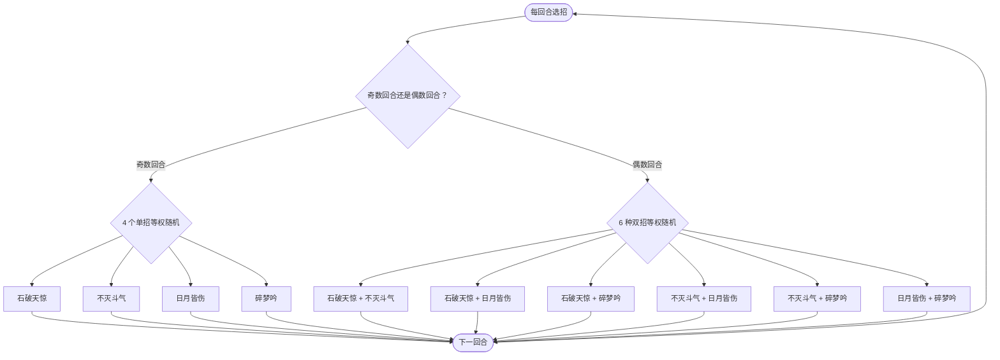
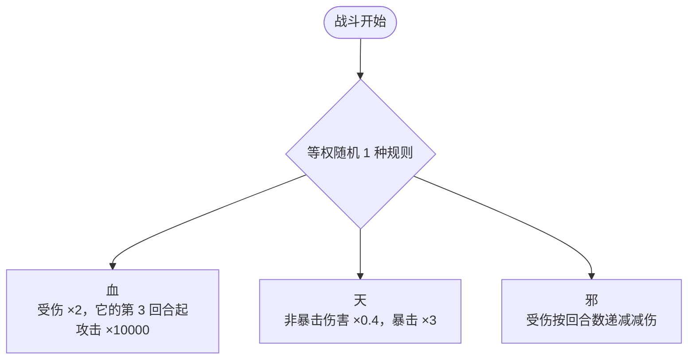

# 盖亚

## 基本信息

| 属性 | 数值 |
|---|---|
| 分类 | [Boss 怪物](/monsters/boss/) |
| 生命值 | 183 - 186 |
| 被动能力 | [返璞归真](#被动能力)（暴击回血）+ [暴击](#被动能力)（初始暴击率 0%，随命中成长）+ [横幅规则](#横幅规则)（开局 3 选 1） |

## 行动逻辑

开局自带返璞归真 + 暴击 + 横幅规则（血/天/邪三选一随机）；之后奇数回合从 4 个单招中等权随机 1 个，偶数回合从 6 种双招组合中等权随机 1 种并依次结算两招。

**开场横幅规则（三选一，互斥）**

> **奇数回合**（4 选 1 等权）：石破天惊 / 不灭斗气 / 日月皆伤 / 碎梦吟；**偶数回合**（6 选 1 等权）双招连招，依次执行两个招式。

- **石破天惊**：16伤害，速度+2，反转敌人全属性提升
- **不灭斗气**：全属性+2，下次攻击必暴击
- **日月皆伤**：12伤害，双倍反弹下次受到的伤害
- **碎梦吟**：4伤害×4次，每次命中施加1层易伤
- **双招组合**：依次执行两个招式，效果与单招一致

## 招式表

### 单意图招式

| 招式 | 意图 | 描述 | 数值 |
|---|---|---|---|
| 石破天惊 | 攻击 | 造成 16 点伤害。自身速度 +2，并反转你所有的属性提升 | 伤害 16；速度 +2 |
| 不灭斗气 | 不灭斗气 | 自身全属性 +2，且下次攻击必定暴击 | 全属性 +2 |
| 日月皆伤 | 攻击 | 造成 12 点伤害。将下次受到的伤害双倍反弹给你 | 伤害 12 |
| 碎梦吟 | 多段攻击 | 造成 4 点伤害 4 次。每次伤害施加 1 层易伤 | 4 伤害 × 4 次 |

### 双意图组合招式

依次执行两个单意图招式，效果与单意图完全一致。

| 招式 | 意图 1 | 意图 2 |
|---|---|---|
| 石破天惊·不灭斗气 | 石破天惊 | 不灭斗气 |
| 石破天惊·日月皆伤 | 石破天惊 | 日月皆伤 |
| 石破天惊·碎梦吟 | 石破天惊 | 碎梦吟 |
| 不灭斗气·日月皆伤 | 不灭斗气 | 日月皆伤 |
| 不灭斗气·碎梦吟 | 不灭斗气 | 碎梦吟 |
| 日月皆伤·碎梦吟 | 日月皆伤 | 碎梦吟 |

### 招式细节

- **石破天惊**：反转敌人全属性提升——力量、防御、命中、速度中所有为正的属性，翻成**等量的负值**（+5 → −5，不是翻倍）。
- **不灭斗气**：施加力量、防御、命中、速度各 +2，并施加下次攻击必定暴击（攻击后自动移除）。
- **日月皆伤**：造成 12 点伤害，并施加双倍反弹（1 层，只反弹下一次攻击伤害，反弹后消耗）。
- **碎梦吟**：先施加"每次命中施加易伤"能力，再造成 4 点伤害 4 次，每次命中给目标 1 层易伤。

## 被动能力

### 返璞归真

自身造成暴击时，恢复等量于该次暴击伤害的生命值。多段攻击的每一段命中都会结算一次回血（暴击判定整段共享）。

- **能力类型**：不可消除（不被消除增益/减益类效果清除）。

### 暴击

攻击伤害暴击时 ×1.5。暴击率由盖亚自己的命中提供（每层 +10%）——盖亚开局没有命中（暴击率 0%），使用「不灭斗气」（全属性 +2）后命中增长，暴击率随之提升。盖亚开局自带 1 层暴击，是与「返璞归真」联动的内部能力。

## 横幅规则

开局由同步随机数随机选择 3 种规则之一，并在战斗界面顶部常驻显示横幅（淡入动画）。三种规则互斥，均为不可消除。

| 规则 | 名称 | 效果 |
|---|---|---|
| 血 | 血 | 受到的伤害变为 2 倍。第 3 回合起，自身攻击伤害 ×10000（直接处决敌人） |
| 天 | 天 | 受到的所有掉血按暴击与否结算：非暴击降至 40%，暴击变为 3 倍。固定伤害等非攻击伤害不参与暴击判定，统一按 40% |
| 邪 | 邪 | 受到的伤害减少 (70 - 5 × 它已行动的回合数)%，最低 0。开局 65%，你的第 1、2 回合都是 65%，之后每回合再降 5%，你的第 15 回合起为 0% |

## 遭遇战

| 遭遇战 | 房间类型 | 池子 | 数量 | 说明 |
|---|---|---|---|---|
| 盖亚 | Boss | 第一层 | 1 只 | 单怪物 Boss |
| 盖亚与斗神瑞尔斯 | Monster | 事件遭遇战 | 2 只 | 盖亚 + 斗神瑞尔斯同时出场；无奖励 |

## 策略提示

### 横幅规则决定战术（开局必看）

开局观察顶部横幅文字，三种规则对应完全不同的战术：

| 规则 | 盖亚受伤 | 盖亚攻击 | 战术建议 |
|---|---|---|---|
| **血** | ×2 倍（变脆） | 第3回合起 ×10000（秒杀） | **必须在3回合内击杀**，玩家有3个玩家回合（回合1、2、3），第3回合盖亚回合开始时激活秒杀 |
| **天** | 非暴击 ×0.4，暴击 ×3（固定伤害也按 ×0.4） | 正常 | **暴击流最快**，堆暴击率让盖亚承伤3倍；非暴击流伤害降至40%很难打 |
| **邪** | 你的第1、2回合 -65%，之后每回合 -5%，第15回合起 0% | 正常 | **前期难打后期好打**，减伤随它的回合数自然递减，速攻反而吃满减伤 |

**血规则最危险**：盖亚受伤2倍看似脆，但它的第3回合开始时激活攻击×10000必杀。**玩家有3个回合（回合1、2、3）输出窗口**——时序为：玩家回合1→盖亚回合1→玩家回合2→盖亚回合2→玩家回合3→盖亚回合3（**激活秒杀**）。建议保留爆发牌和能量药水，开局直接全力输出。

**天规则最看 build**：暴击流（暴击率 ≥ 50%）打天规则盖亚伤害3倍非常爽。非暴击流的取舍：
- **攻击伤害流**：非暴击伤害×0.4，输出效率大幅下降，确实很难打。但盖亚血量 183-186 不算高，可通过高伤单次攻击 + 力量累积弥补
- **固定伤害/非攻击伤害流**：同样被压到 40%，绕不过天规则；固定伤害打盖亚会自动按非暴击结算
- **注意**：天规则下盖亚暴击回血量不会变3倍（回血取决于盖亚造成的伤害，与盖亚受伤倍率无关）

**邪规则最稳**：开局两个玩家回合都是65%减伤，之后每回合降5%；盖亚血量183-186不高，大约你的第8回合（减伤35%）后就能正常输出。建议前期格挡苟活，后期爆发。

### 偶数回合 Combo 威胁

偶数回合盖亚会**连放 2 个招式**（6选1等权），尤其危险的组合：

| Combo | 第一招 | 第二招 | 总威胁 |
|---|---|---|---|
| **不灭斗气·碎梦吟** | 全属性+2 + 必暴 | 4×4段攻击 + 每次易伤 | 必暴下4段伤害+4层易伤，伤害放大极多 |
| **石破天惊·碎梦吟** | 16伤 + 反属性 + 速度+2 | 4×4段攻击 + 每次易伤 | 先反你属性再4段打，输出骤降 |
| **不灭斗气·日月皆伤** | 全属性+2 + 必暴 | 12伤 + 双倍反弹 | 必暴下12伤约18，但**双倍反弹下次受伤** |
| **石破天惊·日月皆伤** | 16伤 + 反属性 | 12伤 + 双倍反弹 | 28伤+双反，下次攻击盖亚会自伤 |

**偶数回合建议优先格挡**，特别是看到不灭斗气或碎梦吟意图时。Combo 威胁远大于奇数回合单招。

### 返璞归真的回血威胁

盖亚暴击时**回等量于本次实际造成伤害的血**（即未被格挡的伤害）。暴击在整次攻击开始时判定一次，命中同一目标的每一段都按该结果结算回血。配合以下机制回血量会放大：

- **不灭斗气**必暴：单次攻击必暴，回血量 = 暴击伤害（含力量加成）
- **碎梦吟**：若整次攻击判定为暴击，4 段每段都回一次血（共 4 次），不是每段单独掷骰
- **力量累积**：石破天惊+不灭斗气会让盖亚力量递增，暴击伤害随力量放大，回血量也水涨船高

::: warning 天规则不放大回血量
天规则只影响盖亚**受到**的伤害倍率（暴击×3、非暴击×0.4），不影响盖亚**造成**的伤害。返璞归真回血量 = 盖亚实际造成的伤害（未被格挡的伤害），与盖亚受伤倍率无关。所以天规则下盖亚暴击回血量**不会**变3倍，回血量取决于盖亚攻击伤害本身（受力量/暴击倍率1.5影响，不受天规则影响）。
:::

**计算斩杀线时必须把回血算进去**，避免盖亚残血被一次暴击回满。建议在盖亚血量低于50%时保留高伤牌一波带走，避免拉锯战。

### 石破天惊反属性（针对属性流）

石破天惊会把你**正值的力量/防御/命中/速度翻为等量负值**：

- 你力量 +5 → 石破天惊后变 −5（攻击伤害 −5）
- 你防御 +3 → 变 −3（受到的攻击伤害 +3）
- 你速度 +4 → 变 −4（每 −2 层少抽 1 张）

**应对**：
1. **属性流**（堆力量/防御）需在石破天惊后再叠属性，或保留驱散手段清除自身负面属性
2. **非属性流**（直接伤害/格挡）不受影响，石破天惊只反属性不反其他
3. 注意石破天惊只反**正值**属性，负值属性（如虚弱带来的-力量）不受影响

### 碎梦吟多段易伤

碎梦吟 4×4 段伤害，每次命中给目标施加 1 层易伤。**易伤倍率恒定 1.5 倍，与层数无关**（易伤倍率始终为 1.5，层数只影响持续时间，不叠加倍率）：

| 段数 | 基础伤害 | 命中前易伤层数 | 倍率 | 实际伤害 |
|---|---|---|---|---|
| 第1段 | 4 | 0 | ×1.0 | 4 |
| 第2段 | 4 | 1 | ×1.5 | 6 |
| 第3段 | 4 | 2 | ×1.5 | 6 |
| 第4段 | 4 | 3 | ×1.5 | 6 |

**4 段总伤 = 4 + 6 × 3 = 22**（未含盖亚力量加成）。命中后玩家身上累计 4 层易伤，意味着易伤效果将持续 4 回合（每回合 -1 层），期间玩家受到的所有攻击伤害 ×1.5。若碎梦吟出现在偶数回合 Combo 的第二招，前一招的全属性 +2（不灭斗气会让盖亚力量 +2，每段多 2 点）或反属性（石破天惊把玩家正值属性翻负）会进一步放大威胁。

### 日月皆伤的双倍反弹

日月皆伤造成12伤后，盖亚获得1层**双倍反弹**：

- 只对**下一次**攻击伤害生效：实际受到的伤害 ×2 反弹给攻击者，随后能力消耗
- 反弹用非攻击伤害（不受力量/暴击/易伤影响）
- 若本次未受到攻击伤害，能力在盖亚下回合开始时消失
- 非攻击伤害（固定伤害/能力伤害/流失）不触发，也不会消耗

::: warning 天规则+暴击下双反会致命
天规则下盖亚受到的暴击伤害×3，而双倍反弹 = 盖亚实际受到的伤害×2。所以**天规则+玩家暴击**时：反弹伤害 = 原伤害 ×3（天规则暴击）×2（双反）= **6 倍原伤害**。例如玩家暴击原伤 20 → 盖亚受 60 → 反弹给玩家 120 点非攻击伤害（仍可被格挡），足以秒杀。天规则下看到日月皆伤意图后**绝对不要用暴击攻击盖亚**。
:::

**应对取舍**：
- **低伤攻击**：可以用一张低伤攻击主动触发双反，吃掉这次反弹后再爆发
- **非攻击伤害（能力伤害/固定伤害/流失）**：不触发双反，可继续输出
- **纯攻击流**：不想吃反弹就停手，等盖亚下回合开始时双反消失后再输出
- **天规则下**：不要用暴击触发（6倍反弹秒杀），必要时用低伤非暴击攻击或非攻击伤害处理

### 推荐策略总结

1. **开局看横幅定战术**：血规则3回合速杀（玩家有3个回合）、天规则堆暴击、邪规则后期爆发
2. **奇偶节奏**：奇数回合单招威胁小可输出，偶数回合双招威胁大开格挡
3. **警惕必暴+回血**：不灭斗气必暴会让盖亚回血，残血盖亚可能暴击回满
4. **属性流注意反属性**：石破天惊会反你正值属性，需保留驱散或后置叠属性
5. **双反只挡下一次**：日月皆伤后，双反只反弹下一次攻击伤害，可用低伤攻击主动触发或非攻击伤害绕过；天规则下不要用暴击触发
6. **保留爆发**：偶数回合 Combo 后或邪规则后期是输出窗口

## 小贴士

- 开局先看顶部横幅定战术：血规则3回合内速杀，天规则堆暴击，邪规则后期爆发。
- 日月皆伤后不要用高伤或暴击攻击盖亚；可用一次低伤攻击吃掉这层反弹，或等它在盖亚下回合开始时自动消失。

## 源码

- `SeerGaiaMonster.cs`
- `SeerReturnToNaturePower.cs`、`SeerCriticalStrikePower.cs`
- `SeerBloodRulePower.cs`、`SeerHeavenRulePower.cs`、`SeerEvilRulePower.cs`
- `SeerNextGuaranteedCritPower.cs`、`SeerDoubleReflectPower.cs`、`SeerVulnerableOnHitPower.cs`
- 遭遇战：`SeerGaiaBoss.cs`、`SeerEventGaiaRuiersiEncounter.cs`
- 本地化：`monsters.json`、`intents.json`、`powers.json`
