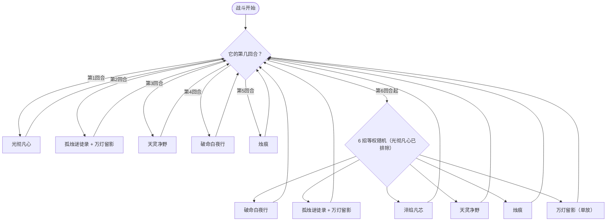

# 孤烛灯使

> **类型**：BOSS 怪物
> **初始生命**：1000
> **遭遇战**：第五幕（终焉之门）Boss 战 · 单怪
> **特性**：[寒灯渡夜](/powers/cold_lamp_night_power.md) 魂灯拔河 + 点灯封印 PP + 消耗魂灯复活 + 生/死/煤灰光环

## 被动能力（开局自带）

| 名称 | 类型 | 效果 |
|------|------|------|
| **[寒灯渡夜](/powers/cold_lamp_night_power.md)** | 能力（不可消除） | ①你的回合开始时，比较你的抽牌堆与弃牌堆：抽牌堆更多则孤烛灯使点亮自身 1 盏[魂灯](/powers/soul_lamp_power.md)，弃牌堆更多则点亮你 1 盏魂灯。②孤烛灯使受到致命伤害时，熸消 1 盏魂灯并回满生命（优先消耗你的魂灯）。③灯火点亮时施加 PP 封禁：孤烛灯使的灯亮，你的 PP 为满值的牌无法打出；你的灯亮，你的 PP 为 1 的牌无法打出。 |

::: tip 魂灯规则
- **魂灯**：灯亮时，怪物侧每盏使你的最大能量 −1，玩家侧每盏使你的最大能量 +1。一方点灯时，另一方全部熄灭（存量不变）。每侧最多 7 盏。
- **怪物亮灯**：你 PP 已满的牌无法打出。
- **玩家亮灯**：你 PP 为 1 的牌无法打出。
- **复活优先级**：它死亡时优先熸消你的魂灯；你场上没有灯时才消耗自己的。全场无灯时才会真正死亡。
:::

## 行动逻辑

第 1–5 回合固定顺序出招，第 6 回合起从 6 招中等权随机 1 招（不会再放光彻凡心）。

> **说明**：第 2 回合「孤烛谜徒录 + 万灯留影」同回合依次结算；第 6 回合起的随机池为 破命白夜行 / 孤烛谜徒录+万灯留影 / 淬焰凡芯 / 天灵净野 / 烛痕 / 万灯留影，光彻凡心不再出现。

## 招式表

| 招式名 | 意图 | 类型 | 效果 |
|--------|------|------|------|
| **光彻凡心** | 光彻凡心 | 常驻光环 | 本场战斗中：灯点亮时，向敌人的弃牌堆加入 1 张「[生](/cards/status/birth.md)」；灯熄灭时，向敌人的抽牌堆加入 1 张「[死](/cards/status/death.md)」；灯熸消时，向敌人的消耗牌堆加入 1 张「煤灰」。 |
| **孤烛谜徒录** | 攻击 66 | 攻击 + PP 归零 + 固伤 | 造成 66 点伤害；将敌人抽牌堆与弃牌堆中所有拥有 PP 的牌降至 0，并对每个敌人造成等同降低总量的[固定伤害](/powers/fixed_damage_power.md)。 |
| **天灵净野** | 天灵净野 | 自身增益 + 异常 | 使每个敌人获得[焚烬](/powers/ash_power.md) 4 层；自身获得 4 回合[吃月亮](/powers/eat_moon_power.md)、6 层[缓冲](/powers/buffer_power.md)与 200 点格挡。 |
| **破命白夜行** | 攻击 50 | 攻击 + 烧伤 + 额外回合 | 造成 50 点伤害；使敌人获得[烧伤](/powers/burn_power.md) 3 层与焚烬 3 层。若敌人已处于烧伤状态，自身回合结束时额外开启 1 个回合；若敌人属性克制自身，自身获得 30% 永久免伤；若自身属性克制敌人，自身获得 80% 永久增伤。 |
| **烛痕** | 攻击 10×N | 多段攻击 + 反弱反强 | 反弱、反强。造成 10 点伤害 N 次（基础 5 次，场上每有 1 盏魂灯额外 +1 次）；将敌人弃牌堆中的所有卡牌洗入抽牌堆。 |
| **淬焰凡芯** | 淬焰凡芯 | 反弱反强 + 回手 + 点灯联动 | 反弱、反强。将敌人消耗牌堆中的所有卡牌移回抽牌堆，并回满其 PP；2 回合内，敌人每次点亮魂灯，自身立即点亮 1 盏魂灯。 |
| **万灯留影** | 攻击 45 | 攻击 + PP 操作 | 造成 45 点伤害；敌人抽牌堆牌数多于弃牌堆时，其所有拥有 PP 的牌回满 PP；少于弃牌堆时，其所有拥有 PP 的牌 PP 降至 1。 |

## 遭遇战

| 遭遇战 | 房间类型 | 池子 | 数量 | 说明 |
|--------|----------|------|------|------|
| 孤烛灯使 | Boss | 第五幕 Boss 池 | 1 只 | 单怪 Boss 战；双 Boss / 三 Boss 规则下与其他第五幕 Boss 同场 |

## 策略提示

1. **抽牌堆与弃牌堆的数量是在下注**：你的回合开始时，抽牌堆多 → 它点灯（你最大能量 −1、满 PP 牌被封）；弃牌堆多 → 你点灯（最大能量 +1、PP=1 的牌被封）。两种都不是纯好事，需要根据手里的 PP 牌决定把牌留在哪个堆。

2. **它有几条命取决于魂灯总数**：死亡时熸消 1 盏灯回满血，优先消耗你的灯。想杀它，先把它和你的灯都清空——全场无灯时才会真死。只打空血不处理灯，等于白打一条命。

3. **孤烛谜徒录是 PP 流处刑**：66 伤害之外，抽牌堆和弃牌堆里所有 PP 牌的 PP 归零，并按归零总量打固定伤害。PP 牌越多越痛。它出这招前尽量把 PP 牌抓在手里或打掉，别让它们躺在两个牌堆里。

4. **淬焰凡芯会把消耗牌堆还回来**：你辛苦消耗掉的高 PP 牌会整堆回抽牌堆并回满 PP，等于帮它重置资源；同时 2 回合内你点灯它会跟着点灯，拔河更吃亏。消耗流别把它当安全区。

5. **万灯留影两头堵**：抽牌堆多 → 你所有 PP 牌回满（看似好事，但配合寒灯渡夜会推动它点灯、封你满 PP 牌）；弃牌堆多 → 所有 PP 降到 1（配合你点灯会封 PP=1 牌）；两边相等时不改变 PP。出招前先看自己两个堆的大小。

6. **破命白夜行会抢回合**：你身上已有烧伤时，它回合结束额外开 1 个回合，等于连续行动。进它回合前尽量清掉烧伤；属性克制关系还会给它 30% 免伤或 80% 增伤，元素队要留意。

7. **天灵净野是防守回合**：4 层焚烬、4 回合吃月亮、6 层缓冲、200 格挡，这回合它几乎不掉血。不要把爆发交在这里，先清焚烬、补格挡。

8. **生/死/煤灰会污染牌堆**：点灯往弃牌堆塞「生」（低血时抽到回血）、熄灯往抽牌堆塞「死」（高血时抽到受伤）、熸消往消耗堆塞煤灰。你的牌堆会越来越脏，过牌与手牌管理比纯输出更重要。

## 源码

- 怪物：`SeerGuzhudengshiMonster.cs`
- 被动能力：`SeerColdLampNightPower.cs`、`SeerSoulLampPowers.cs`、`SeerSoulLampDriver.cs`
- 光环能力：`SeerLightThroughAllHeartsPower.cs`
- 招式能力：`SeerLampFullPpSealPower.cs`、`SeerLampOnePpSealPower.cs`、`SeerEatMoonPower.cs`、`BufferPower.cs`
- 状态牌：`SeerBirth.cs`、`SeerDeath.cs`
- 遭遇战：`SeerGuzhudengshiBoss.cs`
- 本地化：`monsters.json`、`intents.json`、`powers.json`
