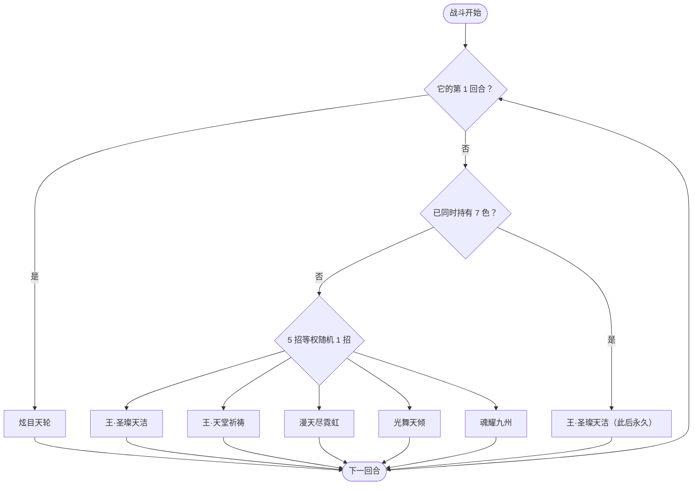

# 圣光斯嘉丽（Boss）

> **类型**：BOSS 怪物
> **初始生命**：3400
> **遭遇战**：第四幕（星海尽头）Boss 战 · 单怪
> **特性**：[七曜天轮](/powers/seven_luminaries_power.md) 七色光线收集 + 颜色越多越强 + 七色齐后永久只用王·圣璨天洁

> **说明**：本页是第四幕 Boss 版本（3400 生命）。第三层精英版本见[圣光斯嘉丽（精英）](/monsters/elite/holy_light_scarlett_monster)。

## 被动能力（开局自带）

| 名称 | 类型 | 效果 |
|------|------|------|
| **[七曜天轮](/powers/seven_luminaries_power.md)** | 能力（不可消除） | 开局持有紫色光线 1 种；技能 4 / 5 各使同时持有的颜色数 +1（从当前未持有的颜色中随机补）。持有光线越多，效果越多。 |

::: tip 七色光线效果
| 光线 | 效果 |
| --- | --- |
| 红光 | 自身造成的攻击伤害提高 80% |
| 橙光 | 自身受到的攻击伤害降低 40% |
| 黄光 | 敌人本回合无法打出攻击牌 |
| 绿光 | 自身回合开始时，回复 50% 已损失生命值 |
| 青光 | 敌人回合开始时，随机获得 5 种异常状态，每种 5 层 |
| 蓝光 | 敌人本回合无法打出技能牌 |
| 紫光 | 敌人本回合无法打出带有[堕落](/powers/fallen_power.md)的牌 |
:::

::: warning 七色齐后进入终局
同时持有 7 色后，斯嘉丽**永久只使用王·圣璨天洁**，且该招的「接下来 X 张牌耗能 +1」中 X 恒为 7。也就是说，拖到七色齐等于进入每回合 50 伤害 + 7 张牌加费的死亡循环。
:::

## 行动逻辑

第 1 回合固定「炫目天轮」；此后未集齐七色时每回合从技能 1~5 中等权随机 1 招，持有 7 色后永久只放「王·圣璨天洁」。

> **说明**：第 2 回合起才开始随机；光舞天倾、魂耀九州各补 1 色，技能 1/2/3 各随机换 1 色，集齐 7 色后不再随机。

## 招式表

| 招式名 | 意图 | 类型 | 效果 |
|--------|------|------|------|
| **王·圣璨天洁** | 攻击 50 | 攻击 + 加费 + 切光 | 造成 50 点伤害（不受微弱影响）；**先随机切换持有的光线**，再让敌人接下来打出的前 X 张牌每张耗能 +1（X＝切换后持有的颜色数，七色齐时为 7）。 |
| **王·天堂祈祷** | 攻击 50 | 攻击 + 清增益 + 固伤 | 造成 50 点伤害（不受微弱影响）；移除敌人所有可见增益状态，每移除 1 个，自身回复 12% 已损失生命值，并对该敌人造成等量[固定伤害](/powers/fixed_damage_power.md)；随机切换持有的光线。 |
| **漫天尽霓虹** | 攻击 8×N | 多段攻击 + 异常 | 反弱、反强。造成 8 点伤害 N 次（基础 6 次，结算时自身每持有 1 种颜色额外 +1 次）；**先随机切换持有的光线**，再使敌人随机获得 5 种异常状态，每种 5 层（新异常不会被本次切色的炫目天轮加成）。 |
| **光舞天倾** | 光舞天倾 | 自身增益 + 补色 | 自身全属性各 +8，获得 4 回合[吃月亮](/powers/eat_moon_power.md)与 4 回合[先制](/powers/first_strike_power.md)（每回合 +2）；同时持有的颜色数 +1，从当前未持有的颜色中随机补 1 种。 |
| **魂耀九州** | 魂耀九州 | 反伤 + 补色 | 敌方下个回合内，自身每次受到伤害时获得 1 层[无实体](/powers/intangible_power.md)，并对所有敌人造成 10 点固定伤害；同时持有的颜色数 +1，从当前未持有的颜色中随机补 1 种。 |
| **炫目天轮** | 炫目天轮 | 常驻光环 | 本场战斗中，自身每次切换持有的光线时，所有可叠加的敌方减益状态与自身的增益状态层数 + 当前持有光线数。 |

## 遭遇战

| 遭遇战 | 房间类型 | 池子 | 数量 | 说明 |
|--------|----------|------|------|------|
| 圣光斯嘉丽（Boss） | Boss | 第四幕 Boss 池 | 1 只 | 单怪 Boss 战；双 Boss / 三 Boss 规则下与其他第四幕 Boss 同场 |

## 策略提示

1. **这是一场颜色竞速**：光舞天倾与魂耀九州各补 1 色，其余招式随机切色；七色齐后只剩王·圣璨天洁 + 7 张加费。必须在七色齐之前结束战斗，拖到终局基本必败。

2. **颜色是常驻组合，不是一次性**：每多一色就多一条持续效果（红增伤、橙减伤、绿回血、黄/蓝/紫封牌、青异常）。后期它会同时拥有多种封锁，攻击/技能/堕落牌都可能被打断。

3. **王·天堂祈祷专杀增益流**：移除你所有可见增益，每移除 1 个回 12% 已损失生命并打等量固定伤害。增益叠得越多，这一招回得越多、打得越痛。增益流要留「不被清」或清后能立刻重建的手段。

4. **魂耀九州惩罚多段攻击**：下回合它每受到一次伤害就 +1 无实体并对全队打 10 固定伤害。多段小伤害在这回合等于自杀；改用单次大伤害或固定伤害，且准备好固定伤害免疫。

5. **王·圣璨天洁会加费**：50 伤害之外，接下来 X 张牌每张 +1 费，X＝当前颜色数。颜色越多，你的出牌节奏越容易被卡死，前期就要规划费用。

6. **炫目天轮会把你的减益越叠越厚**：它每次切色，所有可叠加的敌方减益 +当前颜色数。你身上的中毒/流血/焚烬/衰弱会随着切色不断加深，解异常优先级很高。

7. **七色后的唯一招式是明牌**：如果已经拖到七色，每回合固定 50 伤害 + 7 张加费，这时只需要算「还能撑几回合」并全力抢杀；不要再指望它换招给窗口。

8. **精英版不是同一场战斗**：第三层精英版是 715 生命、不同行动逻辑；本页只描述第四幕 Boss 版，别把两套数值混用。

## 源码

- 怪物：`SeerHolyLightScarlettBossMonster.cs`
- 被动能力：`SeerSevenLuminariesPower.cs`
- 招式能力：`SeerDazzlingWheelPower.cs`、`IntangiblePower.cs`、`SeerEatMoonPower.cs`、`SeerDelayedFirstStrikePower.cs`
- 遭遇战：`SeerHolyLightScarlettBoss.cs`
- 本地化：`monsters.json`、`intents.json`、`powers.json`
