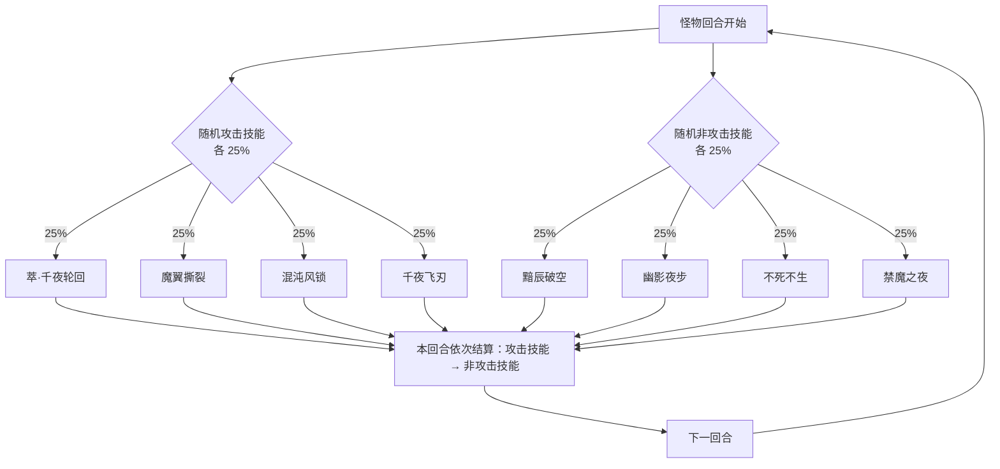

# 混沌·千夜死神

> **类型**：BOSS 怪物
> **初始生命**：1024
> **遭遇战**：第五幕（终焉之门）Boss 战 · 单怪
> **特性**：[极夜之羽](/powers/hundred_night_feather_power.md) 灾厄累积 + 致命伤害减半最大生命 + 死亡清场 + 每回合双动 16 种组合

## 被动能力（开局自带）

| 名称 | 类型 | 效果 |
|------|------|------|
| **[极夜之羽](/powers/hundred_night_feather_power.md)** | 能力（不可消除） | ①双方造成攻击伤害时，受击者获得等同于**未被格挡伤害**的[灾厄](/powers/doom_power.md)。②玩家侧生物受到致命伤害时，若最大生命高于 1，免疫该次死亡并把最大生命折半；千夜死神**始终**免疫致命伤害并折半。③场上有生物死亡时，先移除场上全部灾厄，将清空的层数转化为千夜死神的最大生命值并回复等量生命；然后对全场所有存活单位造成等同于该层数的生命流失。④千夜死神的最大生命值降至 1 点时，战斗立即胜利。 |

::: tip 灾厄是双方共用的死亡倒计时
- 攻击伤害会让**受击者**堆积灾厄；千夜死神被你打，也会积灾厄。
- 它的最大生命被压到 1 就立即胜利——所以这场的真正目标是「把它的最大生命削到 1」，而不是打空一管血。
- 但任何生物死亡都会触发「清空全场灾厄 → 变成它的最大生命与回血 → 对全场造成等量生命流失」。死亡事件会同时奶它、又炸全场。
:::

## 行动逻辑

每回合先从 4 个攻击技能里随机抽 1 个，再从 4 个非攻击技能里随机抽 1 个，两招同回合依次结算，共 16 种等概率组合（每种 6.25%）；抽完回到随机池，可连续重复同一组合。

> **说明**：攻击系和非攻击系各抽 1 个，两招同回合依次结算；随机取自同一套池子，下一次仍可能抽到同样的组合。

## 招式表

| 招式名 | 意图 | 类型 | 效果 |
|--------|------|------|------|
| **萃·千夜轮回** | 攻击 60 | 攻击 + 禁疗 + 暴击 | 造成 60 点伤害；3 回合内敌人无法回复生命；自身接下来 2 次攻击必定暴击。 |
| **魔翼撕裂** | 攻击 50 | 攻击 + 流血 + 灾厄翻倍 | 造成 50 点伤害，使敌人获得 11 层[流血](/powers/bleed_power.md)；将自身所有异常状态转化为等量灾厄，然后使场上所有灾厄层数翻倍。 |
| **混沌风锁** | 攻击 8×N | 多段攻击 + 吸强反弱 | 偷取每个敌人力量/防御/命中/速度的**正面层数**（敌人扣多少、自身加多少）；自身四维**负层翻正**；造成 8 点伤害 N 次（基础 4 次，本场战斗若有生物死亡过则 +1 次）；使每个敌人命中 −8。 |
| **千夜飞刃** | 攻击 48 | 攻击 + 永久闪避 | 造成 48 点伤害；所有玩家的**战斗牌堆**（抽牌堆+手牌+弃牌堆+消耗牌堆）合计每有 1 张牌，自身永久获得 1% [闪避](/powers/dodge_power.md)。 |
| **黯辰破空** | 黯辰破空 | 自身增益 | 场上每存在 1 层灾厄，自身全属性各 +1；自身获得 4 回合[吃月亮](/powers/eat_moon_power.md)。 |
| **幽影夜步** | 幽影夜步 | 先制 + 即死 | 自身获得 4 回合[先制](/powers/first_strike_power.md)（每回合 +2）；直接消灭场上所有灾厄层数大于其当前生命值的生物。 |
| **不死不生** | 不死不生 | 自爆 + 全体固伤 | 自身死亡，然后对所有敌人造成等同于死亡前最大生命值 10% 的[固定伤害](/powers/fixed_damage_power.md)。 |
| **禁魔之夜** | 禁魔之夜 | 堕落转灾厄 | 将敌人的全部[堕落](/powers/fallen_power.md)层数转化为等量灾厄，随后将其堕落设为 99 层。 |

## 遭遇战

| 遭遇战 | 房间类型 | 池子 | 数量 | 说明 |
|--------|----------|------|------|------|
| 混沌·千夜死神 | Boss | 第五幕及以后 Boss 池 | 1 只 | 单怪 Boss 战；双 Boss / 三 Boss 规则下与其他第五幕 Boss 同场 |

## 策略提示

1. **目标是削最大生命，不是打空血**：它对致命伤害会免疫并**把最大生命减半**；最大生命降到 1 时立即胜利。所以每次「击杀」都只是把上限砍半，需要连续打穿多次。看到空血不要慌，继续压下一管。

2. **灾厄必须盯紧，尤其是你的**：你受到攻击会积灾厄，幽影夜步会直接秒杀「灾厄 **>** 当前生命」的生物（严格大于，持平不会死）。进它的非攻击回合前，确保自己血量高于灾厄层数，或提前清灾厄。

3. **魔翼撕裂会让灾厄翻倍**：它先把自己的异常转成灾厄，再把全场灾厄 ×2。如果场上已经堆了不少灾厄，这一招会瞬间把所有人推到即死线。看到魔翼撕裂，优先保命而不是输出。

4. **死亡事件会奶它并炸全场**：任何生物死亡都会清空全场灾厄，变成它的最大生命和回血，再对全场造成等量生命流失。不要在小怪/召唤物上制造死亡，也别让自己的血量进入「死了触发它回血」的区间。

5. **黯辰破空按灾厄层数加属性**：场上灾厄越多，它全属性涨得越夸张。灾厄既是你的死亡倒计时，也是它的成长资源，双重压力。

6. **千夜飞刃会叠永久闪避**：所有玩家的战斗牌堆（抽牌堆+手牌+弃牌堆+消耗牌堆）合计每张牌给它 1% 永久闪避，牌堆越厚它越难打中。厚牌组/无限流在这关会明显吃亏，需要必定命中手段。

7. **禁魔之夜专杀堕落流**：把你的堕落全部转成灾厄，再把堕落重置到 99。堕落体系在这关等于自爆，进战前评估是否要换掉堕落组件。

8. **不死不生是同归于尽技**：它自杀并对全体造成等于死亡前最大生命 10% 的固定伤害。由于被动会免疫死亡并减半最大生命，这招实际是「用一次最大生命减半换全队固定伤害」。固定伤害免疫/减免在这回合依然要准备好。

## 源码

- 怪物：`SeerHundunQianYeSiShenMonster.cs`
- 被动能力：`SeerHundredNightFeatherPower.cs`
- 招式能力：`SeerFallenPower.cs`、`SeerDodgePower.cs`、`SeerAccuracyPower.cs`（灾厄使用原版灾厄能力）
- 遭遇战：`SeerHundunQianYeSiShenBoss.cs`
- 本地化：`monsters.json`、`intents.json`、`powers.json`
