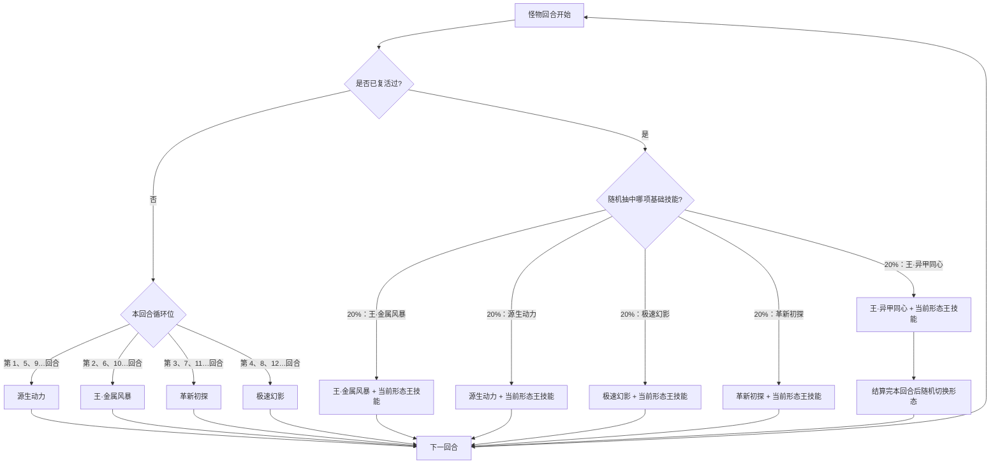
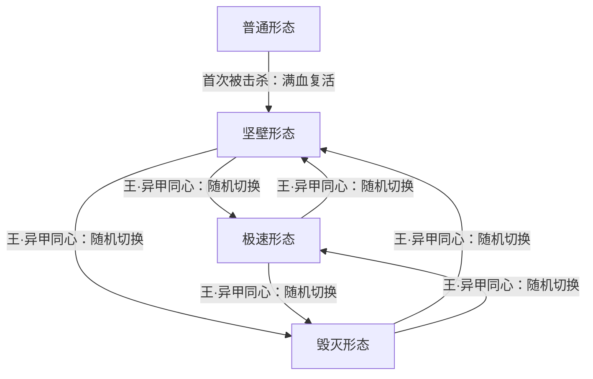

# 马尔修斯

> **类型**：BOSS 怪物
> **初始生命**：2700（首次被击杀满血复活，综合约 5400）
> **遭遇战**：第四幕（星海尽头）Boss 战 · 单怪
> **特性**：两阶段（首次被击杀满血复活并切至坚壁形态）+ 三形态轮换（坚壁/极速/毁灭各有登场效果与常驻被动）

## 被动能力（开局自带）

| 名称 | 类型 | 效果 |
|------|------|------|
| **万动异甲**（形态机制） | 开局被动（不可消除） | 首次被击杀时满血复活并切换至坚壁形态（获得 50%[永久减伤](/powers/permanent_damage_reduction_power.md)）；坚壁形态下敌人回合开始时获得 100 点格挡，自身回合结束时若无格挡则恢复已损失生命的 40%；极速形态登场全属性 +8；毁灭形态登场获得 80%[永久增伤](/powers/permanent_damage_boost_power.md) |

::: tip 三形态的登场效果与常驻被动
- **坚壁形态**：登场 +50% 永久减伤；**敌人回合开始**时获得 100 格挡；自身回合结束时若自身**没有格挡**，则恢复已损失生命的 40%。
- **极速形态**：登场全属性 +8；**攻击造成伤害后**自身[先制](/powers/first_strike_power.md) +2，并**降低敌人全属性各 2 点**。
- **毁灭形态**：登场 +80%[永久增伤](/powers/permanent_damage_boost_power.md)；攻击技能伤害再 +50%；拥有**斩杀**——生命值低于 30% 的敌人会被直接击杀。
- 「王·异甲同心」会**随机切换**到一个与当前不同的形态（可能切回坚壁），配合登场效果反复刷新形态 buff。
:::

## 行动逻辑

复活前按固定顺序循环「源生动力 → 王·金属风暴 → 革新初探 → 极速幻影」（每 4 回合一轮）；首次被击杀后满血复活并进入坚壁形态，此后每回合**在意图上并排写明两个技能**：随机抽中的 1 项基础技能 + 当前形态对应的王技能，按这两招依次结算。

> **说明**：复活前为可预判的 4 步循环；复活后每回合同一行动内依次结算「随机 1 个基础技能 + 当前形态的王技能」，意图上会把这两招的名字都写出来。若这回合抽到**王·异甲同心**，它的随机切形态会**放到追加之后**才发生 —— 所以这回合追加的王技能仍属于当前形态（写什么打什么）。

**形态与复活切换**：

> 切换只会切到与当前不同的形态（可能切回坚壁），每次切换都会重新触发该形态的登场效果；形态切换不会重置金属风暴已累计的增伤。

## 招式表

| 招式名 | 意图 | 类型 | 效果 |
|--------|------|------|------|
| **王·异甲同心** | 王·异甲同心 | 自身/全场操作（仅复活后使用） | 自身全属性 +8；清除敌人所有**可见**增益、己方所有**可见**减益；**本场自身增益无法被清除**、**敌人无法回复生命**；敌人最大能量 −1；随后随机切换形态 |
| **王·金属风暴** | 攻击 50 | 攻击 + 封牌 | 对所有敌人造成 50 点伤害（**本场每释放一次 +50%** → 75 / 100 / 125…，无上限；意图图标显示的就是实时伤害）；敌人下回合无法打出状态牌 |
| **源生动力** | 源生动力 | 吸取 + 销毁 0 费牌 + 自身格挡 | 吸取每个敌人 20 点生命；**销毁敌人手牌/抽牌堆/弃牌堆/消耗牌堆中所有 0 费牌**（移入销毁牌堆，不是消耗牌堆），并按张数向敌人抽牌堆放入等量的锁匣与断程；自身获得 200 点格挡 |
| **极速幻影** | 极速幻影 | 反弱反强 + 升级 + 固伤 | 自身四维负层翻正、敌人四维正层翻负（反弱/反强）；升级场上所有可升级状态牌；消耗自身全部格挡，按其 10% 对每个敌人造成[固定伤害](/powers/fixed_damage_power.md) |
| **革新初探** | 攻击 30 | 攻击 + 异常 + 暴击 | 对所有敌人造成 30 点伤害，[先制](/powers/first_strike_power.md) +1；敌人随机获得 3 种异常各 3 层；接下来 2 回合自身攻击必定暴击 |
| **王·擎天之光** | 攻击 20×2（极速） | 多段攻击 + 固伤 | 对所有敌人造成 20 点伤害 2 次（不受微弱）；自身每有 1 级[速度](/powers/speed_power.md)，额外对每个敌人附加 **该敌人**最大生命 1/8（向下取整）× 速度层数 的[固定伤害](/powers/fixed_damage_power.md) |
| **王·钢铁契约** | 攻击 45（坚壁） | 攻击 + 后续减伤 | 对所有敌人造成 45 点伤害（不受微弱、**无视格挡**）；下回合自身每次受到伤害时，伤害减少本次技能造成的实际伤害 |
| **王·破坏死光** | 攻击 55（毁灭） | 攻击 + 生命差增伤 | 对所有敌人造成 55 点伤害（不受微弱）；本次攻击按「自身与敌人当前生命差的绝对值 ÷ 10」的百分比额外增伤（相差 1000 血 → +100%；全场取差值最大者）；意图图标显示的就是实时伤害 |

> **复活后的一回合**：意图上会并排显示**两个真实技能** —— 随机抽中的基础技能（王·异甲同心 / 王·金属风暴 / 源生动力 / 极速幻影 / 革新初探 之一）＋ 当前形态对应的王技能（坚壁 → 王·钢铁契约；极速 → 王·擎天之光；毁灭 → 王·破坏死光），按这两招依次结算。

::: tip 锁匣 / 断程 状态牌
- **锁匣**：0 费状态牌，只要在手牌，你**无法打出攻击牌**；每打出一张能力牌升级 1 次（耗能 +1，可无限升级）。
- **断程**：0 费状态牌，只要在手牌，你**无法打出技能牌**；升级规则同上。
- 源生动力会**销毁你所有 0 费牌**（真·销毁：进**销毁牌堆**，与消耗堆是两回事），并按张数向抽牌堆塞入等量的锁匣 + 断程。手牌 / 抽牌堆 / 弃牌堆 / **消耗牌堆**里的 0 费牌都算，**打出去或提前消耗都躲不掉**（只有移入销毁牌堆才离开计数）。
- **一律销毁，PP 牌也不例外**：0 费的 PP 牌同样直接进销毁牌堆（不清 PP）。锁匣 / 断程本身也是 0 费牌，所以**下一次源生动力会把它们一起销毁**。
- 它们会持续卡住你的手牌位，**0 费牌越多的卡组受害越重**。
:::

## 遭遇战

| 遭遇战 | 房间类型 | 池子 | 数量 | 说明 |
|--------|----------|------|------|------|
| 马尔修斯 | Boss | 第四幕 Boss 池 | 1 只 | 单怪 Boss 战；双 Boss / 三 Boss 规则下与其他第四幕 Boss 同场 |

## 策略提示

1. **实质是两管血**：普通形态 2700 血；首次被击杀后**满血复活**并进入坚壁形态——总承伤量约两倍。规划输出时要按「再打一管」准备，别把斩杀爆发全用在第一阶段。

2. **复活前是可预判的固定循环**：顺序为 源生动力 → 王·金属风暴 → 革新初探 → 极速幻影，4 步一轮。可以精准卡招：例如在极速幻影前不堆格挡；源生动力会把**手牌 / 抽牌堆 / 弃牌堆 / 消耗牌堆**里的 0 费牌一起处理掉，提前消耗也躲不掉，只有移入销毁牌堆的牌才不会被选中。

3. **源生动力会塞满锁匣/断程**：它吸你 20 血、**销毁你所有 0 费牌**（手牌/抽牌堆/弃牌堆/消耗牌堆一律进销毁牌堆，PP 牌也不例外），并按张数向抽牌堆塞入等量锁匣与断程（锁匣卡攻击牌、断程卡技能牌，还会随你打能力牌升级加费）。**别带太多 0 费牌**，被塞牌后尽快清掉状态牌，否则手牌被卡死。

4. **王·金属风暴伤害永久递增**：基础 50、**本场每释放一次 +50%**（50→75→100→…，无上限）。循环里它每 4 回合出现一次且复活后可能更频繁，越拖越痛。优先在早期结束循环，或专门留减伤应对它的大数值版本。

5. **坚壁形态最难磨**：50% 永久减伤 + 每敌人回合开始白嫖 100 格挡 + 无格挡时回合末回 40% 已损失生命。要持续压制、不让它空场（否则大回血），并用[固定伤害](/powers/fixed_damage_power.md) 绕过格挡。注意 王·钢铁契约 无视你的格挡打 45 并给它下回合固定减伤。

6. **极速形态的固伤最危险**：极速形态登场 +8 全属性（含 8 级[速度](/powers/speed_power.md)），配 王·擎天之光 会按「每级速度 × 敌人最大生命 1/8」附加[固定伤害](/powers/fixed_damage_power.md)——8 级速度即约 8×(最大生命/8)=最大生命 的固伤，非常致命。用[免固](/powers/turn_immune_fixed_damage_power.md)（免疫固定伤害）或压低它速度来应对，并注意它在极速下每次攻击还涨[先制](/powers/first_strike_power.md)。

7. **毁灭形态有斩杀**：+80% 永久增伤、攻击再 +50%，且**生命值低于 30% 时被直接击杀**。看到它切毁灭，务必把血量维持在 30% 以上，别残血站场；同时 王·破坏死光 会按「双方当前生命差的绝对值 ÷ 10」的百分比增伤，双方血量差越大越痛。

8. **王·异甲同心是重置技**：它自己全属性 +8、清你所有可见增益、清它所有可见减益、你最大能量 −1、你无法回血、它本场增益不可被清除，并随机换形态。这招会反复出现——依赖增益/回血滚雪球的卡组会被持续打断，需备好不依赖 buff 的过渡输出。

9. **复活后无法预判**：此后每回合「随机基础技能 + 形态王技能」两招连发，且形态随机切换、登场效果反复刷新。按最坏组合（如毁灭形态 + 高伤王技能）预留防御与斩杀手段，优先保持血量安全线。

## 源码

- 怪物：`SeerMaerxiusiMonster.cs`
- 被动能力：`SeerMaerxiusiPower.cs`（形态机制）
- 关联能力：`SeerPermanentDamageReductionPower.cs`（坚壁减伤）、`SeerPermanentDamageBoostPower.cs`（毁灭增伤）、`SeerFlatDamageReductionPower.cs`（王·钢铁契约）、`SeerStatusCardSealPower.cs`（王·金属风暴封状态牌）、`SeerBuffUnremovablePower.cs`（增益不可清除）、`SeerNoHealPower.cs`（敌人无法回血）、`SeerMaxEnergyDownPower.cs`（最大能量 −1）、`SeerTurnGuaranteedCritPower.cs`（回合必定暴击）、`SeerNoWeaknessPower.cs`（不受微弱）、`SeerFixedDamagePower.cs`（固定伤害）、`SeerFirstStrikePower.cs`（先制）
- 状态牌：`SeerLockBox.cs`（锁匣）、`SeerSeverPath.cs`（断程）
- 意图：`SeerNamedSingleAttackIntent.cs`、`SeerNamedMultiAttackIntent.cs`、`SeerPuniNamedBuffIntent.cs`、`SeerDynamicIntentList.cs`（把「随机基础技能 + 该形态王技能」翻译成本回合真实的两条技能意图）
- 遭遇战：`SeerMaerxiusiBoss.cs`
- 本地化：`monsters.json`（`SEER_MONSTER_SEER_MAERXIUSI_MONSTER.*`）、`intents.json`（`SEER_MAERXIUSI_*`）、`powers.json`（`SEER_POWER_SEER_MAERXIUSI_POWER.*`）
