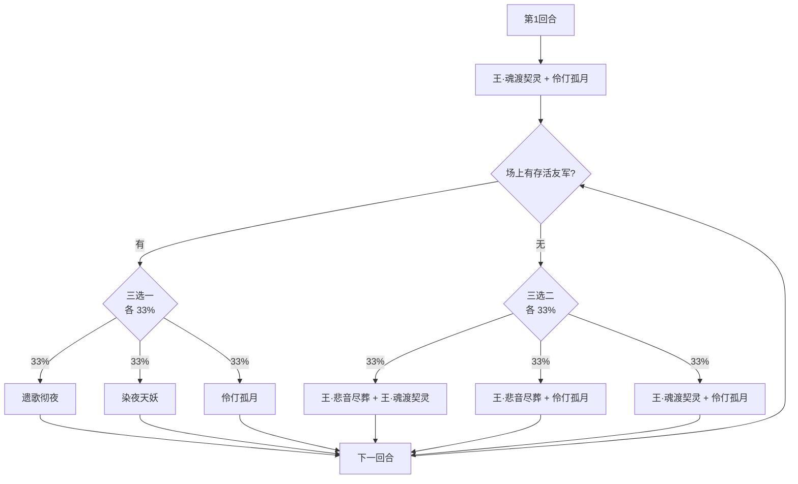

# 冥契·格斯塔丝

> **类型**：BOSS 怪物
> **初始生命**：2500
> **遭遇战**：第四幕（星海尽头）Boss 战 · 单怪（会召唤精灵王友军）
> **特性**：[幽夜冥契](/powers/nether_pact_power.md) 友军吸血涨上限 + 牌型连续判定 + 召唤第四幕精灵王 + 伤害翻倍 + 友军死亡溢出转移

## 被动能力（开局自带）

| 名称 | 类型 | 效果 |
|------|------|------|
| **[幽夜冥契](/powers/nether_pact_power.md)** | 能力（不可消除） | ①自身或友军造成攻击伤害时，全体友军回复等同于实际伤害的生命值，最大生命值提高等量。②敌人连续打出 2 张**不同类型**的卡牌时，全体友军永久获得 10% 增伤。③敌人连续打出 2 张**相同类型**的卡牌时，全体友军永久获得 5% 减伤。 |
| **遗歌彻夜**（自身） | 能力（不可消除） | ①本场每有 1 个生物死亡，层数 +1（供染夜天妖计数）。②友军死亡时，其承受的致死溢出伤害按当前比例（初始 100%）转移给敌人，每次转移后比例 +100%。 |

::: tip 牌型连续判定
它按玩家记录最近一张牌的类型，**玩家回合结束时清空**，所以只判定同一回合内的连续出牌：
- 攻→技、技→能这类**类型变化**：全体友军永久 +10% 增伤。
- 攻→攻、技→技这类**同类型连打**：全体友军永久 +5% 减伤。
两种都会让它越打越强，只是方向不同；没有「安全牌序」。
:::

## 行动逻辑

首回合固定「王·魂渡契灵 + 伶仃孤月」（伶仃孤月会在无友军时召唤 1 位精灵王友军）。之后每回合开始前先看场上是否还有存活友军：有友军则从 3 个单招里随机 1 个；无友军则从 3 个双招组合里随机 1 个。

> **说明**：分支在**每个怪物回合开始前**抽定（三选一/三选二各 33%）。伶仃孤月命中后会补上友军，因此召唤成功后的下一回合通常会进入「三选一」分支；友军阵亡则回到「三选二」。

## 招式表

| 招式名 | 意图 | 类型 | 效果 |
|--------|------|------|------|
| **王·悲音尽葬** | 攻击 50（每次翻倍） | 攻击 + 永久翻倍 | 对所有敌人造成 50 点伤害（不受微弱影响）。本场战斗中，每次使用此招后伤害翻倍；敌方召唤的生命值总量每有 1 点，伤害提高 1%。 |
| **王·魂渡契灵** | 攻击 40（无视格挡） | 攻击 + 复活消耗 | 对所有敌人造成 40 点伤害（无视格挡），自身先制 +1；若敌方拥有复活类效果，强制触发其中 1 项并消耗其 1 次可用次数。 |
| **遗歌彻夜** | 遗歌彻夜 | 全体增益 | 自身与全体友军全属性各 +8，获得 100 点格挡，接下来 2 次攻击必定暴击。 |
| **染夜天妖** | 染夜天妖 | 按死亡数惩罚 | 按本场战斗阵亡生物数量：使全体敌人获得等量层数[魂缚锁链](/powers/soul_lock_power.md)与等量种随机异常状态各等量层，并使其全属性降低等量层数。自身与全体友军获得 4 回合[吃月亮](/powers/eat_moon_power.md)与 4 回合[弹控](/powers/debuff_immune_reflect_power.md)。 |
| **伶仃孤月** | 攻击 25 | 攻击 + 召唤 / 复制 | 对敌人反强（正层翻负）、对友军反弱（负层翻正）；对所有敌人造成 25 点伤害。若场上没有友军，召唤 1 位第四幕精灵王友军（25% 生命）；若场上已有友军，将友军的所有可复制增益复制给自己。 |

## 遭遇战

| 遭遇战 | 房间类型 | 池子 | 数量 | 说明 |
|--------|----------|------|------|------|
| 冥契·格斯塔丝 | Boss | 第四幕 Boss 池 | 1 只 | 单怪 Boss 战；双 Boss / 三 Boss 规则下与其他第四幕 Boss 同场 |

## 策略提示

1. **友军是它的血包**：幽夜冥契让全体友军在造成攻击伤害时回血并提高最大生命。只要友军还在打，它的血线就会越打越高。想赢必须先处理「友军持续输出」这个循环，而不是只盯本体。另外，友军死亡时「遗歌彻夜」会把其**致死溢出伤害**按当前比例转移给你，初始 100%、每次转移后比例再 +100 个百分点——杀友军也可能当场挨一大口反伤。

2. **召唤的是第四幕精灵王，四分之一血但全套技能**：伶仃孤月召唤的友军是第四幕 Boss 之一，25% 生命但不带爪牙。四分之一血也是 Boss 级威胁，出场后要立刻评估是速杀还是控制。

3. **王·悲音尽葬每次翻倍**：50 → 100 → 200…，无上限。循环里它出现得越晚，伤害越离谱。必须在它翻倍起来之前结束战斗，或每回合留足格挡。

4. **王·魂渡契灵会吃掉你的复活**：40 点无视格挡伤害，还会强制触发你的复活类效果并消耗一次可用次数。靠复活拖延的构筑会被它直接拆掉，别把保命全押在复活上。

5. **染夜天妖按死亡数惩罚全队**：本场每死 1 个生物，全体敌人获得等量魂缚锁链、异常和全属性降低。杀友军会让后续染夜天妖更痛。是否杀友军要算清「现在省下的输出」和「之后吃到的惩罚」。

6. **遗歌彻夜是防守窗口**：全体 +8 全属性、100 格挡、2 次必暴。这回合它和友军几乎不掉血，爆发交在这里会被格挡和必暴反打吃掉，优先清异常、补格挡。

7. **牌序没有安全答案**：同类型连打给它减伤，换类型给它增伤。你能做的是控制节奏——在需要爆发时接受它增伤，在防守时接受它减伤，而不是试图「不触发」。

8. **AOE 与单点要分开规划**：本体 2500 + 四分之一血 Boss 友军，双目标同时存在。纯单点会漏友军，纯 AOE 又会被它的高额回复拖住；最好有「先秒友军再转火本体」或「固定伤害压本体」的明确路线。

## 源码

- 怪物：`SeerMingqiGesitasiMonster.cs`
- 被动能力：`SeerNetherPactPower.cs`、`SeerElegyOvernightPower.cs`
- 招式能力：`SeerSoulLockPower.cs`、`SeerEatMoonPower.cs`、`SeerDebuffImmuneReflectPower.cs`
- 遭遇战：`SeerMingqiGesitasiBoss.cs`
- 本地化：`monsters.json`、`intents.json`、`powers.json`
