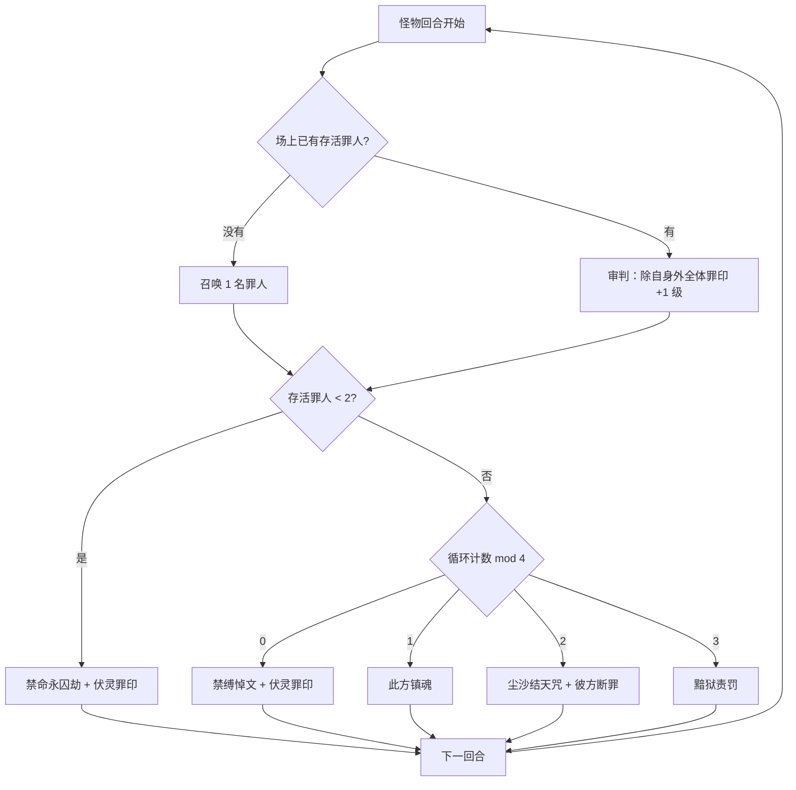

# 莫塔里安

> **类型**：BOSS 怪物
> **初始生命**：6000
> **遭遇战**：第五幕（终焉之门）Boss 战 · 单怪（会持续召唤罪人）
> **特性**：[万劫重枷](/powers/motalian_judgement_power.md) 罪印等级审判 + 召唤单体精英罪人 + 永久封牌封遗物 + 献祭罪人核爆

## 被动能力（开局自带）

| 名称 | 类型 | 效果 |
|------|------|------|
| **[万劫重枷](/powers/motalian_judgement_power.md)** | 能力（不可消除） | ①自身回合开始时，若场上没有罪人，召唤 1 名罪人；若场上已有罪人，对除自身外的全体生物执行一次审判，提升其罪印等级并按罪印结算。②玩家一整轮内未打出任何卡牌时，罪印等级在敌人回合结束时降低 1 级。 |

::: tip 罪印等级
罪印是挂在生物身上的等级，从 1 级「待审」开始逐级提升：

| 等级 | 罪行 | 效果 |
| --- | --- | --- |
| 1 | 待审 | 无额外效果 |
| 2 | [轻罪](/powers/sin_light_power.md) | 攻击伤害 +10%；自身回合结束时受到 20 点[固定伤害](/powers/fixed_damage_power.md) |
| 3 | [重罪](/powers/sin_heavy_power.md) | 攻击伤害 +50%；自身回合开始时，最大生命降低至当前生命 |
| 4 | [死罪](/powers/sin_death_power.md) | 攻击伤害 +100%；自身回合结束时受到等同于最大生命的伤害（可被格挡） |
| 5 | [不赦之罪](/powers/sin_unpardonable_power.md) | 攻击伤害 +300%；自身回合结束时死亡，且无法复活 |

罪印升级来自莫塔里安的**审判**：每个怪物回合开始时，只要场上有罪人，就会对除自身外的全体生物执行一次审判（罪印 +1 级），与你打不打牌无关。玩家一整轮**一张牌都不打**时，罪印才会在敌人回合结束时降 1 级。罪印既是压力，也是让莫塔里安自己被「不赦之罪」反噬的开关。
:::

## 行动逻辑

每个怪物回合开始时先结算被动：场上没有罪人则召唤 1 名；已有罪人则对除自身外的全体生物审判一次（罪印 +1 级）。随后按「场上存活罪人是否达到 2」决定出招：不足 2 强制「禁命永囚劫 + 伏灵罪印」；达到 2 后进入 4 回合循环。

> **说明**：强制招会再召唤 1 名罪人并审判一次，所以通常两回合内就能凑到 2 名罪人。循环计数只在「审判后仍有 2 名以上存活罪人」的回合才 +1，因此被打死的罪人会拖慢循环，而不是跳过循环。

## 招式表

| 招式名 | 意图 | 类型 | 效果 |
|--------|------|------|------|
| **禁命永囚劫** | 攻击 64 | 攻击 + 召唤 + 审判 | 对所有敌人造成 64 点伤害，召唤 1 名罪人，并对除自身外的全体生物执行一次审判。 |
| **尘沙结天咒** | 攻击 50 | 攻击 + 清属性 + 固伤 | 对所有敌人造成 50 点伤害；移除场上所有生物的全部属性层数（包括负层），并对除自身外的所有生物造成等同于移除层数 5 倍的[固定伤害](/powers/fixed_damage_power.md)（在各自回合开始时结算，不可格挡）。 |
| **禁缚悼文** | 禁缚悼文 | 自身增益 + 永久封印 | 自身全属性各 +6，场上每有 1 级罪印额外各 +6；每名敌人随机封印 5 种非状态卡牌（同名牌全部封印）与 3 件遗物，持续至战斗结束。 |
| **伏灵罪印** | 伏灵罪印 | 自身增益 | 获得 4 回合[弹控](/powers/debuff_immune_reflect_power.md)、[免弱](/powers/attr_down_immune_turn_power.md)与[吃月亮](/powers/eat_moon_power.md)，获得 200 点格挡；场上每存在 1 个生物，自身永久获得 8% 免伤与 15% 增伤。 |
| **黯狱责罚** | 攻击 6×N | 多段攻击 + 缓冲 | 对所有敌人造成 6 点伤害 N 次（基础 8 次，本场每有 1 个生物阵亡额外 +1 次）；获得等同于本场阵亡生物数的[缓冲](/powers/buffer_power.md)。 |
| **此方镇魂** | 此方镇魂 | 友军回复 + 复制增益 | 使全体罪人回复全部生命值，并将自身所有可见增益状态复制给全体罪人。 |
| **彼方断罪** | 彼方断罪 | 献祭 + 核爆 | 献祭全体罪人，对其造成致死伤害，并对敌人造成等同于献祭生命总和的伤害，再附加等量[固定伤害](/powers/fixed_damage_power.md)（在各自回合开始时结算）。 |

## 遭遇战

| 遭遇战 | 房间类型 | 池子 | 数量 | 说明 |
|--------|----------|------|------|------|
| 莫塔里安 | Boss | 第五幕及以后 Boss 池 | 1 只 | 单怪 Boss 战；双 Boss / 三 Boss 规则下与其他第五幕 Boss 同场 |

## 策略提示

1. **罪印是会反噬的双刃剑**：每个怪物回合开始的审判会把全场罪印往上推，等级越高它和罪人越强；但推到 5 级「不赦之罪」，持有者回合结束会直接死亡且无法复活——包括莫塔里安自己。空过一整轮可以让罪印降 1 级，什么时候「喂等级」、什么时候「压等级」是这场的核心决策。

2. **玩家空过是控罪印的手段**：一整轮不打任何牌，敌人回合结束时罪印降 1 级。面对即将进入「不赦之罪」的莫塔里安，空过可能比硬打更安全；但空过也意味着这一轮零输出，要算好节奏。

3. **罪人是单体精英，还会被复制增益**：召唤的罪人来自前三层单体精英，并按「当前幕 × 出身幕」缩放生命；第五幕中第 1/2/3 层出身的罪人分别为 ×15 / ×9 / ×3 生命（第四幕为 ×10 / ×6 / ×2）。此方镇魂会回满罪人并把莫塔里安全部增益复制给它们，伏灵罪印还会按场上生物数给它永久免伤/增伤。罪人越多，它越硬。

4. **禁缚悼文是永久封牌封遗物**：每名敌人随机封 5 种卡牌（所有同名卡）和 3 件遗物，持续到战斗结束。这招会直接砍掉多个构筑核心，必须有第二套输出/防御方案，别把整局押在单张 key 牌或单件 key 遗物上。

5. **尘沙结天咒清空所有属性**：连负属性一起清，然后按清除总量 ×5 打固定伤害。你叠的力量/防御/速度/命中越高，这一招越痛。爆发前先看它是否在循环位；如果下一招是尘沙，别把属性堆到峰值。

6. **彼方断罪是献祭核爆**：献祭所有罪人，按它们的生命总和先打直接伤害再打等量固定伤害。罪人血量在第五幕被放大，这一招的总伤非常夸张。看到循环进入「尘沙 + 彼方」回合，必须留大格挡与固定伤害免疫。

7. **黯狱责罚按死亡数涨段数**：本场每死 1 个生物，多 1 段 6 伤，还给莫塔里安等量缓冲。罪人死亡也会计数，越拖越痛，别指望靠换命拖时间。

8. **6000 血 + 永久免伤 + 罪人回血**：纯爆发很容易被免伤和回血磨掉。固定伤害、百分比伤害、以及把它推到「不赦之罪」自爆，是三条更现实的击杀路线。

## 源码

- 怪物：`SeerMotalianMonster.cs`
- 被动能力：`SeerMotalianJudgementPower.cs`、`SeerSinPower.cs`
- 罪印等级：`SeerSinTierPowers.cs`
- 招式能力：`BufferPower.cs`、`SeerEatMoonPower.cs`、`SeerDebuffImmuneReflectPower.cs`、`SeerAttrDownImmuneTurnPower.cs`
- 遭遇战：`SeerMotalianBoss.cs`
- 本地化：`monsters.json`、`intents.json`、`powers.json`
