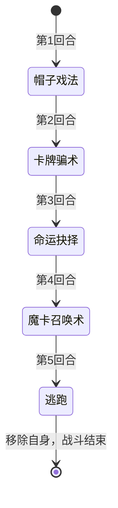

# 王牌术师

> **类型**：精英怪物
> **初始生命**：1145
> **遭遇战**：第三层精英战斗
> **特性**：袖里乾坤（受伤减少的百分比 = 你牌组张数）+ 5 回合固定剧本（帽子戏法→卡牌骗术→命运抉择→魔卡召唤术→逃跑）+ 抉择与牌组污染

## 被动能力（开局自带）

| 名称 | 类型 | 效果 |
|------|------|------|
| **袖里乾坤**（不可消除） | 能力 | 自身受到的伤害减少的百分比**等于敌人牌组中的卡牌总数**（例：你牌组 40 张 → 减伤 40%） |

::: warning 袖里乾坤让"大牌组"变成护甲
- 减伤百分比 = 你**初始牌组**（不是战斗中的抽牌堆/弃牌堆）的总张数，只对**受威力加成的攻击**生效
- 30 张牌 → 打它只吃 70% 伤害；60 张牌 → 只吃 40%。**牌组越大它越硬**
- 100 张及以上牌时减伤视为 100%（打不动）
- **反制手段**：精简牌组（这是最直接的）；或用不受"受加成攻击"减免影响的手段
:::

## 行动逻辑

固定剧本，无随机：帽子戏法 → 卡牌骗术 → 命运抉择 → 魔卡召唤术 → 逃跑（战斗结束）。

> **说明**：完全固定剧本，可精确预判。第 5 回合它会**逃跑**（移除自身、结束战斗）——若你未能在前 4 回合内击杀它，它将不再被消灭。

## 招式表

| 招式名 | 意图 | 类型 | 效果 |
|--------|------|------|------|
| **帽子戏法** | 帽子戏法 | 牌组污染 | 向你**每个牌堆**（抽牌堆/手牌/弃牌堆/消耗堆）各加入 5 张**隐匿炸弹** |
| **卡牌骗术** | 卡牌骗术 | 自身增益 + 遮蔽 | 自身全属性 +9；**遮蔽**你的所有手牌内容（仍显示费用） |
| **命运抉择** | 攻击 55 | 单次攻击 + 抉择 | 造成 55 点伤害；触发抉择，你必须二选一：**立即死亡**，或**随机永久移除 1 件非初始遗物** |
| **魔卡召唤术** | 攻击 7×7 | 多段攻击 + 抉择 | 连续攻击 7 次、每次 7 点；触发抉择：从 3 张不同诅咒中选 1 张**永久加入你的牌组** |
| **逃跑** | 逃跑 | 脱离战斗 | 移除自身并结束战斗 |

::: tip 特殊卡牌：隐匿炸弹（诅咒）
- **费用**：1，带[薇](/mechanics/vigil.md)关键词
- **效果**：失去 3 点最大生命值、10 点生命值
- **薇**：与它相邻的非「薇」牌被打出时，它会**自动打出**——所以它们不是安静躺在手里的废牌，而是会主动引爆
- 帽子戏法一次性塞给你 4 个牌堆各 5 张 = **20 张**隐匿炸弹，它们会随抽牌循环反复出现，**每打一张都要付出血量代价**
:::

::: warning 命运抉择的"死亡"选项
抉择弹出的两张卡：**死亡**（立即死亡）与**移除**（随机永久移除 1 件非初始遗物）。除非你没有可移除的非初始遗物，否则**永远选"移除"**——用一件遗物换命。若你没有任何非初始遗物，移除选项不会生效，此招只剩 55 点伤害。
:::

## 遭遇战

| 遭遇战 | 房间类型 | 池子 | 数量 | 说明 |
|--------|----------|------|------|------|
| `SeerAceMagicianEliteEncounter` | Elite | 第三层精英池 | 1 只 | 第三层单怪精英遭遇战 |

## 策略提示

1. **这是一场 5 回合剧本，第 5 回合它就跑**：招式顺序固定（帽子戏法→卡牌骗术→命运抉择→魔卡召唤术→逃跑）。**你只有 4 个回合把它打死**，否则它逃离战斗、无法再被消灭。目标是"4 回合内的爆发"，不是消耗。

2. **牌组越小越容易打**：袖里乾坤按你牌组张数减伤。30 张牌它减伤 30%，60 张减伤 60%。**精简单牌组（或临时通过机制减少牌组张数）能显著降低难度**；反之牌组臃肿时它几乎打不动。

3. **第 1 回合就被塞 20 张隐匿炸弹**：四个牌堆各 5 张，之后会不断抽到。它们带「薇」，**在你打出相邻牌时会自动引爆**（每张掉 3 最大生命 + 10 生命），所以不能靠"不打它"来规避。能弃则弃、能消耗则消耗，并尽量把它们隔在手牌两端，减少被相邻牌带爆的机会。

4. **第 3 回合命运抉择：选"移除"保命**：55 点伤害之外，你还得在"立即死亡"与"随机永久移除 1 件非初始遗物"之间二选一。除非你完全没有非初始遗物，否则**认赔一件遗物**是唯一理性选择——**先想清楚哪件遗物丢了最不心疼**。

5. **第 4 回合魔卡召唤术会永久加诅咒**：7×7 = 49 伤害，外加从 3 张诅咒里**永久**选 1 张进牌组。这会影响你之后的整局——尽量在这一招之前结束战斗，或做好被污染的准备。

6. **卡牌骗术的遮蔽很烦但不致命**：第 2 回合起你的手牌内容被隐藏（仍显示费用）。对熟悉自己牌组的人影响有限；不熟的话会拖慢决策。**提前记住关键牌的费用**能减轻影响。

7. **它的直伤不高，威胁在"长期账单"**：单招 49/55 点，本身不难格挡；真正的代价是**诅咒 + 隐匿炸弹污染牌组、命运抉择夺走遗物**。所以别把这当成对拼血量的战斗——**速杀能一次性免掉所有污染**。

8. **击杀窗口与减伤赛跑**：1145 血 ÷（1 − 你牌组数/100）才是你要打出的实际伤害。若你牌组 40 张，相当于要打 ≈1908 点。**第 1 回合它不造成直伤**，是铺场/攒能量的好时机，把爆发集中在第 1~4 回合内兑现。

9. **多人注意抉择对象**：抉择类（命运抉择/魔卡召唤术）以**某一名玩家**为对象结算（取第一个对手玩家），被点名的队友承担死亡/遗物/诅咒代价；帽子戏法则对每个人的牌堆都生效。队友间可提前分配"谁顶抉择、谁负责输出"。

## 源码

- 怪物：`SeerAceMagicianMonster.cs`
- 被动能力：`SeerAceMagicianPower.cs`（袖里乾坤）
- 遮蔽：`SeerNewSkillPowersH.cs`、UI 补丁 `SeerVeilPatch.cs`
- 特殊卡牌：`SeerHiddenBomb.cs`（隐匿炸弹，诅咒）、`SeerFateDeath.cs`（死亡）、`SeerFateRemove.cs`（移除）
- 诅咒池：`SeerCurseCardPool.cs`
- 意图：`SeerNamedMultiAttackIntent.cs`、`SeerNamedSingleAttackIntent.cs`、`SeerPuniNamedBuffIntent.cs`、`SeerNamedDebuffIntent.cs`
- 遭遇战：`SeerAceMagicianEliteEncounter.cs`
- 本地化：`monsters.json`（`SEER_MONSTER_SEER_ACE_MAGICIAN_MONSTER.*`）、`intents.json`（`SEER_ACE_*`）、`cards.json`（`SEER_CARD_SEER_HIDDEN_BOMB.*`、`SEER_CARD_SEER_FATE_*`）、`powers.json`（`SEER_POWER_SEER_ACE_MAGICIAN_POWER.*` 等）
