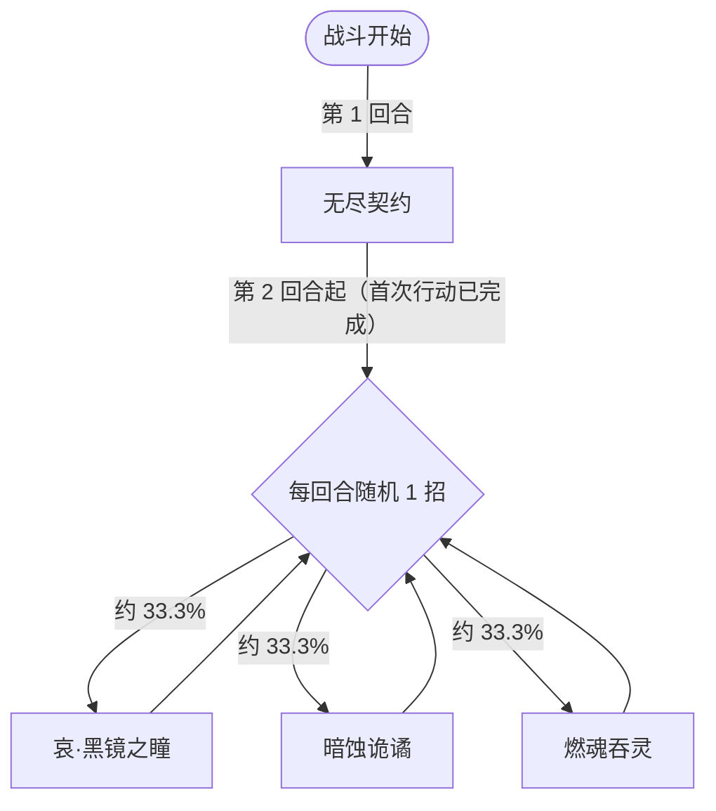

# 哀目黑子

> **类型**：精英怪物
> **初始生命**：970
> **遭遇战**：第三层精英战斗
> **特性**：同律（连续 3 张同类型牌即结束你的回合）+ 永久免控 + 堕落 99 + 魂缚（按牌组张数）

## 被动能力（开局自带）

| 名称 | 类型 | 效果 |
|------|------|------|
| **同律** | 能力（不可消除） | 敌人连续打出 3 张同类型牌后，立即结束该敌人的回合 |

::: warning 同律：连续同类型牌 = 直接断你回合
- 只要你在自己的回合内**连续打出 3 张同类型牌**（攻击/技能/能力算不同类型），哀目黑子立刻结束你的回合
- 这专门惩罚“一口气甩一串攻击”或“连铺能力”的打法：必须**交替出牌类型**来规避
- 举例：攻击 → 攻击 → 攻击（第 3 张瞬间断回合）；换成 攻击 → 技能 → 攻击 → 技能 就能持续出牌
:::

## 行动逻辑

第 1 回合固定无尽契约；第 2 回合起从「哀·黑镜之瞳 / 暗蚀诡谲 / 燃魂吞灵」中随机 3 选 1。

> **说明**：第 2 回合起三招各 33.3% 随机，可连续重复同一招。

## 招式表

| 招式名 | 意图 | 类型 | 效果 |
|--------|------|------|------|
| **哀·黑镜之瞳** | 攻击 45 | 单次攻击 + 强攻增益 | **反弱反强**（先反后打：自身负属性翻正、敌方正属性翻负）；造成 45 点伤害；**额外造成等于本次伤害的固定伤害**；自身接下来 2 次攻击必定暴击 |
| **暗蚀诡谲** | 攻击 44 | 单次攻击 + Debuff + 自保 | 造成 44 点伤害；将敌人[堕落](/powers/fallen_power.md)层数**设置为 99**；自身获得 3 层[无实体](/powers/intangible_power.md) |
| **燃魂吞灵** | 燃魂吞灵 | 自身增益 + Debuff | 自身全属性 +10；按敌人牌组卡牌数量施加**魂缚**（每 10 张牌施加 1 层[魂缚锁链](/powers/chains_of_binding_power.md)） |
| **无尽契约** | 无尽契约 | 自身增益（永久） | 永久免疫所有异常状态与属性下降；**每次自身受到伤害后**，给所有敌人随机异常持续 4 回合 |

::: warning 暗蚀诡谲：把你的堕落直接拉到 99
- 它会把你的[堕落](/powers/fallen_power.md)层数**设置为 99**（低于则补足，高于则下调）
- 堕落是负面层数、不会清零，满 100 会触发「魔君接管」式的失控风险——99 是差一点就爆表的危险值
- 若你本来就在走堕落流，这一招会把你直接推到临界线上，务必提前规划失控预案
:::

::: tip 魂缚：按你的牌组厚度惩罚
- 魂缚层数 = 你的牌组卡牌数 ÷ 10（向下取整）
- 持有魂缚时，你每回合**抽到的前 N 张牌会被侵蚀为魂缚**，而**每回合只能打出 1 张魂缚牌**
- 牌组越厚，一次被侵蚀的牌越多、可打出的受限越严重——厚牌组在这战会被额外惩罚
:::

## 遭遇战

| 遭遇战 | 房间类型 | 池子 | 数量 | 说明 |
|--------|----------|------|------|------|
| 哀目黑子精英 | Elite | 第三层精英池 | 1 只 | 单怪精英遭遇战 |

## 策略提示

1. **交替出牌类型是硬要求**：同律让你连续 3 张同类型牌就断回合。出牌节奏必须“攻击-技能-能力”交替，或每打 2 张同类就插一张别的类型。习惯一回合甩一串攻击的卡组会被反复断回合，等于每回合少打好几张。

2. **优先在第 1 回合抢输出**：第 1 回合它必放无尽契约（纯自保，不攻击），是安全的输出窗口。此时它尚未获得永久免控之外的其它东西，抓紧铺场/压血。

3. **永久免控意味着别带异常流**：无尽契约让哀目黑子永久免疫所有异常状态与属性下降，常规的毒/虚弱/易伤/降属性手段全部无效，只能靠直接伤害与固定伤害。同时**你每打它一次，它就回敬你一个随机异常 4 回合**——多段小攻击会让你身上堆满 debuff，尽量用少而重的攻击。

4. **哀·黑镜之瞳是本战最大威胁（未格挡约 90）**：45 点攻击伤害 + 一份等于**实际掉血**的固定伤害；完全不格挡时合计约 90 点，若格挡住一部分，追加的固定伤害也同步变少。之后它接下来两次攻击**必定暴击**（攻击伤害 ×1.5），要格外防备后续两回合。该招还带反弱（修自身）/反强（翻你四维），你身上的正向属性会被翻成负值。

5. **盯紧堕落条，防暗蚀诡谲**：暗蚀诡谲把你的堕落设为 99，离 100 爆表只差 1 层。若你后续再沾任何堕落源，很容易触发失控。有净化堕落的手段要留着备用。

6. **厚牌组会被魂缚惩罚**：燃魂吞灵按“牌组张数 ÷ 10”施加魂缚，牌越多被侵蚀越多、受“每回合只能打 1 张魂缚牌”的限制越狠。精简牌组或带解束缚手段能缓解压力。

7. **无实体一闪而过**：暗蚀诡谲会给它 3 层无实体（接下来 3 次伤害各封顶为 1）。打之前先垫小攻击逐层“喂”掉，别用大招去撞。

8. **随机阶段三招都可能连续出现**：第 2 回合起三招各 33.3%，可能连着放哀·黑镜之瞳。暴击只放大 45 点那段攻击（约 67 点），追加的固定伤害仍按实际掉血另算——按"攻击暴击 + 追加固伤"两段一起预留格挡。

9. **970 血 + 无减伤/无格挡/无复活**：相比其它精英，哀目黑子本体不算硬，真正的难点在“同律断回合 + 免控 + 魂缚”三重节奏干扰。只要稳住出牌节奏、用高质量攻击压血，整体是可速攻的。

## 源码

- 怪物：`SeerAimuHeiziMonster.cs`
- 被动能力：`SeerAimuHeiziPower.cs`（同律）
- 技能能力：`SeerPermanentDebuffImmunePower.cs`（免控）、`SeerNewSkillPowersD.cs`（无尽契约）、`SeerNextGuaranteedCritPower.cs`（必定暴击）、`SeerFallenCountHelper.cs`（堕落计数）
- 意图：`SeerNamedSingleAttackIntent.cs`、`SeerPuniNamedBuffIntent.cs`
- 遭遇战：`SeerAimuHeiziEliteEncounter.cs`
- 本地化：`monsters.json`（`SEER_MONSTER_SEER_AIMU_HEIZI_MONSTER.*`）、`intents.json`（`SEER_HEIZI_*`）、`powers.json`（`SEER_POWER_SEER_AIMU_HEIZI_POWER.*`、`SEER_POWER_SEER_ENDLESS_CONTRACT_POWER.*`）
