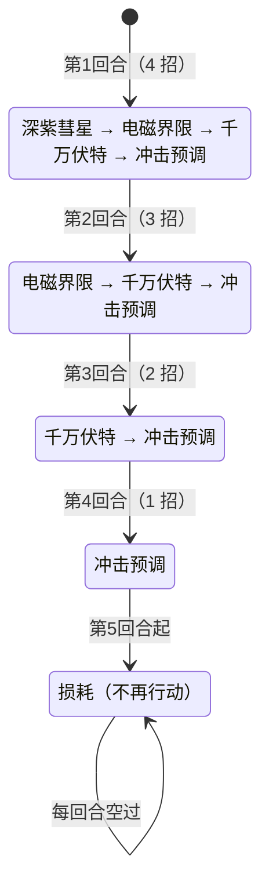

# 异星装甲·赛伯斯特

> **类型**：精英怪物
> **初始生命**：2000
> **遭遇战**：第三层精英战斗
> **特性**：开局 10 层蓄能（每用一次技能 -1，用尽即「损耗」摆烂）+ 固定四回合降序连招（4→3→2→1 招）+ 千万伏特每回合回满血

## 被动能力（开局自带）

| 名称 | 类型 | 效果 |
|------|------|------|
| **异星装甲** | 能力（不可消除） | 战斗开始时获得 10 层**蓄能** |
| **蓄能** | 能力（不可消除） | 战斗开始时获得 10 层。每使用一次技能，蓄能层数 -1，作为整场的"技能次数预算"；第 5 回合起固定进入「损耗」 |

::: tip 蓄能是「技能次数预算」
- 每个技能消耗 1 层蓄能；连招一回合放几个技能就扣几层。
- 回合招数降序：第 1 回合 4 招 → 第 2 回合 3 招 → 第 3 回合 2 招 → 第 4 回合 1 招，共消耗 4+3+2+1=10 层，正好用光。
- 第 4 回合出完最后 1 招后蓄能归零，从第 5 回合起进入「损耗」，**不再行动**（纯木桩）。
- 若某招被"攻击无效/封属"跳过，被跳过的招**不消耗蓄能**，蓄能会剩下；但降序连招仍按固定回合推进，**第 5 回合照样进入损耗**。
- 先制/超频等由普通能力承载，可被常规手段处理；「异星装甲／蓄能」为开局被动（不可消除）。
:::

## 行动逻辑

前 4 回合按固定的降序连招出招，每回合出招数比上回合少 1 个；第 5 回合起固定进入「损耗」，永久循环空过。

> **说明**：连招内的技能顺序固定，并非随机；第 5 回合起为「损耗」，塞伯斯特每回合无事发生，直到被击杀。即使有技能被封印跳过、蓄能未归零，也不会延长连招。

::: warning 千万伏特会把血线回满
第 1／2／3 回合的连招都包含**千万伏特**，其中一条效果是「恢复至满生命」。也就是说这 3 个回合里你打出的任何伤害，都会在该招结算时被回满抵消。真正能留住伤害的窗口从**第 4 回合**（只剩冲击预调、无回血）开始。
:::

## 招式表

| 招式名 | 意图 | 类型 | 效果 |
|--------|------|------|------|
| **x·深紫彗星** | 攻击 50 | 单次攻击 + 封禁 | 造成 50 点伤害；敌人每拥有 1 点**辉星**额外受 5 点**固定伤害**；本场敌人无法再获得辉星，获得时改为每点辉星受 5 点固定伤害 |
| **千万伏特** | 攻击 45 | 单次攻击 + 自身增益 + 回血 | 造成 45 点伤害；先制 +1；**恢复至满生命**；按场上存在的全属性种类数（0~4）随机施加等量异常各 3 回合 |
| **电磁界限** | 强化 | 自身增益 + 干扰 | 自身全属性 +2；获得 4 回合[超频](/powers/overclock_power.md)；向敌人手牌加入 4 张带保留的随机状态牌 |
| **冲击预调** | 强化（干扰） | 清减益 + 封牌 + 永久减伤 | 清除自身所有减益；使敌人下回合无法打出**技能牌**；额外获得 25% 永久减伤 |
| **损耗** | — | 空过 | 第 5 回合起不再行动 |
| **深紫彗星·电磁界限·千万伏特·冲击预调** | 第 1 回合组合 | 连招（4 招） | 依次施放：深紫彗星 → 电磁界限 → 千万伏特 → 冲击预调 |
| **电磁界限·千万伏特·冲击预调** | 第 2 回合组合 | 连招（3 招） | 依次施放：电磁界限 → 千万伏特 → 冲击预调 |
| **千万伏特·冲击预调** | 第 3 回合组合 | 连招（2 招） | 依次施放：千万伏特 → 冲击预调 |

## 遭遇战

| 遭遇战 | 房间类型 | 池子 | 数量 | 说明 |
|--------|----------|------|------|------|
| 异星装甲·赛伯斯特精英 | Elite | 第三层精英池 | 1 只 | 单怪精英遭遇战 |

## 策略提示

1. **前 3 回合是「无效输出期」，别恋战**：第 1／2／3 回合的连招都带千万伏特，会把自己**回满血**。你在这 3 回合造成的伤害会被原样抹掉，所以这段应把资源放在**防守、铺场、过牌、叠形态**上，而不是冲伤害数字。

2. **第 4 回合起才是真正开打**：第 4 回合只剩冲击预调（无回血），从第 5 回合起进入「损耗」——塞伯斯特**彻底不动**。也就是说真正能稳定输出的窗口是第 4 回合往后，对着一个 2000 血的木桩慢慢磨即可。伤害爆发（大剑、终结技）留到第 4 回合再交。

3. **抗住第 1 回合的 4 连**：第 1 回合同时吃 50（彗星）+ 45（千万伏特）+ 随机异常 + 手牌塞 4 张状态牌，是全战斗最凶的一回合。开局前应确保手上有格挡/减伤，且**预留技能牌位**（第 1 回合冲击预调会让你下回合无法打技能牌）。

4. **冲击预调封技能牌**：第 1／2／3／4 回合末尾都会「使敌人下回合无法打出技能牌」。你的核心技能牌（形态、增益、过牌）要避开被封的回合；攻击牌不受影响，被封的回合优先出攻击。此外该招还会让它额外获得 25% 永久减伤，实际输出窗口会越拖越紧。

5. **辉星流派被彗星针对**：深紫彗星一旦打出，本场你**再也无法获得辉星**，且每获得 1 点辉星改吃 5 点固定伤害；打出该招时还会按你**当前**辉星数直接再吃 5×辉星 固定伤害。依赖辉星的构筑要么在第 1 回合前把辉星用掉，要么改走不依赖辉星的路线。

6. **千万伏特按「全属性种类数」上异常**：它会统计全场（含你自己）力量/防御/命中/速度里出现的种类数（0~4），逐一随机给你挂异常、各持续 3 回合。它自己的电磁界限会给四种属性各 +2，所以前 3 回合的连招里通常都会挂满 4 个异常；你身上的属性种类越多也会推高数量。可考虑减少暴露的属性种类，或备好解异常。

7. **电磁界限的 4 张保留状态牌**：给手牌塞 4 张带**保留**的随机状态牌，会长期占用手牌位、拖慢抽牌节奏。要主动清理（用弃牌/消耗手段），别让它把关键牌挤出循环。

8. **超频的移除代价**：超频持续 4 回合，期间它每回合开始拿 1 层先制；超频**被移除时给持有者 2 层瘫痪**。若你有移增益手段，注意移除时机的收益与代价。

9. **损耗阶段零威胁**：只要熬到第 5 回合，塞伯斯特就是纯靶子。所以整场战斗的本质是「前 4 回合保命 + 第 4 回合起一波带走」，切忌在无效输出期把自己打崩。

## 源码

- 怪物：`SeerAlienArmorSebstMonster.cs`
- 被动能力：`SeerAlienArmorSebstPower.cs`（异星装甲）、`SeerChargeReservePower.cs`（蓄能／损耗）
- 招式相关能力：`SeerNewSkillPowersG.cs`（深紫彗星·封辉星）、`SeerOverclockPower.cs`（超频）、`SeerSkillCardSealPower.cs`（冲击预调·封技能牌）、`SeerFirstStrikePower.cs`（先制）、`SeerFixedDamagePower.cs`（固定伤害）
- 意图：`SeerNamedSingleAttackIntent.cs`、`SeerPuniNamedBuffIntent.cs`（具名意图类，按 `intents.json` 的键取标题/描述）
- 遭遇战：`SeerAlienArmorSebstEliteEncounter.cs`
- 本地化：`monsters.json`（`SEER_MONSTER_SEER_ALIEN_ARMOR_SEBST_MONSTER.*`）、`intents.json`（`SEER_SEBST_COMET`、`SEER_SEBST_TEN_MILLION_VOLT`、`SEER_SEBST_ELECTRO_MAGNETIC`、`SEER_SEBST_IMPACT_PRESET`、`SEER_SEBST_EXHAUSTED`）、`powers.json`（`SEER_POWER_SEER_ALIEN_ARMOR_SEBST_POWER.*`、`SEER_POWER_SEER_CHARGE_RESERVE_POWER.*`）
