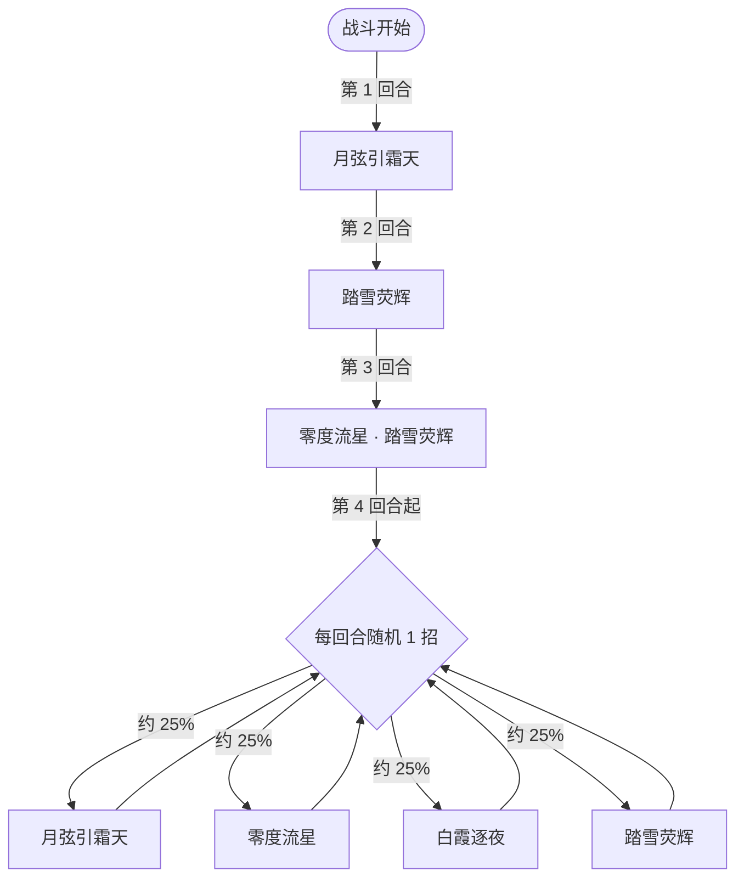

# 布蕾里克

> **类型**：精英怪物
> **初始生命**：1200
> **遭遇战**：第三层精英战斗
> **特性**：霜华噬命（单次受伤超最大生命 1% 时把全属性转移给你，此后按你的全属性层数吸血）+ 冰封/冻伤与 PP 削减

## 被动能力（开局自带）

| 名称 | 类型 | 效果 |
|------|------|------|
| **霜华噬命** | 开局被动（不可消除） | ①单次**实际掉血**超过自身最大生命 1% 时，将自身的全属性提升转移给敌人；②此后每回合开始时，按敌人全属性层数之和的 2 倍吸取其生命 |

::: tip 属性掠夺的触发与反噬
- 阈值 = 最大生命 ×1% = **12 点**（单次**实际掉血** >12 才触发，格挡掉的部分不算）。一旦触发，布蕾里克把自身全部正向四维（力量/防御/命中/速度）**整体移交给攻击者（你）**。
- 移交是**一次性**的：之后它进入「吸血」状态——你每持有 1 层全属性，它每回合吸你 2 点生命（无视格挡的非攻击流失）。
- 也就是说：单次打穿它 12 点，你**白拿一堆属性**，代价是每回合按属性层数持续失血。用「单次实际掉血不超过 12」的多段/小额伤害，可以既不送属性也不触发吸血；把伤害格挡住同样不会触发。
:::

## 行动逻辑

第 1 回合「月弦引霜天」，第 2 回合「踏雪荧辉」，第 3 回合组合招「零度流星 · 踏雪荧辉」，第 4 回合起每回合从 4 个基础技能中随机出 1 招。

> **说明**：`·` 表示同一回合内先后的组合招；第 4 回合起 4 招等概率随机、可重复，白霞逐夜不会在前 3 回合出现。

## 招式表

| 招式名 | 意图 | 类型 | 效果 |
|--------|------|------|------|
| **零度流星 · 踏雪荧辉** | 攻击 60 + 踏雪荧辉 | 组合招（第 3 回合） | 先施放零度流星，再施放踏雪荧辉 |
| **月弦引霜天** | 攻击 44 | 攻击 + Debuff | 造成 44 点伤害；敌人获得 3 层[冰封](/powers/freeze_power.md)、3 层[冻伤](/powers/frostbite_power.md)；敌人[防御](/powers/defense_power.md)提升 10 点 |
| **零度流星** | 攻击 60 | 攻击 + 反用防御 | 造成 60 点伤害；结算时把目标**当前的[防御](/powers/defense_power.md)层数视为等量增伤**（攻击值 = 60 + 2×防御，再照常被防御减免，净伤害约 60 + 防御）；防御本身不会被清除或翻负；下回合获免固 |
| **白霞逐夜** | 白霞逐夜 | 自身增益 + 封牌 | 自身全属性 +3；获 4 回合[吃月亮](/powers/eat_moon_power.md)；下回合敌人无法打出带[堕落](/powers/fallen_power.md)效果的牌 |
| **踏雪荧辉** | 踏雪荧辉 | PP 削减 + 自身闪避 | 减少敌人共 30 点 PP；若敌人全属性层数之和高于自身则下回合获 100%[闪避](/powers/dodge_power.md) |

::: tip 月弦引霜天 → 零度流星 的组合
- 月弦引霜天给你 +10 点[防御](/powers/defense_power.md)；零度流星会把这份防御**当成增伤**来用：攻击值 60+2×10=80，再被 10 点防御减免，净吃 70。
- 注意它**不会**把你的防御翻成负数、也不会清掉防御——防御仍然留着，只是这一击里那 10 点防御从"减伤"变成了"加伤"。
- [冰封](/powers/freeze_power.md)：你攻击伤害降低，回合结束时移除并转为若干层[冻伤](/powers/frostbite_power.md)；[冻伤](/powers/frostbite_power.md)则是你回合开始时受到的持续伤害。
:::

## 遭遇战

| 遭遇战 | 房间类型 | 池子 | 数量 | 说明 |
|--------|----------|------|------|------|
| 布蕾里克精英 | Elite | 第三层精英池 | 1 只 | 单怪精英遭遇战 |

## 策略提示

1. **注意 12 点阈值**：单次**实际掉血**超过 12 就会触发霜华噬命——它把全属性**送给你**，然后每回合按你的全属性层数吸血。这其实是「给属性 + 持续失血」的交换：若你能承受吸血（或本就靠属性输出），可以主动触发拿属性；若不想被吸，就控制单次实际掉血不超过 12（用格挡吃掉一部分也算）。

2. **吸血越多越危险**：一旦触发过属性掠夺，此后它**每回合**按你全属性总和 ×2 吸你血，且无视格挡。你叠的属性越厚，每回合失血越狠（+10 层 = 每回合 -20）。若非必要，别在触发后继续堆属性。

3. **月弦引霜天 + 零度流星的连招**：第 1 回合它给你 +10 防御；第 3 回合零度流星会把这 10 点防御当成增伤，净伤害从 60 抬到约 70。别指望那段防御保护你——它不会变负，但在这一击里等于白送伤害。

4. **冰封/冻伤是持续掉血**：月弦引霜天叠 3 层[冰封](/powers/freeze_power.md) + 3 层[冻伤](/powers/frostbite_power.md)：冰封先减你攻击、回合末转为更多冻伤；冻伤每回合持续扣血。带解异常或高回复能显著降低压力。

5. **踏雪荧辉削 PP**：单次减少你共 30 点 PP（PP 卡牌的 PP 被随机扣减）。若你的卡组重度依赖 PP 资源，这个削减会直接削出手数，注意提前把关键 PP 牌留出余量。

6. **全属性层数决定它的闪避**：踏雪荧辉出招瞬间若你的全属性层数之和**高于**它，它才会让**自己**下回合获得 100%[闪避](/powers/dodge_power.md)（这是它的防御手段）。如果你被属性掠夺送了属性、层数反超它，下一回合它就可能 100% 闪避你的攻击——别在它闪避回合浪费斩杀。

7. **白霞逐夜叠属性 + 封堕落牌**：它自身全属性 +3 并获 4 回合[吃月亮](/powers/eat_moon_power.md)，同时封掉你下回合带[堕落](/powers/fallen_power.md)效果的牌。若卡组含大量堕落相关牌，需避开这回合的关键输出。

8. **第 3 回合组合招压力最大**：零度流星（60 + 你的防御层数，通常约 70）+ 踏雪荧辉（削 PP）同回合，既是最高一击也是资源打击。第 4 回合起 4 招随机，需同时准备挡 44/60 伤害、解冰封/冻伤、补 PP 与应对闪避。

## 源码

- 怪物：`SeerBuleilikeMonster.cs`
- 被动能力：`SeerBuleilikePower.cs`（霜华噬命）
- 关联能力：`SeerFreezePower.cs`（冰封）、`SeerFrostbitePower.cs`（冻伤）、`SeerDodgePower.cs`（闪避）、`SeerEatMoonPower.cs`（吃月亮）、`SeerFallenSealPower.cs`（白霞逐夜封牌）、`SeerTurnImmuneFixedDamagePower.cs`（免固）、`SeerDefensePower.cs`（防御）
- 意图：`SeerNamedSingleAttackIntent.cs`、`SeerPuniNamedBuffIntent.cs`
- 遭遇战：`SeerBuleilikeEliteEncounter.cs`
- 本地化：`monsters.json`（`SEER_MONSTER_SEER_BULEILIKE_MONSTER.*`）、`intents.json`（`SEER_BULEILIKE_*`）、`powers.json`（`SEER_POWER_SEER_BULEILIKE_POWER.*`）
