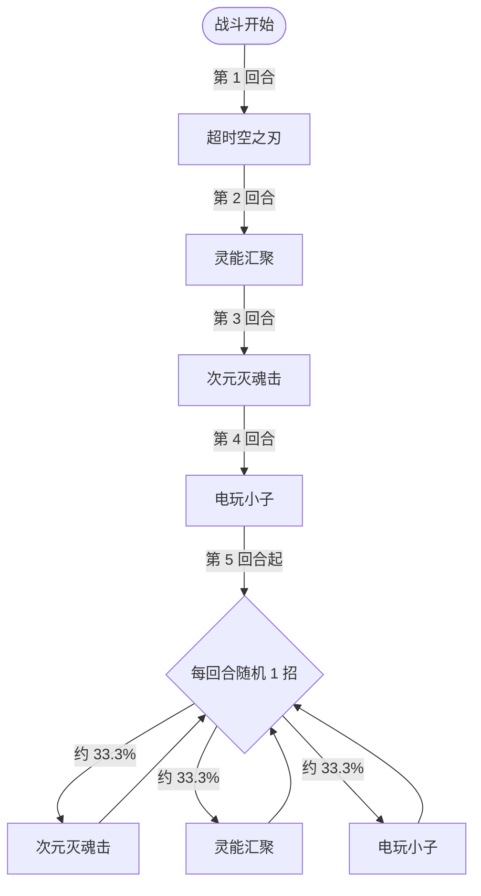

# 苍天歌

> **类型**：精英怪物
> **初始生命**：987
> **遭遇战**：第三层精英战斗
> **特性**：咏势（你每打出一张牌，它下次攻击伤害 +20% 且可累积）+ 前 4 回合固定出招 + 超时空之刃跨战斗预埋 45 固伤

## 被动能力（开局自带）

| 名称 | 类型 | 效果 |
|------|------|------|
| **咏势**（不可消除） | 能力 | 敌人每打出 1 张牌，自身**下次攻击**的伤害提高 20%，可累积；在自身攻击结算后清零 |

::: tip 咏势的累积与结算
- **累积**：你每打出一张牌（任意类型）计 1 层，图标层数就是当前累积的倍数
- **生效倍率**：下次**受威力加成的攻击**伤害 ×（1 + 累积层数 × 20%）。3 张牌 = ×1.6，5 张牌 = ×2.0
- **仅作用于攻击**：非攻击牌（能力/技能）只计数、不吃倍率
- **攻击后清零**：苍天歌自身打出攻击并结算后，累积立刻归零，从 0 重新计
- **跨招式保留**：倍率只作用于"下一次攻击"——超时空之刃全额吃倍率；次元灭魂击只有第一段 35 吃倍率，追加的那一段在倍率清零后才结算，不吃
:::

## 行动逻辑

前 4 回合固定出招，第 5 回合起从技能 2/3/4 中随机 1 招（技能 1 超时空之刃不再出现在循环中）。

> **说明**：`/` 表示三选一随机出招（可重复）。第 5 回合起只会在次元灭魂击、灵能汇聚、电玩小子之间循环，超时空之刃的跨战斗固伤只会在第 1 回合预埋一次。

## 招式表

| 招式名 | 意图 | 类型 | 效果 |
|--------|------|------|------|
| **超时空之刃** | 攻击 54 | 单次攻击 + 跨战斗预埋 | 造成 54 点伤害；使敌人在**下一场 Boss 战开始时**受 45 点固定伤害（该效果跨战斗保留） |
| **次元灭魂击** | 攻击 35 | 单次攻击 + 属性反转 + 双倍 | **反弱反强**（先反后打：自身负属性翻正、敌方正属性翻负）；造成 35 点伤害；对处于**异常状态**的敌人**追加一次等量攻击**（合计 70 点） |
| **灵能汇聚** | 灵能汇聚 | 自身增益 + 干扰 | 自身全属性 +7；恢复自身**已损失生命**的 50%；下回合你每打出一张牌，随机获得 2 种异常，每种持续 2 回合 |
| **电玩小子** | 电玩小子 | 格挡 + 封印 + Debuff | 获得 200 点格挡；下回合你的**偶数张攻击牌**无效；所有敌人获得**害怕**、**疲惫**各 3 回合 |

::: warning 本地化措辞与实现细节
- **次元灭魂击「双倍伤害」**：实现为在敌人处于异常时**再追加一次完整的 35 点攻击**（而非把单次伤害乘 2）。追加段本身是普通攻击伤害、可格挡，且**不吃咏势倍率**（第一段结算后倍率已清零），所以实际是"35×咏势 + 35"。
- **害怕 / 疲惫**：害怕 = 攻击伤害 -30%；疲惫 = 攻击伤害 -20%，且造成伤害时自身受到等于层数的不可格挡伤害。两者都持续 3 回合。
:::

## 遭遇战

| 遭遇战 | 房间类型 | 池子 | 数量 | 说明 |
|--------|----------|------|------|------|
| `SeerCangTianGeEliteEncounter` | Elite | 第三层精英池 | 1 只 | 第三层单怪精英遭遇战 |

## 策略提示

1. **咏势是"打得越多越疼"的软计时**：它下次攻击的伤害随你出牌数线性放大。若你在一回合里连甩 5 张牌再挨它的攻击，54 会变成 108、35 会变成 70。**控制出牌节奏**：在预料它将攻击的回合，尽量少出牌或先格挡到位。

2. **第 1 回合必定超时空之刃（54 + 预埋 45）**：这一击本身 54，更重要的是它把 45 点固定伤害记到了**下一场 Boss 战开局**。也就是说无论你这把精英怎么打，之后打 Boss 时会白白挨 45 固伤——提前为此预留血量/减伤。

3. **第 3 回合次元灭魂击可能双段 70**：只要你身上挂着**任意一种异常状态**，它就会追加第二段 35 = 合计 70；其中第一段还吃咏势倍率，出牌多时第一段会明显高于 35。**打这一招前尽量清空自身异常**，或备好 70+ 的格挡。

4. **灵能汇聚回血掐灭速杀幻想**：第 2 回合它会恢复已损失生命的 50%（打掉 300 就回 150）+ 全属性 +7。想靠磨血压制很难，**要在灵能汇聚前把它打进残血、或在它回血后重新压过回复量**。

5. **灵能汇聚的后续异常链**：你接下来一个回合内，每出一张牌就随机吃 2 种异常各 2 回合。出牌越多、身上异常越杂，还可能反过来触发次元灭魂击的双倍。**这一回合要么少出牌，要么先备解异常手段**。

6. **电玩小子封印偶数张攻击牌**：第 4 回合起它可能放这招——200 点格挡 + 下回合你的**偶数张攻击牌无效**。安排攻击牌顺序：把弃之可惜的牌放在偶数位顶掉封印，把关键攻击放在奇数位。

7. **害怕 + 疲惫双降攻**：电玩小子给全体害怕（-30% 攻击）与疲惫（-20% 攻击 + 自伤）各 3 回合，你的输出会被压掉一大截。**别把爆发计划排在这 3 回合里**，或先备好解 debuff / 提高基础伤害的手段。

8. **反弱反强针对正属性 buff**：次元灭魂击使用前，你的正属性（力量/防御/命中/速度）会被翻负。若你正在铺属性 buff，务必避开它这招的回合，否则等于自己给自己上负属性。

9. **第 5 回合起随机且含灵能汇聚**：三选一里有灵能汇聚（回血），只要随机到就可能被它回一大口。**别指望它连续不抽到回血**，稳定输出 + 在它残血回合果断斩杀才是稳妥打法。987 血、无免死无复活，合理节奏 5~7 回合。

## 源码

- 怪物：`SeerCangTianGeMonster.cs`
- 被动能力：`SeerCangTianGePower.cs`（咏势）
- 回溯干扰：`SeerNewSkillPowersD.cs`（灵能汇聚）
- 偶数攻击封印：`SeerNewSkillPowersE.cs`（电玩小子）
- 害怕 / 疲惫：`SeerFearPower.cs`、`SeerFatiguePower.cs`
- 跨战斗固伤：`SeerMonsterRunData.cs`
- 意图：`SeerNamedSingleAttackIntent.cs`、`SeerNamedDebuffIntent.cs`
- 遭遇战：`SeerCangTianGeEliteEncounter.cs`
- 本地化：`monsters.json`（`SEER_MONSTER_SEER_CANG_TIAN_GE_MONSTER.*`）、`intents.json`（`SEER_CANGTIANGE_*`）、`powers.json`（`SEER_POWER_SEER_CANG_TIAN_GE_POWER.*` 等）
