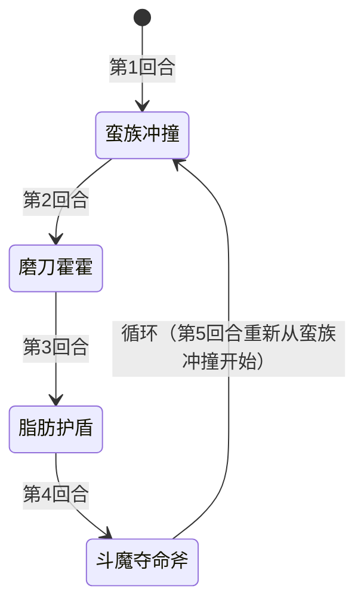

# 斗魔旺乔

## 基本信息

| 属性 | 数值 |
|---|---|
| 分类 | [精英怪物](/monsters/elite/) |
| 生命值 | 321 - 324 |

## 被动能力

无开局被动。它的全属性、斗气、覆甲与脂肪护盾都由招式本身施加，不属于开局自带能力。

## 行动逻辑

按「蛮族冲撞 → 磨刀霍霍 → 脂肪护盾 → 斗魔夺命斧」固定顺序循环出招，无随机成分。

## 招式表

| 招式 | 意图 | 描述 | 数值 |
|---|---|---|---|
| 蛮族冲撞 | 蛮族冲撞 | 自身损失10点生命值（不可格挡的非攻击伤害），对单体造成8点伤害5次 | 自损 10 / 伤害 8×5 |
| 磨刀霍霍 | 磨刀霍霍 | 自身全属性+3，获得25层斗气 | 全属性+3 / 斗气 25层 |
| 脂肪护盾 | 脂肪护盾 | 自身覆甲+10，获得50点格挡。接下来2回合，每次受到攻击（每张攻击牌结算一次）获得5层斗气 | 覆甲 10 / 格挡 50 / 斗气 5层/张攻击牌 |
| 斗魔夺命斧 | 斗魔夺命斧 | 造成25点伤害（受力量加成），附加自身当前生命值30%的固定伤害（整数除法，满323血=96点） | 伤害 25 + 固定伤害（当前生命×30%） |

::: tip 脂肪护盾的实际数值
脂肪护盾的意图、实际效果与 Power 描述一致：获得 10 层覆甲、50 点格挡，接下来 2 回合每次**受到攻击**获得 5 层斗气。

注意"每次受到攻击"按**攻击牌**结算：一张 5 段攻击牌只触发一次 +5 斗气，不是每段各触发一次。
:::

## 遭遇战

| 遭遇战 | 房间类型 | 池子 | 数量 | 说明 |
|---|---|---|---|---|
| `SeerDouMoWangQiaoElite` | Elite | 第三层精英池 | 1 只 | 单怪精英遭遇战，仅第三层（荣耀）出现 |
| `SeerMixedEliteEncounter` | Elite | 第三层混合精英池（mod 侧） | 1 只（共 2 只） | 与 1 只原版精英同场，仅第三层（荣耀） |

## 策略提示

1. **固定循环可预判，自损是免费输出**：斗魔旺乔按「蛮族冲撞 → 磨刀霍霍 → 脂肪护盾 → 斗魔夺命斧」固定顺序循环，无任何随机成分。蛮族冲撞每轮自损 10 血（不可格挡的非攻击伤害），4 轮循环下来自损 40 血，相当于玩家"免费"打了 40 点伤害。配合玩家输出，可以在 2~3 轮循环内击杀，根本不用拖到斗气叠满。

2. **斗气机制与满血免疫**：每层斗气使斗魔旺乔的攻击伤害附加**目标已损失生命值 1%** 的额外伤害（仅对攻击伤害生效，目标满血时不加成）。磨刀霍霍一次叠 25 层斗气，脂肪护盾期间每张攻击牌额外给 5 层斗气。若玩家满血则斗气无加成；若玩家残血且斗气层数高，斗魔夺命斧和蛮族冲撞的额外伤害会显著提升。保持高血量可大幅降低斗气威胁。

3. **脂肪护盾回合：每打一张攻击牌就送 5 层斗气**：护盾期间（2 回合）它每次**受到攻击**获得 5 层斗气，触发按攻击牌结算——多段攻击只算一次，不会因为段数多而多叠。所以破它的 50 点格挡（以及它靠覆甲每回合补的 10 点格挡）时，多段牌反而划算；真正要控制的是"这 2 回合里你总共打了几张攻击牌"。尽量用少量高效攻击牌，或干脆防守，等护盾结束再集中输出。

4. **斗魔夺命斧的固定伤害随血量降低而降低**：斗魔夺命斧附加当前生命值 30% 的固定伤害（向下取整）。满 323 血 = 96 点固定伤害，但蛮族冲撞自损 10 后，下一轮斗魔夺命斧的固定伤害会降到约 93 点（313 血 × 30%）。所以越往后斗魔夺命斧威胁越小，速战对自己有利。

5. **覆甲 vs 格挡**：脂肪护盾同时获得 10 层覆甲和 50 点格挡。覆甲**不是减伤**——它让斗魔旺乔在**每个回合结束时**获得等同于层数的格挡（10 点），再在它回合开始时 -1 层，相当于接下来约 10 个回合每回合白拿 10 点格挡；那 50 点格挡则下回合清空。两种防御叠加，破盾需要多段或高单发。护盾回合每张攻击牌都会送 5 层斗气、多段不额外叠，所以用一张多段牌破盾比连打几张单段牌更省斗气。

6. **321~324 血 + 2~3 轮循环击杀窗口**：斗魔旺乔血量 321~324，每轮循环（4 回合）自损 10 血。2 轮循环（8 回合）后自损 20 血，玩家需补 301~304 血即可击杀。配合玩家输出，6~8 回合内可完成击杀。若输出足够，2 轮循环内（8 回合）即可击杀，此时斗气至少 25 层（磨刀霍霍一次），威胁可控。

## 源码

- 怪物：`SeerDouMoWangQiaoMonster.cs`（生命 321~324，固定循环：蛮族冲撞→磨刀霍霍→脂肪护盾→斗魔夺命斧）
- 相关能力：`SeerFatShieldPower.cs`（脂肪护盾，2 回合内受击获得 5 层斗气）、`SeerBattleFuryPower.cs`（斗气，每层附加目标已损失生命 1% 攻击伤害）
- 遭遇战：`SeerDouMoWangQiaoElite.cs`、`SeerMixedEliteEncounter.cs`
- 本地化：`monsters.json`（`SEER_MONSTER_SEER_DOU_MO_WANG_QIAO_MONSTER.*`）、`intents.json`（`SEER_BATTLE_AXE.*`、`SEER_SHARPEN.*`、`SEER_FAT_SHIELD_INTENT.*`、`SEER_BARBARIAN_CHARGE.*`）、`powers.json`（`SEER_POWER_SEER_BATTLE_FURY_POWER.*`、`SEER_POWER_SEER_FAT_SHIELD_POWER.*`）
