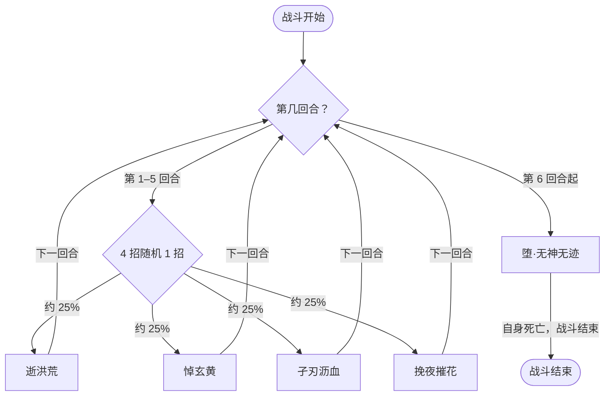

# 堕息·迹

> **类型**：精英怪物
> **初始生命**：2500
> **遭遇战**：第三层精英战斗
> **特性**：刻/痕（持「痕」时每次打出攻击牌永久 -10 伤害并 +51 层堕落）+ 前 5 回合四招随机、第 6 回合自我了断并把敌人生命降至 1

## 被动能力（开局自带）

| 名称 | 类型 | 效果 |
|------|------|------|
| **堕息**（刻） | 开局被动（不可消除） | 战斗开始时自身获得「刻」。持有「刻」时，每次使用攻击技能对所有敌人施加 2 层「痕」；若敌人已持有「痕」，自身额外获得 2 层[缓冲](/powers/buffer_power.md) |
| **痕**（施加于敌人） | 状态标记（不可消除） | 持有者打出攻击牌时：该牌数值在本场战斗中永久 -10，并获得 51 层[堕落](/powers/fallen_power.md)；持有者自己的回合结束时「痕」减少 1 层 |

::: tip 「刻」与「痕」的联动
- 开局堕息·迹自带「刻」；只要它用**攻击技能**（逝洪荒 / 悼玄黄），就会给每个敌人挂上 2 层「痕」（孑刃沥血、挽夜摧花是增益/封牌招，不触发）。多段攻击也只按一次攻击结算，不会按段数重复施加。
- 你身上**只要还有「痕」**，它每次攻击都会**额外给自己 +2 层缓冲**——与痕的层数多少无关，关键是"有没有"。所以尽快把痕耗到 0 比单纯少叠层更重要。
- 「痕」在**你自己的回合结束时**才 -1，因此回合内多次攻击会多次结算。
:::

::: warning 「痕」的两条惩罚
- 每次你打出**攻击牌**（持「痕」时）：这张牌的伤害数值在本场战斗**永久 -10**（底层改 Damage 基础值）。同一张攻击牌反复打出会持续缩水。
- 同时你 **+51 层堕落**：每累计满 100 层会触发一次「魔君接管」——立即自动打出手中所有可打出的牌（优先高耗能），并获得混沌化身与抽 1 张牌（此后每满 100 层重复触发，混沌化身持续到战斗结束）。
- 因此「痕」是双刃：攻击换来永久掉伤，但堕落层数也会给你带来接管收益。持「痕」时改用技能牌/能力牌/固定伤害可以规避掉伤。
:::

## 行动逻辑

第 1–5 回合从「逝洪荒 / 悼玄黄 / 孑刃沥血 / 挽夜摧花」中随机出 1 招；第 6 回合使用一次「堕·无神无迹」，随后它自我了断、战斗结束。

> **说明**：前 5 回合 4 招等概率随机、可重复；第 6 回合必定施放「堕·无神无迹」，该招会把敌我双方当前生命值降到 1，然后堕息·迹自我了断，战斗随即结束。

## 招式表

| 招式名 | 意图 | 类型 | 效果 |
|--------|------|------|------|
| **堕·无神无迹** | 堕·无神无迹 | 特殊（第 6 回合） | 将敌人的最大生命值与当前生命值都降至 1，随后自我了断、结束战斗 |
| **逝洪荒** | 攻击 55 | 攻击 + Debuff | 造成 55 点伤害；先制 +2；施加 3 层害怕、3 层疲惫 |
| **悼玄黄** | 攻击 55 | 攻击 + Debuff | 造成 55 点伤害；先制 +2；施加 3 层诅咒、3 层臣服 |
| **孑刃沥血** | 孑刃沥血 | 自身增益 + 干扰 | 全属性 +14；获得 50 点格挡；本场战斗中敌人使用药水时立即死亡 |
| **挽夜摧花** | 挽夜摧花 | 自身增益 + 出牌无效 | 获得 4 回合弹控与吃月亮；本场战斗中敌人拥有正先制时，其打出的牌无效 |

::: warning 元素克制会招致封牌
- 另有一条**条件效果**（意图文本未列出）：若你的元素克制堕息·迹，
  - 逝洪荒会额外让你**下回合无法打出技能牌**；
  - 悼玄黄会额外让你**下回合无法打出攻击牌**。
- 触发条件是「你克制它」，与「痕」无关。若你的卡组依赖某类牌型，注意别在关键回合踩上封牌。
:::

## 遭遇战

| 遭遇战 | 房间类型 | 池子 | 数量 | 说明 |
|--------|----------|------|------|------|
| 堕息·迹精英 | Elite | 第三层精英池 | 1 只 | 单怪精英遭遇战 |

## 策略提示

1. **5 回合软计时，尽快击杀**：第 6 回合起堕息·迹会施放「堕·无神无迹」——把你最大生命值与当前生命值一并降到 1 并自我了断。由于它自杀后战斗随即结束，这一招本身不致死，但你必须在被打到 1 血前活过 5 回合、并尽可能在窗口内清空它 2500 点生命。拖到第 6 回合等于放弃满血收益。

2. **「痕」让你的攻击牌永久掉伤**：持「痕」时每打出一张攻击牌，该牌本场战斗伤害永久 -10（可累加）。反复打同一张核心攻击牌会持续缩水，因此持「痕」期间优先用**技能牌 / 能力牌 / 固定伤害**输出，或直接打可重复生成的消耗型攻击牌吸收惩罚。

3. **堕落是双刃**：每次攻击 +51 层堕落，每满 100 层触发「魔君接管」自动打出手中所有可打出的牌并抽 1 张、获得混沌化身。若你的牌组偏手动打出收益，可主动多攻击来频繁触发接管；但要接受攻击牌掉伤的代价。

4. **只要身上有「痕」，它每次攻击都变硬**：你持有「痕」时它每次攻击额外给自己 +2 层[缓冲](/powers/buffer_power.md)（免疫接下来的伤害次数）；这与痕的层数无关，只判"有无"。所以关键是把痕**清到 0**，而不是少叠几层。「痕」在你自己的回合结束时才 -1，可等它掉光后再集中爆发；持痕期间尽量用技能/能力牌，别用攻击牌喂它缓冲。

5. **孑刃沥血后禁用一切药水**：该招使你「本场战斗中用药水立即死亡」。见到它之后，任何回复药水、增益药水都不能再喝，否则直接暴毙。需在见到此招前把药水用完，或整场放弃药水。

6. **挽夜摧花封杀先制流派**：该招使你「本场战斗中拥有正先制时，你打出的牌无效」。若你的卡组靠[先制](/powers/first_strike_power.md)加成打爆发，先制 > 0 时出牌会被白白浪费，需要改用不带先制的输出线，或先把自身先制层清到 0 再出牌。

7. **别让属性膨胀**：孑刃沥血每次给自己全属性 +14 并加 50 格挡。若随机连出两三次，它会又硬又痛。用固定伤害绕过格挡、或先破格挡再打，是稳定推血的手段。

8. **逝洪荒 / 悼玄黄是主要削血威胁**：两招各造成 55 点伤害并叠 3 层两种异常（害怕/疲惫 或 诅咒/臣服）。5 回合随机里可能连续出现，需预留解异常或格挡手段；同时它们正是给「痕」的招，注意节奏。

9. **元素克制要付出封牌代价**：若你的元素正好克制它，逝洪荒会锁你的技能牌、悼玄黄会锁你的攻击牌（各 1 回合）。若卡组某一牌型占比过高，尽量在非关键回合承伤，别把斩杀回合让给封牌。

## 源码

- 怪物：`SeerDuoxijiMonster.cs`
- 被动能力：`SeerDuoxijiPower.cs`（堕息/刻）、`SeerMarkPower.cs`（刻）、`SeerTrailPower.cs`（痕）
- 封牌 / 干扰：`SeerSkillCardSealPower.cs`（逝洪荒封技）、`SeerAttackCardSealPower.cs`（悼玄黄封攻）、`SeerNewSkillPowersG.cs`（挽夜摧花）、`SeerPotionDeathPower.cs`（孑刃沥血·禁药即死）
- 意图：`SeerNamedSingleAttackIntent.cs`、`SeerPuniNamedBuffIntent.cs`
- 遭遇战：`SeerDuoxijiEliteEncounter.cs`
- 本地化：`monsters.json`（`SEER_MONSTER_SEER_DUOXIJI_MONSTER.*`）、`intents.json`（`SEER_DUOXIJI_*`）、`powers.json`（`SEER_POWER_SEER_DUOXIJI_POWER.*`、`SEER_POWER_SEER_TRAIL_POWER.*`、`SEER_POWER_SEER_MARK_POWER.*`）
