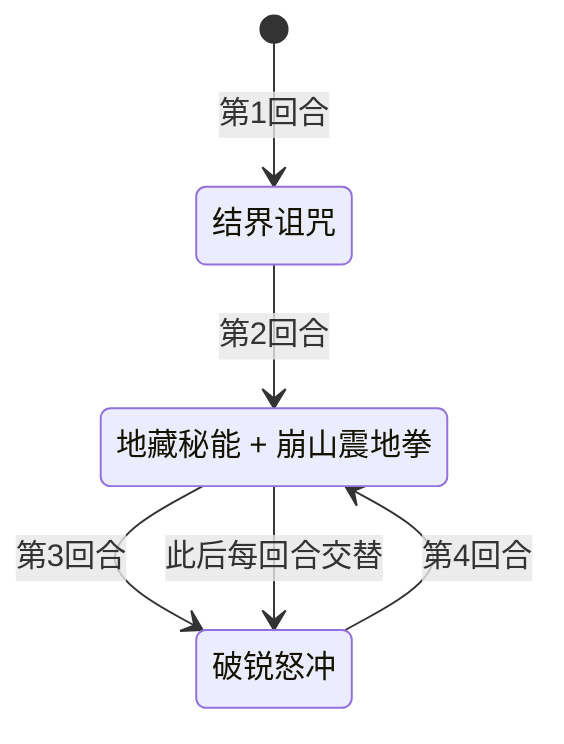

# 大地之神·卡修斯

> **类型**：精英怪物
> **初始生命**：3000
> **遭遇战**：第三层精英战斗
> **特性**：大地之神（可复活 3 次 + 敌方每回合只能打出 1 张牌 + 每次造成伤害往敌方牌组塞随机诅咒）+ 常驻 75% 减伤 + 崩山震地拳

## 被动能力（开局自带）

| 名称 | 类型 | 效果 |
|------|------|------|
| **大地之神** | 能力（不可消除） | ①自身可以复活 3 次；②敌人每回合只能打出 1 张牌；③自身每次造成伤害时，向敌方牌组加入 1 张随机赛尔诅咒 |

::: warning 一回合一张牌——本战最大约束
- 大地之神在场期间，**玩家每回合只能打出 1 张牌**（被动硬性限制，无法绕过）
- 这直接决定了本战的构筑取向：单卡质量、单卡循环、低牌组循环能力远比“多卡组合”重要
- 任何依赖“一回合打一串牌”的套路都会失效
:::

## 行动逻辑

第 1 回合放结界诅咒；之后「地藏秘能 + 崩山震地拳」与「破锐怒冲」交替循环。

> **说明**：从第 2 回合起固定为「地藏秘能 + 崩山震地拳组合（双意图一回合双招）」→「破锐怒冲」交替，无随机成分。

## 招式表

| 招式名 | 意图 | 类型 | 效果 |
|--------|------|------|------|
| **破锐怒冲** | 攻击 75 | 单次攻击 + 护盾 | 造成 75 点伤害；下回合免疫受到的伤害，并将所免疫的伤害转化为自身生命回复 |
| **结界诅咒** | 结界诅咒 | 自身增益（永久） | 持续至战斗结束，免疫异常状态和能力下降，获得 75% 永久减伤 |
| **地藏秘能** | 地藏秘能 | 自身增益 + Debuff | 自身全属性 +2、先制 +2；随机给予敌人 5 种异常各 5 回合；获得 2 层[无实体](/powers/intangible_power.md) |
| **崩山震地拳** | 攻击 60 | 单次攻击 + 判伤 | 造成 60 点伤害；实际伤害 **≥ 60** 则自身回满生命；实际伤害 **≤ 60** 则给予敌人 60 点固定伤害 |
| **地藏秘能·崩山震地拳** | 地藏秘能 + 崩山震地拳 | 组合招（双意图） | 同一回合先施放地藏秘能，再施放崩山震地拳 |

::: warning 崩山震地拳的判伤逻辑（本页以实际效果为准）
判伤用的是本次攻击的**实际掉血值**：
- **实际掉血 ≥ 60**（满额命中）→ 卡修斯**回满生命**
- **实际掉血 ≤ 60**（被格挡/减伤压低）→ 对玩家追加 60 点固定伤害
- 恰好 60 时**两条同时生效**：卡修斯回满血，同时玩家再吃 60 点固定伤害
- 实战含义：**格挡往往不是免费的**——把实际掉血压到 60 以下虽然阻止它回满血，但你会額外吃 60 点固定伤害；完全不格挡则它回满血
:::

## 遭遇战

| 遭遇战 | 房间类型 | 池子 | 数量 | 说明 |
|--------|----------|------|------|------|
| 大地之神·卡修斯精英 | Elite | 第三层精英池 | 1 只 | 单怪精英遭遇战 |

## 策略提示

1. **核心是“每回合 1 张牌”下的单体爆发**：被动让你每回合只能出 1 张牌，牌组越散越吃亏。优先单卡高伤、可回收循环、或能形成自我循环的卡；多卡 combo 在这里基本打不出来。

2. **3000 血 + 3 次复活 = 实际四条命**：卡修斯被打死后会复活 3 次，等于要击杀它 4 次才真正结束。算好总伤害预算（≈3000×4 的等效血量，另加 75% 减伤的折算），不要看到血条见底就松懈。

3. **第 1 回合就会上 75% 减伤 + 免控 + 免弱**：结界诅咒在开场施加且**持续至战斗结束**。此后卡修斯免疫一切异常和属性下降，任何“削弱流/毒流/异常流”直接失效。只能靠**固定伤害**（不吃减伤）或极高单次爆发来突破。

4. **崩山震地拳是一道两难题**：不格挡 → 卡修斯**回满血**（把前面所有输出清零）；堆格挡把实际掉血压到 60 以下 → 阻止回血，但玩家額外吃 60 点固定伤害。多数情况应选择“吃 60 固定伤害、阻止回血”，别让它每回合回满。

5. **破锐怒冲后续回合不要打它**：破锐怒冲后，卡修斯下一回合**免疫受到的伤害并把伤害转化为回血**。这一回合对它的任何攻击都是白打（甚至送血），应改为叠格挡、过牌、上 buff，等免疫期过再输出。

6. **地藏秘能组合回合是双重打击**：组合回合先上「全属性 +2、先制 +2、随机 5 种异常各 5 回合、2 层无实体」，再补一发崩山震地拳。无实体让它的受伤封顶为 1（多层按次数递减），等于又加了一层硬壳——这一回合压力最大。

7. **诅咒会持续污染牌组**：卡修斯每次造成伤害就往你牌组塞 1 张随机赛尔诅咒（它攻击频繁，累积很快）。诅咒牌会稀释你的抽牌、增加“每回合 1 张牌”下的废卡率。带净化/消耗手段，或尽量速战速决。

8. **先制 +2 会让你下一张牌贵 2 费**：先制不改变行动顺序，只让持有者的对手下一张牌耗能 +层数；地藏秘能给的 +2 意味着你下回合唯一能打的那张牌要多付 2 费。有反先制/移除增益手段时优先用。

9. **结算顺序**：第 1 回合结界诅咒 →（第 2 回合起）地藏秘能+崩山震地拳 → 破锐怒冲 → 循环。结界减伤与免控从第 1 回合起永久存在，没有"免疫期之外"的窗口；能利用的节奏点是破锐怒冲之后的那个免疫回合——那一回合打它等于送血，应专心叠格挡/过牌/上 buff。

## 源码

- 怪物：`SeerEarthGodCasiusMonster.cs`
- 被动能力：`SeerEarthGodCasiusPower.cs`（大地之神）
- 技能能力：`SeerNewSkillPowersC.cs`（破锐怒冲）、`SeerPermanentDebuffImmunePower.cs`（免控）、`SeerAttributeDownImmunePower.cs`（免弱）、`SeerPermanentDamageReductionPower.cs`（永久减伤）
- 意图：`SeerPuniNamedBuffIntent.cs`、`SeerNamedSingleAttackIntent.cs`
- 遭遇战：`SeerEarthGodCasiusEliteEncounter.cs`
- 本地化：`monsters.json`（`SEER_MONSTER_SEER_EARTH_GOD_CASIUS_MONSTER.*`）、`intents.json`（`SEER_DADIZHISHEN_*`）、`powers.json`（`SEER_POWER_SEER_EARTH_GOD_CASIUS_POWER.*`、`SEER_POWER_SEER_BREAK_SHARP_CHARGE_POWER.*`）
