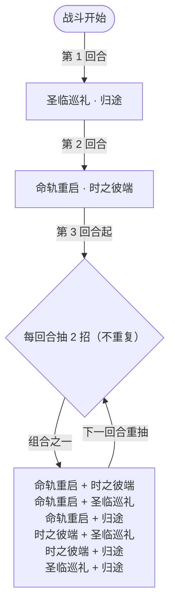

# 终末大天使

> **类型**：精英怪物
> **初始生命**：888
> **遭遇战**：第三层精英战斗
> **特性**：终末（未处于能力提升状态时获 100% 闪避，仅对攻击伤害生效）+ 清除格挡/全属性、反弹伤害的双段循环

## 被动能力（开局自带）

| 名称 | 类型 | 效果 |
|------|------|------|
| **终末** | 开局被动（不可消除） | 自身未处于能力提升状态时，获得 100%[闪避](/powers/dodge_power.md) |

::: tip 终末：100% 闪避，但「闪避」有边界
- 「能力提升状态」= 力量 / 防御 / 命中 / 速度**任一 > 0**。终末大天使自身从不加全属性，因此**默认常驻 100% 闪避**。
- [闪避](/powers/dodge_power.md)只对**攻击伤害**结算：自伤、DoT、**固定伤害不参与闪避**。因此它对普通攻击近乎免疫，但会被[固定伤害](/powers/fixed_damage_power.md)、中毒 / 烧伤 / 冻伤等非攻击来源正常削血。
- 一旦它（无论何种方式）获得任一正向全属性，闪避会立刻撤除；反之属性被清（如它自己的「归途」清全场全属性）后，闪避会重新挂上。
:::

## 行动逻辑

第 1 回合「圣临巡礼 · 归途」，第 2 回合「命轨重启 · 时之彼端」，第 3 回合起每回合随机释放 2 个基础技能（互不相同，**意图上会并排显示这两个技能**）。

> **说明**：`·` 表示同一回合内先后的组合招；第 3 回合起从 4 个基础技能中抽取 2 个（同一行动内依次结算）。

## 招式表

| 招式名 | 意图 | 类型 | 效果 |
|--------|------|------|------|
| **圣临巡礼 · 归途** | 圣临巡礼 + 归途 | 组合招（第 1 回合） | 先施放圣临巡礼，再施放归途 |
| **命轨重启 · 时之彼端** | 命轨重启 + 时之彼端 | 组合招（第 2 回合） | 先施放命轨重启，再施放时之彼端 |
| **随机双技** | 本回合抽中的两招 | 随机（第 3 回合起） | 第 3 回合起从 4 个基础技能中随机抽 2 个（不重复）依次释放；**意图上直接显示这两招的真名与伤害** |
| **终末·命轨重启** | 攻击 40 | 攻击 + Debuff | 造成 40 点伤害；敌人获得 3 层混乱、3 层疲惫、3 层害怕；消除敌人所有增益 |
| **终末·时之彼端** | 攻击 30 | 攻击 + 反弹 | 造成 30 点伤害；反弹自身下回合受到的伤害并恢复等量生命 |
| **圣临巡礼** | 攻击 36 | 攻击 + 自身格挡 | [先制](/powers/first_strike_power.md) +1；以光暗影属性造成 36 点伤害；获得等同本次**实际掉血**的格挡 |
| **归途** | 攻击 20 | 攻击 + 清场 | 造成 20 点伤害；消除双方所有格挡并按清除总量造成等量固定伤害；消除双方所有全属性提升；清除的全属性提升每 1 层使敌人获得 1 种随机异常（各 1 回合） |

::: warning 时之彼端：整回合反弹
- 「终末·时之彼端」获得的反弹是**整回合**生效（本地化描述为「下回合」）：该回合内它每次受到的攻击伤害都 **100% 反馈回你**，并恢复等量生命。
- 由于它常态 100% 闪避，攻击本就难命中；若你已设法破掉闪避，务必避开它处于反弹状态的回合再打，否则等于自己打自己。
:::

::: warning 归途会按你的格挡量反噬
- 归途**清除双方所有格挡**（含它自己的格挡），并按清除总量对**你**造成等量固定伤害；你获得的随机异常**次数**则按清除的**全属性提升层数**（双方合计）计算，每 1 层给 1 次（各 1 回合）。
- 也就是说：**你堆的格挡越多，归途的固定伤害越痛**；**你堆的全属性越高，附加的异常次数越多**。面对它时不要靠一回合叠巨量格挡硬抗——归途会连本带利还给你。
- 它同时清除双方所有全属性提升，这会重新触发它自己的「终末」100% 闪避。
:::

## 遭遇战

| 遭遇战 | 房间类型 | 池子 | 数量 | 说明 |
|--------|----------|------|------|------|
| 终末大天使精英 | Elite | 第三层精英池 | 1 只 | 单怪精英遭遇战 |

## 策略提示

1. **核心破局点：用非攻击伤害**：它默认 100% [闪避](/powers/dodge_power.md)，普通攻击基本无效。解法是[固定伤害](/powers/fixed_damage_power.md)、中毒 / 烧伤 / 冻伤等 DoT —— 这些**不参与闪避**，可以正常削掉它 888 点生命。堆固定伤害是本场的正解。

2. **不要堆格挡**：归途会清除双方所有格挡，并按清除总量对你造成**等量固定伤害**；同时按清除的**全属性提升层数**给你等量次随机异常（各 1 回合）。格挡越厚，固定伤害越狠；属性 buff 越厚，异常越多。抗它的伤害优先用减伤/闪避，而不是堆格挡。

3. **避开时之彼端的反弹回合**：该招当回合内它每次受击都 100% 反伤并回血。即使你已破掉闪避，也别在这回合打它——尤其别用高额一次性伤害，那等于把自己打死。等反弹窗口过去再输出。

4. **命轨重启清空你的增益**：该招造成 40 伤并叠 3 层混乱、3 层疲惫、3 层害怕，还**消除你所有增益**。依赖属性/增益滚雪球的卡组会被频繁打断，注意别把节奏全押在增益上。

5. **圣临巡礼给它回血式格挡**：它获得等同本次实际伤害的格挡，即你越难打穿、它越硬。若走固伤流派，格挡挡不住固定伤害——这进一步说明固伤是正解；若走攻击流，需先破格挡。

6. **第 1 回合组合招最凶**：圣临巡礼（36 伤 + 等量格挡）接归途（清格挡 + 按格挡反噬）。若你在它巡礼后还没破格挡，归途会立刻把它的格挡转成对你的固定伤害。开局尽量别自己先叠大格挡。

7. **第 3 回合起双招随机**：之后每回合随机 2 个基础技能，可能一回合内同时出现高伤（巡礼 36）+ 反弹（时之彼端）或清场（归途）。无法预判，需按最坏组合预留生存手段。

8. **别指望给它上属性破闪避**：理论上让它获得任一正向全属性即可撤除闪避，但它的归途会清除双方全属性、从而**重新挂回闪避**，操作风险高、不划算。老实走固定伤害/DoT 路线更稳。

## 源码

- 怪物：`SeerEndArchangelMonster.cs`
- 被动能力：`SeerEndArchangelPower.cs`（终末）
- 关联能力：`SeerDodgePower.cs`（闪避）、`SeerFixedDamagePower.cs`（固定伤害）、`SeerTimeEndRoundPower.cs`（时之彼端·整回合反弹）、`SeerConfusionPower.cs`（混乱）、`SeerFatiguePower.cs`（疲惫）、`SeerFearPower.cs`（害怕）、`SeerFirstStrikePower.cs`（先制）
- 意图：`SeerNamedSingleAttackIntent.cs`、`SeerPuniNamedBuffIntent.cs`、`SeerDynamicIntentList.cs`（把「随机 2 招」翻译成本回合真实的两条技能意图）
- 遭遇战：`SeerEndArchangelEliteEncounter.cs`
- 本地化：`monsters.json`（`SEER_MONSTER_SEER_END_ARCHANGEL_MONSTER.*`）、`intents.json`（`SEER_END_ARCHANGEL_*`）、`powers.json`（`SEER_POWER_SEER_END_ARCHANGEL_POWER.*`、`SEER_POWER_SEER_TIME_END_ROUND_POWER.*`）
