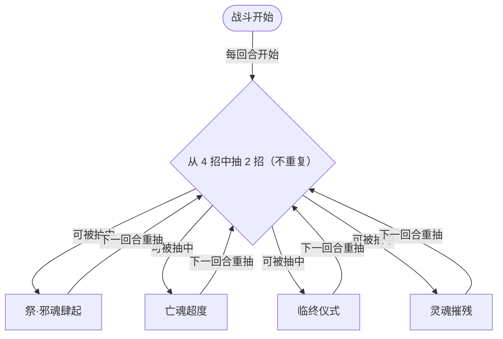

# 邪魂大祭司

> **类型**：精英怪物
> **初始生命**：750
> **遭遇战**：第三层精英战斗
> **特性**：邪祭（开局按你牌组张数获得等量仪式 → 每回合狂涨力量）+ 每回合随机 2 招 + 祭·邪魂肆起按同名牌数指数增伤 + 灵魂摧残无实体

## 被动能力（开局自带）

| 名称 | 类型 | 效果 |
|------|------|------|
| **邪祭**（不可消除） | 能力 | 战斗开始时，敌人**初始牌组**中的**每张牌**使自身获得 1 层**仪式** |

::: warning 邪祭是最凶的力量滚雪球
- **仪式**（原版 Ritual）：拥有者**自己的回合结束时**，获得等同于仪式层数的**力量**；刚获得的第一个回合不触发，从下一次回合结束起开始涨
- 你的牌组有多少张牌，它就叠多少层仪式。30 张牌 → 每回合结束 +30 力量；50 张牌 → 每回合结束 +50 力量
- 力量直接抬高它**每一次攻击**的伤害（祭·邪魂肆起、亡魂超度都吃），而且**每回合都再涨一次**
- **反制核心：牌组越小越好**。这是压它滚雪球速度的唯一直接手段
:::

## 行动逻辑

每回合从 4 个技能中**随机选 2 个（不重复）**依次释放，无固定顺序。**意图上会直接显示本回合抽中的那两招。**

> **说明**：每回合从 4 招里抽 2 招连放（同一回合不会重复同一招）。无法像固定循环那样精准预判，但**每回合必有 2 次行动**，需按"两招"的强度准备防御。

## 招式表

| 招式名 | 意图 | 类型 | 效果 |
|--------|------|------|------|
| **祭·邪魂肆起** | 攻击（动态） | 单次攻击（指数增伤） | 造成 16 点伤害；统计你牌组中数量最多的**同名牌**，你每拥有 1 张该同名牌，本次伤害**翻倍**（伤害 = 16 × 2同名牌数） |
| **亡魂超度** | 攻击（动态） | 单次攻击 + 吸血 + 成长 | 造成 40 点伤害，恢复等于本次**实际伤害**的生命；每使用一次，基础伤害**永久 +10** |
| **临终仪式** | 临终仪式 | 自身增益 + 塞牌 + 标记 | 自身全属性 +6；用【灵魂】【鬼火】填满你的手牌；本场战斗中，你每打出名称含「鬼」或「魂」的牌就失去 5 × 层数的生命（可叠加） |
| **灵魂摧残** | 灵魂摧残 | 全体 Debuff + 自身增益 | 随机施加 3 种异常，每种 3 层；自身获得 5 回合**免控**；获得 3 层**无实体** |

::: warning 两个必须理解的实际效果
- **祭·邪魂肆起的指数增伤**：伤害按"最多同名牌张数 N"取 16 × 2N。带 2 张同名 → 64；4 张同名（如 4 张初始打击）→ 256；再叠加每回合上涨的力量，堪称恐怖。**牌组里的重复牌越多、这一招越致命**。
- **无实体只挡"次数"**：灵魂摧残给的 3 层无实体，让你对它造成的**伤害与生命损失降为 1**，但**按攻次递减**——即只挡掉你接下来的 3 次伤害实例。用多段小攻击（或廉价的攻击牌）先"破盾"，再打真正的爆发。
:::

## 遭遇战

| 遭遇战 | 房间类型 | 池子 | 数量 | 说明 |
|--------|----------|------|------|------|
| `SeerEvilSoulPriestEliteEncounter` | Elite | 第三层精英池 | 1 只 | 第三层单怪精英遭遇战 |

## 策略提示

1. **牌组张数直接决定它的力量增速**：邪祭按你初始牌组每张牌给 1 层仪式，**每个回合结束时** +（层数）力量并**永久累积**。30 张牌起步就是每回合结束 +30 力量；由于仪式在获得后的第一个回合不触发，实际是第 3 回合起它的攻击 +30，第 4 回合起 +60 以上。**这是压死人的主因**——精简牌组、并在 3~4 回合内速杀，是唯一解。

2. **别带重复牌，否则祭·邪魂肆起教你做人**：这一招按你最多的同名牌数取指数：1 张 → 32，2 张 → 64，3 张 → 128，4 张 → 256。**牌组里同名卡越少越好**，初始的重复打击/防御本身就是隐患。

3. **无实体挡的是次数不是回合**：灵魂摧残给 3 层无实体，你的前 3 次伤害实例只会打出 1 点。**先用 3 张廉价多段/小攻击"骗掉"无实体**，再倾泻真正的爆发——否则大招会被压成 1。

4. **亡魂超度越用越猛且会吸血**：基础伤害 40，**每用一次永久 +10**（第二次 50、第三次 60…），并按**实际掉血**回血。若你护不住要害，它会靠吸血稳住血线。**别让它多次使用这招**——速战速决。

5. **临终仪式塞满你的手牌是"双刃陷阱"**：它用【灵魂】【鬼火】把你的手牌填满（按 10 张上限），且每打出名称含「鬼」「魂」的牌你会掉 5×层数血。**灵魂/鬼火两张都带"魂/鬼"，打出去就是自残**——能弃则弃、能消耗则消耗，别被迫打它们。

6. **临终仪式的标记会叠加**：每次临终仪式都会让"打出鬼/魂牌的扣血"层数 +1。若它反复放这招，之后每打一张鬼/魂牌扣血会越来越多。**手牌被塞满时优先找弃牌/消耗手段清理**。

7. **每回合两招，防御要按两招算**：它不像固定循环怪只出一招，而是**每回合随机连放 2 个技能**（不重复）。可能"祭·邪魂肆起 + 亡魂超度"同回合打出双高伤。**格挡/减伤要按 2 次行动的总量准备**，无法只防一招。

8. **灵魂摧残的免控锁死削弱手段**：它给自己 5 回合免控，期间你无法用异常削弱它。**别把节奏建立在"先上虚弱再打"上**；多段面对高力量，减伤/格挡类更靠得住。

9. **随机性带来的最坏情况**：两招随机意味着它可能连续回合抽到"祭·邪魂肆起 + 亡魂超度"这种高伤组合。**手牌里常备一次大额格挡/硬减伤**以应对连锁爆发；750 血本身不厚，问题的核心始终是"力量涨得太快"，速杀压倒一切。

## 源码

- 怪物：`SeerEvilSoulPriestMonster.cs`
- 被动能力：`SeerEvilSoulPriestPower.cs`（邪祭）
- 临终仪式标记：`SeerNewSkillPowersD.cs`
- 免控：`SeerDebuffImmunePower.cs`；无实体：`IntangiblePower.cs`（原版）
- 意图：`SeerNamedSingleAttackIntent.cs`、`SeerNamedDebuffIntent.cs`、`SeerDynamicIntentList.cs`
- 遭遇战：`SeerEvilSoulPriestEliteEncounter.cs`
- 本地化：`monsters.json`（`SEER_MONSTER_SEER_EVIL_SOUL_PRIEST_MONSTER.*`）、`intents.json`（`SEER_PRIEST_*`）、`powers.json`（`SEER_POWER_SEER_EVIL_SOUL_PRIEST_POWER.*` 等）
