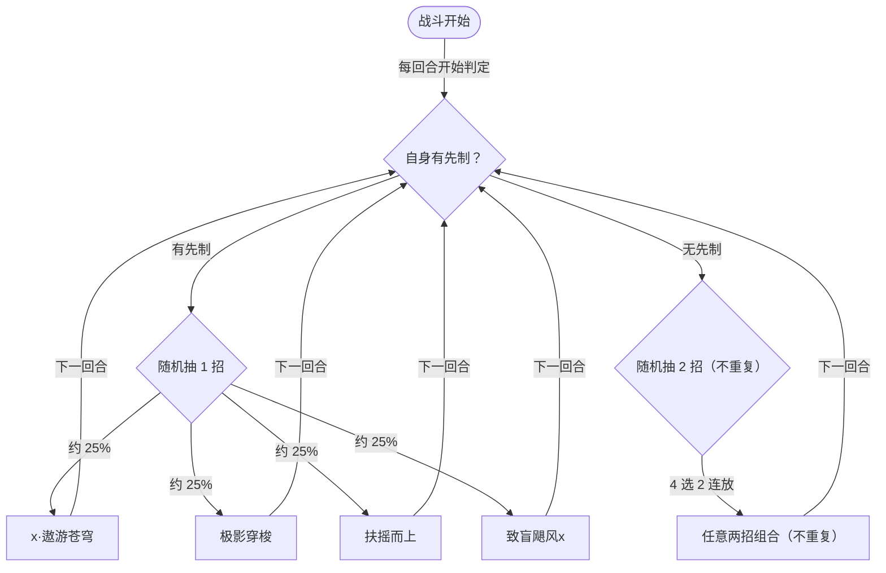

# 极天之翼·托鲁克

> **类型**：精英怪物
> **初始生命**：2000
> **遭遇战**：第三层精英战斗
> **特性**：极天之翼（每回合开始若无先制则先制 +3 → 抬高你出牌耗能）+ 按先制切行动次数 + 速度滚雪球 + 致盲飓风全体削弱

## 被动能力（开局自带）

| 名称 | 类型 | 效果 |
|------|------|------|
| **极天之翼**（不可消除） | 能力 | 每回合开始时，若自身没有**先制**（或层数 ≤ 0），则获得 3 层先制 |

::: tip 先制对托鲁克意味着什么
- **先制**：正层数拥有者的对手每层打牌耗能 +1。**托鲁克持有先制时，你下一张牌耗能 +（先制层数）**——被动常见给到 3 层，等于**你每回合第一张牌要额外花 3 费**
- 先制在**你打出牌后**被清除（下一回合它的被动再补满）
- 它自身也用先制**决定行动次数**（见行动逻辑）与**遨游苍穹的段数**
- 结论：你每回合几乎都要先为"第一张牌 +3 费"买单，出牌/出能量规划要据此调整
:::

## 行动逻辑

按自身是否持有先制切换：**有先制 → 随机 1 招**；**无先制 → 随机 2 招（不重复）**。判定发生在你的回合开始（抽意图时），两种情况意图都会显示具体抽中的招，2 招时并排显示两个技能名。

> **说明**：意图是在**你的回合开始**抽定的，而它的被动会在**它自己回合开始**补先制，所以多数回合抽意图时它都持有先制 → **每回合只出 1 招**（但会持续抬高你的耗能）。只有在抽意图之前把它的先制清掉（驱散/移除增益等），才会抽到 2 招。`x·遨游苍穹` 的段数随它当前先制层数变化。

## 招式表

| 招式名 | 意图 | 类型 | 效果 |
|--------|------|------|------|
| **x·遨游苍穹** | 攻击 48×N | 动态多段攻击 + 固伤 | 造成 48 点伤害；自身每有 1 层**先制**额外发动 1 次攻击（段数 = 1 + 先制层数）；附加等于自身**当前速度值 ×10** 的固定伤害 |
| **极影穿梭** | 攻击 8×5 | 多段攻击 + 自身增益 | 连续攻击 5 次、每次 8 点；每次造成**实际伤害**后，自身速度 +2 并获得 30 点格挡 |
| **扶摇而上** | 扶摇而上 | 自身增益 | 自身全属性 +7；获得 3 回合效果：每回合**先制 +1、速度 +2** |
| **致盲飓风x** | 致盲飓风x | 自身增益 + 全体 Debuff | 自身先制 +2；对所有敌人施加：命中 -7、易伤 5 层、虚弱 5 层、害怕 3 层、失明 3 层 |

::: warning 速度是它真正的滚雪球引擎
- **极影穿梭**每次实际命中都让它 **速度 +2 并 +30 格挡**，最多一轮 +10 速度、+150 格挡
- **遨游苍穹**的附加固伤 = **当前速度 ×10**。速度越堆越高，这一击的固定伤害就越恐怖（速度 5 → 附加 50 固伤）
- **扶摇而上**再给 3 回合的每回合速度 +2，把速度雪球踩得更快
- 应对要点：**别让它多次命中极影穿梭/扶摇而上**，否则速度固伤会迅速失控
:::

## 遭遇战

| 遭遇战 | 房间类型 | 池子 | 数量 | 说明 |
|--------|----------|------|------|------|
| `SeerExtremeSkyWingTorukEliteEncounter` | Elite | 第三层精英池 | 1 只 | 第三层单怪精英遭遇战 |

## 策略提示

1. **先制在收你"过路费"**：托鲁克持有先制（常见 3 层）时，你每回合第一张牌耗能 +3。**先花能量规划好第一张牌**——把最想早打出来的牌放在清除先制的那一张上，或先打一张便宜的牌"交税"。

2. **它的行动次数与先制挂钩**：有先制 → 每回合 1 招（被动几乎总会在它回合开始补满）；无先制 → 连出 2 招。注意判定在**你的回合开始**：你正常出牌只会消耗自己这一次的加费，它的被动随后又补满，所以不会因此变成 2 招；只有用驱散类手段在抽意图前清掉它的先制，才会让它当回合连放 2 招。

3. **速度滚雪球优先级最高**：极影穿梭每次命中就速度 +2、格挡 +30，扶摇而上还每回合 +2 速度。而**遨游苍穹附加速度×10 的固伤**。**优先打断/压速度**——别让它反复打出极影穿梭与扶摇而上，否则固伤会从几十涨到上百。

4. **遨游苍穹的段数看先制**：段数 = 1 + 先制层数。3 层先制 → 4×48 = 192，还外加速度×10 固伤。**它的先制越高，这一招越致命**——设法别让它长期保持高先制。

5. **致盲飓风x 是全体削弱组合拳**：命中 -7、易伤 5、虚弱 5、害怕 3、失明 3 一次糊上来。**失明**会让你攻击时有几率自伤/伤害降低，**易伤**再让你多挨 50% 伤害。挨了之后要么立刻解异常，要么留足格挡硬吃。

6. **极影穿梭的 +格挡**：它一轮极影穿梭可获得最多 150 格挡。**想打它就得先破格挡**——用多段攻击或高单发，别让格挡把你的输出吞掉。

7. **扶摇而上给的是持续 3 回合的强化**：先制 +1/速度 +2 每回合都在叠。**看到它打出扶摇而上，就等于吹响了它加速的号角**——尽快进入斩杀，或准备承受越来越高的固伤。

8. **2000 血 + 格挡 + 速度 = 拉锯战**：它靠格挡（极影穿梭）与速度固伤打持久战。**多段攻击 + 破格挡手段**比纯爆发更稳；同时注意它格挡会随每次极影穿梭上涨。

9. **多人注意致盲飓风的全体 debuff**：致盲飓风对**所有敌人**生效，全队一起被削命中/挂易伤/失明。**多人时需分配解异常资源**，并让命中稳定的队友承担关键输出，避免被失明拖成"打自己"。

## 源码

- 怪物：`SeerExtremeSkyWingTorukMonster.cs`
- 被动能力：`SeerExtremeSkyWingTorukPower.cs`（极天之翼）
- 极影穿梭：`SeerNewSkillPowersC.cs`
- 扶摇而上：`SeerNewSkillPowersD.cs`
- 先制：`SeerFirstStrikePower.cs`；失明：`SeerBlindPower.cs`；害怕：`SeerFearPower.cs`
- 固定伤害：`SeerFixedDamagePower.cs`
- 意图：`SeerDynamicMultiAttackIntent.cs`、`SeerNamedMultiAttackIntent.cs`、`SeerPuniNamedBuffIntent.cs`、`SeerDynamicIntentList.cs`
- 遭遇战：`SeerExtremeSkyWingTorukEliteEncounter.cs`
- 本地化：`monsters.json`（`SEER_MONSTER_SEER_EXTREME_SKY_WING_TORUK_MONSTER.*`）、`intents.json`（`SEER_TORUK_*`）、`powers.json`（`SEER_POWER_SEER_EXTREME_SKY_WING_TORUK_POWER.*` 等）
