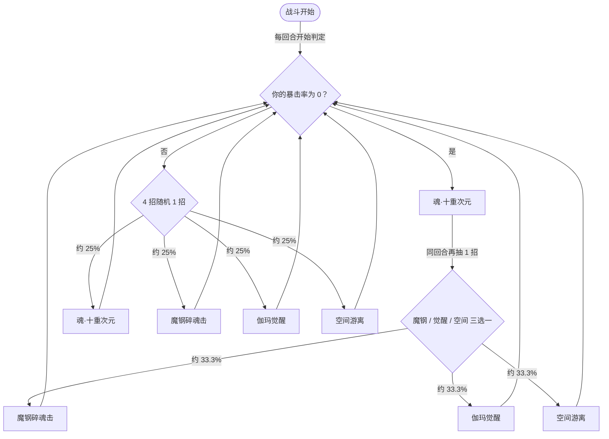

# 伽玛星魂

> **类型**：精英怪物
> **初始生命**：1234
> **遭遇战**：第三层精英战斗
> **特性**：星陨（免疫并反弹暴击伤害，且受暴击后立即结束你的回合）+ 按你暴击率切换行动模式 + 反弹异常/偷属性

## 被动能力（开局自带）

| 名称 | 类型 | 效果 |
|------|------|------|
| **星陨**（不可消除） | 能力 | ① **免疫暴击伤害**，并把该次暴击伤害**反弹**给你；② 每次被攻击暴击命中后，**立即结束你的当前回合**（不可撤销） |

::: warning 星陨专门克制暴击流
- **暴击被免疫**：你打出的暴击不造成伤害，伤害量被**原样反弹**回你身上（无视格挡的生命流失）
- **回合被立即结束**：受到暴击后，你的**当前回合当场结束**（不可撤销），你剩下的手牌、能量全部作废
- 结论：**面对伽玛星魂不要打暴击**——一次暴击 = 白送伤害 + 回合被切断
:::

## 行动逻辑

行动模式**由你的暴击率决定**：你的暴击率为 0 时它每回合放 2 招（魂·十重次元 + 从魔钢碎魂击/伽玛觉醒/空间游离中随机 1 招）；暴击率不为 0 时它每回合只放 1 招（4 选 1 随机）。

> **说明**：暴击率为 0 时它**每回合连放 2 招**（先技能 1，再从 2/3/4 随机 1 招）；暴击率不为 0 时**每回合只放 1 招**。带暴击能压它的行动次数，但代价是星陨的反弹与断回合。

## 招式表

| 招式名 | 意图 | 类型 | 效果 |
|--------|------|------|------|
| **魂·十重次元** | 攻击 5×10 | 多段攻击 + 异常 + 命中 | 连续攻击 10 次、每次 5 点；每次攻击随机施加 1 种异常（1 层）；使敌人命中 +5 |
| **魔钢碎魂击** | 攻击（动态） | 单次攻击 + 先制 | 造成 35 点伤害；自身先制 +2；你每拥有 1 种异常状态，本次伤害 +5 |
| **伽玛觉醒** | 伽玛觉醒 | 自身增益 | 自身全属性 +5；获得 3 回合效果：你每打出 1 张攻击牌，**该牌 PP 清零**，每次触发自身获得 18 点格挡 |
| **空间游离** | 空间游离 | 自身增益 + 削属性 | 获得 5 回合**弹控**；使敌人**敏捷 -10**；随机吸取敌人除命中外的 1 种属性 24 点（力量/防御/速度三选一） |

::: tip 几个容易被忽略的点
- **魂·十重次元的命中 +5 是给你加的**：这一招会提升**你的**命中 +5（对你有利），但同时会甩你 10 个随机异常。别被"命中 +5"迷惑——异常缠身才是主要代价。
- **魔钢碎魂击吃你的异常种数**：35 + 5×(你身上的异常种数)。叠了 4 种异常 → 55 点。**保持身上异常干净**能显著压低这一击。
- **伽玛觉醒期间打攻击牌会掉 PP**：3 回合内你每打出攻击牌，该牌 PP 清零，并给它 +18 格挡。**这段时间少打攻击牌**（改用技能/能力牌），或接受 PP 损失与它涨格挡。
:::

## 遭遇战

| 遭遇战 | 房间类型 | 池子 | 数量 | 说明 |
|--------|----------|------|------|------|
| `SeerGammaStarSoulEliteEncounter` | Elite | 第三层精英池 | 1 只 | 第三层单怪精英遭遇战 |

## 策略提示

1. **暴击流直接报废**：星陨免疫暴击伤害、把伤害反弹给你、还立刻结束你的回合。**任何带暴击的构筑面对它都要么停手、要么换不暴击的攻击**。一次暴击就可能让你整回合的节奏崩掉。

2. **暴击率是个"开关"，权衡后再按**：你暴击率为 0 → 它每回合放 **2 招**（更痛）；不为 0 → 每回合只放 **1 招**（但你的暴击会触发星陨）。**理想是"暴击率压得极低但非 0 且几乎不触发暴击"**，若做不到，就要分清"多吃一招"和"暴击自伤 + 断回合"哪个更亏。

3. **魂·十重次元是异常制造机**：10 段每段随机甩 1 个异常，一回合能给你糊上多个不同异常。**备好解异常手段**，否则下一招魔钢碎魂击会因你异常多而暴增（每多 1 种 +5）。

4. **魔钢碎魂击按异常种数增伤**：35 基础 + 每种异常 +5。**尽量保持身上只有 0~1 种异常**，能把这一击压在 35~40 点；异常缠身时可能飙到 60+。

5. **伽玛觉醒时别硬打攻击牌**：3 回合内你每打攻击牌，该牌 PP 清零、它再 +18 格挡。**改走技能牌/能力牌输出，或干脆攒牌**，等这 3 回合过去再爆发，避免又掉 PP 又喂它格挡。

6. **空间游离偷属性 + 削敏捷**：它 5 回合弹控（你上 debuff 会被反弹给全体），还偷走你力量/防御/速度之一的 24 点、并给你敏捷 -10。**别在弹控期上 debuff**；被偷属性的那一项 buff 等于白铺，注意补回。

7. **它对"多段"比"爆发"更友好**：没有暴击的多段攻击（如低费连击）既能稳定推进，又不会触发星陨。**用不暴击的多段武器磨血**，比一发暴击大招划算得多。

8. **1234 血偏厚，但行动可控**：它的威胁是"异常累积 → 高伤 + 断回合"，而非瞬间斩杀。**控制异常、避开暴击、稳扎稳打**，节奏在 6~8 回合；反而拖太久会被多次魂·十重次元堆满异常，需及时清理。

9. **多人注意弹控与偷属性**：空间游离的弹控会把异常反弹给**全体玩家**，偷属性也是对你方某一目标结算；空间游离/伽玛觉醒在多人下威胁面更大。**全队统一避免暴击**是这场的共同纪律。

## 源码

- 怪物：`SeerGammaStarSoulMonster.cs`
- 被动能力：`SeerGammaStarSoulPower.cs`（星陨）
- 觉醒：`SeerNewSkillPowersE.cs`
- 弹控：`SeerDebuffImmuneReflectPower.cs`
- 暴击判定：`SeerCriticalStrikePower.cs`
- 意图：`SeerNamedSingleAttackIntent.cs`、`SeerNamedMultiAttackIntent.cs`、`SeerPuniNamedBuffIntent.cs`、`SeerDynamicIntentList.cs`
- 遭遇战：`SeerGammaStarSoulEliteEncounter.cs`
- 本地化：`monsters.json`（`SEER_MONSTER_SEER_GAMMA_STAR_SOUL_MONSTER.*`）、`intents.json`（`SEER_GAMMA_*`）、`powers.json`（`SEER_POWER_SEER_GAMMA_STAR_SOUL_POWER.*` 等）
