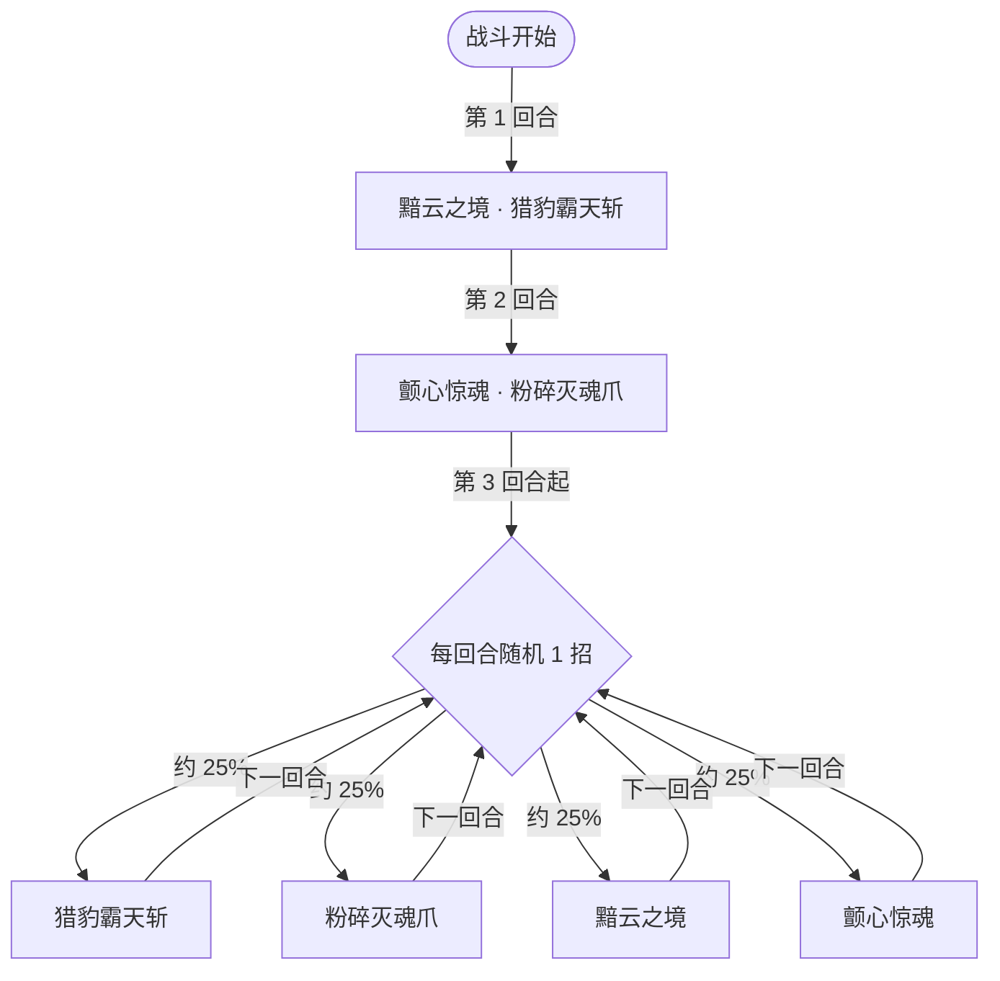

# 鬼蚀豹尊

> **类型**：精英怪物
> **初始生命**：826
> **遭遇战**：第三层精英战斗
> **特性**：蚀影（按你抽牌堆+弃牌堆牌数概率翻倍伤害）+ 复制你的牌撑大牌堆（反过来喂高它的伤害）+ 猎豹霸天斩连击随属性提升

## 被动能力（开局自带）

| 名称 | 类型 | 效果 |
|------|------|------|
| **蚀影** | 能力（不可消除） | 自身造成的伤害有概率**翻倍**，概率 = 敌人**抽牌堆与弃牌堆中的卡牌数量之和**（上限 100%） |

::: warning 你的牌堆越大，它打得越狠
蚀影的翻倍概率**直接等于**你「抽牌堆 + 弃牌堆」的总牌数。牌堆一旦堆到 100 张，它的**每一次**伤害都翻倍。更糟的是它自己还会**把你的牌复制回你的牌堆**（黯云之境复制弃牌堆、颤心惊魂复制抽牌堆）——你越拖，牌堆越厚，它的翻倍概率和粉碎爪上限就越高。**速杀是唯一解**。
:::

## 行动逻辑

前两回合固定组合：第 1 回合黯云之境 → 猎豹霸天斩；第 2 回合颤心惊魂 → 粉碎灭魂爪；第 3 回合起从四招中随机 1 招。

> **说明**：前两回合各是一套双招组合，第 3 回合起四选一随机（含复制你牌堆的两招）。

## 招式表

| 招式名 | 意图 | 类型 | 效果 |
|--------|------|------|------|
| **猎豹霸天斩** | 攻击 7×N | 多段攻击 + 回血 | 连续攻击 7 次，每次 7 点伤害；自身每有 **1 种属性提升**，连击数额外 +1；**恢复等于本技能造成的总伤害的生命值** |
| **粉碎灭魂爪** | 攻击 随机 0~40 | 单次攻击（浮动） | 在区间内随机取值：下限 = 你的**抽牌堆张数**，上限 = 40 + 你的**弃牌堆张数**（上限低于下限时取下限） |
| **黯云之境** | 强化 | 自身增益 + 复制 | 自身全属性 +5；获得 5 层[缓冲](/powers/buffer_power.md)；**复制敌人弃牌堆中的所有卡牌** |
| **颤心惊魂** | 强化 | 必暴 + 弹控 + 复制 | 自身接下来 2 次攻击[必定暴击](/powers/next_guaranteed_crit_power.md)；获得 5 回合[弹控](/powers/debuff_immune_reflect_power.md)；**复制敌人抽牌堆中的所有卡牌** |
| **黯云之境·猎豹霸天斩** | 首回合组合 | 连招（2 招） | 先放黯云之境，再放猎豹霸天斩 |
| **颤心惊魂·粉碎灭魂爪** | 第 2 回合组合 | 连招（2 招） | 先放颤心惊魂，再放粉碎灭魂爪 |

::: tip 猎豹霸天斩的连击与回血会滚雪球
黯云之境先把豹尊的四项属性各 +5（= 4 种属性提升），紧接着的猎豹霸天斩基础 7 击就会变成 7+4=11 击 × 7 = 77 点，并**回复等量生命**。每再叠一次属性提升，连击再来 +1。加上「必定暴击」时，单次可以进一步放大。
:::

## 遭遇战

| 遭遇战 | 房间类型 | 池子 | 数量 | 说明 |
|--------|----------|------|------|------|
| 鬼蚀豹尊精英 | Elite | 第三层精英池 | 1 只 | 单怪精英遭遇战 |

## 策略提示

1. **它血很少（826），速杀是正解**：豹尊血量在精英里偏低，但拖下去会因蚀影翻倍与牌堆膨胀变得极危险。**在前 2-3 回合内解决**是最稳的。

2. **控制你的牌堆厚度**：蚀影翻倍概率 = 你**抽牌堆 + 弃牌堆**牌数之和。你**弃牌越多、牌堆越厚**，它翻倍越频繁；**粉碎灭魂爪**的上下限也随你**抽/弃牌堆**数量线性增长。尽量**精简出牌、减少无谓弃牌**（或用消耗把牌移出弃牌堆），压低它的翻倍概率与爪击伤害。

3. **别让它复制你的牌**：黯云之境**复制你的整个弃牌堆**、颤心惊魂**复制你的整个抽牌堆**，把副本塞回你的牌堆——你的牌越多，它的蚀影概率和粉碎爪上限就越高。**尽快打断/速杀**，或在此之前把关键牌用掉、减少可被复制的牌。

4. **猎豹霸天斩的连击随属性膨胀**：它每有 1 种属性提升就多 1 段，且**回血等于总伤害**。黯云之境之后的首斩常达 11 段；你越低效、给它越多属性空间，它回血越猛。要优先在早期压低它的血线、阻止它靠回血站桩。

5. **颤心惊魂的必暴 + 弹控**：它给自己 2 次[必定暴击](/powers/next_guaranteed_crit_power.md)，接下来的攻击（含粉碎灭魂爪）会按 1.5× 结算，叠上蚀影翻倍就是 **3×** 量级；同时 5 回合弹控会让你的异常**反弹回自己**——这期间别对它上异常。

6. **黯云之境的 5 层缓冲要先破**：获得 5 层缓冲（免疫接下来 5 次伤害实例）。它有缓冲时你的伤害会被白白吃掉，需用**多段/小额**先磨掉缓冲再打真实伤害。

7. **粉碎灭魂爪的浮动区间**：下限 = 你抽牌堆张数，上限 = 40 + 弃牌堆张数。牌堆厚时这一爪可能直接打出很高的数值且带翻倍——**保持牌堆精简**是降低这发威胁的直接手段。

8. **多段防守更划算**：它的伤害以多段（猎豹斩 7×N）和单发浮动（粉碎爪）为主；多段护璧/按次数触发的防御对连击类很有效，固定减伤对粉碎爪稳定收益。

## 源码

- 怪物：`SeerGhostErosionLeopardLordMonster.cs`
- 被动能力：`SeerGhostErosionLeopardLordPower.cs`（蚀影）
- 招式相关能力：`BufferPower.cs`（缓冲）、`SeerNextGuaranteedCritPower.cs`（必定暴击）、`SeerDebuffImmuneReflectPower.cs`（弹控）
- 遭遇战：`SeerGhostErosionLeopardLordEliteEncounter.cs`
- 本地化：`monsters.json`（`SEER_MONSTER_SEER_GHOST_EROSION_LEOPARD_LORD_MONSTER.*`）、`intents.json`（`SEER_LEOPARD_LEOPARD_SLASH`、`SEER_LEOPARD_SHATTER_CLAW`、`SEER_LEOPARD_DARK_CLOUD`、`SEER_LEOPARD_TREMBLE_SOUL`）、`powers.json`（`SEER_POWER_SEER_GHOST_EROSION_LEOPARD_LORD_POWER.*`）
