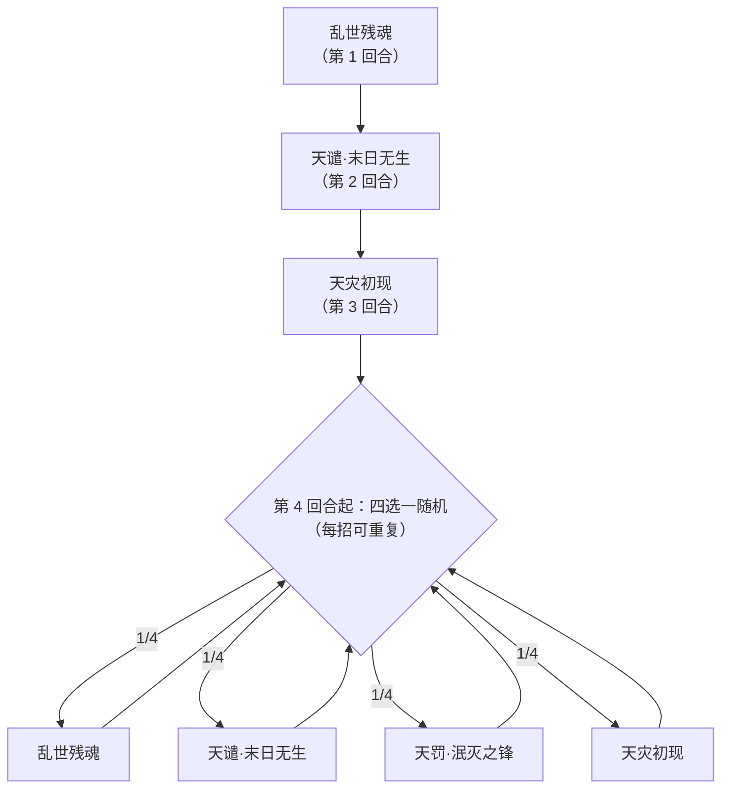

# 鬼面阎罗

> **类型**：精英怪物
> **初始生命**：975
> **遭遇战**：第三层精英战斗
> **特性**：阎罗之威（自身每 1 级属性使伤害 +20%）+ 三招固定起手 + 天谴吸收强化必定暴击 + 天灾初现叠永久免伤

## 被动能力（开局自带）

| 名称 | 类型 | 效果 |
|------|------|------|
| **[阎罗之威](/powers/ghost_face_yama_power.md)**（不可消除） | 能力 | 自身每提升 1 级能力，造成的伤害提高 20% |

::: warning 阎罗之威怎么算「1 级能力」
- 「级别」= **自身四维正层数之和**（[力量](/powers/strength_power.md) + [防御](/powers/defense_power.md) + [命中](/powers/accuracy_power.md) + [速度](/powers/speed_power.md)）。
- 伤害倍率 = 1 + 级别 × 20%。它第 1 回合的乱世残魂给自己 +7 全属性 = 28 级 → **伤害直接 ×6.6**；两轮乱世残魂后 56 级 → ×12.2。
- **它的属性越高，所有攻击越疼**——这是它最核心的滚雪球机制，也是你要优先压制的东西。
:::

## 行动逻辑

前 3 回合固定：乱世残魂 → 天谴·末日无生 → 天灾初现；第 4 回合起从四招中随机 1 招。

> **说明**：第 1~3 回合固定脚本（先叠属性、再吸收+暴击、后叠免伤）。第 4 回合起在乱世残魂 / 天谴·末日无生 / 天罚·泯灭之锋 / 天灾初现 之间四选一随机，可重复。

## 招式表

| 招式名 | 意图 | 类型 | 效果 |
|--------|------|------|------|
| **天谴·末日无生** | 攻击 50 | 吸收强化 + 攻击（可必定暴击） | **吸收敌人**的四维正属性（力量/防御/命中/速度，1:1 转给自己）；造成 50 点伤害；**若自身处于能力提升状态，则本次攻击必定暴击** |
| **天罚·泯灭之锋** | 攻击 40 | 攻击 + 多重异常 + 先制 | 造成 40 点伤害；对所有敌人施加持续 3 回合的[诅咒](/powers/curse_power.md)、[害怕](/powers/fear_power.md)、[疲惫](/powers/fatigue_power.md)；自身[先制](/powers/first_strike_power.md) +2 |
| **乱世残魂** | 乱世残魂 | 自身增益 + 格挡 + 护强化 | 自身全属性 +7；获得 80 点格挡；[3 回合内强化被消除时恢复](/powers/chaos_remain_soul_power.md) |
| **天灾初现** | 天灾初现 | 弹控 + 永久免伤 | 获得持续 5 回合的[弹控](/powers/debuff_immune_reflect_power.md)；获得持续 1 回合的特殊效果：**敌人每使用 1 张牌，自身获得 10% 永久免伤** |

::: warning 天谴的意图 50 远低于实际
- 它有任意正属性时，天谴**必定暴击**（×1.5）。再叠加阎罗之威的属性增伤：
  - 第 1 回合乱世残魂后 28 级 → 天谴 50 × 6.6 × 1.5 ≈ 495。
  - 若你在第 2 回合前挂了正属性（被它吸收），级别更高 → 伤害再涨。
- 意图上只显示 50，**实际承受往往是 500 以上**。**第 2 回合务必按 495+ 预留格挡/减伤**。
:::

::: warning 天灾初现的「永久免伤」是拖时间的惩罚
- 该效果持续 1 回合（即你紧接着的那个回合）：你**每打出 1 张牌**，它就获得 10% 永久[免伤](/powers/permanent_damage_reduction_power.md)。
- 你在一回合里连甩 6 张牌 = 它 +60% 永久免伤，本场后半段基本打不动。**它出完天灾初现的那一回合，尽量少出牌**（或只出关键 1~2 张）。
- 同时它还有 5 回合[弹控](/powers/debuff_immune_reflect_power.md)：你的异常无效并**反弹给你**。
:::

::: tip 三类异常（诅咒 / 害怕 / 疲惫）
- **[诅咒](/powers/curse_power.md)**：攻击伤害 -10%；每回合开始获得一张诅咒牌；回合结束受 3~50 点随机伤害后减 1 层。
- **[害怕](/powers/fear_power.md)**：攻击伤害 -30%，回合结束减 1 层。
- **[疲惫](/powers/fatigue_power.md)**：攻击伤害 -20%，且每次造成伤害时自身受到等于层数的不可格挡伤害，回合结束减 1 层。
- 三者各 3 回合叠在一起，输出被压掉一大截，还会附带诅咒牌污染与自伤。
:::

## 遭遇战

| 遭遇战 | 房间类型 | 池子 | 数量 | 说明 |
|--------|----------|------|------|------|
| `SeerGhostFaceYamaEliteEncounter` | Elite | 第三层精英池 | 1 只 | 第三层单怪精英遭遇战 |

## 策略提示

1. **它的属性就是伤害倍率——别给它叠、也别送它叠**：阎罗之威把四维层数总和换算成伤害增伤（每级 +20%）。乱世残魂一次 +7 全属性 = 28 级 = **×6.6**。**压制它的属性成长，是这场的头号任务**。

2. **第 2 回合天谴 = 吸收你的强化 + 必定暴击，约 495+ 伤害**：它先抢走你的正属性（变相给自己叠伤），再以「有属性 → 必定暴击」打出一记 50 × 倍率 × 1.5。**第 2 回合前身上别留正属性**（送了等于给它加伤），**并准备好 495+ 的格挡或减伤**。

3. **第 3 回合天灾初现，之后那一回合少出牌**：它出完天灾初现后的**你的回合**，你每打 1 张牌它就 +10% 永久免伤。**最多只出关键 1~2 张**，否则本场后半段你会彻底打不动它。

4. **天灾初现的 5 回合弹控 = 别丢异常**：这 5 回合内你的所有 debuff 对它无效，还会**反弹到你自己身上**。**这 5 回合纯输出，别浪费异常牌**，也小心反弹把自己毒/虚弱了。

5. **乱世残魂 3 回合内强化不可被消除**：它第 1 回合乱世残魂后，**3 回合内你消除它强化的手段会被它自动恢复**。想扒它的属性，要么等这 3 回合过，要么等它自己没开这层保护时再动手。

6. **天罚的三重异常会抽干你的输出**：诅咒（-10% + 塞诅咒牌 + 3~50 随机伤）、害怕（-30%）、疲惫（-20% + 自伤），各 3 回合叠一起。**别把爆发排在这 3 回合**，或先备净化 / 提高基础伤害。

7. **975 血 + 80 格挡 + 永久免伤，是本批最耐打的之一**：它有三重生存（厚血、乱世残魂的格挡、天灾初现的免伤）。**靠平砍基本磨不动**——必须用大爆发 + 精准的少出牌节奏（避免给它叠免伤）。

8. **第 4 回合起四选一随机**：乱世残魂（继续叠属性/格挡）、天谴（吸强化+暴击）、天罚（40 + 异常）、天灾初现（弹控+免伤）——随机意味着你要同时准备好「应付暴击大伤、扛异常、压制它叠免伤」。

9. **核心节奏总结**：**T2 顶住 495 暴击 → T3 后少出牌压免伤 → 等它弹控/护强化窗口过 → 一波大爆发**。全程避免在自己身上堆属性、避免多段连甩。合理节奏 8~12 回合。

## 源码

- 怪物：`SeerGhostFaceYamaMonster.cs`
- 被动能力：`SeerGhostFaceYamaPower.cs`（阎罗之威）
- 乱世残魂：`SeerNewSkillPowersF.cs`
- 天灾初现：`SeerNewSkillPowersD.cs`、`SeerDebuffImmuneReflectPower.cs`
- 必定暴击：`SeerNextGuaranteedCritPower.cs`
- 诅咒 / 害怕 / 疲惫：`SeerCursePower.cs`、`SeerFearPower.cs`、`SeerFatiguePower.cs`
- 意图：`SeerNamedSingleAttackIntent.cs`（天谴/天罚）、`SeerPuniNamedBuffIntent.cs`（乱世残魂/天灾初现）
- 遭遇战：`SeerGhostFaceYamaEliteEncounter.cs`
- 本地化：`monsters.json`（`SEER_MONSTER_SEER_GHOST_FACE_YAMA_MONSTER.*`）、`intents.json`（`SEER_YAMA_*`）、`powers.json`（`SEER_POWER_SEER_GHOST_FACE_YAMA_POWER.*`、`SEER_POWER_SEER_CHAOS_REMAIN_SOUL_POWER.*`、`SEER_POWER_SEER_CALAMITY_EMERGES_POWER.*` 等）
