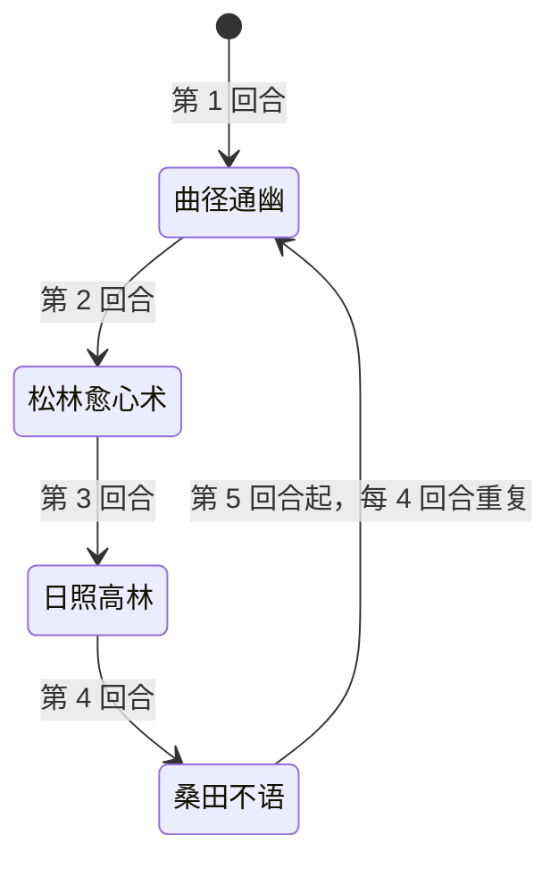

# 古温婆婆

> **类型**：精英怪物
> **初始生命**：1256
> **遭遇战**：第三层精英战斗
> **特性**：古温（每回合对你 +5 中毒 +5 寄生）+ 固定四连循环 + 曲径通幽回血格挡 + 日照高林毒寄翻倍

## 被动能力（开局自带）

| 名称 | 类型 | 效果 |
|------|------|------|
| **[古温](/powers/guwen_granny_power.md)**（不可消除） | 能力 | 每回合开始时（怪物侧），对所有敌人施加 5 层[中毒](/powers/poison_power.md)和 5 层[寄生](/powers/parasite_power.md) |

::: tip 中毒与寄生的结算方式
- **[中毒](/powers/poison_power.md)**：自身回合开始时，受到等于当前层数的伤害，然后**层数减半**。
- **[寄生](/powers/parasite_power.md)**：自身回合开始时，受到等于当前层数的伤害，**古温婆婆回复等量生命**，然后层数 -1。
- 两者每回合都被古温被动 +5 层补充；寄生更狠——你受到的寄生伤害会**等量治疗她**，等于全额变成她的续航。
- 日照高林期间，这两个层数还会**每回合被翻倍**（见下）。
:::

## 行动逻辑

完全固定循环：曲径通幽 → 松林愈心术 → 日照高林 → 桑田不语，然后回到曲径通幽，周而复始。

> **说明**：4 招固定顺序、无随机，可精确预判每一回合她要干什么——这既是她的弱点（可针对布防），也是她的强点（循环里既有回血格挡又有毒爆）。

## 招式表

| 招式名 | 意图 | 类型 | 效果 |
|--------|------|------|------|
| **曲径通幽** | 曲径通幽 | 格挡 + 反击固伤 + 回血 | 获得 240 点格挡；恢复 240 点生命；**该格挡消失时**对所有敌人造成 24 点[固定伤害](/powers/fixed_damage_power.md) |
| **松林愈心术** | 攻击 45 | 攻击 + 封印 + 汲取 | 造成 45 点伤害；使敌人**下回合无法打出攻击牌和技能牌**；在接下来的 3 个它的回合开始时，每回合吸取敌人 8 点生命（能力显示 4 层） |
| **日照高林** | 日照高林 | 自身增益 + 毒寄翻倍 | 自身全属性 +7；在接下来的 3 个它的回合开始时，将敌人的当前[中毒](/powers/poison_power.md)与[寄生](/powers/parasite_power.md)层数**翻倍**（能力显示 4 层） |
| **桑田不语** | 攻击 35 | 攻击 + 异常转化 | 造成 35 点伤害；将**自身所有异常状态层数总和**转化为等量中毒和寄生，施加给敌人 |

::: warning 松林愈心术封的是「攻击牌和技能牌」
- 该招之后你**下一回合无法打出**攻击牌与技能牌（能力牌不受影响）。
- 若你的输出全靠攻击牌，这一回合会被硬生生吞掉——**要么提前把关键输出牌打完，要么备好能力牌/其他手段顶过这个空窗**。
:::

::: warning 日照高林是「毒寄爆炸」的引擎
- 她第 3 回合施放，随后**第 4~6 回合**（她的回合开始时）各翻倍一次，共 3 次；第 7 回合才再次施放。配合被动每回合 +5/+5，层数会滚雪球式增长（5 → 10 → 20 → 40…）。
- 每回合翻倍意味着**拖延的代价是指数级的**：不尽快解掉毒/寄生，短短几回合就会叠到能自伤上百层的地步。
- [寄生](/powers/parasite_power.md)翻倍后，你掉的血也成倍地变成古温婆婆的续航——**日照高林期间不清毒，等于一边挨打一边给她输血**。
:::

::: tip 桑田不语是「异常反噬」
- 它把**古温婆婆自己身上的异常层数总和**以等量分别变成中毒和寄生还给你（两种各得该值）。
- 古温婆婆本身没有异常，但**如果你往她身上叠过 debuff，这些层数会被一次性打包成毒/寄加倍奉还**。
- 结论：**打她尽量别堆异常**，或者在她出桑田不语之前把她的异常清干净。
:::

## 遭遇战

| 遭遇战 | 房间类型 | 池子 | 数量 | 说明 |
|--------|----------|------|------|------|
| `SeerGuwenGrannyEliteEncounter` | Elite | 第三层精英池 | 1 只 | 第三层单怪精英遭遇战 |

## 策略提示

1. **每回合白白叠 +5 中毒 +5 寄生，寄生还会给她回血**：她的被动每回合恒定给你上毒上寄。中毒伤害随层数增长，寄生则**把你掉的血全额变成她的续航**。**开局就要把「解中毒/寄生、毒抗、净化」手段准备好**，否则你是在自伤的同时给她输血。

2. **日照高林的翻倍是指数炸弹，必须打断层数**：她第 3 回合施放，随后第 4~6 回合共 3 次把中毒和寄生**翻倍**（第 7 回合再施放，第 8~10 回合再翻）。层数 5 → 10 → 20 → 40 → …. **这 3 次翻倍内层数会爆炸**——要么在此之前清空自身毒/寄生，要么用净化手段每回合掐一次，别让翻倍发生。

3. **曲径通幽 = 240 格挡 + 240 回血，是消耗战的命门**：每 4 回合一次，她一次抬 240 格挡并回 240 血。**光靠平砍很难磨穿**——需要高爆发或无视格挡的伤害。注意：这 240 格挡**消失时**（被你打穿，或她下回合开始清空剩余格挡）就会对全体触发 24 点固定伤害。

4. **松林愈心术封印你下一回合的攻击牌和技能牌**：她第 2 回合起松林愈心术，封印你**下回合**的攻击牌 + 技能牌。**别把核心输出全压在攻击牌上**——这一回合留能力牌或提前清场。同时她开始连续 3 个回合、每回合吸取你 8 点生命（你 -8、她 +8，不可格挡）。

5. **别在她身上堆异常**：桑田不语会把她自己身上的异常总和一次性转化成中毒 + 寄生砸给你。**叠得越多、反噬越狠**。打她要么纯输出，要么在她出桑田不语前清掉她身上的异常。

6. **循环固定，可精确预判布防**：曲径通幽（防/回血）→ 松林愈心术（封攻技 + 汲取）→ 日照高林（毒爆引擎）→ 桑田不语（异常反噬）→ 回到曲径。**第 1、5、9… 回合防她回血格挡；第 3、7、11… 回合是她施放日照高林，随后第 4~6、8~10… 回合防毒寄翻倍**。按循环排你的爆发与解卡节奏。

7. **1256 血 + 周期回血，速杀窗口有限**：她每 4 回合回 240，等于每回合均摊 60 点续航。**你的持续 DPS 必须压过这个回复量**，否则永远磨不死。用大爆发在两次曲径通幽之间的 3 个回合里灌伤害。

8. **固定伤害与不可格挡伤害要分清**：曲径通幽破格挡的 24 点才是[固定伤害](/powers/fixed_damage_power.md)；松林汲取的 8 点属于不可格挡的非攻击伤害。**免固 / 减伤**类手段对前者尤其有价值。

9. **她是单怪、无召唤、无复活**：全部压力来自毒/寄与回血循环。**核心是「解异常 + 高爆发压过回血」**，撑过日照高林的翻倍期是关键；一旦毒寄叠到高位，基本就是慢性死亡。合理节奏 7~10 回合。

## 源码

- 怪物：`SeerGuwenGrannyMonster.cs`
- 被动能力：`SeerGuwenGrannyPower.cs`（古温）
- 松林封印 / 汲取：`SeerNewSkillPowersB.cs`（松林封牌）、`SeerNewSkillPowersA.cs`（松林汲取）
- 日照高林：`SeerNewSkillPowersA.cs`
- 曲径通幽：`SeerNewSkillPowersC.cs`
- 中毒 / 寄生：`SeerPoisonPower.cs`、`SeerParasitePower.cs`
- 固定伤害：`SeerFixedDamagePower.cs`
- 意图：`SeerNamedSingleAttackIntent.cs`（松林愈心术/桑田不语）、`SeerPuniNamedBuffIntent.cs`（日照高林/曲径通幽）
- 遭遇战：`SeerGuwenGrannyEliteEncounter.cs`
- 本地化：`monsters.json`（`SEER_MONSTER_SEER_GUWEN_GRANNY_MONSTER.*`）、`intents.json`（`SEER_GUWEN_*`）、`powers.json`（`SEER_POWER_SEER_GUWEN_GRANNY_POWER.*`、`SEER_POWER_SEER_PINE_*`、`SEER_POWER_SEER_SUN_HIGH_FOREST_POWER.*`、`SEER_POWER_SEER_WINDING_PATH_POWER.*` 等）
