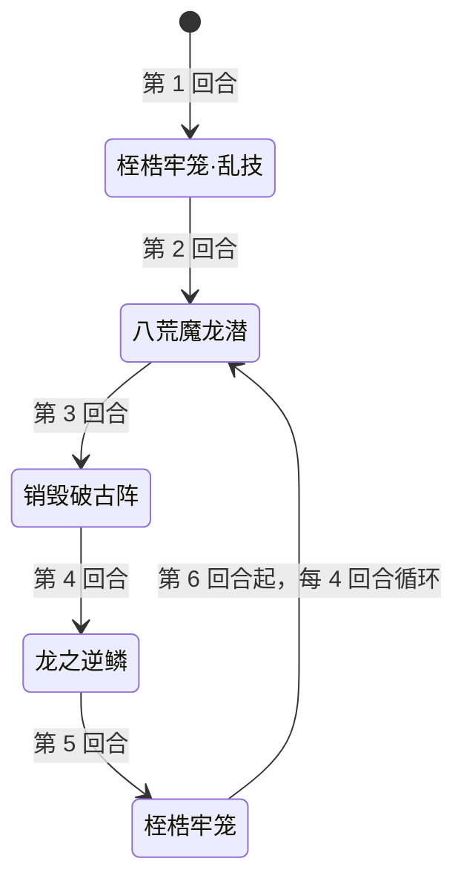

# 地狱魔龙兽

> **类型**：精英怪物
> **初始生命**：1047
> **遭遇战**：第三层精英战斗
> **特性**：乱技（开局按你牌组每 15 张额外随机技能）+ 桎梏牢笼免死复活 + 龙之逆鳞一次性按已出牌数补属性 + 八荒魔龙潜销毁抽牌堆

## 被动能力（开局自带）

| 名称 | 类型 | 效果 |
|------|------|------|
| **乱技**（不可消除） | 能力 | 战斗开始时的第 1 回合，敌人牌组每 15 张牌，使自身额外随机获得 1 个技能（技能可重复）；牌组数量向下取整 |

::: tip 乱技的触发方式
- 额外技能数 = 你**牌组总张数 ÷ 15**（向下取整）。45 张牌 → 额外 3 个随机技能
- 这些额外技能在**第 1 回合**、桎梏牢笼之后逐个随机释放（从 4 个技能里随机，可重复）
- 所以牌组越大，开局爆发越乱越猛——**小牌组能显著压低开局压力**
:::

## 行动逻辑

第 1 回合固定「桎梏牢笼·乱技」（先桎梏牢笼，再释放额外随机技能）；此后按 八荒魔龙潜 → 销毁破古阵 → 龙之逆鳞 → 桎梏牢笼 的顺序固定循环。

> **说明**：第 1 回合是特殊的「桎梏牢笼·乱技」；第 2 回合起进入 八荒魔龙潜 → 销毁破古阵 → 龙之逆鳞 → 桎梏牢笼 的固定循环，第 5 回合的桎梏牢笼之后再从八荒魔龙潜开始。

## 招式表

| 招式名 | 意图 | 类型 | 效果 |
|--------|------|------|------|
| **桎梏牢笼·乱技** | 桎梏牢笼 | 自身增益 + 随机额外技能 | 先获得 5 回合**弹控**与 2 回合**免死**；再按乱技数量随机释放额外技能（可重复） |
| **八荒魔龙潜** | 攻击 60 | 单次攻击 + 销毁牌堆 | 造成 60 点伤害；**销毁你抽牌堆中的所有牌**（移入销毁牌堆）；每销毁 1 张，随机施加 1 种异常状态（1 层） |
| **销毁破古阵** | 攻击 7×N | 动态多段攻击 | 连续攻击 5 次、每次 7 点；你每拥有 1 个增益效果，连击次数 +1 |
| **龙之逆鳞** | 龙之逆鳞 | 一次性补偿属性 | 结算时统计你**本场已打出过的牌数**，自身全属性一次性 +1 × 该累计数（不是之后每打一张都加） |
| **桎梏牢笼** | 桎梏牢笼 | 自身增益 | 获得 5 回合**弹控**；获得 2 回合**免死**（死亡时回满生命，回合数可叠加） |

::: warning 桎梏牢笼的免死复活
- **免死**：持续期间，自身**死亡时立即回满生命值**
- **回合数可叠加**：第 1 回合给 2 回合、第 5 回合再给 2 回合，若在免死尚未结束时又叠加，持续回合会累加
- **弹控**：5 回合免疫异常并把异常反弹给全体敌人
- 这意味着开局前两回合它是"打不死的"——死亡会被直接回满，真正可击杀的窗口是**免死失效之后、下一次桎梏牢笼之前**
:::

## 遭遇战

| 遭遇战 | 房间类型 | 池子 | 数量 | 说明 |
|--------|----------|------|------|------|
| `SeerHellDragonBeastEliteEncounter` | Elite | 第三层精英池 | 1 只 | 第三层单怪精英遭遇战 |

## 策略提示

1. **只有 1047 血，但要"打死两次"**：桎梏牢笼让它死亡时回满生命。第 1~2 回合的免死窗口内它几乎杀不死（死一次回满一次）。**真正的击杀窗口在第 3~4 回合**（免死刚结束、第 5 回合桎梏牢笼还没到）——把爆发攒到这个窗口一波带走。

2. **控牌组张数压乱技**：乱技按你牌组每 15 张给 1 个额外开局技能。牌组 60 张 = 开局额外 4 个随机技能，配合桎梏牢笼可能一回合连丢好几招。**能精简就精简牌组**，或接受开局高压、优先撑格挡。

3. **第 2 回合八荒魔龙潜摧毁你的抽牌堆**：它会把你**整个抽牌堆**销毁进销毁牌堆，每张还附带一个随机 1 层异常。这是资源层面的重击——**第 2 回合前尽量把要用的牌抓在手里或已打出**，别把关键牌留在抽牌堆里等着被烧。

4. **销毁破古阵吃你的增益数量**：基础 5×7 = 35，你身上每多 1 个增益就多 1 次连击。**第 3 回合前少堆增益**（或算好总伤害），否则可能被 10 段以上的连击打穿。

5. **龙之逆鳞按「累计已出牌数」一次性补属性**：第 4 回合结算时，它会把**你本场到目前为止打出的牌数总和**一次性加到自身四维（力量/防御/命中/速度各 +N）。也就是说前 3 回合你出牌越多，这一下越痛；但结算后你后续再出牌**不会**继续给它加，直到下一次循环的龙之逆鳞再按累计总数补一次。**前 3 回合能少出牌就少出牌**，击杀窗口仍是第 3~4 回合。

6. **弹控期间别上 debuff**：桎梏牢笼给的 5 回合弹控（覆盖第 1 回合起）会把你的异常原样反弹给全体。开局前几回合**不要试图用虚弱/易伤削弱它**，反弹只会回到你（和队友）身上。

7. **免死回合数可叠加**：如果它连续两次桎梏牢笼都在免死未结束前打出，免死持续回合会累加，击杀窗口会被继续往后推。**留意它免死的剩余回合数**，别在还有免死时浪费爆发。

8. **多人注意弹控与抽牌堆销毁的群伤**：弹控把异常反弹给**全体敌人**，多人时上 debuff 全队遭殃；八荒魔龙潜销毁的是**每个玩家各自的抽牌堆**并按张数给每人叠异常，各自要管好自己的牌堆与血线。

9. **1047 血 + 免死 = 节奏怪**：它本身很脆，威胁全在"免死拖延 + 滚雪球"。合理打法是**忍住不送资源、攒爆发、在第 3~4 回合击杀**；若拖到第 5 回合桎梏牢笼再来一轮，难度会陡增。

## 源码

- 怪物：`SeerHellDragonBeastMonster.cs`
- 被动能力：`SeerHellDragonBeastPower.cs`（乱技）
- 免死：`SeerNewSkillPowersE.cs`（桎梏牢笼）
- 弹控：`SeerDebuffImmuneReflectPower.cs`
- 意图：`SeerNamedSingleAttackIntent.cs`、`SeerDynamicMultiAttackIntent.cs`、`SeerPuniNamedBuffIntent.cs`、`SeerDynamicIntentList.cs`
- 遭遇战：`SeerHellDragonBeastEliteEncounter.cs`
- 本地化：`monsters.json`（`SEER_MONSTER_SEER_HELL_DRAGON_BEAST_MONSTER.*`）、`intents.json`（`SEER_HELL_*`）、`powers.json`（`SEER_POWER_SEER_HELL_DRAGON_BEAST_POWER.*` 等）
