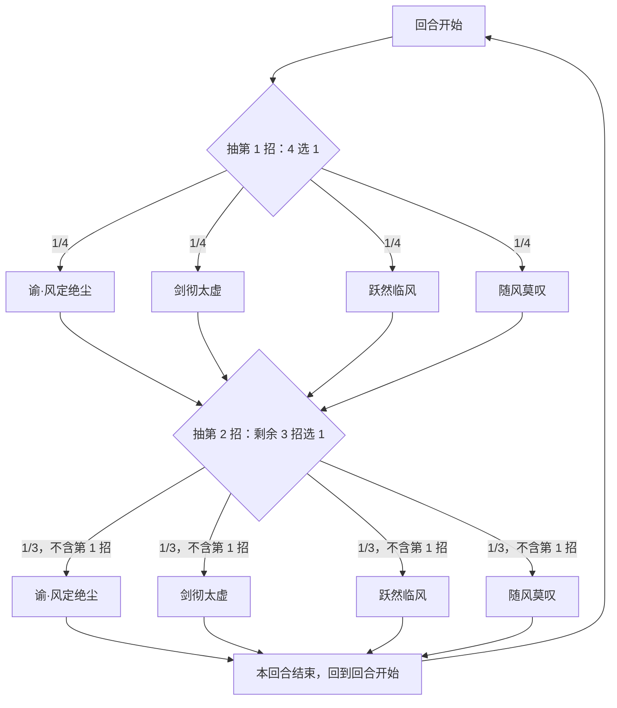

# 圣谕之风·岚

> **类型**：精英怪物
> **初始生命**：2500
> **遭遇战**：第三层精英战斗
> **特性**：圣谕之风（它打你一律按「克制」、你打它一律按「微弱」，多属性再按官方式合并，双属性全克制 = ×3）+ 每回合随机双招 + 剑彻太虚无视格挡叠固伤 + 随风莫叹封大攻击牌

## 被动能力（开局自带）

| 名称 | 类型 | 效果 |
|------|------|------|
| **[圣谕之风](/powers/holy_edict_wind_lan_power.md)**（不可消除） | 能力 | 自身每个属性都视为**克制**敌人（×1.5）、敌人每个属性都视为**微弱**自身（×0.75），再按官方多属性公式合并。1 个属性时它打你 ×1.5；2 个属性时 ×3 |

::: warning 圣谕之风的实际倍率（以代码为准）
- **它打你**：岚的属性一律按「克制」→ 起手（双方各 1 个属性）×1.5；**跃然临风**给双方各加 1 个属性后（各 2 个）×3。
- **你打它**：你的属性一律按「微弱」→ ×0.75。
- 多属性合并走[官方公式](/mechanics/element-affinity)（n 个属性全克制 = ×1.5n）。
- **你对它的伤害** = 微弱倍率 0.75（你视为被它微弱）——你的输出天生被削掉 25%。
- 属性相克表在这一战**整体失效**——岚的每个属性一律按「克制」、你的每个属性一律按「微弱」结算，不再各跑相克表。
:::

## 行动逻辑

每回合固定执行「御风双式」：从 4 个技能中随机抽 **2 个不重复**的技能依次释放。

> **说明**：每回合固定先抽 2 招（不重复、有先后顺序）再依次释放，共 12 种组合；意图会并排显示这两招的真名与伤害。

## 招式表

| 招式名 | 意图 | 类型 | 效果 |
|--------|------|------|------|
| **谕·风定绝尘** | 攻击 48 | 攻击 + 封印 + 护强化 | 造成 48 点伤害；3 回合内敌人**无法打出能力牌**、自身四维强化**不可被消除** |
| **剑彻太虚** | 攻击 40 | 无视格挡攻击 + 叠加固伤 | 造成 40 点伤害（**无视格挡**）；附加等于自身四维属性总和 × 倍率的[固定伤害](/powers/fixed_damage_power.md)；**每使用一次倍率 +1**（起始 2 倍） |
| **跃然临风** | 跃然临风 | 自身增益 + 随机属性 | 自身全属性 +6；为敌人和自身**各添加 1 个随机属性** |
| **随风莫叹** | 随风莫叹 | 弹控免弱 + 封大攻击 | 获得 3 回合的[弹控](/powers/debuff_immune_reflect_power.md)与[免弱](/powers/attr_down_immune_turn_power.md)；1 回合内：**基础伤害大于 20 的敌方攻击牌无法打出** |
| **御风双式** | 本回合抽中的两招 | 调度 | 从 4 个技能中随机抽 2 个（不重复）依次释放；**意图上直接显示这两招的真名与伤害** |

::: warning 剑彻太虚的固伤会随属性与使用次数指数成长
- 固定伤害 = **自身四维属性总和 × 倍率**，倍率起始 2，**每用一次 +1**（2 → 3 → 4 → 5…）。
- 跃然临风每用一次给自身 +6 全属性（12 级），属性总和水涨船高 → 固伤基数也更肥。
- 于是「用越多次剑彻太虚、属性叠得越高」→ 固伤越恐怖，且**无视格挡**（只有免固 / 减伤能挡）。
:::

::: tip 随风莫叹专封「大攻击牌」
- 该效果持续 **1 回合**（你紧接着的那个回合）：你**数值大于 20 的攻击牌无法打出**。
- 应对：**这一回合只用数值 ≤ 20 的攻击牌，或改用技能牌/能力牌**，把大攻击牌留到下一回合。
:::

## 遭遇战

| 遭遇战 | 房间类型 | 池子 | 数量 | 说明 |
|--------|----------|------|------|------|
| `SeerHolyEdictWindLanEliteEncounter` | Elite | 第三层精英池 | 1 只 | 第三层单怪精英遭遇战 |

## 策略提示

1. **它的伤害随双方属性数上升**：圣谕之风让岚的一切攻击按「克制」结算，多属性再按官方公式放大——**跃然临风**给双方各加 1 个属性（各 2 个）后，岚打你就是 ×3。**核心赢法是速杀 / 别让它连着叠属性**。

2. **你对它的伤害被你 25%**：微弱倍率 0.75 让你所有攻击打它都 ×0.75。**算伤害时按七五折估**，别按面板值规划斩杀。

3. **跃然临风是本战的「倍率开关」**：它给双方各加 1 个随机属性——岚的属性一多，它的伤害就从 ×1.5 涨到 ×3。**看到它打跃然临风，优先在它叠起来之前解决掉它**。

4. **剑彻太虚无视格挡 + 固伤叠加**：40 点不可格挡，外加「属性总和 × 倍率」的固伤（倍率每用 +1）。**格挡对这招无效**——只有[免固](/powers/immune_fixed_damage_power.md) / 减伤 / 快速击杀能应对。它用剑彻太虚的次数越多、属性越高，固伤越离谱。

5. **谕·风定绝尘封你 3 回合能力牌、护它 3 回合四维强化**：这 3 回合你打不出能力牌，且**你消除它四维强化的手段会被它挡住**。**别把铺场或扒属性的计划排在这窗口里**。

6. **随风莫叹封「基础伤害 > 20 的攻击牌」并给 3 回合弹控**：它出这招后，**你那一回合基础伤害 > 20 的攻击牌全部打不出**，同时它的异常免疫 3 回合。**这一回合改用基础伤害 ≤20 的攻击牌或非攻击牌**，别把大攻击全废掉。

7. **每回合随机 2 招，无法预判**：它每回合从 4 招里抽 2 个不重复地打。**你可能同一回合吃到「剑彻太虚 + 谕·风定绝尘」这样的高压组合**。只能全面准备：格挡、免固、抗封、以及跨越它属性的爆发。

8. **2500 血、无召唤、无复活**：目标唯一。**全程围绕「抢在它叠元素/属性前灌死」的节奏**——它没有续航机制，一旦你压住它的成长（速杀不拖），威胁就固定可控；反之每拖一回合都更危险。合理节奏 6~9 回合。

## 源码

- 怪物：`SeerHolyEdictWindLanMonster.cs`
- 被动能力：`SeerHolyEdictWindLanPower.cs`（圣谕之风）
- 风定绝尘 / 剑彻太虚：`SeerNewSkillPowersD.cs`
- 随风莫叹：`SeerNewSkillPowersB.cs`、`SeerDebuffImmuneReflectPower.cs`、`SeerAttrDownImmuneTurnPower.cs`
- 固定伤害：`SeerFixedDamagePower.cs`
- 属性系统：`SeerElementPower.cs`
- 意图：`SeerNamedSingleAttackIntent.cs`（风定绝尘/剑彻太虚）、`SeerPuniNamedBuffIntent.cs`（跃然临风/随风莫叹）、`SeerDynamicIntentList.cs`（把「随机 2 招」翻译成本回合真实的两条技能意图）
- 遭遇战：`SeerHolyEdictWindLanEliteEncounter.cs`
- 本地化：`monsters.json`（`SEER_MONSTER_SEER_HOLY_EDICT_WIND_LAN_MONSTER.*`，含 `moves.DOUBLE_RANDOM_MOVE.title` = 御风双式）、`intents.json`（`SEER_LAN_*`）、`powers.json`（`SEER_POWER_SEER_HOLY_EDICT_WIND_LAN_POWER.*`、`SEER_POWER_SEER_WIND_SETTLES_DUST_POWER.*`、`SEER_POWER_SEER_SWORD_PIERCE_VOID_POWER.*`、`SEER_POWER_SEER_WIND_SIGH_POWER.*` 等）
