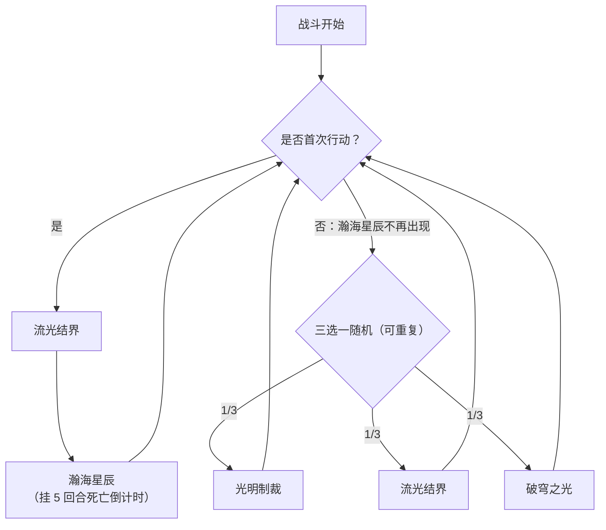

# 圣羽天翔·英普瑞斯

> **类型**：精英怪物
> **初始生命**：2000 - 2000
> **遭遇战**：第三层精英战斗
> **特性**：免疫异常与属性下降（每次被拦下则秒杀概率 +10%）+ 瀚海星辰给你 5 回合死亡倒计时 + 破穹之光吃月亮每回合回血

## 被动能力（开局自带）

| 名称 | 类型 | 效果 |
|------|------|------|
| **圣羽天翔** | 能力（不可消除） | ① 免疫异常状态和属性下降效果；② 每拦下 1 个此类效果，自身**秒杀概率 +10%**（**悬浮框与角标都显示当前累计概率**）；它造成伤害后按该概率掷骰，命中直接秒杀 |

::: warning 「别给它上异常」——每次尝试都在给它概率秒杀你
英普瑞斯对**异常状态和属性下降完全免疫**。你每尝试对它施加一次异常/属性下降，效果会被拦下，但会**给它累计 +10% 秒杀概率**；此后它**造成伤害时会按该累计概率掷骰，命中即直接击杀你**。也就是说，对它上一堆 debuff 等于在给自己堆死刑概率。**打它请走纯伤害**。
:::

::: warning 光明制裁自贴的异常也会被拦下并计数
光明制裁会让英普瑞斯**给自己随机挂 3 种异常**。但按被动，这 3 次自贴同样会被拦下——等于该招不但没削弱它，反而常给它**再叠 30% 秒杀概率**。这个副作用也要计入风险评估。
:::

## 行动逻辑

首次行动固定组合：流光结界 → 瀚海星辰；此后每回合从 光明制裁 / 流光结界 / 破穹之光 中随机 1 招（瀚海星辰只在首回合出现）。

> **说明**：第一动固定「流光结界 → 瀚海星辰」并挂上死亡倒计时；之后只在光明制裁 / 流光结界 / 破穹之光 三招里随机，瀚海星辰不会在后续回合再次出现。

## 招式表

| 招式名 | 意图 | 类型 | 效果 |
|--------|------|------|------|
| **X·瀚海星辰** | 攻击 50 | 单次攻击 + 死亡倒计时 | 造成 50 点伤害；对敌人施加死亡倒计时：**5 回合后死亡**；每实际受到 10 点伤害**立即**-1（实时结算、零头累计、被打空当场处决）|
| **光明制裁** | 攻击 15×3 | 多段攻击 + 削属性 + 格挡 | 连续攻击 3 次，每次 15 点伤害；敌人全属性 -2；自身获得 45 点格挡；自身随机获得 3 种异常各 3 回合、3 层 |
| **流光结界** | 强化 | 吸属性 + 格挡 + 闪避 | 随机吸取敌人共 30 点全属性（力量/防御/命中/速度四项随机分配，**固定扣满 30 点**：不够就扣成负值，自身据为己有）；自身获得 45 点格挡；自身**闪避率 +30%** |
| **破穹之光** | 强化 | 免疫 + 回血（吃月亮） | 获得 4 回合[免控](/powers/debuff_immune_power.md)；获得 4 回合[吃月亮](/powers/eat_moon_power.md)；自身秒杀层数翻倍 |
| **流光结界·瀚海星辰** | 首回合组合 | 连招（2 招） | 先放流光结界，再放瀚海星辰 |

::: tip 吃月亮：每回合回 500、并对你打 100 固伤
[吃月亮](/powers/eat_moon_power.md) 在英普瑞斯的回合开始时触发：恢复自身**最大生命的 25%**（最多 500 点，满血时实际回复为 0），并对所有对手造成等于本次**实际恢复量 20%** 的固定伤害（最多约 100 点；满血时为 0），持续 4 回合。配合 2000 血，等于给你叠加了「每回合最多 500 回血」的续航考验。
:::

## 遭遇战

| 遭遇战 | 房间类型 | 池子 | 数量 | 说明 |
|--------|----------|------|------|------|
| 圣羽天翔·英普瑞斯精英 | Elite | 第三层精英池 | 1 只 | 单怪精英遭遇战 |

## 策略提示

1. **这是一场硬性 5 回合的斩杀赛**：首回合的瀚海星辰给你挂上**死亡倒计时**——在你的回合结束时递减，起始 5，归零/见底时**直接处决你**（无视格挡）。你必须在这个倒计时内干掉 2000 血的英普瑞斯，否则必死。

2. **受伤会加速倒计时（实时）**：倒计时每 **实际受到 10 点伤害就 -1**，**当场结算**（不是等回合结束）——零头也累计（5+5 同样算 1 次），被伤害打空则**立刻处决**。所以**防守同样在续命**——少吃伤害 = 倒计时走得更慢。

3. **绝对不要给它上异常或属性下降**：它**完全免疫**，而且每次被拦下都给它 **+10% 秒杀概率**，之后它一造成伤害就可能**直接秒杀你**。它的「光明制裁」自贴异常也会被拦下计入。打它就是**纯伤害输出**，别碰任何 debuff。

4. **破穹之光会让它每回合最多回 500**：一旦出到破穹之光，紧接的 4 回合它每回合恢复最多 500 血（按实际回复量）并对你打最多约 100 点固定伤害。这段时间要靠爆发破掉回复，或在此之前已建立足够斩杀优势。你每被这 100 点固定伤害打到，倒计时还会因伤害而加速。

5. **流光结界吸你 30 点四维 + 45 格挡 + 30% 闪避**：它会把你的属性**固定抽走 30 点**（随机分摊到四项，你没有也照样扣成负值）据为己有，并给自己 **45 点格挡、+30% 闪避**。这会同时削弱你的输出、让它的攻击更容易滚雪球；而且**闪避会吃掉你的攻击**——需要**高命中/无法闪避/必中**的手段，或先想办法剥掉它的闪避。

6. **光明制裁削你全属性 -2 并自叠 45 格挡**：3 段 × 15 伤害 + 你全属性 -2，进一步压低你的输出；它自己叠 45 格挡。连续中招会让你越打越软。

7. **它免疫控制**：破穹之光给免控，加上被动免疫异常，任何「冻结/眩晕/沉默/异常」类控场对它无效。唯一可靠的路子是**在倒计时内把它打死**。

8. **面向「命中」与「爆发」构筑**：因为倒计时约 5 回合、它还带 30% 闪避和吃月亮回血，想拿下需要**必中手段 + 高爆发 + 抗固伤**；慢速消耗流几乎必败。

## 源码

- 怪物：`SeerHolyFeatherImperiusMonster.cs`
- 被动能力：`SeerHolyFeatherImperiusPower.cs`（圣羽天翔·免疫与秒杀累计）
- 招式相关能力：`SeerNewSkillPowersC.cs`（瀚海星辰·死亡倒计时）、`SeerDodgePower.cs`（闪避）、`SeerEatMoonPower.cs`（吃月亮）、`SeerDebuffImmunePower.cs`（免控）
- 遭遇战：`SeerHolyFeatherImperiusEliteEncounter.cs`
- 本地化：`monsters.json`（`SEER_MONSTER_SEER_HOLY_FEATHER_IMPERIUS_MONSTER.*`）、`intents.json`（`SEER_IMPERIUS_VAST_SEA_STARS`、`SEER_IMPERIUS_LIGHT_SANCTION`、`SEER_IMPERIUS_FLOWING_LIGHT`、`SEER_IMPERIUS_SKY_BREAKING_LIGHT`）、`powers.json`（`SEER_POWER_SEER_HOLY_FEATHER_IMPERIUS_POWER.*`）
