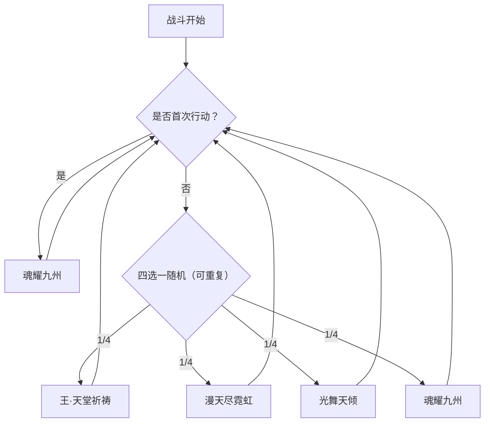

# 圣光斯嘉丽

> **类型**：精英怪物
> **初始生命**：715
> **遭遇战**：第三层精英战斗
> **特性**：圣裁（封敌方「堕落」牌）+ 首回合无实体反击 + 天堂祈祷消强化回血反噬 + 吃月亮周期回血

## 被动能力（开局自带）

| 名称 | 类型 | 效果 |
|------|------|------|
| **[圣裁](/powers/holy_light_scarlett_power.md)**（不可消除） | 能力 | 敌人无法打出带有「堕落」效果的牌 |

::: tip 「堕落」的判定口径
- 「带堕落效果的牌」= 该牌的**标题或描述文本中包含「堕落」二字**。
- 一旦命中判定，该牌在你的整场战斗中**无法打出**（会被直接拦截）。
- 若你的构筑核心依赖「堕落」体系（如某些堕落/焰系套路），本战会被直接掐断——**提前把这部分牌挪出主要打法**。
:::

## 行动逻辑

第 1 回合固定「魂耀九州」；第 2 回合起从 王·天堂祈祷 / 漫天尽霓虹 / 光舞天倾 / 魂耀九州 中随机 1 招。

> **说明**：第 1 回合必出魂耀九州（无实体反击的预告）。第 2 回合起在王·天堂祈祷、漫天尽霓虹、光舞天倾、魂耀九州之间四选一随机，可重复。

## 招式表

| 招式名 | 意图 | 类型 | 效果 |
|--------|------|------|------|
| **王·天堂祈祷** | 攻击 33 | 攻击 + 消除强化 + 回血反噬 | 消除敌人的四维正属性（力量/防御/命中/速度）；**每消除 1 种**，自身恢复最大生命 10%（71.5）并对敌人造成等于本次实际回复量的[固定伤害](/powers/fixed_damage_power.md)；造成 33 点伤害（**不受[微弱](/powers/weak_power.md)影响**） |
| **漫天尽霓虹** | 攻击 6×6 | 多段攻击 + 属性反转 | **反弱反强**；连续攻击 6 次每次 6 点；敌人每拥有 1 张带「堕落」的牌，本招**连击次数额外 +1** |
| **光舞天倾** | 光舞天倾 | 自身增益 + 吃月亮 | 自身全属性 +1；敌人每拥有 1 张带「堕落」的牌，自身全属性**额外 +1**；获得持续 4 回合的[吃月亮](/powers/eat_moon_power.md) |
| **魂耀九州** | 魂耀九州 | 反伤 + 无敌 | 1 回合内：**每次受到伤害时**，自身获得 1 层[无实体](/powers/intangible_power.md)，并对敌人造成 10 点[固定伤害](/powers/fixed_damage_power.md) |

::: warning 王·天堂祈祷：消你几个四维 buff，就打你几个 71.5
- 判定按属性**种类**计数（[力量](/powers/strength_power.md)/[防御](/powers/defense_power.md)/[命中](/powers/accuracy_power.md)/[速度](/powers/speed_power.md)，每类有正层数计 1 个），**单人最多 4 个**；多人时每个玩家各自最多 4 个，回复量按合计。
- 单人满身四维正属性时挨这招：她最多回 4×71.5 = 286 血，并反手给你最多 286 点[固定伤害](/powers/fixed_damage_power.md)（无视格挡）。
- 结论：**别在可能吃到天堂祈祷的回合前把四维 buff 堆满**——堆得越满，这一招越是「一口把你打回原形外加重伤」。
:::

::: warning 魂耀九州：多段攻击的陷阱
- 该效果持续 **1 回合**（在你的回合结束后递减）。在你这一整个回合里，**每一次命中的伤害**都会让她获得 1 层[无实体](/powers/intangible_power.md)（后续伤害大幅衰减），并给你 10 点[固定伤害](/powers/fixed_damage_power.md)。
- 也就是说，**多段小伤在这回合既要吃每段 10 点反伤，又会让她越打越「硬」**。第 1 回合尽量**用少量大段攻击**，别用连击。
:::

::: tip 吃月亮：4 回合的周期回血
- [吃月亮](/powers/eat_moon_power.md)在她**自己回合开始时**触发：恢复最大生命的 25%（178.75），并对所有对手造成**本次实际回复量 20%** 的[固定伤害](/powers/fixed_damage_power.md)（满血不回复时则为 0）。
- 持续 4 回合，每触发一次减 1 层。**面对持续 4 回合的 178.75 回复，你的持续输出必须压过它**，或用大爆发在窗口内打完。
:::

## 遭遇战

| 遭遇战 | 房间类型 | 池子 | 数量 | 说明 |
|--------|----------|------|------|------|
| `SeerHolyLightScarlettEliteEncounter` | Elite | 第三层精英池 | 1 只 | 第三层单怪精英遭遇战 |

## 策略提示

1. **「堕落」体系在这战直接瘫痪**：被动圣裁让你**打不出任何标题/描述含「堕落」的牌**。若你的核心输出靠堕落牌，本战务必换成备用打法，别整局卡手。

2. **第 1 回合别用多段攻击**：首回合它必出魂耀九州。你这一回合**每次命中的伤害**都会让她叠 1 层[无实体](/powers/intangible_power.md)，并反你 10 点[固定伤害](/powers/fixed_damage_power.md)。**用单次大伤，别甩连击**——否则你既打不动她又狂掉血。

3. **打它之前别把四维属性 buff 堆满**：王·天堂祈祷消你每一个四维正属性 → 每个 71.5 回血 + 71.5 固伤（固伤按**实际回复量**结算：她血越满，这一招打出的固伤越少——快到满血时甚至接近 0）。四维齐全时是**最多回 286 血 + 打你最多 286 固伤**。**裸装进场或用完属性立即消费**，把这一招的收益压到最低。

4. **漫天尽霓虹的段数随你的「堕落」牌数增加**：基础 6 段，你每带 1 张「堕落」牌 +1 段。**带堕落牌越多，这招越狠**——如果只是少量堕落牌，影响可控；多张则是灾难。

5. **吃月亮让拖回合变成灾难**：光舞天倾后 4 回合，每回合最多回 178.75 + 反最多 35.75 固伤（满血时不回血也不反伤）。**持续 output 必须压过她每回合的回复量**，否则你越打她越满。看到吃月亮图标就规划好这 4 回合的爆发。

6. **反弱反强会翻转你的属性**：漫天尽霓虹把她的负属性翻正、你的正属性翻负。**你若靠正属性输出，打这招前后要留后手**；她若被削出负属性，这一招会白送她正属性。

7. **715 血、无复活，但回血手段密集**：天堂祈祷（消除时回血）+ 吃月亮（周期回血）两套续航。**靠平砍磨血很难**，要在没有吃月亮的窗口里灌大爆发。

8. **第 2 回合起随机 4 选 1**：33 直伤、6×N 多段、全属性增益+吃月亮、无实体反击——每回合都可能是其中之一。**同时准备好格挡（33/6×N）、清空自身属性的心理准备、以及跨越吃月亮回血的爆发**，没法只针对一种。

9. **单怪、无召唤**：目标唯一，输出可聚焦。**核心赢法是「裸身抗天堂祈祷 + 大爆发压过吃月亮」**，合理节奏 6~9 回合。

## 源码

- 怪物：`SeerHolyLightScarlettMonster.cs`
- 被动能力：`SeerHolyLightScarlettPower.cs`（圣裁）
- 吃月亮：`SeerEatMoonPower.cs`
- 魂耀九州：`SeerNewSkillPowersC.cs`、无实体（原版能力）
- 固定伤害：`SeerFixedDamagePower.cs`
- 意图：`SeerNamedSingleAttackIntent.cs`（王·天堂祈祷）、`SeerDynamicMultiAttackIntent.cs`（漫天尽霓虹）、`SeerPuniNamedBuffIntent.cs`（光舞天倾/魂耀九州）
- 遭遇战：`SeerHolyLightScarlettEliteEncounter.cs`
- 本地化：`monsters.json`（`SEER_MONSTER_SEER_HOLY_LIGHT_SCARLETT_MONSTER.*`）、`intents.json`（`SEER_SCARLETT_*`）、`powers.json`（`SEER_POWER_SEER_HOLY_LIGHT_SCARLETT_POWER.*`、`SEER_POWER_SEER_EAT_MOON_POWER.*`、`SEER_POWER_SEER_SOUL_SHINE_NINE_PROVINCES_POWER.*` 等）
