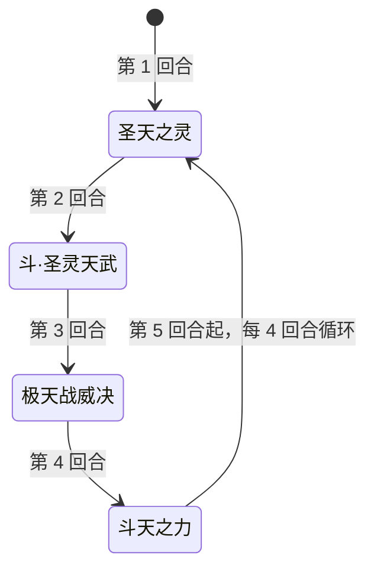

# 圣战·瑞尔斯

> **类型**：精英怪物
> **初始生命**：1354
> **遭遇战**：第三层精英战斗
> **特性**：圣战反噬（每次受击反弹该次伤害 1/6 并无视格挡流失 + 自身等量回血）+ 四招固定循环（圣天之灵 → 斗·圣灵天武 → 极天战威决 → 斗天之力）

## 被动能力（开局自带）

| 名称 | 类型 | 效果 |
|------|------|------|
| **圣战**（不可消除） | 能力 | 自身受到**攻击**伤害时，攻击者失去该次攻击**实际伤害**的 1/6 的生命（无视格挡的生命流失），自身恢复等量生命 |

::: tip 圣战反噬的运作（设计稿名「圣战反噬」，本地化名「圣战」）
- **仅对攻击伤害触发**：固定伤害、流失等非攻击来源不触发
- **按实际掉血计算**：反弹量 = 该次攻击真正打掉的血量 ÷ 6，被格挡吸收的部分不计入
- **反弹无视格挡**：攻击者失去的 1/6 生命是不可格挡的生命流失，格挡挡不住
- **自身等量回血**：反弹多少，瑞尔斯就回复多少
- 例：你一次攻击实际打掉它 60 血 → 你失去 10 生命，它回复 10 生命
:::

## 行动逻辑

纯固定循环，无任何随机：开场即施放圣天之灵，之后按 斗·圣灵天武 → 极天战威决 → 斗天之力 的顺序周而复始。

> **说明**：完全固定循环，可精确预判每一回合。第 1 回合即施放圣天之灵（免控 + PP 削能），不造成直接伤害；此后每 4 回合为一轮。

## 招式表

| 招式名 | 意图 | 类型 | 效果 |
|--------|------|------|------|
| **圣天之灵** | 圣天之灵 | 自身增益 + 干扰 | 自身获得 5 回合免控；施加持续 5 回合的**圣灵削能**：敌人每打出 1 张**赛尔牌**，该牌 PP 最多 -2，每实际扣 1 点 PP 造成 1 点固定伤害 |
| **斗·圣灵天武** | 攻击 45 | 单次攻击 + 属性反转 + 封印 | **反弱反强**（先反后打：自身负属性翻正、敌方正属性翻负）；造成 45 点伤害；自身获得**圣武封灵**：敌人下回合**打出的**第一张攻击牌与第一张技能牌**无效**（可以打出，但不会产生效果）|
| **极天战威决** | 攻击 15×3 | 多段攻击 + Debuff | 造成 3 次、每次 15 点伤害；对敌人施加 4 回合「挫锐」：接下来 4 个回合开始时先制 -1 |
| **斗天之力** | 斗天之力 | 自身增益 | 自身全属性 +2；获得 3 回合**吃月亮**；获得等于全属性提升后四项之和的**格挡** |

::: tip 两处技能细节
- **反弱反强**：对瑞尔斯自身，把它身上的负属性（弱化）翻成正值（×2 抵消并转正）；对玩家，把正属性（强化）翻负。因此**别在斗·圣灵天武前堆正属性 buff**——会被直接翻负。
- **吃月亮**（斗天之力给出 3 层）：瑞尔斯每个回合开始时恢复自身最大生命的 1/4（1354/4 ≈ 338），并对所有对手附加等于**本次实际恢复量** 20% 的固定伤害。满血时实际恢复为 0，则无固伤。
- **斗天之力的格挡**：等于「全属性 +2 后」力量+防御+命中+速度之和。以初始 0 计，+2 后四维和通常为 8；若此前已叠过属性，格挡会更高。
:::

## 遭遇战

| 遭遇战 | 房间类型 | 池子 | 数量 | 说明 |
|--------|----------|------|------|------|
| `SeerHolyWarRuiersiEliteEncounter` | Elite | 第三层精英池 | 1 只 | 第三层单怪精英遭遇战 |

## 策略提示

1. **固定循环即是攻略**：招式顺序永远相同（圣天之灵 → 斗·圣灵天武 45 → 极天战威决 45 + 4 回合先制 -1 → 斗天之力 → 循环），可以精确规划每回合的格挡与爆发。第 1 回合它只放圣天之灵、不输出，是最安全的准备回合。

2. **圣战反噬按「实际掉血总量」的 1/6 回流，拆分段数不会减少总反噬**：每次攻击实际打掉它 N 血，你就流失 N/6 并无视格挡；同时它回复等量。打它 600 一口气 → 你自损 100 且它回 100；拆成 10 段每段 60，总反噬仍是 100。**关键不是拆段，而是用格挡/减伤压低每次真正打掉的血量，并算清自损是否致命**。

3. **斗天之力前是唯一无自回窗口**：吃月亮到第 4 回合（斗天之力）才施加，第 5 回合起才开始回血；第 1~3 回合瑞尔斯只能靠圣战反噬回血。把爆发集中在这个窗口，能在它获得持续自回前重创或击杀。

4. **圣天之灵的 5 回合免控封锁 debuff**：第 1 回合起 5 回合内你无法给它上任何异常状态（虚弱/易伤等全免疫）。靠 debuff 削弱再打的思路要推迟到第 6 回合以后，或改走直伤。

5. **圣灵削能在惩罚 PP 卡**：持续 5 回合，你每打 1 张 PP 牌，该牌剩余 PP 最多扣 2 点，并让你吃最多 2 点固定伤害（只剩 1 PP 时只扣 1 点）。PP 卡打多了既掉 PP 又掉血，**优先用非 PP 牌或低 PP 牌**，把 PP 卡留到削能结束后。

6. **斗·圣灵天武封印首张攻击/技能牌**：第 2 回合它给你挂圣武封灵，下回合你**打出的**第一张攻击牌和第一张技能牌会**直接无效**——牌照样打出、能量照样付，但**没有任何效果**。所以出牌顺序是**自选**的：先丢一张便宜的牌（低费攻击牌 / 废牌）把它「顶掉」，再打关键牌。

7. **极天战威决先制 -1 拉长战线**：第 3 回合起 4 个回合，你每回合先制 -1（即下一张牌耗能 +1）。配合 3×15 = 45 的伤害，这回合要同时准备格挡与额外能量，避免因 +1 费而卡住关键牌。

8. **吃月亮让站桩拖不动**：第 4 回合后每轮靠斗天之力续 3 层吃月亮，每回合回 ≈338 血 + 对你 ≈68 固伤。若你的输出低于它的自回，会陷入"越打越回"的僵局。**要么在它残血时一轮带走，要么准备稳定高于回血的持续输出**。

9. **多人注意反弱反强与反噬**：反弱反强对**所有敌人**生效，全队正属性都会被翻负，别在斗·圣灵天武前集体铺 buff；圣战反噬只反弹给**实际打出那次攻击的那名玩家**，让血量健康者承担输出、残血者避开输出，可降低团灭风险。

## 源码

- 怪物：`SeerHolyWarRuiersiMonster.cs`
- 被动能力：`SeerHolyWarRuiersiPower.cs`（圣战/圣战反噬）
- 封印：`SeerNewSkillPowersB.cs`（圣武封灵）
- 先制削弱：`SeerDelayedFirstStrikePower.cs`（多回合先制的负值用法，每回合先制 −1）
- 吃月亮：`SeerEatMoonPower.cs`
- PP 削能：`SeerNewSkillPowersG.cs`（圣灵削能）
- 免控：`SeerDebuffImmunePower.cs`
- 意图：`SeerRuiersiIntents.cs`
- 遭遇战：`SeerHolyWarRuiersiEliteEncounter.cs`
- 本地化：`monsters.json`（`SEER_MONSTER_SEER_HOLY_WAR_RUIERSI_MONSTER.*`）、`intents.json`（`SEER_RUIERSI_*`）、`powers.json`（`SEER_POWER_SEER_HOLY_WAR_RUIERSI_POWER.*` 等）
