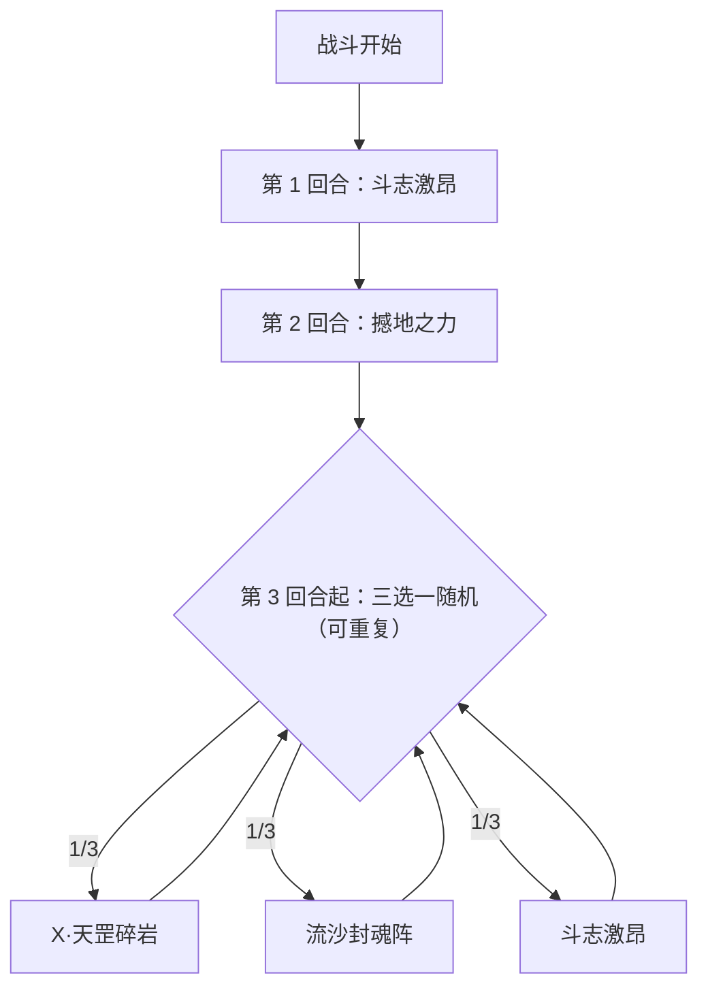

# 不灭地威·萨瑞卡

> **类型**：精英怪物
> **初始生命**：2000 - 2000
> **遭遇战**：第三层精英战斗
> **特性**：不灭地威（单次受伤 > 100 即回满血、甚至免死）+ 流沙封魂阵强制每次受伤 ≥ 120 + 天罡碎岩会把自身负属性翻正

## 被动能力（开局自带）

| 名称 | 类型 | 效果 |
|------|------|------|
| **不灭地威** | 能力（不可消除） | 自身受到的**单次伤害大于自身最大生命值 5%** 时，立即恢复至满生命值 |

::: warning 阈值 = 100，且能免死
- 萨瑞卡最大生命 2000，5% = 100。**任何一次 > 100 的伤害都会让它当场回满**，前功尽弃。
- 连**致命一击**也受此限制：只有「致死那一下的伤害 ≤ 100」它才会真正死亡；若一下超过 100，它会免死并回满。所以**收尾务必用 ≤ 100 的一击**。
- 推论：**多段小伤害（每段 ≤ 100）是最优解**，大额单发爆发对它完全无效甚至是负收益。
:::

## 行动逻辑

开局两回合固定：第 1 回合斗志激昂 → 第 2 回合撼地之力；第 3 回合起，每回合从 X·天罡碎岩 / 流沙封魂阵 / 斗志激昂 中随机 1 招。

> **说明**：第 1、2 回合固定；第 3 回合起只在 X·天罡碎岩 / 流沙封魂阵 / 斗志激昂 三招中随机，撼地之力不会在后续回合再出现。

## 招式表

| 招式名 | 意图 | 类型 | 效果 |
|--------|------|------|------|
| **X·天罡碎岩** | 攻击 | 消强 + 反弱 + 双方失血 | **消强**、**反弱**；对敌人造成等于自身最大生命 6%（120）的伤害（**可格挡**）；自身也受等量伤害 |
| **流沙封魂阵** | 攻击 45 | 单次攻击 + 全场封阵 | 造成 45 点伤害；2 回合内，双方**每次受到的伤害不低于各自最大生命值的 6%** |
| **斗志激昂** | 强化 | 自身增益 + 全场增伤 | 自身全属性 +2；**所有生物**获得 50% 永久增伤；1 回合内，自身因**攻击伤害以外**的原因损失生命值后，立即**恢复等量生命值** |
| **撼地之力** | 强化 + 干扰 | 弹控 + 异常 | 获得 4 回合[弹控](/powers/debuff_immune_reflect_power.md)；对所有敌人施加[疲惫](/powers/fatigue_power.md)、[害怕](/powers/fear_power.md)、[睡眠](/powers/sleep_power.md)各 3 回合；每有一种施加失败，对该敌造成 30 点固定伤害 |

::: warning 天罡碎岩自带「回满」
天罡碎岩会对萨瑞卡自己造成 120 点不可格挡的自伤，而 120 **大于 100 的被动阈值**——按其被动，这一下会让它**立即回满血**。换言之，天罡碎岩等于**自带一次回满**，你在该招前后打掉的伤害都会被抵消；同时它还会**清空你的增益**并对你造成 120 点**可格挡的攻击伤害**。
:::

::: tip 流沙封魂阵 = 2 回合「免伤盾」
封阵期间「每次受伤不低于最大生命的 6%」意味着：对萨瑞卡的**任何伤害都会被抬到 ≥ 120**，而 120 > 100 立刻触发被动回满。结果就是**这 2 回合你几乎无法对它造成净伤害**（每一下都被顶到越阈，然后回满）。同样地，你受到的**每一次**伤害也会被抬到 ≥ 你最大生命的 6%。这两回合应转为防守、叠状态、清手牌，而不是硬输出。
:::

## 遭遇战

| 遭遇战 | 房间类型 | 池子 | 数量 | 说明 |
|--------|----------|------|------|------|
| 不灭地威·萨瑞卡精英 | Elite | 第三层精英池 | 1 只 | 单怪精英遭遇战 |

## 策略提示

1. **必须用「小刀」打，别用大炮**：被动阈值是 100。任何单发 > 100 的伤害都会让它**回满血**，等于白打。请把输出拆成**多段、每段 ≤ 100** 的形式（多段攻击牌、dot、固定伤害），持续放血。

2. **收尾也要 ≤ 100**：致死一击若超过 100，它会**免死并回满**。所以斩杀要留一发**不超过 100** 的伤害来收口；别用大终结技去补最后一下。

3. **流沙封魂阵期间停手**：封阵 2 回合里，任何对它的伤害都被抬到 ≥ 120 → 触发回满，你根本打不动；同时你自己的每次受伤被抬到 ≥ 6% 最大生命。这 2 回合是**防守回合**：补格挡、清状态、铺形态，别浪费输出牌。

4. **天罡碎岩 = 白送它一次回满 + 清你增益**：它会自伤 120 → 触发被动回满，还会**清空你的全部强化**并对你造成 120 点可格挡的攻击伤害。要在这招的回合**避免把增益堆满**（会被清），并预留 120 点格挡/减伤。它还会在出招时把**自身负属性翻正**——你削它属性的收益会被这一招抹掉，别把削属性当主要打法。

5. **斗志激昂给「全体」+50% 增伤——你也有份**：这一招对**所有生物**生效，包括你。它自己的 120 点攻击伤害会变成约 180 点（仍可格挡），但你的输出同样 +50%，可借它一波爆发（注意此时仍要遵守「每段 ≤ 100」的约束）。它 1 回合内还会把**攻击伤害以外的掉血**按等量**回补**（先真实掉血、再恢复等量，净变化为 0），所以别指望用固定伤害/流失类效果压它血线。

6. **撼地之力的三重削弱**：对你叠[疲惫](/powers/fatigue_power.md)（攻 -20%，且每次造成伤害时自伤等于层数）、[害怕](/powers/fear_power.md)（攻 -30%）、[睡眠](/powers/sleep_power.md)（攻 -50%），各 3 回合，输出被大幅压制，需备解异常手段。

7. **别用弹控/免控去硬顶撼地之力**：该招对「施加失败」的敌人额外造成 30 点固定伤害。你若有免疫异常的手段，反而会因为「免疫成功=施加失败」而吃 30 固伤——得不偿失。

8. **节奏总纲**：这是一只「反爆发」怪。稳定地用多段小伤害慢慢放血、在流沙/天罡回合转守、收尾用 ≤ 100 的一击——就能稳定拿下；反之追求一次性秒杀只会不断喂它回满。

## 源码

- 怪物：`SeerImmortalEarthSarikaMonster.cs`
- 被动能力：`SeerImmortalEarthSarikaPower.cs`（不灭地威）
- 招式相关能力：`SeerNewSkillPowersD.cs`（流沙封魂阵 / 斗志激昂）、`SeerPermanentDamageBoostPower.cs`（永久增伤）、`SeerDebuffImmuneReflectPower.cs`（弹控）、`SeerFatiguePower.cs` / `SeerFearPower.cs` / `SeerSleepPower.cs`（疲惫/害怕/睡眠）、`SeerFixedDamagePower.cs`（固定伤害）
- 遭遇战：`SeerImmortalEarthSarikaEliteEncounter.cs`
- 本地化：`monsters.json`（`SEER_MONSTER_SEER_IMMORTAL_EARTH_SARIKA_MONSTER.*`）、`intents.json`（`SEER_SARIKA_HEAVEN_EARTH_ROCK`、`SEER_SARIKA_QUICKSAND`、`SEER_SARIKA_FIGHTING_SPIRIT`、`SEER_SARIKA_EARTH_SHATTER`）、`powers.json`（`SEER_POWER_SEER_IMMORTAL_EARTH_SARIKA_POWER.*`）
