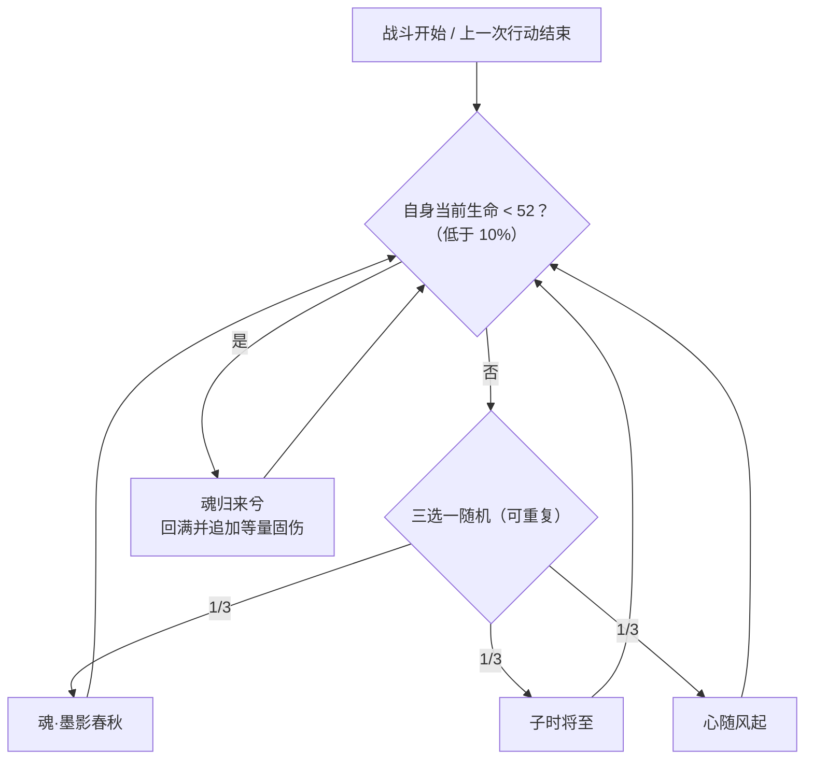

# 墨影星魂

> **类型**：精英怪物
> **初始生命**：520
> **遭遇战**：第三层精英战斗
> **特性**：墨影（前 2 回合敌方无法打出技能牌）+ 三招随机 + 残血「魂归来兮」回满并按回复量反噬

## 被动能力（开局自带）

| 名称 | 类型 | 效果 |
|------|------|------|
| **[墨影](/powers/ink_shadow_star_soul_power.md)**（不可消除） | 能力 | 登场后的前 2 回合，敌人无法打出**技能牌** |

::: tip 墨影封的是「技能牌」
- 判定为卡牌的**类型**：技能牌，不是「能力牌」也不是「攻击牌」。
- 前 2 回合内，你打出的技能牌被直接拦下（无法打出），攻击牌与能力牌不受影响。
- 计轮：以**玩家回合开始**计轮，前 2 个玩家回合内生效，第 3 个玩家回合起失效。
- 多人时对每个敌人分别拦截各自打出的技能牌。
:::

## 行动逻辑

按自身剩余生命分支：生命 ≥ 10%（≥ 52）时，从 魂·墨影春秋 / 子时将至 / 心随风起 中随机 1 招；生命低于 10%（< 52，即 ≤ 51）时改用「魂归来兮」。

> **说明**：血量一旦跌破最大生命的 10%（< 52），会**立刻**把当前意图改成「魂归来兮」；该招回满血后再回到三选一随机。52 血正好是 10%，不会触发。

## 招式表

| 招式名 | 意图 | 类型 | 效果 |
|--------|------|------|------|
| **魂·墨影春秋** | 攻击 | 比例攻击 + 先制压制 + 召唤 | 造成等于**敌方最大生命值 50%** 的伤害；目标先制 -2（下一张牌耗能 +2）；若场上没有月照星魂，召唤 1 位月照星魂 |
| **子时将至** | 子时将至 | 自伤 + 格挡 + 免控 | 自身受到等于自身最大生命 10%（52）的不可格挡自伤；所有友方获得 100 点格挡；自身获得持续 5 回合的[免控](/powers/debuff_immune_power.md) |
| **心随风起** | 心随风起 | 全体增益 | 所有友方全属性（[力量](/powers/strength_power.md)/[防御](/powers/defense_power.md)/[命中](/powers/accuracy_power.md)/[速度](/powers/speed_power.md)）+5；所有友方接下来 2 次攻击必定[暴击](/powers/next_guaranteed_crit_power.md)（1.5 倍） |
| **魂归来兮** | 魂归来兮 | 回满 + 固定伤害 | 恢复至满生命值；对每个敌人造成等于**本次实际回复量**的[固定伤害](/powers/fixed_damage_power.md) |

::: warning 魂归来兮是「斩杀线」，不是「回血」
- 触发条件：自身生命低于最大生命的 10%（< 52，即 ≤ 51；52 正好 10% 不触发）。
- 效果是**回满血**（回复量 = 最大生命 - 当前生命），并把**这一次的回复量**当作固定伤害打到你脸上。
- 极端情况：你把它打到 1 血，它回满 → 回复 519 → 对你造成 519 点固定伤害。因此**绝不能把它压到 52 血以下却打不死**。
:::

## 遭遇战

| 遭遇战 | 房间类型 | 池子 | 数量 | 说明 |
|--------|----------|------|------|------|
| `SeerInkShadowStarSoulEliteEncounter` | Elite | 第三层精英池 | 1 只 | 第三层单怪精英遭遇战 |

## 策略提示

1. **魂·墨影春秋按你的最大生命结算，血厚反而更痛**：这招造成**你最大生命值 50%** 的伤害。80 血角色挨 40，120 血角色挨 60。它是本怪最危险的单招，且**可被格挡**——按你最大生命的半数预留格挡量。

2. **前 2 回合技能牌被封印**：墨影只封技能牌。如果你这套构筑的核心技能牌多，前两回合等于半残。**前 2 回合尽量用攻击牌与能力牌铺场**，把关键技能牌留到第 3 回合再打。

3. **子时将至 = 100 格挡 + 5 回合免控**：它自伤 52 换来 100 点格挡，并**免疫异常 5 回合**。这段时间你所有的中毒/易伤/虚弱/石化等手段统统无效——**别把 debuff 循环排在这 5 回合里**。破它这 100 格挡要用实打实的伤害或无视格挡的牌。

4. **心随风起是滚雪球**：+5 全属性 + 接下来 2 次**必定暴击**。以 80 血的你为例，魂·墨影春秋基础 40，+5 力量后变 45，再暴击 1.5 倍约 68。每层必定暴击被一次攻击消耗，看到必定暴击图标就提前把格挡拉满。

5. **斩杀线在 52 血以下，必须一波带走**：一旦它生命低于 52（≤ 51），当前意图会立刻改为魂归来兮：回满 + 把回复量当固伤砸你（残血越少、反噬越狠，最高可达几百）。**在它跌破 10% 之前，就要保证你的爆发够一回合清空剩余血量**；否则宁可先不打，存够伤害再一次性斩杀。

6. **魂归来兮的固伤无视格挡**：它是[固定伤害](/powers/fixed_damage_power.md)，格挡、减伤一律无效，只能靠**别让它触发**或靠免疫固定伤害的手段规避。

7. **先制 -2 会拖慢你的下一张牌**：魂·墨影春秋命中后，你下一张牌耗能 +2。**别在它刚出这招后塞满手牌却卡费**——留足能量的牌先打。

8. **单怪开局，但会召唤**：开局只有一个目标；一旦它出「魂·墨影春秋」且场上没有月照星魂，就会召唤 1 位月照星魂，变成双目标。三招随机里「子时将至」「心随风起」是增益，「魂·墨影春秋」是直伤，**尽快解决本体**，别让召唤物拖长战斗。节奏可控，合理 5~6 回合内解决。

## 源码

- 怪物：`SeerInkShadowStarSoulMonster.cs`
- 被动能力：`SeerInkShadowStarSoulPower.cs`（墨影）
- 先制削弱：`SeerFirstStrikePower.cs`
- 免控：`SeerDebuffImmunePower.cs`
- 必定暴击：`SeerNextGuaranteedCritPower.cs`
- 固定伤害：`SeerFixedDamagePower.cs`
- 意图：`SeerPuniNamedBuffIntent.cs`
- 遭遇战：`SeerInkShadowStarSoulEliteEncounter.cs`
- 本地化：`monsters.json`（`SEER_MONSTER_SEER_INK_SHADOW_STAR_SOUL_MONSTER.*`）、`intents.json`（`SEER_MOYE_*`）、`powers.json`（`SEER_POWER_SEER_INK_SHADOW_STAR_SOUL_POWER.*` 等）
