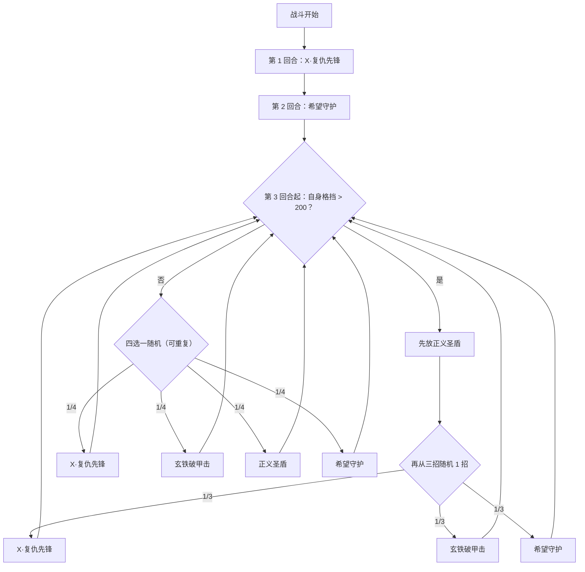

# 正义圣盾·凯普特

> **类型**：精英怪物
> **初始生命**：2000 - 2000
> **遭遇战**：第三层精英战斗
> **特性**：振金盾牌（每回合按你总生命值获得格挡 + 格挡不消失且回合初翻倍）+ 复仇先锋按「本回合被格挡伤害」追加 + 希望守护拿自身格挡打固定伤害

## 被动能力（开局自带）

| 名称 | 类型 | 效果 |
|------|------|------|
| **正义圣盾（振金盾牌）** | 能力（不可消除） | ① 每回合开始时，获得等于**敌人所有生物当前生命值总和**的**格挡**；② 自身格挡不会在回合结束时消失，而是保留至下一回合，并在每回合开始时**翻倍** |
| **复仇先锋** | 能力（不可消除） | 记录**自身**本回合已格挡的伤害总量 |

::: warning 格挡会滚雪球
「敌人所有生物当前生命值总和」= 你（及队友）**当前生命的合计**。也就是说你血越厚，凯普特每回合白拿的格挡越多；而格挡**不清除、回合初先翻倍**，会指数级膨胀。这是本战最致命的机制：**拖得越久，越打不动它**。
:::

## 行动逻辑

前 2 回合固定（第 1 回合复仇先锋 → 第 2 回合希望守护）；第 3 回合起分两种：自身格挡 **> 200** 时进入「高格挡阶段」（固定先出正义圣盾，再从复仇先锋/玄铁破甲击/希望守护随机 1 招），否则从 4 招里随机 1 招。

> **说明**：高格挡阶段的组合招固定先放「正义圣盾」，再从 X·复仇先锋 / 玄铁破甲击 / 希望守护 中随机 1 招；只要格挡维持在 200 以上，就会一直停在高格挡阶段。

## 招式表

| 招式名 | 意图 | 类型 | 效果 |
|--------|------|------|------|
| **X·复仇先锋** | 攻击 35 | 单次攻击 + 格挡 | 造成 35 点伤害；额外造成等于**自身本回合已格挡伤害总量**的伤害；获得 66 格挡 |
| **玄铁破甲击** | 攻击 25 | 单次攻击 + 反转 | **反弱反强**（先反后打）；造成 25 点伤害；防御与敏捷提升等于**本次实际伤害**的层数 |
| **正义圣盾** | 强化 | 自身增益 | 自身全属性 +2；**每拥有 10 点格挡，全属性额外 +1** |
| **希望守护** | 强化 + 固定伤害 | 弹控 + 翻倍 + 固伤 | 获得 5 回合[弹控](/powers/debuff_immune_reflect_power.md)；当前格挡**翻倍**；造成等于**翻倍前当前格挡数值**的固定伤害 |
| **正义圣盾（高格挡组合）** | 强化 + 随机 | 连招 | 先放正义圣盾，再从 X·复仇先锋 / 玄铁破甲击 / 希望守护中随机 1 招 |

::: tip 「反弱反强」是什么意思
- **反弱**（对自身）：把自己的**负属性**翻转为正——即其身上每有一点负属性，会被反成 **+2 倍**正属性。所以**用属性下降打它是帮它**。
- **反强**（对你）：把你的**正属性**翻转为负，且翻 **-2 倍**。你的增益越多，被反转后亏得越狠。
- 凯普特自身有「反弱」，你对它叠的属性下降会被直接用来强化它；同时「反强」会把你的增益变成双倍减益。
:::

## 遭遇战

| 遭遇战 | 房间类型 | 池子 | 数量 | 说明 |
|--------|----------|------|------|------|
| 正义圣盾·凯普特精英 | Elite | 第三层精英池 | 1 只 | 单怪精英遭遇战 |

## 策略提示

1. **速攻，别拖——格挡是指数级的**：振金盾牌每回合按你**当前总生命**白送格挡，且格挡**不清除、回合初翻倍**。第 1 回合格挡就已不低，越往后越离谱。第 3 回合起只要格挡 > 200 就进入高格挡阶段，每回合强塞一次正义圣盾，全属性按「每 10 格挡 +1」暴涨。拖到中后期基本无解，正确打法是**开局速推**。

2. **不要白白打在被格挡上**：复仇先锋的额外伤害 = **本回合被你打掉、但被格挡吸收的伤害总量**。你越是硬砍它的格挡，下一发复仇先锋追加越高。所以要么用**固定伤害/无视格挡**手段，要么攒够一下打穿的爆发，别做无效输出去喂它。

3. **希望守护会拿它自己的格挡当武器**：它把当前格挡**翻倍**，并立刻造成等于**翻倍前自身格挡值**的固定伤害。格挡越高，这一发固定伤害越致命（固定伤害无视防御）。它自己初始格挡就不低，所以第 2 回合的这发别轻视，需要预留固定减伤/生命缓冲。

4. **用「反弱」反制你的属性下降思路**：它有反弱，你对它施压属性下降会被翻转成强化。削它属性这条路基本走不通，改用**固有减伤、虚弱（若它不免疫）、固定伤害**。

5. **当心「反强」反噬你的增益**：玄铁破甲击带反强，会把你身上的**正属性翻成 -2 倍减益**。在它可能放这招的回合，别把关键增益全堆在场上；可先不叠增益、或准备解减益手段。

6. **弹控 5 回合：别对它上异常**：希望守护给自身 5 回合弹控（免疫异常并把异常反弹给所有敌人）。这期间你的异常类手段会**反弹回你自己**，应改用纯伤害。

7. **高格挡阶段的读牌**：格挡 > 200 后每回合固定「正义圣盾 + 随机 1 招」，其中随机到希望守护时又是一发固定伤害 + 翻倍。此阶段核心矛盾是「它格挡已经远超你能打穿的水平」，此时应已进入斩杀收尾，而不是想着清格挡。

8. **它的输出总量可控，可怕的是防守**：单看伤害（复仇 35+N、破甲 25、希望守护固定伤害），并不算爆发怪；真正压垮你的是**格挡雪球 + 全属性膨胀**。策略重心是「抢在它成型前干掉」，而非硬扛。

## 源码

- 怪物：`SeerJusticeShieldKaipteMonster.cs`
- 被动能力：`SeerJusticeShieldKaiptePower.cs`（振金盾牌）、`SeerNewSkillPowersC.cs`（复仇先锋）
- 招式相关能力：`SeerDebuffImmuneReflectPower.cs`（弹控）、`SeerDefensePower.cs` / `DexterityPower.cs`（属性）
- 遭遇战：`SeerJusticeShieldKaipteEliteEncounter.cs`
- 本地化：`monsters.json`（`SEER_MONSTER_SEER_JUSTICE_SHIELD_KAIPTE_MONSTER.*`）、`intents.json`（`SEER_KAIPTE_AVENGER`、`SEER_KAIPTE_IRON_ARMOR_BREAK`、`SEER_KAIPTE_JUSTICE_SHIELD`、`SEER_KAIPTE_HOPE_GUARD`）、`powers.json`（`SEER_POWER_SEER_JUSTICE_SHIELD_KAIPTE_POWER.*`、`SEER_POWER_SEER_AVENGER_VANGUARD_POWER.*`）
