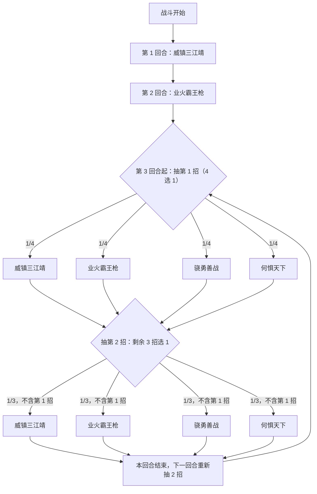

# 小霸王·孙策

> **类型**：精英怪物
> **初始生命**：858 - 858
> **遭遇战**：第三层精英战斗
> **特性**：小霸王（攻击无视格挡）+ 销毁你的非攻击牌进销毁牌堆 + 骁勇善战按销毁牌堆牌数打固伤 + 第 3 回合起每回合两招

## 被动能力（开局自带）

| 名称 | 类型 | 效果 |
|------|------|------|
| **小霸王** | 能力（不可消除） | 自身造成的**攻击伤害无视敌人格挡** |

::: warning 堆格挡对他无效
孙策的所有攻击**无视格挡**（格挡既不减伤也不被消耗）。靠格挡硬扛这条路对他是无效的——你必须用**缓冲（Buffer）、固定减伤、回血、闪避、无实体**等**非格挡**手段来活命。
:::

## 行动逻辑

前 2 回合固定：第 1 回合威镇三江靖；第 2 回合业火霸王枪；第 3 回合起每回合从四招中随机抽 **2 招（不重复）** 依次释放。

> **说明**：第 3 回合起每回合固定两招（不重复、有先后顺序），共 12 种组合；意图会并排显示这两招。

## 招式表

| 招式名 | 意图 | 类型 | 效果 |
|--------|------|------|------|
| **威镇三江靖** | 攻击 5×10 | 多段攻击 + 反转 + 焚烬 + 销毁 | **反弱反强**（先反后打）；连续攻击 10 次，每次 5 点伤害；对敌人施加 3 回合[焚烬](/powers/ash_power.md)；**销毁敌人抽牌堆中所有非攻击牌** |
| **业火霸王枪** | 攻击 30 | 单次攻击 + 销毁 + 抽能 | 造成 30 点伤害；**销毁敌人弃牌堆中所有非攻击牌**；**清空敌人当前能量** |
| **骁勇善战** | 强化 + 固定伤害 | 自身增益 + 固伤 + 格挡 | 自身全属性 +5；对敌人造成等于敌人**销毁牌堆牌数**的**固定伤害**；获得 100 格挡；下回合格挡不会消失 |
| **何惧天下** | 强化（自身缓冲） | 自身缓冲 + 弹控 | 自身获得[缓冲](/powers/buffer_power.md)，层数 = **所有敌人销毁牌堆牌数之和**；获得 4 回合[弹控](/powers/debuff_immune_reflect_power.md) |

::: tip「销毁」= 移入销毁牌堆
本页的「销毁」按 mod 约定指把牌**移入销毁牌堆**（独立于消耗牌堆）。因此：
- 威镇三江靖把你**抽牌堆**里的**非攻击牌**全部销毁；业火霸王枪把你**弃牌堆**里的**非攻击牌**全部销毁。
- 这些被销毁的牌会**累加你的销毁牌堆计数**，骁勇善战的固伤**等于该销毁牌堆牌数**；何惧天下则是给孙策自己叠缓冲，层数 = **所有敌人销毁牌堆牌数之和**。
- 也就是说：他被自己的「销毁」机制**喂大**了后续伤害，何惧天下的缓冲也随之变厚（见下）。
:::

::: tip 何惧天下是给孙策自己的护盾
何惧天下的对象是**孙策自身**：他获得的**缓冲**层数 = **所有敌人销毁牌堆牌数之和**。缓冲能逐次抵消他受到的伤害实例，所以前面被销毁的牌越多，他自己越耐打。这层缓冲**不给你任何防护**；要破它只能靠多段攻击逐层剥掉，或抢在他叠起缓冲前打完。
:::

## 遭遇战

| 遭遇战 | 房间类型 | 池子 | 数量 | 说明 |
|--------|----------|------|------|------|
| 小霸王·孙策精英 | Elite | 第三层精英池 | 1 只 | 单怪精英遭遇战 |

## 策略提示

1. **被动无视格挡——别指望靠格挡活命**：孙策所有攻击**穿透格挡**。你的生存要完全依赖**缓冲、固定减伤、回血、闪避、无实体**等非格挡手段。堆再高格挡也照打不误。

2. **第 1 回合 50 点穿甲 + 焚烬 + 销毁抽牌堆非攻击牌**：威镇三江靖 10×5=50 点（无视格挡），并把你抽牌堆里**所有非攻击牌销毁进销毁牌堆**——对技能/能力牌密集的构筑是毁灭性打击。开局前要评估「牌库被清空一半」的影响。

3. **焚烬（3 回合）是持续削弱**：[焚烬](/powers/ash_power.md)让你**攻击伤害 -20%**，且每回合结束你获得 2 层烧伤并减少 1 层焚烬。它持续 3 回合，正好压制你的输出节奏，需解异常手段。

4. **业火霸王枪清空能量 + 销毁弃牌堆非攻击牌**：一发 30 伤害，把你**弃牌堆里的非攻击牌全部销毁**，并**清空你当前能量**。它会打断你的能量节奏（高费回合被打空很致命），也进一步喂大销毁牌堆。

5. **骁勇善战按「销毁牌堆牌数」打固伤**：前面两招销毁的牌越多，这一发**固定伤害越高**（= 你销毁牌堆的牌数，固定伤害无视防御）。所以**别让销毁牌堆无谓膨胀**；若你的构筑本就大量消耗/销毁牌，这招会非常痛。

6. **何惧天下是给他自己叠缓冲**：层数 = **所有敌人销毁牌堆牌数之和**。前面销毁的牌越多，他这层护盾越厚；缓冲按「伤害实例」逐次消耗，所以多段攻击能快速剥层，单发大伤则会被它吃掉。它同时给自己 4 回合弹控，这期间别往他身上丢异常（会反弹）。**这层缓冲不保护你**。

7. **反强反弱：别堆增益去打**：威镇三江靖带**反强**（把你的正属性翻成 **-2 倍**负属性）与**反弱**（它把自己的负属性翻成双倍正属性）。所以**不要在它出这招的回合堆增益**，也别想靠削它属性取胜。

8. **骁勇善战 +100 格挡且下回合不消失**：一旦出这招，它会有 100 格挡并延续到下一回合。它在格挡上是不亏的，要留够输出穿透或改用固定伤害。

9. **总节奏**：他 858 血、输出以多段穿甲 + 固伤为主。核心矛盾是「他的穿甲持续伤害 vs 你的非格挡生存手段」以及「销毁机制滚大的销毁牌堆」。**速杀**能同时缓解两者。若被拖长，骁勇善战会越打越痛，他还会用何惧天下给自己叠缓冲，越拖越耐打。

## 源码

- 怪物：`SeerLittleOverlordSunceMonster.cs`
- 被动能力：`SeerLittleOverlordSuncePower.cs`（小霸王·无视格挡）
- 招式相关能力：`SeerAshPower.cs` / `SeerBurnPower.cs`（焚烬/烧伤）、`SeerNewSkillPowersB.cs`（骁勇善战·格挡不消失）、`SeerFixedDamagePower.cs`（固定伤害）、`BufferPower.cs`（缓冲）
- 无视格挡补丁：`SeerIgnoreBlockPatch.cs`
- 遭遇战：`SeerLittleOverlordSunceEliteEncounter.cs`
- 本地化：`monsters.json`（`SEER_MONSTER_SEER_LITTLE_OVERLORD_SUNCE_MONSTER.*`）、`intents.json`（`SEER_SUNCE_WEI_ZHEN`、`SEER_SUNCE_YE_HUO`、`SEER_SUNCE_XIAO_YONG`、`SEER_SUNCE_HE_JU`）、`powers.json`（`SEER_POWER_SEER_LITTLE_OVERLORD_SUNCE_POWER.*`）
