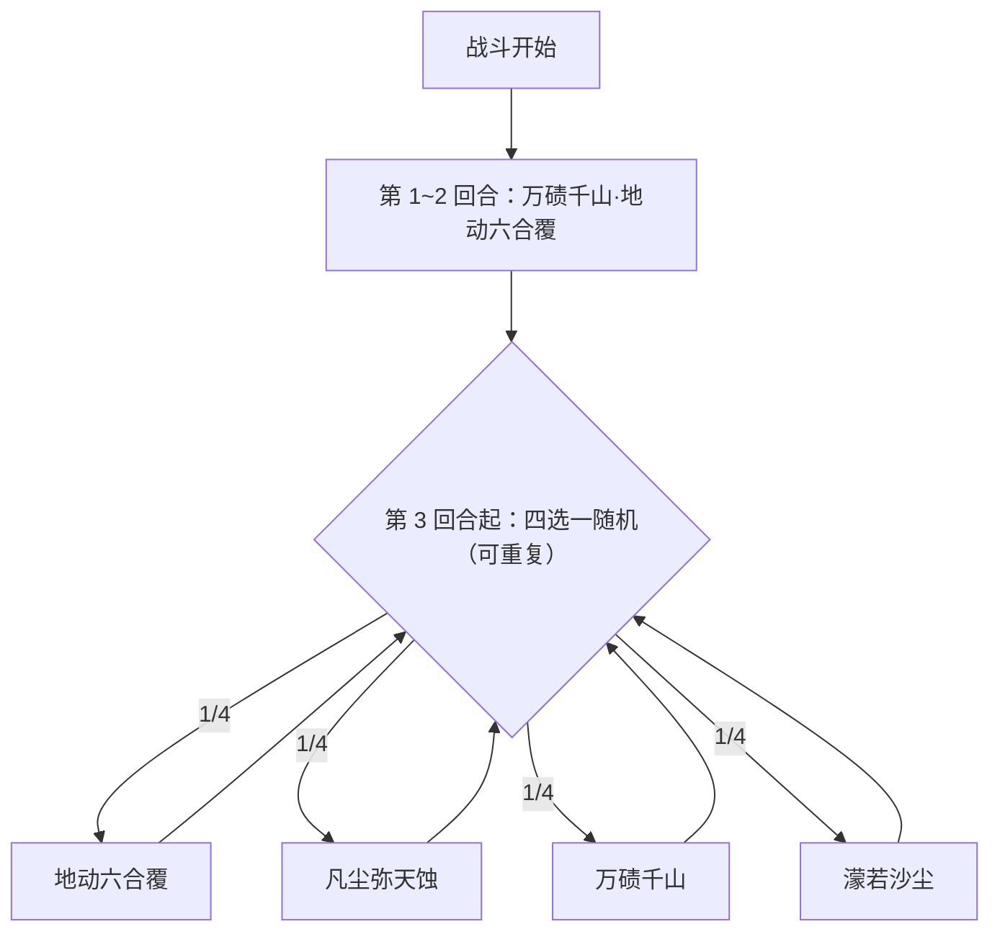

# 狂沙之主·萨特

> **类型**：精英怪物
> **初始生命**：1000
> **遭遇战**：第三层精英战斗
> **特性**：狂沙之躯（单回合受到的伤害上限 80）+ 黯天之尘（攻击技能翻倍伤害、先制 +1 并随机尘封你一张牌）

## 被动能力（开局自带）

| 名称 | 类型 | 效果 |
|------|------|------|
| **狂沙之躯** | 开局被动（不可消除） | 自身单回合受到的伤害不超过 80 点 |

::: tip 狂沙之躯：硬性单回合伤害上限
- 每回合最多从它身上扣 80 点生命，超出部分被按比例削掉（不参与扣血）。
- 计数以萨特自身回合开始清零，即一个完整回合内累计不超过 80。
- 因此 1000 血**至少需要 13 个回合**才能清空；把爆发堆在单回合里是纯浪费，节奏应摊平为「每回合打满 80」。
:::

::: tip 黯天之尘（攻击技能触发）
- 地动六合覆在结算末尾会给萨特自身 +3 层「黯天之尘」。
- 之后萨特每次使用**攻击技能**（地动六合覆、凡尘弥天蚀）都会消耗 1 层触发：自身[先制](/powers/first_strike_power.md) +1、**本次伤害提高 100%**，并随机**尘封**你 1 张牌。
- 由于地动六合覆在结尾才补尘，第 1 回合的 46 点是原值；**从第 2 回合起**（已有存尘）该招实际翻倍为约 92 点。
- **尘封**：从你的**牌组**中随机选 1 张牌封锁，与它当前在抽牌堆、手牌还是弃牌堆无关；同名的所有副本一起无法打出，需经过 5 场战斗才能解封。
:::

## 行动逻辑

第 1、2 回合固定组合招「万碛千山·地动六合覆」，第 3 回合起每回合从 4 个基础技能中随机出 1 招。

> **说明**：第 1、2 回合都是同一套「万碛千山 → 地动六合覆」组合；第 3 回合起四招等概率随机、可重复，每回合只出一招。

## 招式表

| 招式名 | 意图 | 类型 | 效果 |
|--------|------|------|------|
| **万碛千山·地动六合覆** | 万碛千山 + 攻击 46 | 组合招（第 1-2 回合） | 先施放万碛千山，再施放地动六合覆 |
| **地动六合覆** | 攻击 46 | 攻击 + Debuff | 造成 46 点伤害；敌人获得 2 层束缚、2 层臣服；自身获 3 层黯天之尘；击杀敌人则获 5 层[缓冲](/powers/buffer_power.md) |
| **凡尘弥天蚀** | 攻击 10×3 | 多段攻击 + 反弱反强 | 反弱反强（先反后打）；造成 10 点伤害 ×3；敌人每有 1 **种**异常，攻击次数 +1 |
| **万碛千山** | 万碛千山 | 自身增益 + Debuff | 自身全属性 +6；**自身**获 4 回合[吃月亮](/powers/eat_moon_power.md)；敌人获 4 回合[石化](/powers/petrify_power.md)；持续期间逼迫敌人每回合召唤 |
| **濛若沙尘** | 濛若沙尘 | 自身增益 | 获 4 回合弹控、免固；获 40%[永久闪避](/powers/dodge_power.md)；下回合自身每减 1 个增益获 1 层[缓冲](/powers/buffer_power.md) |

::: warning 万碛千山：石化 + 吃月亮的组合
- [石化](/powers/petrify_power.md)（施加于你）：你的攻击伤害 -70%，并把原伤害的 70% 转化为萨特自身的格挡——直接压制你的输出。
- [吃月亮](/powers/eat_moon_power.md)（施加于**萨特自己**）：他的回合开始时恢复自身最大生命 1/4，并对你追加该实际恢复量 20% 的固定伤害。
- 两者都由万碛千山各给 4 层；前两回合连续施放两次，层数会叠加到约 8 层（约 8 回合），之后每次随机抽到万碛千山再 +4。务必按叠加后的持续回合重新计算节奏。
:::

## 遭遇战

| 遭遇战 | 房间类型 | 池子 | 数量 | 说明 |
|--------|----------|------|------|------|
| 狂沙之主·萨特精英 | Elite | 第三层精英池 | 1 只 | 单怪精英遭遇战 |

## 策略提示

1. **把输出摊平，别堆单回合爆发**：狂沙之躯把单回合伤害锁死在 80，超过部分全部浪费。最优节奏是**每回合稳定打满 80**，坚持 13 个回合即可清空 1000 血。倍率型大爆发对它几乎无效。

2. **警惕黯天之尘翻倍**：地动六合覆第 1 回合 46 点，之后每次**攻击技能**都会消耗 1 层黯天之尘：本次伤害 +100%（地动六合覆约 92 点，凡尘弥天蚀每段 10 → 20）并附带[先制](/powers/first_strike_power.md) +1。第 2 回合起格挡/减伤要按 92 预留，而不是 46。

3. **尘封会永久废掉本场一张牌**：地动六合覆 / 凡尘弥天蚀每次触发黯天之尘都会从你的牌组随机尘封 1 张牌（同名牌全部封锁，本场及之后 5 场战斗内不可打出）。封锁对象与牌当前所在牌堆无关，无法靠“把关键牌抓在手里”规避；想降低影响，只能减少牌组里的同名核心牌数量，或接受它被封锁后改用别的制胜手段。

4. **前两回合固定高压**：第 1、2 回合都是「万碛千山 + 地动六合覆」组合。两次万碛会把[石化](/powers/petrify_power.md)（你减攻 + 伤害转它格挡）与[吃月亮](/powers/eat_moon_power.md)（**萨特回血 + 对你打固伤**）叠到约 8 层，同时还要扛约 46→92 的攻击。

5. **濛若沙尘：免固 + 闪避 + 弹控**：该招一轮内同时给 40% 永久闪避（你约四成攻击打空）、4 回合免固（免疫固定伤害）、4 回合弹控（你的异常被反弹）。若你的主力是固定伤害或异常流，这 4 回合务必改变打法（改用可命中的直接攻击）。

6. **[束缚](/powers/constrict_power.md) / [臣服](/powers/subjugation_power.md) 与反强反弱**：地动六合覆给你 2 层束缚 + 2 层臣服；凡尘弥天蚀则同时反强（翻掉你的正属性）反弱。**异常种类**越多，凡尘弥天蚀的攻击段数越多（每多 1 种异常 +1 次 ×10 伤害），所以别在它出招前把异常种类堆多。

7. **万碛千山的召唤压力**：持续期间逼迫你每回合召唤一次（奥斯提）。这会持续占用你的资源与节奏，需评估召唤代价，避免被拖慢推进。

8. **第 3 回合起无法预判**：之后 4 招随机可重复。需要同时准备挡伤害（地动六合覆 ~92 / 凡尘弥天蚀多段）、破格挡（石化转化的格挡）、躲闪（40% 闪避）、以及反异常。把它当作「每回合 80 血、耐打 13 回合」的消耗战来处理最稳妥。

## 源码

- 怪物：`SeerMadSandLordSateMonster.cs`
- 被动能力：`SeerMadSandLordSatePower.cs`（狂沙之躯）、`SeerNewSkillPowersH.cs`（黯天之尘）
- 关联能力：`SeerDodgePower.cs`（闪避）、`SeerPetrifyPower.cs`（石化）、`SeerEatMoonPower.cs`（吃月亮）、`SeerDebuffImmuneReflectPower.cs`（弹控）、`SeerTurnImmuneFixedDamagePower.cs`（免固）、`SeerBuffLossBufferPower.cs`（濛若沙尘）、`SeerConstrictPower.cs`（束缚）、`SeerSubjugationPower.cs`（臣服）
- 意图：`SeerNamedSingleAttackIntent.cs`、`SeerDynamicMultiAttackIntent.cs`、`SeerPuniNamedBuffIntent.cs`
- 遭遇战：`SeerMadSandLordSateEliteEncounter.cs`
- 本地化：`monsters.json`（`SEER_MONSTER_SEER_MAD_SAND_LORD_SATE_MONSTER.*`）、`intents.json`（`SEER_SATE_*`）、`powers.json`（`SEER_POWER_SEER_MAD_SAND_LORD_SATE_POWER.*`、`SEER_POWER_SEER_DARK_DUST_POWER.*`）
