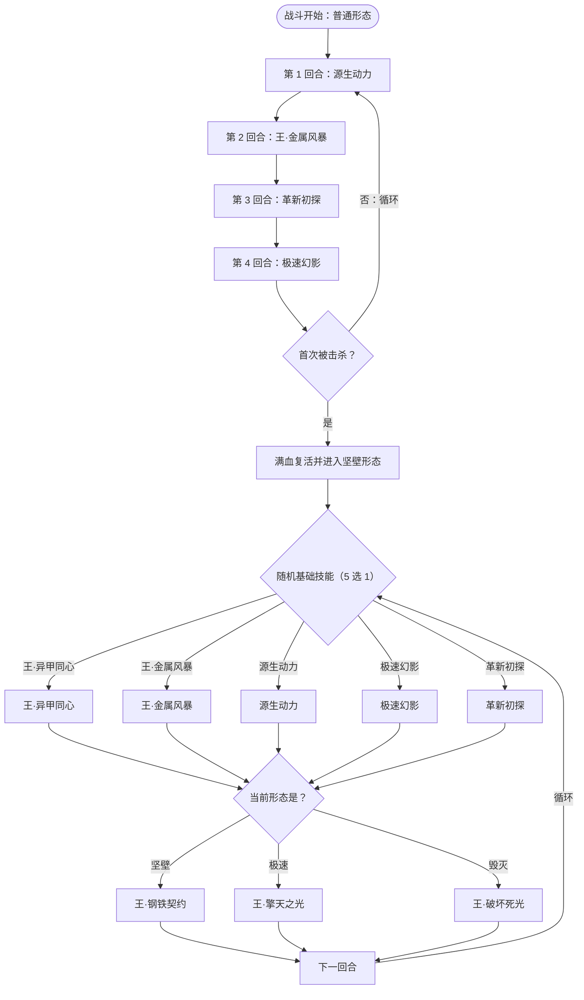

# 机械王·马尔修斯（已移至 Boss 图鉴）

机械王·马尔修斯现为**第四幕（星海尽头）Boss**，不再出现在第三层精英池。

完整页面见 **[机械王·马尔修斯（Boss）](/monsters/boss/maerxiusi_monster.md)**。

## 被动能力

开局自带**马尔修斯**形态机制：首次被击杀时满血复活并切入坚壁形态；三种形态（坚壁 / 极速 / 毁灭）各有登场效果与常驻被动。详见 Boss 页的「被动能力」表。

## 行动逻辑

复活前按固定顺序循环：源生动力 → 王·金属风暴 → 革新初探 → 极速幻影（第 5 回合回到源生动力）。首次被击杀后满血复活并进入坚壁形态，此后每回合在意图上并排显示「随机 1 个基础技能 + 当前形态对应的王技能」，依次结算两招。

> **说明**：复活前是 4 步固定循环，可提前预判；复活后每回合依次结算「随机 1 个基础技能 + 当前形态王技能」，若抽到王·异甲同心，它的切形态会推迟到追加王技能之后再发生。

## 招式表

| 招式名 | 类型 | 效果 |
|--------|------|------|
| 源生动力 | 吸取 + 销毁 0 费牌 + 格挡 | 吸取敌人 20 点生命；销毁敌人所有 0 费牌（手牌 / 抽牌堆 / 弃牌堆 / 消耗牌堆），并按张数向抽牌堆放入等量锁匣与断程；自身获得 200 格挡 |
| 王·金属风暴 | 攻击 + 封牌 | 造成 50 点伤害；本场每释放一次 +50%（无上限）；敌人下回合无法打出状态牌 |
| 革新初探 | 攻击 + 异常 + 暴击 | 造成 30 点伤害；先制 +1；敌人随机获得 3 种异常各 3 回合；接下来 2 回合自身攻击必定暴击 |
| 极速幻影 | 反弱反强 + 升级 + 固伤 | 反弱反强；升级场上所有可升级状态牌；消耗自身全部格挡，按其 10% 造成固定伤害 |
| 王·异甲同心 | 清增益 + 切形态 | 自身全属性 +8；清除敌人所有增益、己方所有减益；本场自身增益无法被清除、敌人无法回复生命；敌人最大能量 −1；随机切换形态 |
| 王·钢铁契约 | 攻击（坚壁） | 造成 45 点无视格挡伤害；下回合自身每次受到伤害时，减伤等于本次实际造成的伤害 |
| 王·擎天之光 | 多段攻击（极速） | 造成 20 点伤害 2 次；每有 1 级速度，额外对每个敌人附加「该敌人最大生命 1/8（向下取整）× 速度层数」的固定伤害 |
| 王·破坏死光 | 攻击（毁灭） | 造成 55 点伤害；按「自身与敌人当前生命差 ÷ 10」的百分比额外增伤（相差 1000 血 → +100%；取差值最大者） |

## 遭遇战

| 遭遇战 | 房间类型 | 池子 | 数量 | 说明 |
|---|---|---|---|---|
| `SeerMaerxiusiBoss` | Boss | 第四幕（星海尽头）Boss 池 | 1 只 | 第三层精英池已移除，现仅在第四幕作为 Boss 出场 |

## 策略提示

1. **实质是两管血**：普通形态 2700 血，首次被击杀后满血复活并进入坚壁形态，总承伤约两倍。不要把斩杀爆发全用在第一阶段。

2. **复活前可精准卡招**：源生动力 → 王·金属风暴 → 革新初探 → 极速幻影，4 步一轮。源生动力会销毁手牌 / 抽牌堆 / 弃牌堆 / 消耗牌堆里的全部 0 费牌——打出去或消耗掉都躲不掉，只能靠卡面费用不为 0。

3. **复活后看清两个意图**：每回合是「随机基础技能 + 当前形态王技能」两招连放，意图上会并排写出两个名字，按顺序都要防。王·金属风暴的伤害会随释放次数永久上涨。

4. **形态决定应对**：坚壁靠格挡与回血拖时间，极速会滚速度与固伤，毁灭有 30% 斩杀线。被「王·异甲同心」切形态后要立刻按新形态重算威胁。

## 源码

- 怪物：`SeerMaerxiusiMonster.cs`
- 形态能力：`SeerMaerxiusiPower.cs`
- 遭遇战：`SeerMaerxiusiBoss.cs`
- 本地化：`monsters.json`、`intents.json`、`powers.json`、`encounters.json`
