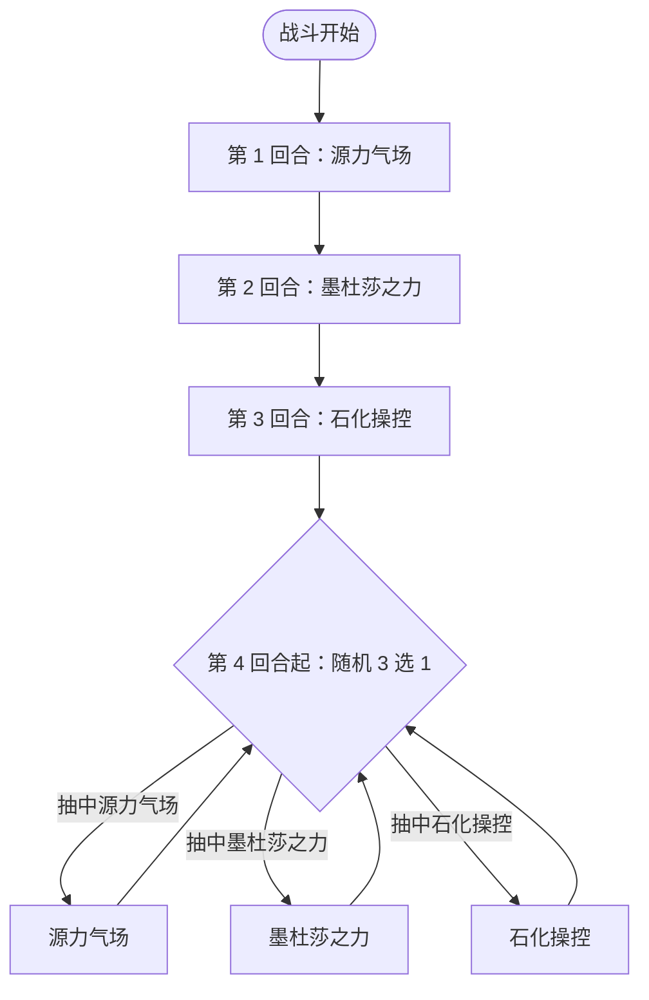

# 墨杜萨

> **类型**：精英怪物
> **初始生命**：222 - 226
> **遭遇战**：第三层精英战斗（**必与[墨鲁萨](/monsters/elite/medusa_minion_monster)同场出现**，玩家居中、墨杜萨居左、墨鲁萨居右）
> **特性**：石化之视（朝向即石化）+ 源力气场（背向多打）+ 石化操控（格挡转非攻击伤害）+ 墨杜莎之力（场上所有生物石化+力量，触发墨鲁萨无限念力）

## 必与墨鲁萨同场（核心机制）

::: warning 这不是"联动"——是必然同场
墨杜萨**只会**在「墨杜萨精英」遭遇战中与[墨鲁萨](/monsters/elite/medusa_minion_monster)同场出现，没有"单独墨杜萨"的情况。两个怪物的招式、朝向、状态都互相影响，必须当作一个整体来理解：

1. **朝向共用**：玩家只有一个朝向（朝左或朝右）。朝左 = 面对墨杜萨 / 背对墨鲁萨；朝右 = 背对墨杜萨 / 面对墨鲁萨。**没有"同时背对两个"的选项**，必选其一承受代价。
2. **石化传递（核心联动）**：墨杜萨的被动「石化之视」每回合遍历场上所有生物，墨鲁萨因右侧标记被判定为"面对墨杜萨"，每回合被施加 2 层石化。墨鲁萨被石化后，「无限念力」每回合触发 → **力量翻倍**。这个联动从第 2 回合起开始生效（第 1 回合的石化在无限念力之后才施加），与玩家朝向无关。
3. **朝向效果互斥**：朝左规避墨鲁萨的失神咒念波（每段 8 伤害 ×8）但吃墨杜萨的石化之视（玩家自己被上石化）；朝右规避墨杜萨的石化之视（玩家不被上石化，但墨鲁萨仍被上石化）但吃墨鲁萨的失神咒念波 + 源力气场多打 2 次。
:::

## 被动能力（开局自带）

| 名称 | 类型 | 效果 |
|------|------|------|
| **[石化之视](/powers/petrify_gaze_power.md)**（1 层） | 能力（不可消除） | 每回合开始时，对所有正面对着墨杜萨的生物施加 2 层石化 |
| **左侧标记**（1 层，隐藏） | 能力（不可消除） | 标记墨杜萨在战场左侧，用于朝向判断。不显示给玩家 |

::: tip 朝向机制
- 墨杜萨在战场**左侧**，墨鲁萨在战场**右侧**，玩家居中
- 玩家有朝向（朝左或朝右），影响两个怪物的招式效果：
  - **朝左（面对墨杜萨）**：石化之视每回合施加 2 层石化；源力气场正常 5 次
  - **朝右（背对墨杜萨）**：石化之视不生效；源力气场多打 2 次（共 7 次 = 42 伤害）
- 朝向选择是核心策略：朝左承受石化，朝右承受额外伤害
:::

::: warning 石化状态效果
- **攻击伤害降低 70%**（只造成 30% 伤害）
- **攻击后获得格挡**：等于原始伤害的 70%
- 回合结束时减少 1 层
- 即石化状态下攻击几乎无效，且攻击会给自身加格挡（反而帮助石化操控）
:::

## 行动逻辑

前 3 回合固定出招，第 4 回合起 3 选 1 随机（同一招不会连续重复）。

> **说明**：第 4 回合起每回合从三招中随机抽 1 招，且不会连续重复同一招；三条回边都回到下一次随机。

## 招式表

| 招式名 | 意图 | 类型 | 效果 |
|--------|------|------|------|
| **源力气场** | 攻击 6×5 | 多段攻击 | 对单体目标造成 6 点伤害 5 次。若有任何敌人背对墨杜萨，连击 +2（共 7 次 = 42 伤害） |
| **墨杜莎之力** | 墨杜莎之力 | Debuff + 增益 | 对所有敌人施加石化 3 层；场上**所有生物**（含墨杜萨、墨鲁萨、玩家）获得 8 点力量 |
| **石化操控** | 石化操控 | Debuff | 对所有敌人施加石化操控（下回合结束时清除所有格挡，并挂上等量不可格挡的非攻击伤害，在你再下回合开始时结算） |

::: warning 石化操控机制
- 施加 1 层，持续 1 回合
- 下回合结束时：清除所有格挡，并挂上等量**不可格挡的非攻击伤害**（在你再下回合开始时结算，不受力量/易伤影响）
- 例：下回合叠了 20 格挡 → 回合结束失去 20 格挡，再下回合开始受 20 点不可格挡伤害
- 应对：被施加石化操控后，下回合**不要叠格挡**，改用其他防御手段（减伤、闪避等）
:::

## 与墨鲁萨的联动机制（核心）

::: danger 联动一：石化之视 → 无限念力 → 力量翻倍（第 2 回合起每回合滚雪球）
墨杜萨的被动「石化之视」每回合开始时遍历**场上所有生物**，用朝向判断过滤。墨鲁萨位于右侧、墨杜萨位于左侧，朝向判断规则是"右侧生物面对左侧目标"，因此墨鲁萨每回合都被判定为"面对墨杜萨"，被施加 2 层石化。

**结论**：石化之视每回合会给墨鲁萨施加 2 层[石化](/powers/petrify_power.md)。每次敌方阵营回合开始、石化之视再次施加石化之前，若墨鲁萨仍处于石化状态，「无限念力」就会触发 → **力量翻倍**。

时序（同一敌方阵营回合内，先结算阵营回合开始的被动，再按左→右依次行动）：
1. 第 1 回合阵营回合开始：墨鲁萨此刻还没有石化，无限念力不触发；随后石化之视才给它 2 层石化
2. 第 1 回合行动：墨鲁萨出源力迸发，力量 0→3；回合结束时石化 2→1
3. 第 2 回合阵营回合开始：无限念力先结算，力量 3→6；随后石化之视再 +2 层 → 墨鲁萨身上的石化为 3 层
4. 第 2 回合行动：墨杜萨先出「墨杜莎之力」给所有生物 +8 力量 → 墨鲁萨力量 6→14；随后墨鲁萨出深蓝迷光，基础值 35+14=49，因石化只打出约 15 点，并按原始伤害的 70% 获得格挡；回合结束时石化 3→2
5. 第 3 回合起：无限念力仍会每回合翻倍力量（14→28…），但墨鲁萨已永久循环失神咒念波（非攻击伤害不受力量影响），这个力量已无输出意义

**关键点**：
- 石化之视是**每回合**给墨鲁萨上石化，不是只在墨杜莎之力回合。从第 2 回合起，只要墨杜萨活着，墨鲁萨就一直处于石化状态，无限念力每回合都触发力量翻倍。
- 墨杜莎之力给墨鲁萨 +8 力量（场上所有生物）；由于翻倍先于墨杜莎之力结算，第 2 回合墨鲁萨是 3→6，再加 8 到 14。
- 墨杜萨死后，石化之视消失，墨鲁萨不再被上石化；身上剩余的石化每回合 -1，耗尽后无限念力也就不再触发。**优先击杀墨杜萨可解除墨鲁萨的力量翻倍威胁**——这本身就是优先击杀墨杜萨的重要理由。
:::

::: tip 联动二：墨杜莎之力的力量加成对墨鲁萨也生效
墨杜萨的「墨杜莎之力」（第 2 回合固定招式）给**场上所有生物**+8 力量，包括墨鲁萨自己。但注意：墨杜莎之力的**石化**只对敌人施加，**不包括墨鲁萨自己**。墨鲁萨的石化来源是石化之视，不是墨杜莎之力。

墨鲁萨的力量只作用于深蓝迷光这类攻击；但墨鲁萨自己每回合都被石化之视叠上石化，攻击伤害要多乘 0.3。第 2 回合力量为 6，墨杜莎之力再 +8 到 14，深蓝迷光的基础值是 35+14 = 49，实际约 15 点，并按原始伤害的 70% 转化为自己的格挡。深蓝迷光只第 2 回合出一次，之后永久失神咒念波（非攻击伤害，既不吃力量也不吃石化的减伤），所以力量翻倍真正放大的只是那一发深蓝迷光的伤害与其附带的格挡。
:::

::: warning 联动三：朝向不可两全
玩家只有一个朝向，无法同时规避两个怪物的招式：

| 朝向 | 对墨杜萨 | 对墨鲁萨 |
|------|---------|---------|
| **朝左**（面对墨杜萨） | 石化之视每回合 +2 石化（玩家 + 墨鲁萨都被上石化）；源力气场正常 5 次 | 失神咒念波**完全规避**；源力迸发改为全属性+3、吃月亮 4 回合、对全体敌人睡眠 4 回合 |
| **朝右**（面对墨鲁萨） | 石化之视不触发（玩家不被上石化，但**墨鲁萨仍被上石化**，因为墨鲁萨的朝向判断不依赖玩家朝向）；源力气场多打 2 次（共 7 次 = 42 伤害） | 失神咒念波吃满 64 伤害；源力迸发同样施加睡眠 4 回合（不再区分朝向） |

**重要**：墨鲁萨被石化之视上石化，**与玩家朝向无关**——墨鲁萨的朝向判断走的是"右侧生物面对左侧目标"的规则，不看玩家朝向。所以无论玩家朝左还是朝右，墨鲁萨每回合都会被上石化，无限念力都会触发。

**两种朝向的代价仅影响玩家自身**：朝左玩家自己吃石化，朝右玩家不吃石化但吃源力气场多 2 次。对墨鲁萨的力量翻倍没有影响。
:::

### 墨鲁萨的行动逻辑（必同场对手）

[墨鲁萨](/monsters/elite/medusa_minion_monster)（右侧）按固定三段序列行动，第 3 回合起永久循环失神咒念波：

| 招式名 | 回合 | 效果 |
|--------|------|------|
| **源力迸发** | 第 1 回合 | 自身全属性 +3，获得 4 回合[吃月亮](/powers/eat_moon_power.md)；对**所有**敌人施加 4 回合睡眠 |
| **深蓝迷光** | 第 2 回合 | 对单体造成 35 点攻击伤害；对睡眠状态的敌人附加虚弱/易伤各 2 层 |
| **失神咒念波** | 第 3 回合起循环 | 对所有面对墨鲁萨的生物造成 8 点伤害 8 次（共 64 点，非攻击伤害，可被格挡） |

::: tip 墨鲁萨的被动
- **[无限念力](/powers/infinite_telekinesis_power.md)**：回合开始时，若自身处于石化状态，则力量翻倍（与墨杜萨的墨杜莎之力联动）
- **右侧标记**（隐藏）：标记墨鲁萨在战场右侧，用于朝向判断
- **[凝视](/powers/facing_power.md)**：施加给所有对手，使玩家朝向影响墨鲁萨招式效果
:::

## 遭遇战

| 遭遇战 | 房间类型 | 池子 | 数量 | 说明 |
|--------|----------|------|------|------|
| 墨杜萨精英 | Elite | 第三层精英池 | 2 只 | 墨杜萨（左）+ 墨鲁萨（右），玩家居中，自定义场景 |

::: warning 不参与混合精英池
墨杜萨精英是双怪遭遇战，不参与混合精英池（混合精英只选单怪精英）。
:::

## 策略提示

1. **核心矛盾：朝左吃石化降输出，朝右吃额外伤害**：朝左面对墨杜萨 → 每回合受 2 层石化（攻击伤害降低 70%），但背对墨鲁萨可规避失神咒念波 64 伤害；朝右背对墨杜萨 → 不受石化，但源力气场多打 2 次（42 伤害）+ 面对墨鲁萨失神咒念波 64 伤害。两种朝向都有代价，需根据当前手牌和血量权衡。速攻流（4-5 回合击杀一只）建议朝右保输出；持久战建议朝左规避失神咒念波。

2. **石化严重削弱输出**：石化降低 70% 攻击伤害 + 攻击后加 70% 格挡（反而帮助石化操控）。3 层石化持续 3 回合，期间攻击几乎无效。如果朝左面对墨杜萨，每回合 +2 石化，输出能力持续下降。携带解石化手段或选择朝右承受伤害更实际。

3. **石化操控后不要叠格挡**：被施加石化操控后，你下回合结束时所有格挡会被清除，并挂上等量不可格挡的非攻击伤害（再下回合开始结算）。该回合应避免叠格挡，改用减伤、闪避、吸血等防御手段。预判石化操控回合（第 3 回合及之后随机到时）提前准备。

4. **墨杜莎之力是双刃剑**：给所有生物 +8 力量，包括玩家。如果玩家有高攻击频率的牌，可以利用 +8 力量反制输出。但同时墨杜萨和墨鲁萨也 +8 力量，后续源力气场与深蓝迷光伤害增加；失神咒念波是非攻击伤害，不受力量影响。

5. **优先击杀墨杜萨**：墨杜萨的石化之视是持续威胁（每回合石化），且石化操控的格挡惩罚极强。墨鲁萨的失神咒念波虽然 64 伤害高，但只打面对自己的生物（朝左即可规避）。建议优先击杀墨杜萨解除石化威胁。

6. **双怪血量都不低，速攻需规划**：墨杜萨和墨鲁萨都是 222~226 血。集中火力也需要数回合才能击杀一只。源力迸发现在固定为自身全属性+3、吃月亮 4 回合、全体敌人睡眠 4 回合，不再因朝向改变；朝左可规避失神咒念波，朝右则要承受 64 伤害。

7. **朝左的完整代价**：朝左面对墨杜萨 → 石化之视每回合 +2 石化 → 墨杜莎之力 +3 石化 → 共 5 层石化持续 5 回合。同时背对墨鲁萨 → 源力迸发的睡眠仍会施加，但不受失神咒念波。朝左适合需要规避失神咒念波 64 伤害的情况。

8. **朝右的完整代价**：朝右背对墨杜萨 → 源力气场 42 伤害 → 不受石化之视。同时面对墨鲁萨 → 源力迸发睡眠 4 回合 → 失神咒念波 64 伤害。朝右适合需要规避石化（保持输出能力）的情况，但伤害压力更大。

9. **墨鲁萨第 3 回合起无限失神咒念波**：墨鲁萨从第 3 回合起只使用失神咒念波（8×8=64 伤害，只打面对自己的生物，可被格挡）。如果朝左（背对墨鲁萨），完全不受失神咒念波影响。这是朝左的最大优势。

## 源码

- 怪物：`SeerMedusaMonster.cs`
- 同行怪物：`SeerMedusaMinionMonster.cs`（墨鲁萨）
- 被动能力：`SeerPetrifyGazePower.cs`（石化之视）、`SeerLeftSidePower.cs`（左侧标记，隐藏）
- 石化状态：`SeerPetrifyPower.cs`（降低攻击+加格挡）
- 石化操控：`SeerPetrifyControlPower.cs`（格挡转固定伤害）
- 墨鲁萨被动：`SeerInfiniteTelekinesisPower.cs`（无限念力）、`SeerRightSidePower.cs`（右侧标记）
- 遭遇战：`SeerMedusaElite.cs`（双怪精英，自定义场景）
- 本地化：`monsters.json`（`SEER_MONSTER_SEER_MEDUSA_MONSTER.*`、`SEER_MONSTER_SEER_MEDUSA_MINION_MONSTER.*`）、`intents.json`（`SEER_SOURCE_AURA.*`、`SEER_PETRIFY_CONTROL.*`、`SEER_MEDUSA_POWER.*`、`SEER_SOURCE_BURST.*`、`SEER_DEEP_BLUE_LIGHT.*`、`SEER_MINDBLANK_WAVE.*`）、`powers.json`（`SEER_POWER_SEER_PETRIFY_GAZE_POWER.*`、`SEER_POWER_SEER_PETRIFY_CONTROL_POWER.*`、`SEER_POWER_SEER_PETRIFY_POWER.*`）
