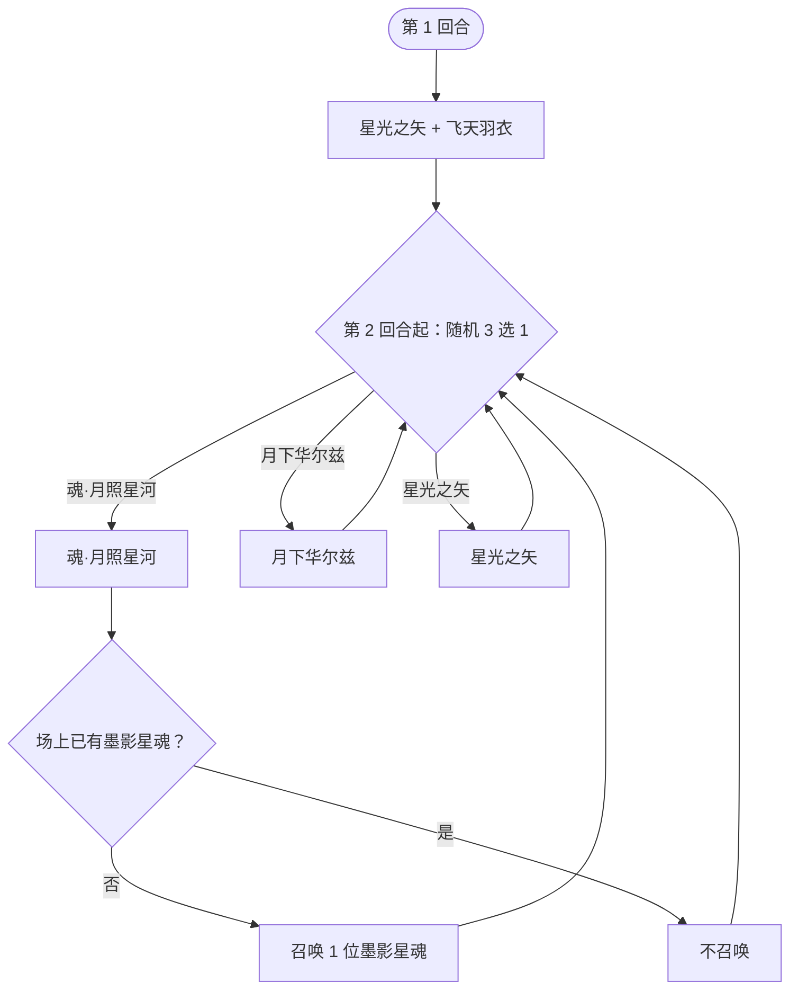

# 月照星魂

> **类型**：精英怪物
> **初始生命**：520
> **遭遇战**：第三层精英战斗
> **特性**：月照（前 2 回合自身免控免削、敌方无法打出能力牌）+ 首回合 2 层缓冲 + 永久免疫固定伤害 + 偷取强化 + 残血华尔兹翻倍

## 被动能力（开局自带）

| 名称 | 类型 | 效果 |
|------|------|------|
| **[月照](/powers/moonlit_star_soul_power.md)**（不可消除） | 能力 | ① 登场后的前 2 回合，自身免疫控制和削弱效果；② 前 2 回合，敌人无法打出**能力牌** |

::: tip 月照的双重封印
- **自身免疫控制/削弱**：前 2 回合你对它的所有异常（中毒、易伤、虚弱、石化、各种 debuff）与属性削弱统统无效。
- **敌方无法打出能力牌**：前 2 回合你的**能力牌**被拦下，攻击牌与技能牌不受影响。
- 计轮以**玩家阵营回合开始**为准：前 2 个玩家回合有效，第 3 个玩家回合开始时失效。
- 即：**开局两回合只能靠攻击牌真刀真枪打，铺场型能力牌与 debuff 循环都要延后**。
:::

## 行动逻辑

第 1 回合固定依次使用「星光之矢 + 飞天羽衣」（同回合双意图）；第 2 回合起从技能 1/2/3 中随机 1 招。

> **说明**：第 1 回合是固定组合招（星光之矢→飞天羽衣）。第 2 回合起在「魂·月照星河 / 月下华尔兹 / 星光之矢」中三选一随机；只有魂·月照星河会在场上没有墨影星魂时召唤 1 位。技能 4 飞天羽衣不再出现在循环里（其效果已在第 1 回合生效且为永久）。

## 招式表

| 招式名 | 意图 | 类型 | 效果 |
|--------|------|------|------|
| **星光之矢 · 飞天羽衣**（第 1 回合） | 星光之矢 + 飞天羽衣 | 组合招（双意图） | 先**星光之矢**：所有友方获得 2 层[缓冲](/powers/buffer_power.md)、全属性 +5；再**飞天羽衣**：所有友方本场永久[免疫固定伤害](/powers/immune_fixed_damage_power.md)、[先制](/powers/first_strike_power.md) +1 |
| **魂·月照星河** | 攻击 6×6 | 多段攻击 + 吸收强化 + 召唤 | **吸收敌人**全部四维正强化（1:1 转移给自己）；**反弱**；自身获得永久 [50% 增伤](/powers/permanent_damage_boost_power.md)；连续攻击 6 次每次 6 点；若场上没有墨影星魂，召唤 1 位墨影星魂 |
| **月下华尔兹** | 攻击 33 | 单次攻击（随血量增幅） | 造成 33 点伤害；自身生命 < 1/2 时伤害 ×2；< 1/3 时 ×3 |
| **星光之矢** | 星光之矢 | 全体增益 | 所有友方获得 2 层[缓冲](/powers/buffer_power.md)；所有友方全属性 +5 |
| **飞天羽衣** | 飞天羽衣 | 全体增益 | 所有友方本场战斗中永久[免疫固定伤害](/powers/immune_fixed_damage_power.md)；所有友方[先制](/powers/first_strike_power.md) +1 |

::: warning 月下华尔兹的意图显示低于实际
- 意图上的「攻击 33」是**基础值**。它自身挂着「永久增伤 50%」后，实际是 33 × 1.5 ≈ 50。
- 再叠加残血倍率：生命 < 1/2 → ×2（约 99）；生命 < 1/3 → ×3（约 148）。
- 也就是说**它越残、这一拳越重**——别把收尾拖成挨一拳 148 的残局。
:::

::: tip 魂·月照星河的增伤对本次攻击立即生效
「获得永久 50% 增伤」在**本次 6 段攻击之前**结算，所以这一次的 6 段就已经按 ×1.5 打（每段约 9，合计约 54），并且这项增伤会**永久保留**，之后所有攻击都吃。
:::

## 遭遇战

| 遭遇战 | 房间类型 | 池子 | 数量 | 说明 |
|--------|----------|------|------|------|
| `SeerMoonlitStarSoulEliteEncounter` | Elite | 第三层精英池 | 1 只 | 第三层单怪精英遭遇战 |

## 策略提示

1. **第 1 回合固定吃一套「2 缓冲 + 永久免固」**：飞天羽衣让**它自己**本场永久免疫[固定伤害](/powers/fixed_damage_power.md)，星光之矢再给 2 层[缓冲](/powers/buffer_power.md)（前 2 次受击免疫）。**你的固定伤害类手段这一整场都别指望**；开局两下攻击也会被缓冲吃掉，**用两段廉价攻击先把缓冲剥掉**，再上大的。

2. **前 2 回合封印你的能力牌与 debuff**：月照让你前 2 回合无法打出能力牌，同时它自身免疫控制/削弱。**开局两回合专注攻击牌输出**，别浪费能力牌和 debuff。

3. **千万别在它可能出「魂·月照星河」时堆满属性**：这招把你的[力量](/powers/strength_power.md)/[防御](/powers/defense_power.md)/[命中](/powers/accuracy_power.md)/[速度](/powers/speed_power.md) 正层数**按 1:1 抢走**转给自己，还会**反弱**。你堆得越多、送得越多。**它的回合前身上尽量别挂正属性**。

4. **魂·月照星河 = 永久 50% 增伤，是滚雪球起点**：一旦它打出这招，此后所有攻击 ×1.5。**这一招的威胁不是那 54 伤，而是永久增伤**——它把月下华尔兹从 33 抬到约 50，残血再翻倍就是 99~148。所以**要抢在它积累增幅前把它打残/打死**。

5. **月下华尔兹是「残血陷阱」**：它生命越低，这一拳倍率越高（< 1/2 ×2、< 1/3 ×3）。520 的一半是 260、三分之一约 173。**别把它慢慢磨到残血再挨招**——要么保持压制一波带走，要么收尾那一回合确保格挡覆盖可能的最大伤害。

6. **缓冲只挡 2 次受击**：星光之矢每出一次就再叠 2 层缓冲。第 2 回合起随机到星光之矢，它会继续补缓冲。**面对多段攻击很划算（每段剥一层），面对单次大伤则要先用小牌剥完再打**。

7. **反弱会翻转你的负属性**：若你身上有负属性（被削过），魂·月照星河的反弱把它翻正。**被削过就先别急着补**，避免变相给它送属性。

8. **单怪开局、会召唤**：520 血，前 2 回合靠攻击牌压血，2 回合后它随机出招；魂·月照星河若在场上没有墨影星魂时会召唤 1 位，可能变成双目标。**核心赢法是「在它叠起永久增伤和残血倍率前速杀」**，合理节奏 5~7 回合。

## 源码

- 怪物：`SeerMoonlitStarSoulMonster.cs`
- 被动能力：`SeerMoonlitStarSoulPower.cs`（月照）
- 永久增伤：`SeerPermanentDamageBoostPower.cs`
- 永久免固：`SeerImmuneFixedDamagePower.cs`
- 缓冲 / 先制：`BufferPower.cs`、`SeerFirstStrikePower.cs`
- 意图：`SeerNamedSingleAttackIntent.cs`（月下华尔兹）、`SeerNamedMultiAttackIntent.cs`（月照星河）、`SeerPuniNamedBuffIntent.cs`（星光之矢/飞天羽衣）
- 遭遇战：`SeerMoonlitStarSoulEliteEncounter.cs`
- 本地化：`monsters.json`（`SEER_MONSTER_SEER_MOONLIT_STAR_SOUL_MONSTER.*`，含 `moves.COMBO_STAR_ROBE_MOVE.title` = 星光之矢·飞天羽衣）、`intents.json`（`SEER_MOON_*`）、`powers.json`（`SEER_POWER_SEER_MOONLIT_STAR_SOUL_POWER.*` 等）
