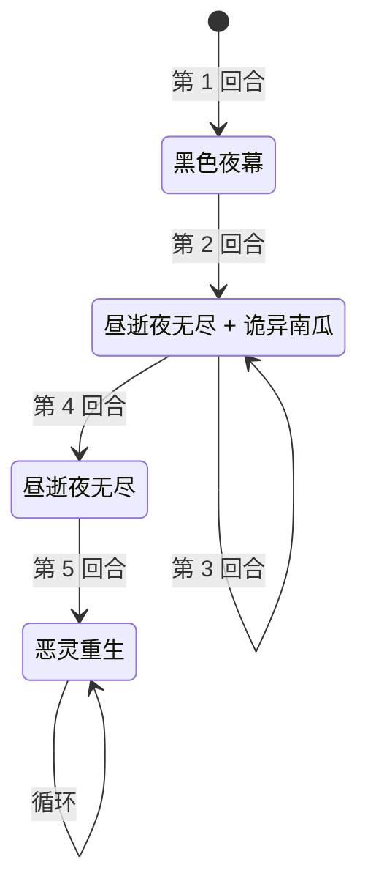

# 夜使·库帕帕

> **类型**：精英怪物
> **初始生命**：456
> **遭遇战**：第三层精英战斗
> **特性**：开局 99 层无实体 + 固定序列铺垫（夜幕 / 灾厄 / 递增斩）+ 第 5 回合起恶灵重生（打不死你就自杀）

## 被动能力（开局自带）

| 名称 | 类型 | 效果 |
|------|------|------|
| **夜使** | 能力（不可消除） | 战斗开始时，自身获得 99 层[无实体](/powers/intangible_power.md) |

::: tip 99 层无实体意味着什么
- 持有[无实体](/powers/intangible_power.md)期间，库帕帕受到的伤害与生命损失**每次降为 1**，每承受一次伤害消耗 1 层
- 也就是开局前 99 次有效命中对它都只造成 1 点伤害，硬磨血线的代价极高
- 多段攻击能快速消耗层数（每一段消耗 1 层）
:::

## 行动逻辑

固定序列：第 1 回合黑色夜幕 → 第 2、3 回合「昼逝夜无尽 + 诡异南瓜」→ 第 4 回合昼逝夜无尽 → 第 5 回合起**无限连续使用恶灵重生**。

> **说明**：第 5 回合起每回合都出恶灵重生，不再使用其它技能，直到战斗结束。

## 招式表

| 招式名 | 意图 | 类型 | 效果 |
|--------|------|------|------|
| **昼逝夜无尽** | 攻击（递增） | 单次攻击 + 自身增益 | 造成伤害（基础 48）；每次使用后基础伤害**永久 +10**，并使**下一次攻击伤害 +50%** |
| **恶灵重生** | 攻击 99 | 单次攻击（自曝技） | 造成 99 点伤害；**未击杀目标则自身死亡**；击杀目标则使敌人下回合开始时结束其回合 |
| **诡异南瓜** | 诡异南瓜 | 自身增益 + Debuff | 自身全属性 +7；对所有敌人施加 48 层[灾厄](/powers/doom_power.md) |
| **黑色夜幕** | 黑色夜幕 | Debuff | 对所有敌人随机施加 7 种异常各 7 回合，并使敌人最大能量 -1 |
| **昼逝夜无尽·诡异南瓜** | 昼逝夜无尽 + 诡异南瓜 | 组合招（双意图） | 同一回合先施放昼逝夜无尽，再施放诡异南瓜 |

::: warning 昼逝夜无尽的伤害递增（本页以实际效果为准）
招式按“先结算本次攻击、再施加加成”的顺序执行，因此 +50% 只作用于**下一次**攻击：
- 第 2 回合首次昼逝夜无尽：基础 48（无加成）→ 之后基础变 58、下次攻击 +50%
- 第 3 回合昼逝夜无尽：58 × 1.5 = 87 → 之后基础变 68、下次攻击 +50%
- 第 4 回合昼逝夜无尽：68 × 1.5 = 102 → 之后基础变 78、下次攻击 +50%
- 第 5 回合恶灵重生：99 × 1.5 ≈ 148（承接上一次挂起的 +50%）
:::

::: tip 恶灵重生：库帕帕的“生死一搏”
- 单体单挑场景下，恶灵重生只有两种结局：**打死你**，或**没打死你、库帕帕自己死亡（战斗结束）**
- 也就是说：只要你能扛住第 5 回合那一发恶灵重生，本战即刻结束
:::

## 遭遇战

| 遭遇战 | 房间类型 | 池子 | 数量 | 说明 |
|--------|----------|------|------|------|
| 夜使·库帕帕精英 | Elite | 第三层精英池 | 1 只 | 单怪精英遭遇战 |

## 策略提示

1. **核心思路：撑到第 5 回合，扛住一发大的**：第 5 回合起库帕帕每回合都放恶灵重生（99 伤害，第 5 回合带上一次遗留的 +50% ≈ 148）。你只需要存活到扛下这一击，库帕帕就会因“未击杀目标”而自杀，战斗直接结束。不必强求打空它 456 血 + 99 层无实体。

2. **灾厄是暗藏的第二条倒计时**：[灾厄](/powers/doom_power.md)会**处决**——敌方回合结束时，若你的当前生命 ≤ 灾厄层数则立即死亡。第 2 回合诡异南瓜给你 48 层，第 3 回合再 +48 累积到 96 层。第 2 回合后你生命必须 > 48，第 3 回合后必须 > 96，否则被直接处决（不吃格挡、不吃无实体）。

3. **第 1 回合黑色夜幕先手压制**：开场就挂 7 种随机异常各 7 回合（含虚弱、易伤等），并把你的**最大能量 -1**。这是本战最需要提前准备解异常的一回合，否则后面 7 回合一直被压着打。

4. **第 2、3 回合是高压组合回合**：这两个回合库帕帕同时打「昼逝夜无尽 + 诡异南瓜」，一边递增伤害一边加 48 灾厄、加全属性。这两回合必须格挡到位、把血线拉高，否则灾厄叠上来就危险。

5. **不要指望快速打死它**：开局 99 层无实体让前 99 次命中都只掉 1 血；想强攻需要极多段数或极长时间。既然生存即胜，火力应优先用于保命（格挡/回血/解 debuff），而非硬磨 99 层壳。

6. **留意昼逝夜无尽的滚雪球**：它每次使用基础 +10，且每次给下一次攻击留 +50%。如果你拖延太多次，第 4 回合的昼逝夜无尽就会到 102 点，第 5 回合的恶灵重生可到约 148 点。算好格挡需求。

7. **第 4 回合是暴风雨前夜**：第 4 回合只有一发昼逝夜无尽（102 点），之后就是恶灵重生。这一回合应把血线、格挡、解异常都准备到最好状态，为第 5 回合的处决判定做准备。

8. **多人时的差异**：恶灵重生若“击杀”了某个队友，会额外让该阵营在下一回合开始时被强制结束回合——多人局里要留意别让它真的击杀成功，否则不止掉一个人，还会丢一整轮行动。

## 源码

- 怪物：`SeerNightEnvoyKupapaMonster.cs`
- 被动能力：`SeerNightEnvoyKupapaPower.cs`（夜使）
- 技能能力：`SeerNextDamageBoostPower.cs`（下一次攻击 +50%）、`SeerNewSkillPowersG.cs`（恶灵重生的死亡跳过标记）；昼逝夜无尽的递增伤害与黑色夜幕的最大能量 −1 由怪物自身结算
- 意图：`SeerNamedSingleAttackIntent.cs`、`SeerPuniNamedBuffIntent.cs`
- 遭遇战：`SeerNightEnvoyKupapaEliteEncounter.cs`
- 本地化：`monsters.json`（`SEER_MONSTER_SEER_NIGHT_ENVOY_KUPAPA_MONSTER.*`）、`intents.json`（`SEER_YESHIKUPAPA_*`）、`powers.json`（`SEER_POWER_SEER_NIGHT_ENVOY_KUPAPA_POWER.*`、`SEER_POWER_SEER_EVIL_REBIRTH_POWER.*`）
