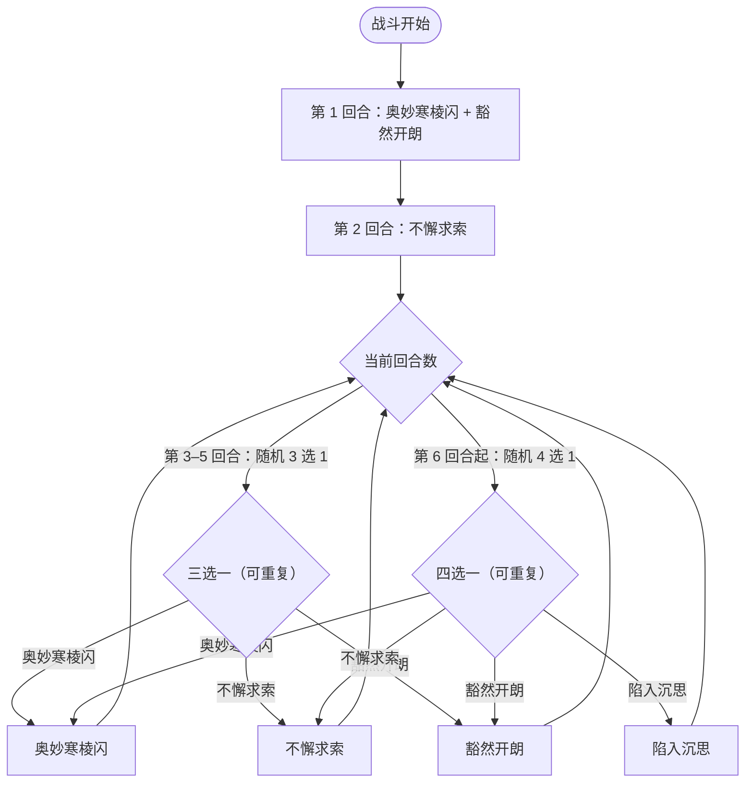

# 帕妮丝

> **类型**：精英怪物
> **初始生命**：747
> **遭遇战**：第三层精英战斗
> **特性**：帕妮丝（回合开始若自身处于异常状态，则本回合免疫**攻击伤害以外**的生命损失）+ 高血量与按体力差放大的固定伤害

## 被动能力（开局自带）

| 名称 | 类型 | 效果 |
|------|------|------|
| **帕妮丝** | 开局被动（不可消除） | 回合开始时，若自身处于异常状态，则本回合内免疫**攻击伤害以外**的生命损失 |

::: tip 「异常即免伤」的判定
- 判定窗口：**自身回合开始时**记录——只要那一刻它身上有任一异常状态（中毒/烧伤/冻伤/混乱等），本回合内一切**非攻击伤害**（[固定伤害](/powers/fixed_damage_power.md)、DoT、扣血类）对它**全部归零**，直到它下次回合开始前都有效。
- 也就是说：想用固定伤害 / 持续伤害磨它，必须确保它回合开始时**不带异常**；但**奥妙寒棱闪会主动给自己上 3 回合[冻伤](/powers/frostbite_power.md)**——它常常自带异常、自动进入免伤状态。所以固伤流在本场并不好使，直接攻击伤害才是主输出。
:::

## 行动逻辑

第 1 回合「奥妙寒棱闪 · 豁然开朗」，第 2 回合「不懈求索」，第 3–5 回合每回合从技能 1/2/3 随机出 1 招，第 6 回合起加入「陷入沉思」、从技能 1/2/3/4 随机出 1 招。

> **说明**：第 3–5 回合三招等概率、可重复；第 6 回合起再加入陷入沉思，四招等概率、可重复。

## 招式表

| 招式名 | 意图 | 类型 | 效果 |
|--------|------|------|------|
| **奥妙寒棱闪 · 豁然开朗** | 攻击 35 + 豁然开朗 | 组合招（第 1 回合） | 先施放奥妙寒棱闪，再施放豁然开朗 |
| **奥妙寒棱闪** | 攻击 35 | 攻击 + 固伤增幅 | 造成 35 点伤害；自身获 3 回合[冻伤](/powers/frostbite_power.md)；敌人受到的[固定伤害](/powers/fixed_damage_power.md)永久 +50% |
| **不懈求索** | 攻击 30 | 攻击 + 固伤 + 自身格挡 | 造成 30 点伤害；附加双方体力差 5% 的[固定伤害](/powers/fixed_damage_power.md)；自身获得等量格挡 |
| **豁然开朗** | 豁然开朗 | 自身增益 + 固伤 | 若自身处于异常则[先制](/powers/first_strike_power.md) +3；自身全属性 +12；3 回合内每回合对敌人造成 15 点[固定伤害](/powers/fixed_damage_power.md)并恢复等量生命 |
| **陷入沉思** | 陷入沉思 | 自损 + 固伤 | 自身损失 30 生命；对敌人造成 30 点[固定伤害](/powers/fixed_damage_power.md)；自身下回合受到的伤害转化为生命恢复 |

## 遭遇战

| 遭遇战 | 房间类型 | 池子 | 数量 | 说明 |
|--------|----------|------|------|------|
| 帕妮丝精英 | Elite | 第三层精英池 | 1 只 | 单怪精英遭遇战 |

## 策略提示

1. **别用固伤流硬吃「异常免伤」**：帕妮丝回合开始只要身上有异常，就免疫**攻击伤害以外**的一切生命损失。她自己的奥妙寒棱闪会给她上 3 回合[冻伤](/powers/frostbite_power.md)，等于常年自带免伤窗口。你的主力应是**直接攻击伤害**，不要靠固定伤害磨她。

2. **不懈求索看体力差**：附加「双方体力差 5%」的[固定伤害](/powers/fixed_damage_power.md)。她 747 血、你早期血少，体力差越大这招越痛。**把自己的血量补满、缩小体力差**能直接削掉这招的威胁；同时她还会获得等量格挡（更难打）。

3. **奥妙寒棱闪永久 +50% 固伤**：命中一次后，本场你受到的[固定伤害](/powers/fixed_damage_power.md)就永久 ×1.5；该增益不随重复施放继续叠加。之后的不懈求索 / 豁然开朗 / 陷入沉思 的固伤都会被这 50% 放大。

4. **豁然开朗的固伤流**：该招自身全属性 +12、并获得 3 回合「每回合对你 15 固伤 + 回血」。她有免伤窗口时你打不出固伤，但她的固伤对你是实打实的——预留格挡/减伤，或在她回血周期前爆发。

5. **陷入沉思是自伤换伤**：她自损 30 血、对你打 30 固伤，并让自己**下回合受伤转化为回血**。她在下回合相当于带「吸血护盾」——尽量错开这回合的高额输出，或干脆不攻击，等她窗口过去。（注：若她当时处于异常状态，根据免伤被动，这一招的自损也可能被一并抵消。）

6. **第 1 回合组合招**：奥妙寒棱闪（35 伤 + 自冻伤 + 给你固伤 +50%）接豁然开朗（全属性 +12 + 先制 +3 + 3 回合固伤回血）。开局即建立固伤优势且叠属性，起手别用固定伤害流。

7. **第 6 回合起多一招**：从此 4 选 1（加入陷入沉思），随机面变大。要同时准备挡 35/30 攻击、应付固伤（15~30 点、被寒棱闪放大后 ×1.5）、以及她下回合回血窗口，按最坏组合留资源。

8. **先制惩罚要留意**：豁然开朗在她处于异常时给她[先制](/powers/first_strike_power.md) +3（她自冻伤，几乎必触发）。若你靠抢节奏/先制竞速，需把她的先制优势考虑进去。

## 源码

- 怪物：`SeerPanisiMonster.cs`
- 被动能力：`SeerPanisiPower.cs`（帕妮丝）
- 关联能力：`SeerFixedDamagePower.cs`（固定伤害）、`SeerFrostbitePower.cs`（冻伤）、`SeerNewSkillPowersD.cs`（寒棱闪·固伤增幅）、`SeerNewSkillPowersC.cs`（豁然开朗、陷入沉思）、`SeerFirstStrikePower.cs`（先制）
- 意图：`SeerNamedSingleAttackIntent.cs`、`SeerPuniNamedBuffIntent.cs`
- 遭遇战：`SeerPanisiEliteEncounter.cs`
- 本地化：`monsters.json`（`SEER_MONSTER_SEER_PANISI_MONSTER.*`）、`intents.json`（`SEER_PANISI_*`）、`powers.json`（`SEER_POWER_SEER_PANISI_POWER.*`、`SEER_POWER_SEER_SUDDEN_ENLIGHTEN_POWER.*`、`SEER_POWER_SEER_DEEP_THOUGHT_POWER.*`、`SEER_POWER_SEER_COLD_EDGE_FLASH_POWER.*`）
