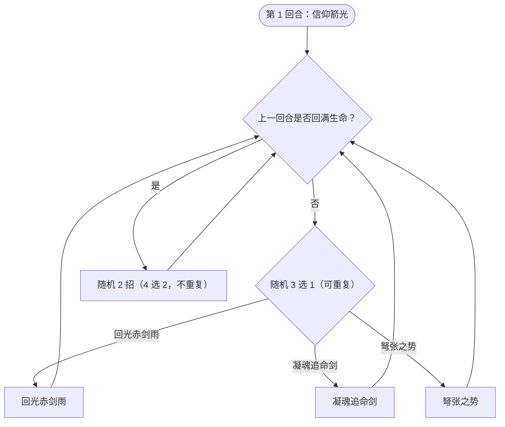

# 虹雨·茜尔

> **类型**：精英怪物
> **初始生命**：678
> **遭遇战**：第三层精英战斗
> **特性**：虹羽（首次回满血获 100% 永久增伤）+ 回满血触发双招 + 凝魂追命剑逐次递减 + 永久免控

## 被动能力（开局自带）

| 名称 | 类型 | 效果 |
|------|------|------|
| **虹羽** | 能力（不可消除） | **首次**恢复至满生命值时，获得 100% 永久增伤 |

::: tip 虹羽与“满血触发”是两套机制
- **虹羽**：整场只触发一次——首次把血回满，就永久 +100% 伤害
- **满血触发（行动层面）**：每当茜尔**回满血的那个回合**，她下一回合会改为**随机放 2 个技能**（不是 1 个）
- 弩张之势会把自己回满血，因此每次弩张之势之后的那一回合，她都会打 2 招
:::

## 行动逻辑

第 1 回合固定信仰箭光；此后若**上一回合把血回满**，本回合随机 2 招（**意图上会并排显示抽中的这两个技能**），否则从技能 1/2/3 随机 1 招。

> **说明**：第 1 回合固定信仰箭光，此后每回合三选一随机；一旦某回合茜尔把血回满（弩张之势，或回光赤剑雨击杀回满），**下一回合**改为从 4 个技能中随机 2 招（不重复）依次释放。

## 招式表

| 招式名 | 意图 | 类型 | 效果 |
|--------|------|------|------|
| **回光赤剑雨** | 攻击 6×8 | 多段攻击 + 回血 | 造成 6 点伤害 × 8 次；每当本技能造成生物死亡时，自身立即回满生命 |
| **凝魂追命剑** | 攻击（递减） | 单次攻击 | 造成 90 点伤害；**每次使用后此技能伤害永久 -10** |
| **弩张之势** | 弩张之势 | 自身增益 + Debuff + 爆伤 | 自身全属性 +6；敌人随机获得 3 种异常各 3 回合；自身**恢复至满生命值**，并对敌人造成**等同于本次实际回复量 10%** 的固定伤害 |
| **信仰箭光** | 信仰箭光 | Debuff + 自身增益 | 敌人获得[失明](/powers/blind_power.md)、[焚烬](/powers/ash_power.md)、[混乱](/powers/confusion_power.md)各 5 回合；自身永久免疫异常 |
| **羽影双华** | 本回合抽中的两招 | 随机组合 | 从 4 个技能中随机抽 2 个（不重复）依次释放；**意图上直接显示这两招的真名与伤害** |

::: warning 弩张之势的固定伤害随“回血量”走
- 弩张之势先回满血，再对敌方造成**等于本次实际回复量 10%** 的固定伤害
- 茜尔当前血量越低，这一发的固定伤害越高（残血时回复量大 → 爆伤大）
- 她满血时打出则回血量为 0，固定伤害也为 0（此时弩张之势只是 +6 全属性 + 3 层异常）
- 因此**把她打到残血后，千万别让她有机会用弩张之势**——那一下往往是致命的
:::

## 遭遇战

| 遭遇战 | 房间类型 | 池子 | 数量 | 说明 |
|--------|----------|------|------|------|
| 虹雨·茜尔精英 | Elite | 第三层精英池 | 1 只 | 单怪精英遭遇战 |

## 策略提示

1. **第 1 回合固定信仰箭光，先扛三 debuff**：[失明](/powers/blind_power.md)（攻击有几率自伤/减伤）、[焚烬](/powers/ash_power.md)（攻击伤害降低 + 回合结束叠烧伤）、[混乱](/powers/confusion_power.md)（回合开始掉血 + 命中下降）各 5 回合，同时茜尔获得**永久免控**。此后你无法用异常压制她，且要处理自己身上的三重异常。

2. **别让她“回满血”，否则下一回合双招**：任何一次把血回满（弩张之势，或回光赤剑雨击杀回满）都会让下一回合变成随机 2 招。要尽量切断她的回血，或提前算好双招回合的格挡需求。

3. **弩张之势是“残血反杀”**：它按回血量打固定伤害，所以她越残这发越痛。压血线时要一鼓作气打空，别把她留在“残血但没死”的状态给弩张之势送人头。压到可控范围后用卡牌精确补刀。

4. **凝魂追命剑逐次变弱**：首用 90，之后每次 −10（90 → 80 → 70 → 60 → … → 0）。也就是说第一次凝魂追命剑最凶（90 点），之后威胁递减。扛过第一发后，这一招会越来越无力。

5. **回光赤剑雨靠“击杀回血”**：6×8=48 的多段伤害，本身不算爆表，但若它击杀了生物（多人局的召唤物、协战单位）茜尔会立即回满血。多人局要留意别给她送“击杀回满”的机会。

6. **虹羽增伤只触发一次，但很致命**：她首次回满血后永久 +100% 伤害，此后凝魂追命剑、回光赤剑雨、弩张之势全部翻倍。速攻、别给她安稳回满血，是控制她成长的关键。

7. **678 血相对不高**：她血量不算厚，没有额外减伤/格挡/复活机制（对比其它精英），只要扛过信仰箭光的开局压制、避免让她回满血双招，几个高爆发回合就能结束。

8. **固定伤害补刀要小心**：若你身上有固定伤害来源，收尾时确保不要用固伤把她“打剩一点又没死”触发弩张之势；卡牌直接打空最稳。

## 源码

- 怪物：`SeerRainbowFeatherXierMonster.cs`
- 被动能力：`SeerRainbowFeatherXierPower.cs`（虹羽）
- 技能能力：`SeerPermanentDebuffImmunePower.cs`（免控）、`SeerBlindPower.cs`（失明）、`SeerAshPower.cs`（焚烬）、`SeerConfusionPower.cs`（混乱）；追命剑的逐次 −10 由怪物自身结算
- 意图：`SeerNamedSingleAttackIntent.cs`、`SeerNamedMultiAttackIntent.cs`、`SeerPuniNamedBuffIntent.cs`、`SeerDynamicIntentList.cs`（把「随机 2 招」翻译成本回合真实的两条技能意图）
- 遭遇战：`SeerRainbowFeatherXierEliteEncounter.cs`
- 本地化：`monsters.json`（`SEER_MONSTER_SEER_RAINBOW_FEATHER_XIER_MONSTER.*`）、`intents.json`（`SEER_XIER_*`）、`powers.json`（`SEER_POWER_SEER_RAINBOW_FEATHER_XIER_POWER.*`）
