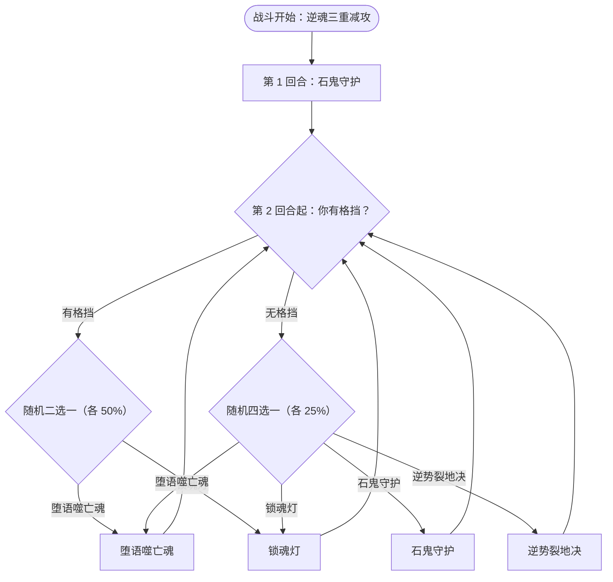

# 逆魂·佩特菲德

> **类型**：精英怪物
> **初始生命**：2000
> **遭遇战**：第三层精英战斗
> **特性**：逆魂（开局三重减攻 + 自身格挡不消失）+ 石鬼守护禁疗 + 堕语噬亡魂吸格挡/吸属性

## 被动能力（开局自带）

| 名称 | 类型 | 效果 |
|------|------|------|
| **逆魂** | 能力（不可消除） | ①第 1 回合开始时，使所有敌人获得[疲惫](/powers/fatigue_power.md)、[害怕](/powers/fear_power.md)、[石化](/powers/petrify_power.md)，各持续 9 回合；②自身**格挡不会消失** |

::: warning 开局三重减攻——输出被砍到只剩零头
第 1 回合佩特菲德给你叠三种减攻异常各 9 层（每回合各 −1 层）：
- [疲惫](/powers/fatigue_power.md)：攻击伤害 −20%，且每次造成伤害自身受等层数不可格挡伤害
- [害怕](/powers/fear_power.md)：攻击伤害 −30%
- [石化](/powers/petrify_power.md)：攻击伤害 −70%，且本应伤害的 70% 转化为**你自己的格挡**

三者叠乘后，你的攻击伤害只剩约 17%（0.8×0.7×0.3）；同时又因石化转化获得大量格挡。这意味着**前 9 回合你的输出极低**，而获得的那点格挡还会被他的堕语噬亡魂吸走。
:::

## 行动逻辑

第 1 回合固定石鬼守护；此后**你有格挡**时在「堕语噬亡魂 / 锁魂灯」中随机（各 50%），**你无格挡**时在「石鬼守护 / 锁魂灯 / 堕语噬亡魂 / 逆势裂地决」中随机（各 25%）。

> **说明**：第 1 回合固定石鬼守护。此后分支完全取决于**你当前有没有格挡**：有格挡时只会在堕语噬亡魂 / 锁魂灯中二选一；无格挡时才可能出石鬼守护或逆势裂地决。每条回边都回到下一次「有/无格挡」判断。

## 招式表

| 招式名 | 意图 | 类型 | 效果 |
|--------|------|------|------|
| **锁魂灯** | 锁魂灯 | 自身增益 + 场地机制 | 自身全属性 +5（**若自身有格挡则翻倍为 +10**）；获得 4 回合「[吃月亮](/powers/eat_moon_power.md)」；**点燃魂灯** |
| **石鬼守护** | 石鬼守护 | 场地机制 | 本场战斗中敌人**无法恢复生命值**；敌人每抽到 1 张牌被挂上 1×层数的固定伤害（在你下回合开始时统一结算）；**此技能可重复使用，每使用一次触发伤害 +1** |
| **堕语噬亡魂** | 攻击 40 | 单次攻击 + 吸取 | 先**吸取敌人全部格挡并以 3 倍归自己**；获得 40 点格挡；以 **2 倍**吸取敌人**全属性**强化；最后造成 40 点伤害 |
| **逆势裂地决** | 攻击 36 | 单次攻击 + 自我增幅 | 造成 36 点伤害；将**自身**四维提升与格挡**翻倍** |

::: tip 魂灯机制
施展锁魂灯会点燃怪物侧的「魂灯」。**魂灯同一时刻只归一方**：怪物方每盏灯让你的**最大能量 −1**（点亮时自动熄灭玩家侧的灯）。佩特菲德每用一次锁魂灯就多一盏，能量被持续压缩。
:::

## 遭遇战

| 遭遇战 | 房间类型 | 池子 | 数量 | 说明 |
|--------|----------|------|------|------|
| 逆魂·佩特菲德精英 | Elite | 第三层精英池 | 1 只 | 单怪精英遭遇战 |

## 策略提示

1. **前 9 回合输出极低，先求稳**：开局疲惫/害怕/石化各 9 层把攻击伤害压到约 17%。这几回合别指望打输出，重点是把血线、资源、牌序养好，等减攻异常逐层衰减（每回合各 −1）后再转入进攻。

2. **不要堆格挡——会被吸**：堕语噬亡魂会**吸取你的格挡 ×3 归自己**。你因为石化转化而天然带格挡，如果还主动叠甲，等于给他送大量格挡。可行的做法是把格挡压到“有格挡但很少”的边界，或干脆不带格挡进他的回合。

3. **不要堆四维增益——会被吸 2 倍**：堕语噬亡魂以 2 倍吸取你的力量/防御/命中/速度强化。开打前堆属性是纯亏本，先把增益留到自己能一击制胜的回合，或改用不吃吸取的伤害来源。

4. **石鬼守护从第 1 回合起就禁疗**：佩特菲德第 1 回合必放石鬼守护，**本场你无法恢复生命**（所有回血手段失效），且**每抽 1 张牌被挂上固定伤害**（初始 1 点，他每再用一次 +1），这些固伤在你下回合开始时统一结算。抽牌流/回血流在这战被直接封死，尽量少抽、速战。

5. **锁魂灯持续压缩你的能量**：每次锁魂灯 +5 全属性（有格挡时 +10）并点一盏魂灯，每盏让你的**最大能量 −1**。叠多了你的行动资源会被掐干，尤其配合“每回合 1 张牌”式的资源紧张会更难受。能压制灯数就压制。

6. **堕语噬亡魂的结算顺序对你不利**：他先**拿走你的全部格挡（×3 归己）**，再给自己 40 格挡、2 倍吸走你的四维，**最后**才打出 40 伤害。也就是说你的格挡保护不了你，反倒成了他的护甲。看到这一招要提前把格挡清掉或干脆不带。

7. **格挡不消失，硬磨极慢**：佩特菲德自身格挡**不会在回合结束消失**，越叠越厚；逆势裂地决还会把他的格挡与四维**翻倍**。他一旦攒起格挡，你的常规攻击会被长期挡住。破防要靠无视格挡的固定伤害/处决类，或抓准他格挡薄弱的窗口。

8. **2000 血 + 减攻开局 = 长线消耗战**：这是一场典型的“熬过前期压制、后期爆发”的拉锯战。带足无视格挡与不吃减攻的伤害来源（固定伤害最优），并备好应对疲惫自伤、抽牌固伤的保命手段。

9. **行动分支看你的格挡**：他出招完全由“你回合开始时有没有格挡”决定。想引导他出你更能接的招（比如避开堕语噬亡魂），可以主动控制自己带入他回合的格挡量——这是一条可利用的“节奏开关”。

## 源码

- 怪物：`SeerReverseSoulPetefideMonster.cs`
- 被动能力：`SeerReverseSoulPetefidePower.cs`（逆魂）
- 技能能力：`SeerNewSkillPowersG.cs`（石鬼守护）、`SeerSoulLampPowers.cs`（魂灯载体）、`SeerSoulLampDriver.cs`（点灯 API）
- 魂灯补丁/界面：`SeerSoulLampMountPatch.cs`、`NSeerSoulLampOverlay.cs`
- 意图：`SeerNamedSingleAttackIntent.cs`、`SeerPuniNamedBuffIntent.cs`
- 遭遇战：`SeerReverseSoulPetefideEliteEncounter.cs`
- 本地化：`monsters.json`（`SEER_MONSTER_SEER_REVERSE_SOUL_PETEFIDE_MONSTER.*`）、`intents.json`（`SEER_PETEFIDE_*`）、`powers.json`（`SEER_POWER_SEER_REVERSE_SOUL_PETEFIDE_POWER.*`、`SEER_POWER_SEER_STONE_GUARD_POWER.*`）
