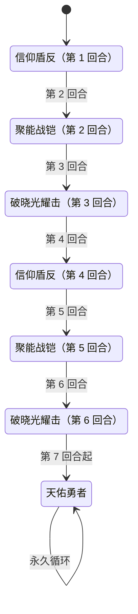

# 坚盾·瓦尔德

> **类型**：精英怪物
> **初始生命**：789
> **遭遇战**：第三层精英战斗
> **特性**：圣盾（受伤即获等量格挡 → 累计格挡反哺破晓光耀击）+ 信仰盾反 + 第 7 回合起无限天佑勇者

## 被动能力（开局自带）

| 名称 | 类型 | 效果 |
|------|------|------|
| **圣盾** | 能力（不可消除） | 自身受到伤害时，按本次**未格挡伤害**获得等量**格挡** |
| **铸盾** | 能力（内部记录） | 记录本场战斗累计获得的格挡量（供破晓光耀击计算伤害） |

::: warning 圣盾：你打的每一拳都在给它叠甲
- 瓦尔德每受到 1 点**未格挡伤害**，就获得 1 点格挡
- 这些格挡会**吸收后续伤害**，且被「铸盾」累计记录——累计越多，破晓光耀击越痛
- 所以“猛攻”在这场战斗里是双刃剑：打得越狠，它越硬、它的反击也越大
:::

## 行动逻辑

第 1-6 回合固定循环「信仰盾反 → 聚能战铠 → 破晓光耀击」两轮，第 7 回合起**永久**使用天佑勇者。

> **说明**：第 7 回合起无限循环天佑勇者，不再使用其它技能，直到战斗结束。

## 招式表

| 招式名 | 意图 | 类型 | 效果 |
|--------|------|------|------|
| **破晓光耀击** | 攻击（动态数值） | 单次攻击 + Debuff | 造成等于**自身本场累计获得格挡量 7%** 的伤害；敌人敏捷、命中、速度各 -5 |
| **信仰盾反** | 攻击 40 | 单次攻击 + 反击 | 造成 40 点伤害；下回合首次受到卡牌伤害后，**立即结束敌人回合，并施加等于本次未格挡伤害的固定伤害（在敌人下回合开始时结算）** |
| **聚能战铠** | 聚能战铠 | 自身增益 | 自身全属性 +10；获得等于**最大生命 10%**（约 79）的格挡；获得 3 回合「[吃月亮](/powers/eat_moon_power.md)」 |
| **天佑勇者** | 天佑勇者 | 处决 | 使场上**当前生命值最低的生物**死亡 |

::: warning 天佑勇者：第 7 回合的处决线
- 天佑勇者击杀的是**场上当前生命最低的生物**——不区分敌我
- 单体单挑场景下，通常你（玩家）的生命低于瓦尔德 789 → 第 7 回合**直接处决玩家**
- 反过来，如果你能把瓦尔德的当前生命压到**比自己更低**，第 7 回合它会**处决自己**（战斗结束）
- 这是一场硬性的 6 回合竞速，请以“第 7 回合前结束战斗”为目标
:::

## 遭遇战

| 遭遇战 | 房间类型 | 池子 | 数量 | 说明 |
|--------|----------|------|------|------|
| 坚盾·瓦尔德精英 | Elite | 第三层精英池 | 1 只 | 单怪精英遭遇战 |

## 策略提示

1. **这是一场 6 回合的硬性竞速**：第 7 回合天佑勇者会处决场上生命最低的生物，通常就是你。必须在 6 回合内解决战斗，或至少把自己的生命保持在瓦尔德当前生命之上（让它处决自己）。

2. **“生命比它高”是一条逃生路线**：天佑勇者按**当前生命**选最低者。如果到第 7 回合时瓦尔德的血比你还低，它会自杀。所以后期别只顾堆格挡——适当保血、把瓦尔德血线压低，可能直接反转处决对象。

3. **信仰盾反回合先手不要打伤害**：信仰盾反后的下一回合，你**首次造成卡牌伤害就会立刻结束自己的回合**，并按该次未格挡伤害给你挂上固定伤害（在你下回合开始时结算）。应对：先用一张 0 伤或低伤牌“喂”掉这次触发，再打真正的输出。

4. **破晓光耀击随你的输出滚雪球**：它按“本场累计获得格挡量的 7%”算伤害。圣盾被动让你每打 1 伤就给它 1 格挡，所以你的总输出越高，破晓光耀击越痛。第 3、6 回合的破晓光耀击要格外留心格挡量是否够。

5. **聚能战铠反复叠加格挡**：第 2、5 回合各给约 79 格挡 + 全属性 +10 + 3 回合吃月亮。吃月亮会让瓦尔德每回合回血并把回血量的 20% 作为固定伤害打给你。格挡越滚越厚，纯靠攻击很难在 6 回合内磨穿。

6. **别用多段小攻击“送甲”**：圣盾按每次受伤给等量格挡，多段攻击会让它频繁叠甲又不一定破防，效率低。集中大伤害（或无视格挡的固定伤害/处决类）更划算。

7. **无视格挡手段是正解**：瓦尔德本体有圣盾 + 聚能战铠双层格挡，常规攻击性价比极低。带无视格挡 / 固定伤害 / 直接处决（如灾厄）的组件，能显著压缩战斗回合数。

8. **第 7 回合之后没有退路**：一旦进入天佑勇者循环，每回合都会处决一次最低血生物。若届时你仍是最低血，每回合都会直面死亡判定——所以在第 6 回合结束前把决战打完。

## 源码

- 怪物：`SeerShieldWardeMonster.cs`
- 被动能力：`SeerShieldWardePower.cs`（圣盾）、`SeerNewSkillPowersC.cs`（铸盾，累计格挡记录）
- 技能能力：`SeerNewSkillPowersC.cs`（信仰盾反）、`SeerEatMoonPower.cs`（吃月亮）
- 意图：`SeerNamedSingleAttackIntent.cs`、`SeerPuniNamedBuffIntent.cs`
- 遭遇战：`SeerShieldWardeEliteEncounter.cs`
- 本地化：`monsters.json`（`SEER_MONSTER_SEER_SHIELD_WARDE_MONSTER.*`）、`intents.json`（`SEER_WARDE_*`）、`powers.json`（`SEER_POWER_SEER_SHIELD_WARDE_POWER.*`、`SEER_POWER_SEER_GUARD_RECORD_POWER.*`、`SEER_POWER_SEER_FAITH_SHIELD_COUNTER_POWER.*`）
