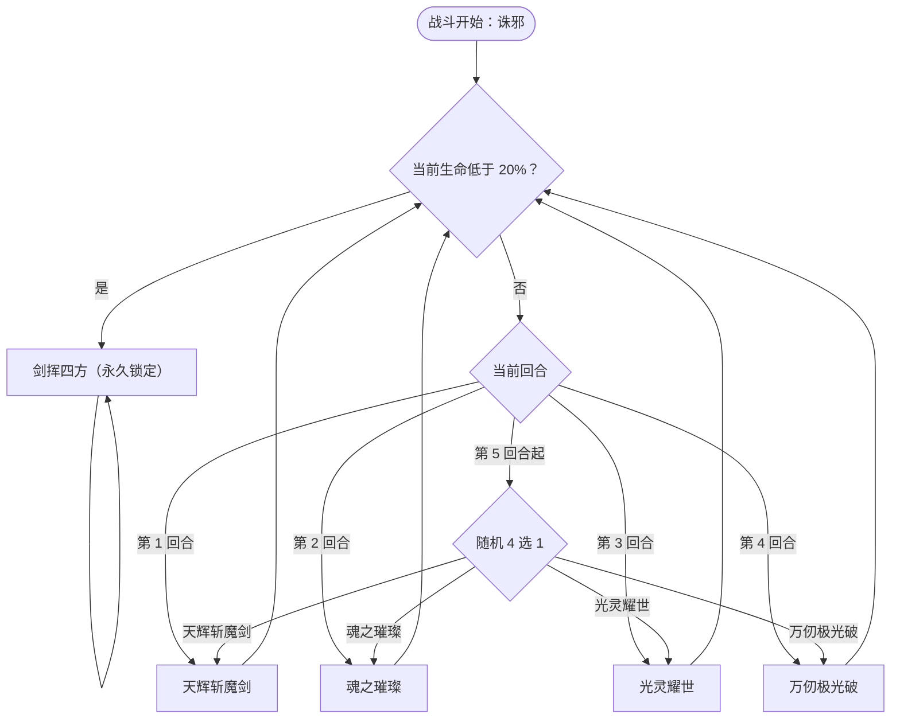

# 六界帝神

> **类型**：精英怪物
> **初始生命**：754
> **遭遇战**：第三层精英战斗
> **特性**：诛邪（随敌方堕落叠伤害）+ 固定回合序列后转为 4 选 1 随机 + 血量低于 20% 永久改用剑挥四方（自身死亡则拉敌方生命到 1）

## 被动能力（开局自带）

| 名称 | 类型 | 效果 |
|------|------|------|
| **诛邪** | 能力（不可消除） | 敌人每拥有 1 层[堕落](/powers/fallen_power.md)，自身造成的伤害提高 2%（精英房间；普通房间为 1%。按敌方当前堕落层数动态计算） |

::: tip 诛邪的成长曲线
- 诛邪是**动态**加成：只看敌人**当前**堕落层数，精英房间每层 +2% 伤害（普通房间 +1%）
- 堕落越高，六界帝神所有攻击（天辉斩魔剑 54、万仞极光破 6×6、剑挥四方 48）同步变强
- 想走堕落流（或已经背了一身堕落诅咒）时要注意：这会直接变成六界帝神的攻击加成
:::

## 行动逻辑

前 4 回合固定出招，第 5 回合起从技能 1-4 随机 4 选 1；生命低于最大生命 20%（754 × 20% ≈ 151）后**永久**改用剑挥四方。

> **说明**：每次行动前先检查生命阈值；一旦低于最大生命的 20%（754 血即低于 151）就闩锁进入剑挥四方，不再出其它招。第 5 回合起四招等概率、可重复。

## 招式表

| 招式名 | 意图 | 类型 | 效果 |
|--------|------|------|------|
| **天辉斩魔剑** | 天辉斩魔剑 | 单次攻击 + Debuff | 造成 54 点伤害；随机附加 2 种异常状态各 2 回合。自身回合结束后**立即额外开启 1 个回合** |
| **魂之璀璨** | 魂之璀璨 | 自身增益 | 自身全属性 +6；获得「[吃月亮](/powers/eat_moon_power.md)」持续 4 回合 |
| **光灵耀世** | 光灵耀世 | 自身增益 + 干扰 | **5 回合内**：自身获得**免控**；每当自身受到伤害时获得 1 层[缓冲](/powers/buffer_power.md)；敌人**赛尔牌**的 PP 消耗变为 5 倍 |
| **万仞极光破** | 攻击 6×6 | 多段攻击 + 增益 | 获得**反弱、反强**效果（先反后打）；造成 6 点伤害 × 6 次；并获得 6 层[缓冲](/powers/buffer_power.md) |
| **剑挥四方** | 攻击 48 | 单次攻击（自曝技） | 造成 48 点伤害；效果期内自身死亡则将敌人生命值降至 1 |

::: warning 反弱 / 反强的真实含义（本页以实际效果为准）
- **反弱**：把**自身**四维（力量/防御/命中/速度）的**负值**翻正为等量正值（原为 −N，则施加 +2×N）
- **反强**：把**敌方**四维的**正值**翻转为等值负值（原为 +N，则施加 −2×N）
- 也就是说万仞极光破不仅打 6×6，还会把玩家的力量/防御/命中/速度增益**变成同等负值**
:::

::: warning 剑挥四方的死亡反噬
- 剑挥四方会施加「剑挥四方」标记（持续至六界帝神下回合结束前）
- **效果期内只要六界帝神死亡，玩家生命值被直接降至 1**
- 即：在这个窗口里把它打死，你也会被拖到 1 血——之后任何一点伤害都可能要命
:::

## 遭遇战

| 遭遇战 | 房间类型 | 池子 | 数量 | 说明 |
|--------|----------|------|------|------|
| 六界帝神精英 | Elite | 第三层精英池 | 1 只 | 单怪精英遭遇战 |

## 策略提示

1. **20%（151 血）是分水岭，尽量卡在锁定前完成击杀**：第 1-4 回合固定、第 5 回合起 4 选 1 随机。一旦生命跌破 151，六界帝神**永久**转入剑挥四方循环，输出+反噬风险翻倍。规划上应把 151 → 0 这一段压到 1-2 个回合内打完，不要慢慢磨。

2. **天辉斩魔剑是双重压力（第 1 回合）**：54 伤害 + 随机 2 种异常各 2 回合，且**本回合结束后六界帝神额外再行动一次**。第 1 回合等于开局就被打两轮。准备解异常手段，或保留足量格挡扛过双回合。

3. **第 2、3 回合是输出窗口**：魂之璀璨（全属性 +6 + 吃月亮）和光灵耀世（免控 + 缓冲 + 锁灵）都是纯增益回合，当回合几乎没有攻击压力（仅吃月亮会按回血量的 20% 打固定伤害）。这两回合应全力输出，别浪费。

4. **万仞极光破（第 4 回合）会反转你的四维**：开打前不要堆力量/防御/命中/速度增益，否则会被反强翻成同等负值（每点 +N 变 −2N）。同理它会给自己上反弱，修复自身被压低的属性，所以单纯用减益压制它的手段收益有限。

5. **光灵耀世的 PP 消耗 ×5**：持续 5 回合内，你的赛尔牌 PP 消耗变为 5 倍——PP 依赖型卡组会当场瘫痪。这是它的“锁灵”干扰，注意留 PP 或改用低 PP 卡。

6. **缓冲会白吃你的多段攻击结算**：万仞极光破直接给 6 层缓冲，光灵耀世则在 5 回合内每受到一次伤害就补 1 层缓冲。每层抵消一次伤害，多段小攻击会被逐层吞掉，集中大伤害更划算。

7. **诛邪随堕落滚雪球**：若你背负堕落层数（或被它在别处叠了堕落），它的每一次攻击都会按层数加伤；精英房间里每层 +2%。堕落高时它的 54/48 都可能继续攀升，务必留意自己的堕落条。

8. **第 5 回合起无法预判**：进入随机阶段后它可能连续多次出天辉斩魔剑（带额外回合）或万仞极光破（四维反转），需要同时准备格挡、解异常、防属性反转三种应对，比固定序列阶段更难规划。

9. **剑挥四方阶段的死亡反噬**：进入该阶段后，若在标记生效期内把它打死，你也会被降到 1 血。稳妥做法是在标记消失的窗口（它刚结束一轮、下一轮标记重置前）完成最后一击，或者干脆在它进入阶段前就结束战斗。

## 源码

- 怪物：`SeerSixRealmGodMonster.cs`
- 被动能力：`SeerSixRealmJudgmentPower.cs`（诛邪）
- 技能能力：`SeerNewSkillPowersA.cs`（光灵耀世）、`SeerNewSkillPowersE.cs`（锁灵）、`SeerExtraTurnPower.cs`（额外回合）、`SeerNewSkillPowersF.cs`（剑挥四方）
- 额外回合补丁：`SeerMonsterExtraTurnPatch.cs`
- 意图：`SeerPuniNamedBuffIntent.cs`、`SeerNamedSingleAttackIntent.cs`、`SeerNamedMultiAttackIntent.cs`
- 遭遇战：`SeerSixRealmGodEliteEncounter.cs`
- 本地化：`monsters.json`（`SEER_MONSTER_SEER_SIX_REALM_GOD_MONSTER.*`）、`intents.json`（`SEER_SIXREALM_*`）、`powers.json`（`SEER_POWER_SEER_SIX_REALM_JUDGMENT_POWER.*`、`SEER_POWER_SEER_RADIANT_WORLD_POWER.*`、`SEER_POWER_SEER_LOCK_SPIRIT_POWER.*`、`SEER_POWER_SEER_SWORD_WAVE_POWER.*`）
