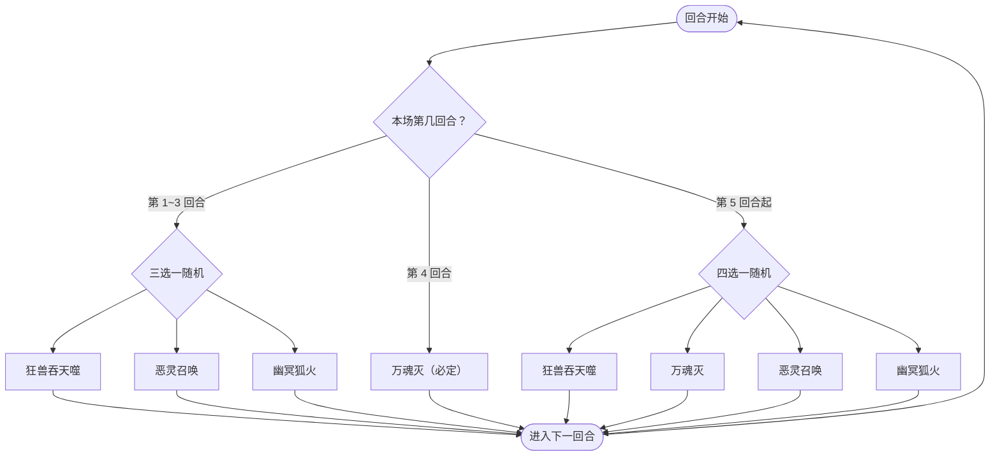

# 燃魂巨兽

> **类型**：精英怪物
> **初始生命**：987
> **遭遇战**：子地图活动精英（贯穹秘境 / 真命龙王），常规三幕精英池不出
> **特性**：吞魂（你每打出一张牌，它最大生命上限增加该牌数值之和）+ 第 4 回合固定「万魂灭」（伤害 = 自身最大生命值 10%，可被格挡）+ 缓冲/吸强滚雪球

## 被动能力（开局自带）

| 名称 | 类型 | 效果 |
|------|------|------|
| **吞魂**（不可消除） | 能力 | 敌人每打出 1 张牌，自身**最大生命值**增加，增加值等于该牌上**所有数值之和** |

::: tip 吞魂在放大「万魂灭」
- 你打出的每张牌，其卡面所有数值合计都会变成燃魂巨兽的最大生命上限增量
- 最大生命上去了，「万魂灭」（伤害 = 当前最大生命值的 10%）的伤害也跟着水涨船高
- 因此**疯狂出牌会同时抬高它的血量和万魂灭伤害**——这一战的出牌节奏要克制
:::

## 行动逻辑

每回合只出 1 招：第 1~3 回合从「狂兽吞天噬 / 恶灵召唤 / 幽冥狐火」三招里随机 1 招；**第 4 回合固定「万魂灭」**；第 5 回合起从四招里随机 1 招（可重复）。

> **说明**：前 3 回合池里**没有**万魂灭；第 4 回合必出且不随机，是整场战斗的核心计时点；第 5 回合起万魂灭才进入随机池。

## 招式表

| 招式名 | 意图 | 类型 | 效果 |
|--------|------|------|------|
| **狂兽吞天噬** | 攻击 35 | 单次攻击 + 吸强 + 附加固伤 | 造成 35 点伤害；**吸强**（1:1 吸取对手全属性转移给自身，每吸 1 层获得 1 层缓冲）；附加等于本次**实际伤害**的固定伤害 |
| **万魂灭** | 攻击 10% | 单次攻击（可格挡） | 自身先制 -3；造成等于自身**当前最大生命值 10%** 的伤害（**可被格挡**） |
| **恶灵召唤** | 恶灵召唤 | 自身增益 + 全体 Debuff | 自身全属性 +8；获得 5 层缓冲；对所有敌人施加 44 层灾厄与 44 层堕落 |
| **幽冥狐火** | 幽冥狐火 | 转移异常 + 弹异常 + 固伤 | 立即把自身**所有异常状态**转移给敌人；获得 5 回合**弹控**（免疫并把异常反弹给全体敌人）；造成等于自身**已损失生命 10%** 的固定伤害 |

::: warning 万魂灭是一道硬性血量检定
- 伤害 = 燃魂巨兽**当前最大生命值的 10%**（基础 987，首发达约 99，还会随吞魂增长），且**可被格挡**
- 意图显示的数值就是这一击的伤害量。第 4 回合开始它准会甩出这一击
- 这不再是“无视格挡的必杀”，把格挡堆起来即可扛住；但它会随吞魂不断变强，拖得越久越难挡
- 换句话说，**这一战的硬性目标仍是在第 4 回合前击杀**（或备好足够的格挡）
:::

::: tip 缓冲与灾厄的实际效果
- **缓冲**（狂兽吞天噬/恶灵召唤获得）：每层**完全抵消一次生命值损失**，多打伤害会一层层被吃掉。吸强获得的缓冲随你被吸走的属性层数增加
- **灾厄 44 层**（恶灵召唤施加给你）：在你的回合结束时，若你的生命值 ≤ 灾厄层数（44），则**直接死亡**。它是一道"低血线处决"，只要保持血量 > 44 就暂时安全
- **堕落 44 层**：seer 专属层数资源，每满 100 层触发魔君接管
:::

## 遭遇战

| 遭遇战 | 房间类型 | 出现位置 | 数量 | 说明 |
|--------|----------|----------|------|------|
| `SeerKingProofRealm4Encounter` | Elite | 王者之证「贯穹秘境」（第 4 列） | 1 只 | 9 选 1 的精英池 |
| `SeerDragonOrbEliteEncounter` | Elite | 真命龙王精英节点 | 1 只 | 6 选 1 的精英池 |

> ⚠️ 常规三幕精英池**不包含**燃魂巨兽；它目前只在子地图活动中出场。

## 策略提示

1. **第 4 回合万魂灭 = 硬性计时**：这一击伤害等于它最大生命值的 10%（987 血时约 99）且可被格挡。**要么在第 4 回合前把它打死，要么堆够格挡硬吃**。这是整场战斗的第一优先级，其它一切都围绕这个 4 回合窗口展开。

2. **吞魂让"多出牌"变成自杀**：你每出一张牌就给它加最大生命，万魂灭的伤害也跟着涨。**控制单回合出牌数、优先用低数值/低费牌**，能压低它的血上限与伤害线；高数值大招也会喂它一大口血，权衡使用。

3. **987 基础血很厚**：3 回合内打掉 987+ 需要爆发构筑。若你的输出跟不上，就得把重心放在"扛过第 4 回合"而非速杀。

4. **吸强 + 缓冲让它越打越硬**：狂兽吞天噬会 1:1 吸走你的全属性（力量/防御/命中/速度）转给它自己，每吸 1 层还给它叠 1 层缓冲。**别在它用这招前堆属性 buff**；缓冲层数高时，你的多段伤害会被一层层吃掉，需靠高单发或少段高伤来突破。

5. **狂兽吞天噬的附加固伤在你回合开始结算**：35 攻击伤害之外，还会按"本次实际掉血"附加等量固定伤害（在你下个回合开始时结算）。挨这一击后要预留额外血量/减伤应对后续固伤。

6. **别给它挂异常——会被幽冥狐火倒打**：幽冥狐火把它的**全部异常转移给你**，并给自己 5 回合弹控（免疫并把异常反弹给全体）。在它放这招前你叠的虚弱/易伤/中毒，会按原层数原样复制到每个玩家身上。看到它即将/刚放幽冥狐火时，停手上 debuff。

7. **幽冥狐火的固伤看它掉了多少血**：固伤 = 它已损失生命的 10%。你把它打得越狠，这招越痛。**在预计它出幽冥狐火的回合，把它的血量拉高**（或反过来，算准能否一击带走）。

8. **恶灵召唤的 44 灾厄是处决线**：挨了之后，你的回合结束时只要**血量 ≤ 44 就直接死亡**。这与"高伤害"是两回事——哪怕你满血硬吃 35，也可能因为血量被磨到 44 以下而在回合末被处决。保持血量 > 44 是底线。

9. **第 5 回合起四招随机**：万魂灭会重新进入随机池，随时可能再来一发。只要拖到第 5 回合之后，就必须持续堆够格挡或已经把它打死——**不要指望万魂灭只出现一次**。

## 源码

- 怪物：`SeerSoulBurningBeastMonster.cs`
- 被动能力：`SeerSoulBurningBeastPower.cs`（吞魂）
- 缓冲叠加：`BufferPower.cs`（原版缓冲）
- 固定伤害：`SeerFixedDamagePower.cs`（固定伤害，下回合开始结算）
- 弹控（免疫并反弹异常）：`SeerDebuffImmuneReflectPower.cs`
- 灾厄 / 堕落：`DoomPower.cs`（灾厄）、`SeerFallenPower.cs`、`SeerFallenCountHelper.cs`（堕落）
- 意图：`SeerNamedSingleAttackIntent.cs`、`SeerNamedDebuffIntent.cs`
- 遭遇战：`SeerSoulBurningBeastEliteEncounter.cs`、`SeerSubmapEncounters.cs`
- 本地化：`monsters.json`（`SEER_MONSTER_SEER_SOUL_BURNING_BEAST_MONSTER.*`）、`intents.json`（`SEER_BURNING_*`）、`powers.json`（`SEER_POWER_SEER_SOUL_BURNING_BEAST_POWER.*` 等）
