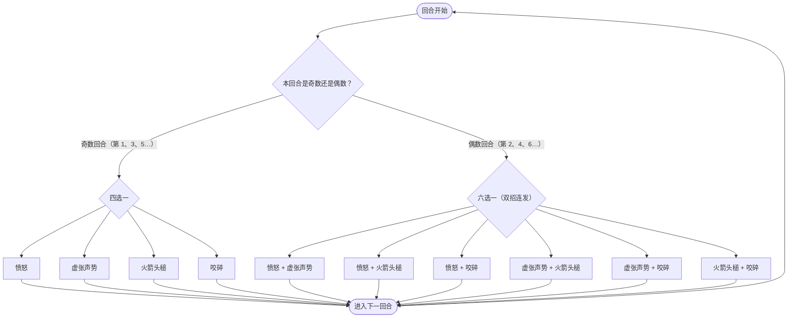

# 钢牙鲨

## 基本信息

| 属性 | 数值 |
|---|---|
| 分类 | [精英怪物](/monsters/elite/) |
| 生命值 | 118 - 122 |
| 被动能力 | 无 |

## 被动能力

无开局被动。

## 行动逻辑

第 1 回合（奇数回合）只出 1 招，从 4 个基础技能里随机；第 2 回合（偶数回合）出 2 招连招，从 6 种组合里随机；之后奇偶交替、可重复。

> **说明**：奇偶按战斗回合数交替，第 1 回合必为奇数（单招），第 2 回合必为偶数（双招）。单招池与双招池互不重叠，所以单招回合不会出现双招、双招回合也不会只放一招。

## 招式表

| 招式 | 意图 | 描述 | 数值 |
|---|---|---|---|
| 愤怒 | 愤怒 | 所有生物**力量**+2，并向你的抽牌堆中加入1张**暴怒**。 | 所有生物力量+2；每个敌人抽牌堆 +1 张暴怒 |
| 虚张声势 | 虚张声势 | 自身**力量**、**防御**、**命中**、**速度**+2。 | 自身全属性+2 |
| 火箭头槌 | 火箭头槌 | 造成3点伤害6次。 | 3 伤害 ×6（共 18） |
| 咬碎 | 咬碎 | 造成15点伤害。所有敌人防御-2。 | 伤害 15 + 所有敌人防御-2 |
| 愤怒·虚张声势 | 愤怒 + 虚张声势 | 先愤怒，再虚张声势 | 全体力量+2 + 1暴怒 + 自身全属性+2 |
| 愤怒·火箭头槌 | 愤怒 + 火箭头槌 | 先愤怒，再火箭头槌 | 全体力量+2 + 1暴怒 + 3×6 伤害 |
| 愤怒·咬碎 | 愤怒 + 咬碎 | 先愤怒，再咬碎 | 全体力量+2 + 1暴怒 + 15 伤害 + 防御-2 |
| 虚张声势·火箭头槌 | 虚张声势 + 火箭头槌 | 先虚张声势，再火箭头槌 | 全属性+2 + 3×6 伤害 |
| 虚张声势·咬碎 | 虚张声势 + 咬碎 | 先虚张声势，再咬碎 | 全属性+2 + 15 伤害 + 防御-2 |
| 火箭头槌·咬碎 | 火箭头槌 + 咬碎 | 先火箭头槌，再咬碎 | 3×6 伤害 + 15 伤害 + 防御-2 |

::: warning ⚠️ 咬碎的意图文案与实战不一致
意图描述写的是「你获得 2 层虚弱」，实际效果是**所有敌人防御 -2**（以源码为准，减防而非给虚弱）。
:::

## 遭遇战

| 遭遇战 | 房间类型 | 池子 | 数量 | 说明 |
|---|---|---|---|---|
| `SeerSteelJawSharkElite` | Elite | 第一层精英池（Overgrowth / Underdocks） | 1 只 | 无具名位置 |
| `SeerMixedEliteEncounter` | Elite | 第一层混合精英池 | 1 只 | 与原版精英随机二怪同场 |
| `SeerKingProofSeerEliteEncounter` | Elite | 王者之证「不动秘境」（第 3 列） | 1 只 | 12 选 1 的赛尔精英池 |

## 策略提示

1. **奇偶回合节奏是核心**：奇数回合只会出现单个意图（4 选 1），偶数回合必定双意图连招（6 选 1）。偶数回合威胁显著更高（如火箭头槌+咬碎 = 18+15 = 33 伤害 + 防御-2），需预留格挡应对偶数回合。

2. **咬碎削弱防御而非虚弱**：咬碎对所有敌人施加防御-2（负层数防御），而非虚弱。负防御会让玩家**受到的攻击伤害每层 +1**，越叠越脆。所有含咬碎的连招均附带防御-2 效果。

3. **火箭头槌多段触发力量加成**：3 伤害 × 6 = 18 总伤，多段攻击每段都吃力量加成。配合虚张声势堆叠的力量（每次 +2 力量），火箭头槌的实际伤害会滚雪球式增长：力量 4 时每段 3+4=7 点，6 段合计 42 点。

4. **愤怒给所有生物力量+2**：愤怒现在会给**所有生物**（包括玩家、钢牙鲨自己与召唤物）力量+2，同时向所有敌人抽牌堆塞 1 张暴怒诅咒牌。玩家也会获得力量，但抽牌堆污染仍然存在；多次使用后双方伤害都会上升。

5. **虚张声势滚雪球**：每次全属性 +2（力量/防御/命中/速度），多次使用后钢牙鲨攻防命中速度全面领先。速度提升会让它在自身回合开始获得最大生命 5%×层数的格挡（每 +2 层即 10% 最大生命格挡），命中提升则每层 +10% 暴击率。建议速战，避免虚张声势叠加过多。

6. **118~122 血适合 3~4 回合击杀**：钢牙鲨血量适中（118~122），3~4 回合内击杀可在虚张声势叠加 2~3 次前结束战斗，将力量增长控制在可接受范围内（力量 +4~6）。

## 源码

- 怪物：`SeerSteelJawSharkMonster.cs`（生命 118~122，奇数回合单意图 4 选 1 + 偶数回合双意图 6 选 1）
- 遭遇战：`SeerSteelJawSharkElite.cs`、`SeerMixedEliteEncounter.cs`、`SeerSubmapEncounters.cs`
- 本地化：`monsters.json`（`SEER_MONSTER_SEER_STEEL_JAW_SHARK_MONSTER.*`）、`intents.json`（`SEER_FURY.*`、`SEER_BLUFF.*`、`SEER_ROCKET_HEADBUTT.*`、`SEER_CRUNCH.*`）、`powers.json`（`SEER_POWER_SEER_DEFENSE_POWER.*`）
