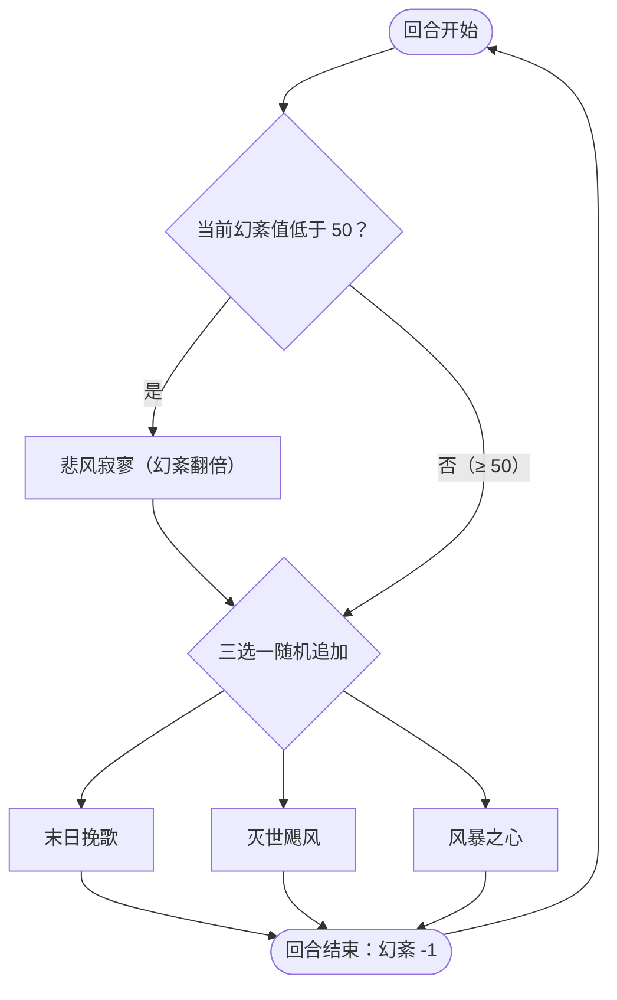

# 风暴女神·斯蒂亚

> **类型**：精英怪物
> **初始生命**：2000 - 2000
> **遭遇战**：子地图活动精英（极天之翼 / 激活节点），常规三幕精英池不出
> **特性**：幻紊（你牌组每张牌使其打出失效概率 +1%，每回合结束 -1）+ 末日挽歌固伤清强 + 风暴之心期间你出牌会助长幻紊

## 被动能力（开局自带）

| 名称 | 类型 | 效果 |
|------|------|------|
| **幻紊** | 能力（不可消除） | 开局幻紊值 = 敌人牌组总张数（等价于每张牌 +1% 失效概率）；敌人打出牌时按其当前幻紊值 % 判定失效；每回合结束时幻紊值 **-1** |

::: warning 幻紊 = 你出牌的「失灵率」
- 幻紊值 = 你**打出任意一张牌时效果失效的概率**（上限 100%）。判定命中时，那张牌**照常打出、照常耗能并进入弃牌堆，但效果完全不结算**（不是「打不出来」）。
- 开局幻紊值 = 你**整个牌组的牌数**（牌组越大，起手失灵率越高）。
- 每次使用**悲风寂寥**，幻紊值**翻倍**；每回合结束时 **-1**。风暴之心存续期间，你**每打出一张牌幻紊值 +5**。
- 幻紊一旦逼近 100%，你的牌基本全变成「照常耗能的空过」——所以它本质上是一个「越拖越绝望」的计时器。
:::

## 行动逻辑

判定点在斯蒂亚的回合：幻紊值 **< 50** 时必定先放「悲风寂寥」（幻紊翻倍），再从「末日挽歌 / 灭世飓风 / 风暴之心」随机 1 招；**≥ 50** 时只从那三招里随机 1 招，不再主动翻倍。

> **说明**：`< 50` 那支必定先放悲风寂寥、再随机追加 1 招（一回合共 2 招）；`≥ 50` 那支只有 1 招。翻倍发生在追加技能之前，因此先翻倍、再在同回合打完随机技能。

## 招式表

| 招式名 | 意图 | 类型 | 效果 |
|--------|------|------|------|
| **X·末日挽歌** | 攻击 58 | 单次攻击 + 清强化 + 固伤 | 先**反弱**（把自己四维的负层翻正）并**消除敌人的四维属性增益**，再造成 58 点伤害；追加 30 点固定伤害；每使用一次自身先制 +1 |
| **灭世飓风** | 攻击 12×4 | 多段攻击 + 异常轰炸 | 连续攻击 4 次，每次造成 12 点伤害；每次造成伤害后随机施加 1 种异常（1 层） |
| **悲风寂寥** | 格挡 | 幻紊翻倍 + 增益 + 格挡 | 幻紊值**翻倍**；自身全属性 +7；获得 75 格挡 |
| **风暴之心** | 强化 | 免疫 + 幻紊助长 | 获得 4 回合[免控](/powers/debuff_immune_power.md)和[免弱](/powers/attr_down_immune_turn_power.md)；获得 1 回合特殊效果：敌人每使用 1 张牌，幻紊值 +5 |

::: tip 末日挽歌是「58 + 30」
末日挽歌面板伤害 58，还会**额外附加 30 点固定伤害**，实际单次约 88 点（固定伤害部分无视格挡）；并会**清除你的四维属性增益**、给自己叠「反弱」。它每用一次还让自身先制 +1，越早清掉越好。
:::

## 遭遇战

| 遭遇战 | 房间类型 | 出现位置 | 数量 | 说明 |
|--------|----------|----------|------|------|
| `SeerExtremeWingEncounter` | Elite | 极天之翼（子地图） | 1 只 | 6 选 1 的精英池 |
| `SeerActivationEliteEncounter` | Elite | 激活节点精英（子地图） | 1 只 | 7 选 1 的精英池 |

> ⚠️ 常规三幕精英池**不包含**斯蒂亚；她只出现在子地图的自定义遭遇中。

## 策略提示

1. **这是一场「出牌失灵」的竞速**：幻紊值越高，你出牌失效概率越高，最高 100%。开局幻紊 = 你**牌组总张数**——牌组越厚起手越吃亏。核心思路是**尽快结束战斗**，别让幻紊累积到让整套牌报废。

2. **悲风寂寥会翻倍幻紊，但每回合只自然 -1**：幻紊每回合结束 **-1**。所以它先「翻倍」、再「-1」，整体是持续走高的；当幻紊 < 50 时它一定先放悲风寂寥（顺带 +75 格挡 + 全属性 +7）。可据此预判它格挡与属性的膨胀节奏。

3. **风暴之心期间少出牌**：该招给你一个 1 回合的「每出一张牌幻紊 +5」。这一回合你打的牌越多，下一段幻紊涨得越快。策略是这一回合**尽量少出牌**（打必要的攻防，不做过牌循环），把出牌量压到最低。

4. **风暴之心期间它免控免弱**：风暴之心给 4 回合免控 + 免弱，此期间你的异常与属性下降手段无效，应改为**纯伤害输出**。两次风暴之心之间没有这层保护。

5. **末日挽歌约 88 点并清你的强化**：一发下来 58 点攻击伤害（可格挡）+ 30 点固定伤害（无视格挡），且**清空你的全部属性增益**。不要把关键属性提前全用光；58 点用格挡接，30 点只能靠免固伤/减伤应对。

6. **灭世飓风是异常风暴**：4 段 × 12，单次伤害不高，但会对每个敌人**随机上 4 层异常（各 1 层）**。段数多，反制「按次数触发」的防御（格挡/护璧）收益不错；同时要备**解异常**手段应对密集的负面状态。

7. **多段防御与减伤打这件很划算**：它的伤害以多段（12×4）和固伤（末日挽歌的 30）为主，纯格挡对固伤无效而固定减伤/多段护璧对灭世飓风有效——按你构筑挑合适的防守手段。

8. **别在风暴之心窗口里用属性下降/异常**：风暴之心给 4 回合免控 + 免弱，此时削它只会白费；此外末日挽歌会把它自己的负属性翻正（反弱）。安全窗口是两次风暴之心之间，走**固定伤害、无视格挡、纯攻击**路线最稳。

9. **总节奏：趁幻紊还没翻倍失控前解决**：越往后幻紊越高、格挡越厚、异常越密。它血量 2000，别把它当成能一两回合秒掉的怪；核心是**卡在幻紊逼近 100% 之前把输出打完**。

## 源码

- 怪物：`SeerStormGoddessStiyaMonster.cs`
- 被动能力：`SeerStormGoddessStiyaPower.cs`（幻紊）
- 招式相关能力：`SeerNewSkillPowersD.cs`（风暴之心等）、`SeerDebuffImmunePower.cs`（免控）、`SeerAttrDownImmuneTurnPower.cs`（免弱）、`SeerFixedDamagePower.cs`（固定伤害）、`SeerFirstStrikePower.cs`（先制）
- 遭遇战：`SeerStormGoddessStiyaEliteEncounter.cs`、`SeerSubmapEncounters.cs`
- 本地化：`monsters.json`（`SEER_MONSTER_SEER_STORM_GODDESS_STIYA_MONSTER.*`）、`intents.json`（`SEER_STIYA_ELEGY`、`SEER_STIYA_WORLD_STORM`、`SEER_STIYA_SAD_WIND`、`SEER_STIYA_STORM_HEART`）、`powers.json`（`SEER_POWER_SEER_STORM_GODDESS_STIYA_POWER.*`）
