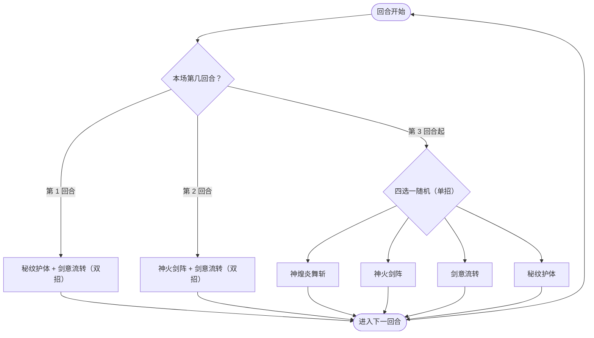

# 希拓

> **类型**：精英怪物
> **初始生命**：1374
> **遭遇战**：子地图活动（黑暗之心 / 贯穹秘境），常规三幕精英池不出
> **特性**：焚天（烧伤敌人减攻、禁疗，自身按敌方烧伤层数吸血）+ 开局即上烧伤并叠加永久免伤

## 被动能力（开局自带）

| 名称 | 类型 | 效果 |
|------|------|------|
| **焚天** | 开局被动（不可消除） | ①处于[烧伤](/powers/burn_power.md)的敌人，其攻击力视为降低，数值等于其烧伤层数；②自身每回合吸血，恢复量等于敌人烧伤层数之和；③处于烧伤的敌人无法恢复生命 |

::: tip 焚天的三重压制
- **减攻**：你身上每有 1 层[烧伤](/powers/burn_power.md)，你打出的攻击伤害就 -1。
- **禁疗**：只要你处于烧伤状态，任何回血（治疗、吸血、卡牌回复）都被屏蔽。
- **吸血**：希拓自身回合开始时，按你（及所有敌人）当前烧伤层数之和回血，因此你烧伤越厚、它越抗打。
- 触发来源：秘纹护体一次给你 10 层烧伤，之后每回合自然 -1。
:::

## 行动逻辑

第 1 回合固定「秘纹护体 · 剑意流转」，第 2 回合固定「神火剑阵 · 剑意流转」，第 3 回合起每回合从 4 个基础技能中随机 1 招（可重复）。

> **说明**：前两回合是固定双招，第 3 回合起才进入随机阶段，且随机阶段只出**单招**。组合招里剑意流转总在第二个（先护体/剑阵，再剑意流转）。

## 招式表

| 招式名 | 意图 | 类型 | 效果 |
|--------|------|------|------|
| **秘纹护体 · 剑意流转** | 秘纹护体 + 剑意流转 | 组合招（第 1 回合） | 先施放秘纹护体，再施放剑意流转 |
| **神火剑阵 · 剑意流转** | 神火剑阵 + 剑意流转 | 组合招（第 2 回合） | 先施放神火剑阵，再施放剑意流转 |
| **神煌炎舞斩** | 攻击 39 | 攻击 + 自身增益 | 造成 39 点伤害；若敌人处于异常状态则[先制](/powers/first_strike_power.md) +2；随后 3 回合自身能力提升无法被消除 |
| **神火剑阵** | 攻击 28 | 攻击 + 反弱反强 + 翻倍烧伤 | 反弱反强（先反后打）；造成 28 点伤害；获 25%[永久免伤](/powers/permanent_damage_reduction_power.md)；将每个敌人的当前烧伤层数**翻倍** |
| **剑意流转** | 剑意流转 | 自身增益 | 自身全属性 +6（敌人处于[烧伤](/powers/burn_power.md)则翻倍至 +12）；获得[永久免伤](/powers/permanent_damage_reduction_power.md) = 敌人烧伤层数 × 5% |
| **秘纹护体** | 秘纹护体 | 自身增益 + Debuff | 使敌人获 10 层[烧伤](/powers/burn_power.md)；自身获 100 点格挡与 4 回合[吃月亮](/powers/eat_moon_power.md) |

::: warning 反强 / 反弱
- **反弱**：希拓自身的负向四维（力量/防御/命中/速度）翻为正；
- **反强**：你身上任一正向四维被整体翻为等量负值。
- 神火剑阵同时对你施放反强——你辛苦叠的力量/防御等增益会被直接翻负。若依赖属性滚雪球，需规避此招或准备重叠手段。
:::

## 遭遇战

| 遭遇战 | 房间类型 | 出现位置 | 数量 | 说明 |
|--------|----------|----------|------|------|
| `SeerDarkHeartEncounter` | Monster | 黑暗之心（已播种能量） | 1 只 | 7 选 1 的活动遭遇 |
| `SeerKingProofRealm4Encounter` | Elite | 王者之证「贯穹秘境」（第 4 列） | 1 只 | 9 选 1 的精英池 |

> ⚠️ 常规三幕精英池**不包含**希拓；她只出现在子地图的自定义遭遇中。

## 策略提示

1. **烧伤是核心负反馈，尽早清理或规避**：秘纹护体给你 10 层[烧伤](/powers/burn_power.md)，每层让你 -1 攻击伤害、被禁疗、并给希拓每回合 10 点吸血。烧伤每回合 -1，但组合招会反复续。带解异常手段、或用不吃攻击伤害的固定伤害流派，能显著削弱它的整套被动。

2. **禁疗最致命**：处在烧伤状态时你完全无法回血（治疗、吸血、回复效果全被屏蔽）。没带解异常就等同于「10 回合内不能续命」，必须靠格挡和减伤硬抗，别指望药水/回血牌救场。

3. **第 1 回合就是组合招**：秘纹护体（10 层烧伤 + 自身 100 格挡 + 4 回合吃月亮）接剑意流转（全属性 +12，因你已烧伤故翻倍，并按 10 层烧伤追加 50% 永久免伤）。开局即高压且它瞬间变硬，最好在它叠满免伤前就规划好破防手段。

4. **永久免伤会滚雪球**：神火剑阵每次给自己 25% 永久免伤，剑意流转再按你烧伤层数 ×5% 追加（10 层 = 50%）。这些免伤本场不消失，越拖越厚。用固定伤害、或趁免伤刚起时爆发，是有效应对。

5. **反强会翻掉你的属性**：神火剑阵对你反强——你所有正向四维瞬间翻为负值。若你靠叠力量/防御打输出（如属性滚雪球卡组），这一招就是直接的克制；建议不要在第 2 回合前把关键属性全押上。

6. **吃月亮是它的续航点**：秘纹护体给希拓 4 回合[吃月亮](/powers/eat_moon_power.md)，每次自身回合开始回复最大生命的 1/4，并按**实际回复量的 20%** 对你追加固定伤害。要抢在它回血周期内打穿，否则 1374 血会被反复回补。

7. **神煌炎舞斩惩罚你的异常**：你处于任何异常状态时它获得[先制](/powers/first_strike_power.md) +2，并在 3 回合内免疫四维属性被削减——这 3 回合用降属性手段削它是白费。若你靠清属性打法，需等该窗口过去。

8. **第 3 回合起无法预判**：之后每回合 4 招随机（可连续同一招）。需要同时准备：挡伤害（神煌炎舞斩 39 / 神火剑阵 28）、破格挡（秘纹护体 100）、解烧伤（秘纹护体的 10 层，神火剑阵还会翻倍现有烧伤）。压力虽分散但仍可控，逐回合对应即可。

## 源码

- 怪物：`SeerXituoMonster.cs`
- 被动能力：`SeerXituoPower.cs`（焚天）
- 关联能力：`SeerBurnPower.cs`（烧伤）、`SeerPermanentDamageReductionPower.cs`（永久免伤）、`SeerEatMoonPower.cs`（吃月亮）、`SeerFirstStrikePower.cs`（先制）、`SeerNewSkillPowersD.cs`（神煌炎舞斩·能力提升不可消除）
- 补丁：`SeerSealPatch.cs`（烧伤禁疗）
- 意图：`SeerNamedSingleAttackIntent.cs`、`SeerPuniNamedBuffIntent.cs`
- 遭遇战：`SeerXituoEliteEncounter.cs`、`SeerSubmapEncounters.cs`
- 本地化：`monsters.json`（`SEER_MONSTER_SEER_XITUO_MONSTER.*`）、`intents.json`（`SEER_XITUO_*`）、`powers.json`（`SEER_POWER_SEER_XITUO_POWER.*`）
